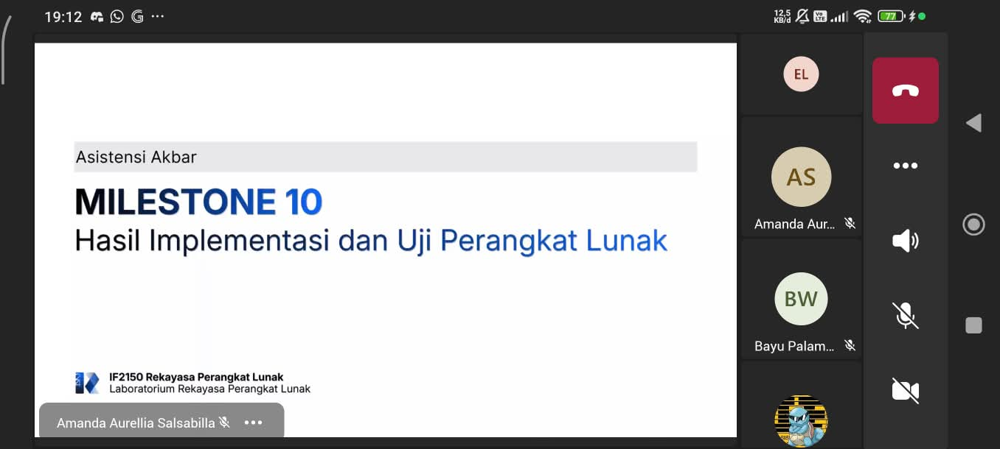

# Form Asistensi

## Tugas Besar IF2150 - Rekayasa Perangkat Lunak

| Informasi | Keterangan |
| --- | --- |
| **Hari** | Senin |
| **Tanggal** | 16/11/2026 |
| **Kelas** | K01 |
| **Nomor Kelompok** | G03  |
| **Nama Kelompok** | MAYOOOOOR  |
| **Nama Perangkat Lunak** | CariJasa  |
| **Dokumen** | K01_G03_HIUPL  |

### Anggota Kelompok

| NIM | Nama |
|---|---|
| 13525031 | Revandra Zacky Maharta |
| 13525079 | Danesh Rasyad Damotino |
| 13525088 | Theresia Estelina Ratu Udju |
| 13525127 | Edward Terrance Lie |
| 13525130 | Necia Aurely Greva Dedevi |

### Catatan

| Catatan |
| --- |
| 1. Bab 1 = Tujuan, lingkup, istilah, aturan penomoran (termasuk ID pengujian baru), referensi, ikhtisar  |
| 2. Bab 2 = System overview + use case diagram |
| 3. Bab 3 = Lingkungan implementasi, daftar modul, antarmuka, dan file lain  |
| 4. Bab 4 = Unit Test, Use Case Test, KNF Test, dan Buktinya |
| 5. Bab 5 = Traceability |
**Notes for this section:**  
*Catatan dapat dituliskan dalam bentuk paragraf atau poin-poin, disesuaikan saja.* 

## Dokumentasi

<!--  -->

  

  <i>Gambar 1. Dokumentasi kegiatan asistensi.</i>

