<h1>
IF2150 REKAYASA PERANGKAT LUNAK
 
TUGAS 10
 
HASIL IMPLEMENTASI DAN UJI PERANGKAT LUNAK (HIUPL)
</h1>
 

## CariJasa

### Untuk: Mikhael Andrian Yonatan

Dipersiapkan oleh:
| Informasi | Keterangan |
| :--- | :--- |
| Kelas | K-01 |
| Kelompok | G-03  |

| NIM | Nama |
|---|---|
| 13525031 | Revandra Zacky Maharta |
| 13525079 | Danesh Rasyad Damotino |
| 13525088 | Theresia Estelina Ratu Udju |
| 13525127 | Edward Terrance Lie |
| 13525130 | Necia Aurely Greva Dedevi |
---

## Daftar Isi

- [BAB 1: Pendahuluan](#bab-1-pendahuluan)
  - [1.1 Tujuan Penulisan Dokumen](#11-tujuan-penulisan-dokumen)
  - [1.2 Lingkup Masalah](#12-lingkup-masalah)
  - [1.3 Definisi, Istilah, dan Singkatan](#13-definisi-istilah-dan-singkatan)
  - [1.4 Aturan Penomoran](#14-aturan-penomoran)
  - [1.5 Referensi](#15-referensi)
  - [1.6 Deskripsi Umum Dokumen (Ikhtisar)](#16-deskripsi-umum-dokumen-ikhtisar)
- [BAB 2: Deskripsi Umum Perangkat Lunak](#bab-2-deskripsi-umum-perangkat-lunak)
- [BAB 3: Implementasi](#bab-3-implementasi)
  - [3.1 Lingkungan Implementasi](#31-lingkungan-implementasi)
  - [3.2 Implementasi Modul](#32-implementasi-modul)
  - [3.3 Implementasi Antarmuka](#33-implementasi-antarmuka)
  - [3.4 File Lain](#34-file-lain)
- [BAB 4: Hasil Pengujian](#bab-4-hasil-pengujian)
  - [4.1 Strategi dan Kedalaman Pengujian Kelas](#41-strategi-dan-kedalaman-pengujian-kelas)
  - [4.2 Pengujian Unit Kelas](#42-pengujian-unit-kelas)
  - [4.3 Pengujian Integrasi](#43-pengujian-integrasi)
  - [4.4 Pengujian Use Case](#44-pengujian-use-case)
  - [4.5 Pengujian Kebutuhan Non-Fungsional (KNF)](#45-pengujian-kebutuhan-non-fungsional-knf)
  - [4.6 Tangkapan Layar dan Bukti Hasil Pengujian](#46-tangkapan-layar-dan-bukti-hasil-pengujian)
- [BAB 5: Traceability](#bab-5-traceability)

---

## Daftar Perubahan

| Revisi | Deskripsi |
| :--- | :--- |
| Penambahan Test Case | Menambah Test Case Ulasan karena Kurang dari 70% coverage |
| Penambahan Test Case | Menambah Test Case Deliverables dan Revisi karena Kurang dari 70% coverage |
| *C* |  |
| ... |  |

---

# BAB 1: Pendahuluan

## 1.1 Tujuan Penulisan Dokumen
Dokumen ini disusun untuk menampilkan hasil implementasi dan pengujian dari Website CariJasa. Pembuatan dokumen ini akan menjelaskan ruang lingkup implementasi dari dokumen DPPL, fungsionalitas, dan hasil pengujiannya terhadap rancangan yang sudah dibuat. Dokumen ini digunakan sebagai laporan untuk hasil implementasi, fungsionalitas, dan bagaimana penerapan Website CariJasa dalam memenuhi ketentuan dalam Requiriment Gathering, SKPL, APL, dan DPPL.

## 1.2 Lingkup Masalah
CariJasa adalah platform *marketplace* jasa berbasis web yang dirancang untuk memudahkan pencarian dan penawaran jasa digital bagi masyarakat Indonesia. Aplikasi ini dibuat untuk mengatasi masalah informasi jasa yang saat ini masih tersebar di berbagai media sosial dan kanal lain, sehingga pengguna kesulitan mencari serta membandingkan tarif, keahlian, dan ulasan penyedia jasa secara mudah. Selain itu, platform ini hadir untuk membantu *freelancer* maupun penyedia jasa lokal memperoleh penghasilan tambahan tanpa harus terikat hubungan kerja tetap. Ruang lingkup aplikasi berfokus pada penyediaan daftar pilihan jasa, fitur pembanding jasa (*compare*), ruang kirim pesan langsung (*chat*), pembayaran digital yang aman, pengiriman hasil kerja dan pengajuan revisi, hingga pelaporan kendala serta bantuan penyelesaian masalah oleh admin.

## 1.3 Definisi, Istilah, dan Singkatan
Semua definisi dan singkatan yang digunakan dalam dokumen ini beserta penjelasannya.

Tabel 1.3. Definisi Istilah dan Singkatan

| Singkatan, Akronim, atau Istilah | Penjelasan |
| :--- | :--- |
| *P/L* | *Singkatan dari Perangkat Lunak, yaitu aplikasi yang memberikan perintah kepada komputer untuk menjalankan tugas tertentu.* |
| *SKPL* | *Singkatan dari Spesifikasi Kebutuhan Perangkat Lunak, yaitu dokumen yang merangkum kriteria-kriteria yang diperlukan untuk membangun aplikasi menjalankan tugasnya.* |
| *DPPL* | *Singkatan dari Deskripsi Perancangan Perangkat Lunak, yaitu dokumen yang menjelaskan rancangan arsitektur, kelas, dan antarmuka P/L.* |
| *HIUPL* | *Singkatan dari Hasil Implementasi dan Uji Perangkat Lunak, yaitu dokumen yang melaporkan hasil implementasi dan pengujian P/L.* |
| *KF* | *Singkatan dari Kebutuhan Fungsional.* |
| *KNF* | *Singkatan dari Kebutuhan Non-Fungsional.* |
| *UC* | *Singkatan dari Use Case.* |
| *BCE* | *Singkatan dari Boundary-Controller-Entity*. pola arsitektur yang memisahkan sistem ke dalam tiga peran yaitu antarmuka (*Boundary*), pengendali logika (*Controller*), dan data (*Entity*). |
| *UML* | *Unified Modeling Language*, bahasa visual standar untuk mendokumentasikan artefak sistem perangkat lunak. |
| *TC* | *Singkatan dari Test Case, yaitu satu kasus uji untuk skenario tertentu.* |
| *UT* | *Singkatan dari Unit Test, yaitu test case tingkat kelas/operasi.* |
| *INT* | *Singkatan dari Integration Test, yaitu test case yang menguji interaksi antarkomponen.* |
| *Boundary* | *Kasus uji pada nilai batas masukan, misalnya nilai minimum, maksimum, atau tepat di ambang aturan.* |
| *Coverage* | *Persentase baris/cabang kode yang dieksekusi oleh pengujian.* |
| *Listing Jasa* | Produk jasa digital yang telah dipublikasikan oleh Penyedia Jasa dan tersedia untuk dipesan oleh Pengguna Jasa.|
| *Deliverables* | Berkas, dokumen, atau tautan hasil pekerjaan akhir yang diserahkan oleh Penyedia Jasa kepada Pengguna Jasa untuk dievaluasi. |
| *Bookmark* | Fitur untuk menandai dan menyimpan penawaran jasa ke dalam daftar tersimpan pengguna agar mudah diakses kembali. |
| *Ticketing* | Sistem pencatatan, pelacakan, dan penanganan tiket keluhan serta laporan sengketa transaksi pengguna oleh Admin. |

## 1.4 Aturan Penomoran
Tuliskan aturan penomoran (ID) yang digunakan dalam dokumen ini. Gunakan pola ID yang **sama** dengan yang sudah dipakai pada dokumen-dokumen sebelumnya (SKPL, APL, DPPL), kecuali untuk ID pengujian yang baru diperkenalkan pada dokumen ini.

Tabel 1.4. Aturan Penomoran

| Hal/Bagian | Penomoran | Keterangan |
| :--- | :--- | :--- |
| *Kebutuhan Awal* | *RXX* | Nomor identifikasi kebutuhan mentah dari tahap elisitasi kebutuhan dengan format dua digit. |
| *Kebutuhan Fungsional* | *KFXX* | Nomor urut Kebutuhan Non-Fungsional dengan Format dua digit |
| *Kebutuhan Non-Fungsional* | *KNFXX* | Nomor urut kebutuhan non-fungsional dengan format dua digit. | 
| *Use Case* | *UCXX* | Nomor urut kasus penggunaan sistem dengan format dua digit. |
| *Kelas* | *CXX* | Nomor identifikasi unik kelas analisis arsitektur BCE. |
| *Algoritma* | *Algo-XXYY* | Nomor identifikasi unik algoritma dari sebuah kelas dengan XX adalah nomor kelas dan YY adalah nomor algoritma |
| *Query* | *Q-XXYY* | Nomor identifikasi unik query dari sebuah kelas dengan XX adalah nomor kelas dan YY adalah nomor algoritma |
| *Antarmuka* | *I-XX* | Nomor Identifikasi untuk setiap antarmuka yang diterapkan |
| *Test Case Unit* | *CXX-UTYY* | XX adalah nomor kelas, YY adalah nomor urut test case unit pada kelas tersebut |
| *Test Case Integrasi* | *INT-TCYY* | YY adalah nomor urut test case integrasi |
| *Test Case Use Case* | *UCXX-TCYY* | XX adalah nomor use case, YY adalah nomor urut test case pada use case tersebut |
| *Test Case KNF* | *KNFXX-TCYY* | XX adalah nomor KNF, YY adalah nomor urut test case pada KNF tersebut |

## 1.5 Referensi
1. **SKPL:** [Spesifikasi Kebutuhan Perangkat Lunak](../M5/K01_G03_SKPL.md)
2. **APL:** [Arsitektur Perangkat Lunak](../M6/K01_G03_APL.md)
3. Badan Pusat Statistik. (2026). *Keadaan angkatan kerja di Indonesia Februari 2026* (Vol. 48, No. 1). Badan Pusat Statistik.
4. Craigslist. (2026). *Craigslist*. https://www.craigslist.org/
5. Fiverr International Ltd. (2026). *Fiverr*. https://www.fiverr.com/
6. Kementerian Perencanaan Pembangunan Nasional/Badan Perencanaan Pembangunan Nasional. (2025). *Indonesia VNR 2025: Voluntary National Review – Fostering inclusive growth: Advancing sustainable and resilient Indonesia*. Kementerian PPN/Bappenas.
7. United Nations Department of Economic and Social Affairs. (2026). *The Sustainable Development Goals report 2026*. United Nations. https://unstats.un.org/sdgs/report/2026/
8. Program Studi Teknik Informatika ITB. (2026). *Materi perkuliahan IF2150 Rekayasa Perangkat Lunak*. Edunex ITB. https://edunex.itb.ac.id/
9. **DPPL :** [DESKRIPSI PERANCANGAN PERANGKAT LUNAK](../M8/K01_G03_DPPL2.md)
10. **Dokumen Implementasi :** [Dokumen Implementasi](../M9/K01_G03_Implementasi.md)

## 1.6 Deskripsi Umum Dokumen (Ikhtisar)
Dokumen ini ditulis dengan pembagian 5 bab, yaitu pendahuluan, deskripsi umum perangkat lunak (DPPL), implementasi, hasil pengujian, dan traceability. Bab pendahuluan, mencakup tujuan penulisan dokumen, lingkup masalah, definisi, istilah, dan singkatan yang digunakan, aturan penomoran dalam laporan, referensi, dan ikhtisar. Bab DPPL diisi dengan system overview (gambaran umum aplikasi), batasan dan konteksnya, serta use case diagram yang digunakan. Bab Implementasi digunakan untuk merangkum lingkungan implementasi, modul, dan antarmuka yang digunakan dalam implementasi. Bab 4 (Hasil Pengujian) berisi strategi pengujian, pengujian unit, integrasi, use case, dan KNF, serta buktinya. Bab 5 (Traceability) digunakan untuk merangkum seluruh pengujian yang dilakukan terhadap tercapaian KF maupun KNFnya.

 

---

# BAB 2: Deskripsi Umum Perangkat Lunak

Bagian ini diisi dengan *System Overview*, dalam bentuk gambar dan narasi yang memberikan gambaran tentang aplikasi dan konteksnya. **Batasan dan keterkaitan** antara sistem yang dibangun dengan sistem lain di luarnya harus jelas. Deskripsi umum sistem perlu dilengkapi dengan pemodelan kasus yang dihadapi, seperti *use case diagram*. Berikan narasi yang jelas untuk setiap gambar yang ditampilkan.

Bagian ini dapat menyalin atau meringkas dari dokumen SKPL atau DPPL.

<i>Gambar 2.1. Use Case Diagram [Nama P/L]</i>

 

---

# BAB 3: Implementasi

Bagian ini diisi dengan informasi tentang elemen P/L yang dikembangkan (*executable files*, *configuration files*, *data files*, dan sebagainya) serta perubahannya terhadap rancangan pada DPPL (jika ada).

## 3.1 Lingkungan Implementasi

Tuliskan *hardware* dan *software* yang digunakan untuk implementasi, mencakup *operating system*, bahasa pemrograman beserta versinya, *framework*/*library*, DBMS, *development tools*, dan *version control*. Lingkungan ini harus konsisten dengan **Subbab 2.1 DPPL**; jelaskan jika ada perubahan. Cantumkan juga *framework* dan alat pengujian yang dipakai.

Tabel 3.1. Lingkungan Implementasi

### Revandra 
| Aspek | Keterangan |
| :--- | :--- |
| *Hardware* | *[Spesifikasi perangkat keras]* |
| *Operating System* | *[Nama dan versi OS]* |
| *Bahasa Pemrograman* | *[Bahasa dan versi]* |
| *Framework/Library* | *[Daftar framework/library beserta versi]* |
| *DBMS* | *[Nama dan versi DBMS]* |
| *Development Tools* | *[IDE, version control, tools lain]* |
| *Testing Tools* | *[Framework unit test, alat ukur performa, alat coverage]* |

### Danesh 
| Aspek | Keterangan |
| :--- | :--- |
| *Hardware* | *[Spesifikasi perangkat keras]* |
| *Operating System* | *[Nama dan versi OS]* |
| *Bahasa Pemrograman* | *[Bahasa dan versi]* |
| *Framework/Library* | *[Daftar framework/library beserta versi]* |
| *DBMS* | *[Nama dan versi DBMS]* |
| *Development Tools* | *[IDE, version control, tools lain]* |
| *Testing Tools* | *[Framework unit test, alat ukur performa, alat coverage]* |

### Theresia 
| Aspek | Keterangan |
| :--- | :--- |
| *Hardware* | *[Spesifikasi perangkat keras]* |
| *Operating System* | *[Nama dan versi OS]* |
| *Bahasa Pemrograman* | *[Bahasa dan versi]* |
| *Framework/Library* | *[Daftar framework/library beserta versi]* |
| *DBMS* | *[Nama dan versi DBMS]* |
| *Development Tools* | *[IDE, version control, tools lain]* |
| *Testing Tools* | *[Framework unit test, alat ukur performa, alat coverage]* |

### Edward 
| Aspek | Keterangan |
| :--- | :--- |
| Hardware | Laptop ASUS ROG G614JU, Intel Core I5 - 13450HX (4.8 GHz), GeForce RTX 4050 TDP 140 Watt, 16GB DDR5-4800 MHz  |
| Operating System | Windows 11 26H2 |
| Bahasa Pemrograman | Typescript with NodeJS 11.19.1 |
| Framework/Library | NextJS |
| DBMS | PostGreSQL 15 dengan Supabase |
| Development Tools | VSCode, Git, Github |
| Testing Tools | Vitest |

### Necia
| Aspek | Keterangan |
| :--- | :--- |
| *Hardware* | *[Spesifikasi perangkat keras]* |
| *Operating System* | *[Nama dan versi OS]* |
| *Bahasa Pemrograman* | *[Bahasa dan versi]* |
| *Framework/Library* | *[Daftar framework/library beserta versi]* |
| *DBMS* | *[Nama dan versi DBMS]* |
| *Development Tools* | *[IDE, version control, tools lain]* |
| *Testing Tools* | *[Framework unit test, alat ukur performa, alat coverage]* |

## 3.2 Implementasi Modul

Daftar modul/kelas yang **TELAH** diimplementasikan. Gunakan nama dan ID kelas yang sama dengan DPPL, dan konsisten dengan Tabel B.5 pada dokumen Implementasi (Tugas 9).

Tabel 3.2. Implementasi Modul

| No | ID Kelas | Nama Modul/Kelas | Nama File Fisik | Nama File Executable |
| :--- | :--- | :--- | :--- | :--- |
| 1 | *[C01]* | *[Nama modul/kelas]* | *[path/ke/file]* | *[Nama file executable, atau - jika tidak ada]* |
| 2 | *[C02]* | *[Nama modul/kelas]* | *[path/ke/file]* | *[...]* |
| ... | *...* | *...* | *...* | *...* |

| C38 | HalamanDeliverables  | Komponen Halaman (page) | src/components/ui/HalamanDeliverables.tsx - HalamanDeliverables   src/app/pengguna/hasil/[idPesanan]/page.tsx (sisi Pengguna Jasa)   src/app/penyedia/pengumpulan/[idPesanan]/hasil/page.tsx (sisi Penyedia Jasa) | Satu komponen dipakai dua sisi lewat prop peran. State hasil, error, sedangMemproses, konfirmasiBerhasil, pesananDitolak. Operasi konfirmasi memanggil konfirmasiSelesai (PATCH .../deliverables/route.ts); data dimuat lewat getHasil dari .../deliverables/route.ts dan .../deliverables/revisi/route.ts |
| C39 | PengajuanRevisi  | Tabel Basis Data | src/app/supabase/migrations/20261103060624_create_carijasa_schema.sql | menambahkan atribut id_revisi dan id_pesanan |
| C40 | HalamanRequestRevisi  | Komponen Halaman (page) | src/app/pengguna/revisi/[idPesanan]/page.tsx - HalamanRequestRevisi | State detail, pesan, files, kuota, errorDetail, errorUmum. Operasi kirimRevisi memanggil ajukanRevisi (src/lib/layanan.ts) ke POST src/app/api/pesanan/[id_pesanan]/deliverables/revisi/route.ts. Kuota dimuat lewat muatKuota |
| C41 | RevisiHandler  | Fungsi, Kelas, dan Routing | src\services\deliverables.service.ts - DeliverablesService   src\test\deliverable.test.ts   src\app\api\pesanan\[id_pesanan]\deliverables\revisi\route.ts  | Class ini Digabung dengan RevisiHandler dan Sebagian PesananHandler. Fungsi yang relevan antara lain : getRevisionHistory, requestRevision, submitRevisionFix, confirmOrderComplete |
| C42 | PencairanDana  | Tabel Basis Data | src/app/supabase/migrations/20261103060624_create_carijasa_schema.sql | - |
| C43 | TiketLaporan  | Tabel Basis Data | src/app/supabase/migrations/20261103060624_create_carijasa_schema.sql | - |
| C44 | HalamanPelaporan | Komponen Halaman (page) | src/app/pengguna/pelaporan/page.tsx - HalamanPelaporan | idPesanan diambil dari query URL. State nama, kat, desk, files, tiket, e. Operasi kirim memanggil kirimLaporan (src/lib/layanan.ts) ke POST src/app/api/pesanan/[id_pesanan]/laporan/route.ts; tiket yang dikembalikan ditampilkan sebagai nomor tiket, status, dan tanggapan admin |
| C45 | LaporanHandler | Fungsi, Kelas dan Routing | src\services\pelaporan.service.ts   src\app\api\pesanan\[id_pesanan]\laporan\route.ts   src\app\api\admin\laporan\[id_tiket]\route.ts   src\app\api\admin\laporan\[id_tiket]\tanggapan\route.ts - PelaporanService dan TanggapanLaporanService | fungsi yang terkait PelaporanService : submitLaporan, validasiOwnerPesanan, validateUrlBukti, getTicketsByUser. fungsi yang terkait TanggapanLaporanService : getAllTicketsForAdmin, getDetailTiketAdmin, catatKeputusanTindakan |
| C46 | Ulasan | Tabel Basis Data | src/app/supabase/migrations/20261103060624_create_carijasa_schema.sql | |
| C47 | HalamanUlasan  | Komponen Halaman (page) | src/app/pengguna/ulasan/[idPesanan]/page.tsx - HalamanUlasan | State n (rating), kom (komentar), files (dokumentasi), done. Operasi kirim memanggil kirimUlasan (src/lib/layanan.ts) ke POST src/app/api/ulasan/route.ts. Rating wajib diisi sebelum dikirim |
| C48 | UlasanHandler  | Fungsi, Kelas, dan Routing | src\services\ulasan.service.ts   src\app\api\ulasan\route.ts| Class UlasanService, validasiRating, hitungRatingAgregat, perbaruiRatingPenyedia, getRatingDanUlasanPenyedia, geStatistikUlasanJasa, getUlasanJasaById, simpanUlasan, getUlasanbyJasa,updateUlasan, deleteUlasan |
| C49 | TanggapanLaporan  | Tabel Basis Data | src/app/supabase/migrations/20261103060624_create_carijasa_schema.sql | - |
| C50 | HalamanPengajuanMediasi | Komponen Halaman (page) | src/app/admin/tiket/[idTiket]/page.tsx - HalamanPengajuanMediasi   src/app/mediasi/[id]/page.tsx (ruang mediasi) | Detail tiket untuk admin, dengan operasi kirim (tanggapan dan jenis sanksi) ke src/app/api/admin/laporan/[id_tiket]/tanggapan/route.ts, dan mediasi (mulai mediasi) ke src/app/api/mediasi/[id_sesi_mediasi]/route.ts (POST) |
| C51 | MediasiHandler | Fungsi, Kelas, dan Routing | src/app/deliverables/mediasi.service.ts - MediasiService   src/app/api/admin/mediasi/[id_sesi_mediasi]/selesai   src/app/api/admin/mediasi/route.ts   src/app/api/mediasi/route.ts   src/app/api/mediasi/[id_sesi_mediasi]/route.ts   src/app/api/mediasi/[id_sesi_mediasi]/pesan/route.ts | fungsi yang disediakan : mulaiMediasi, kirimPesanMediasi, getDaftarMediasiUser, getDetalDanPesanMediasi, selesaikanMediasi. |
| C52 | Admin  | Tabel Basis Data | src/app/supabase/20261103060624_create_carijasa_schema.sql  | Penggunaan id_admin pada rancangan berasal atribut id pengguna (inheritance), tetapi dengan role pengguna berupa 'ADMIN'|
| C53 | HalamanDashboardAdmin | Komponen Halaman (page) | src/app/admin/tiket/page.tsx - HalamanDashboardAdmin | Daftar tiket laporan (state d, err) dari getTiketList (src/lib/layanan.ts) ke src/app/api/admin/laporan/route.ts. Ada keadaan memuat, error, dan kosong. Tombol Detail menuju src/app/admin/tiket/[idTiket]/page.tsx |
| C54 | PengumpulanController | Fungsi, Kelas, dan Routing | src/app/service/deliverable.service.ts - DeliverablesService   src/app/api/pesanan/route.ts src/app/api/pesanan/[id_pesanan]/route.ts   | Class ini Digabung dengan RevisiHandler dan Sebagian PesananHandler. Fungsi yang relevan antara lain : submitDeliverable, getDeliverablebyPesanan, getDeliverableByProdukAkhir, confirmOrderComplete |
| C55 | pesan_chat | Tabel Basis Data | src/app/supabase/migrations/20261103060624_create_carijasa_schema.sql | Menambah Class Baru untuk pesan dalam chat |
| C56 | notifikasi | Tabel Basis Data | src/app/supabase/migrations/20261103060624_create_carijasa_schema.sql | menambah tabel data notifikasi |
| C57 | sesi_mediasi | Tabel Basis Data | src/app/supabase/migrations/20261103060624_create_carijasa_schema.sql | menambah tabel data sesi_mediasi (mirip roomchat tapi bertiga) |
| C58 | pesan_mediasi | Tabel Basis Data | src/app/supabase/migrations/20261103060624_create_carijasa_schema.sql | menambah tabel data pesan dalam sesi_mediasi |

## 3.3 Implementasi Antarmuka

Daftar antarmuka yang telah diimplementasikan. Gunakan ID dan nama layar yang sama dengan ID dan nama layar pada tugas DPPL.

Tabel 3.3. Implementasi Antarmuka

| No | ID Antarmuka | Nama Antarmuka | Nama File Fisik | Nama File Executable |
| :--- | :--- | :--- | :--- | :--- |
| 1 | *[I-01]* | *[Nama layar]* | *[path/ke/file]* | *[Nama file executable, atau - jika tidak ada]* |
| 2 | *[I-02]* | *[Nama layar]* | *[path/ke/file]* | *[...]* |
| ... | *...* | *...* | *...* | *...* |

## 3.4 File Lain

Daftar file lain yang dibuat selain file kelas dan antarmuka, misalnya file *utility*, *configuration*, *database schema/seed*, *file test*, atau *data*.

Tabel 3.4. File Lain

| No | Nama File | Keterangan |
| :--- | :--- | :--- |
| 1 | *[Nama file]* | *[Fungsi file]* |
| ... | *...* | *...* |

 

---

# BAB 4: Hasil Pengujian

Bab ini melaporkan hasil pengujian P/L pada level unit, integrasi, dan sistem. Pengujian dilakukan pada tag release terakhir Tugas 9. Hasil aktual diisi berdasarkan pengamatan saat pengujian. Kesimpulan diisi `Pass` atau `Fail`, dan untuk `Fail` dilengkapi penyebab serta usulan perbaikan.

## 4.1 Strategi dan Kedalaman Pengujian Kelas

Setiap kelas perancangan pada Tabel 4.1 DPPL diklasifikasikan ke dalam tiga tingkat kedalaman pengujian. Tingkat **Mendalam** diberikan pada kelas yang memuat logika bisnis, perhitungan, validasi, aturan status, algoritma, integrasi eksternal, atau keamanan. Tingkat **Sedang** diberikan pada kelas yang hanya mengoordinasikan atau mendelegasikan proses. Tingkat **Tidak perlu** diberikan pada kelas tanpa logika, seperti *entity/DTO* dan kelas konfigurasi, yang teruji secara tidak langsung melalui test case use case. Seluruh kelas wajib dicantumkan beserta alasan penentuan tingkatnya.

Tabel 4.1.1. Identifikasi Tingkat Pengujian Kelas

| ID Kelas | Nama Kelas | Tingkat | Alasan | Test Case Terkait |
| :--- | :--- | :--- | :--- | :--- |
| *C02* | *Pesanan* | *Mendalam* | *Memuat `hitungTotal()` dan transisi status pembayaran* | *C02-UT01 s.d. C02-UT08* |
| *C03* | *Keranjang* | *Sedang* | *Delegasi sederhana ke Produk dan Pesanan* | *C03-UT01 s.d. C03-UT03, INT-TC02* |
| *C01* | *Pelanggan* | *Tidak perlu* | *Hanya menyimpan data akun, tanpa logika* | *-* |
| *[CXX]* | *[Nama kelas]* | *[Mendalam/Sedang/Tidak perlu]* | *[Alasan penentuan tingkat pengujian]* | *[ID test case atau -]* |
| *[CXX]* | *[Nama kelas]* | *[Mendalam/Sedang/Tidak perlu]* | *[Alasan penentuan tingkat pengujian]* | *[ID test case atau -]* |
| C38 | HalamanDeliverables | Tidak Perlu | Pengujian Kelas Halaman dilakukan pada test integrasi | - |
| C39 | PengajuanRevisi | Tidak Perlu | Kelas ini berfungsi sebagai entity (database) | - |
| C40 | HalamanRequestRevisi |  Tidak Perlu | Pengujian Kelas Halaman dilakukan pada test integrasi | - |
| C41 | RevisiHandler | Mendalam | Menguji Logika Bisnis, Validasi Revisi,  Aturan sesuai status, dan Algoritma | *[ID test case atau -]* |
| C42 | PencairanDana | Tidak Perlu | Kelas ini berfungsi sebagai entity (database) | - |
| C43 | TiketLaporan |  Tidak Perlu | Kelas ini berfungsi sebagai entity (database) | - |
| C44 | HalamanPelaporan |  Tidak Perlu | Pengujian Kelas Halaman dilakukan pada test integrasi | - |
| C45 | LaporanHandler | Mendalam | Menguji Logika Bisnis, Validasi input laporan,  Aturan sesuai status pengguna, dan Algoritma sesuai dengan role pengguna  |*[ID test case atau -]* |
| C46 | Ulasan | Tidak Perlu | Kelas ini berfungsi sebagai entity (database) | - |
| C47 | HalamanUlasan |  Tidak Perlu | Pengujian Kelas Halaman dilakukan pada test integrasi | - |
| C48 | UlasanHandler | Mendalam | Menguji pembuatan Ulasan,  validasi input rating, formatting, CRUD terhadap data rating jasa dan rating penyediajasa | *[ID test case atau -]* |
| C49 | TanggapanLaporan | Tidak Perlu | Kelas ini berfungsi sebagai entity (database) | - |
| C50 | HalamanPengajuanMediasi |  Tidak Perlu | Pengujian Kelas Halaman dilakukan pada test integrasi | - |
| C51 | MediasiHandler | *[Mendalam/Sedang/Tidak perlu]* | *[Alasan penentuan tingkat pengujian]* | *[ID test case atau -]* |
| C52 | Admin | Tidak Perlu | Kelas ini berfungsi sebagai entity (database) | - |
| C53 | HalamanDashboardAdmin |  Tidak Perlu | Pengujian Kelas Halaman dilakukan pada test integrasi | - |
| C54 | PengumpulanController | Mendalam | Berisi Logika Utama bisnis untuk pengumpulan deliverables | *[ID test case atau -]* |
| C55 | pesan_chat | Tidak Perlu | Kelas ini berfungsi sebagai entity (database) | - |
| C56 | notifikasi | Tidak Perlu | Kelas ini berfungsi sebagai entity (database) | - |
| C57 | sesi_mediasi | Tidak Perlu | Kelas ini berfungsi sebagai entity (database) | - |
| C58 | pesan_mediasi | Tidak Perlu | Kelas ini berfungsi sebagai entity (database) | - |
| *...* | *...* | *...* | *...* | *...* |

## 4.2 Pengujian Unit Kelas

Pengujian unit dilakukan pada kelas bertingkat Mendalam dan Sedang. Kelas Mendalam diuji pada seluruh operasi public dengan kasus normal, batas, dan negatif, serta mencapai *coverage* minimal 70%. Kelas Sedang diuji minimal dengan satu kasus normal dan satu kasus gagal pada operasi public utama.

Cara menjalankan unit test: *[tuliskan perintah, mis. `pytest src/tests/`]*.

Lokasi file test: *[path, mis. `src/tests/`]*.

### 4.2.1 Kelas [Nama Kelas 1]

**ID Kelas:** *[C02]*  
**Nama Kelas:** *[Pesanan]*  
**Tingkat:** *[Mendalam]*

Tabel 4.2.1. Hasil Pengujian Unit Kelas [C02]

| ID Pengujian | Operasi yang Diuji | Jenis Kasus | Prosedur/Masukan | Hasil yang Diharapkan | Hasil Pengujian | Kesimpulan |
| :--- | :--- | :--- | :--- | :--- | :--- | :--- |
| *C02-UT01* | *`hitungTotal(): Decimal`* | *Normal* | *Pesanan berisi 2 item: 10.000 x 2 dan 5.000 x 1* | *Total = 25.000* | *[Hasil aktual]* | *Pass/Fail* |
| *C02-UT02* | *`hitungTotal(): Decimal`* | *Batas* | *Pesanan berisi tepat 1 item dengan jumlah 1* | *Total = harga item tersebut* | *[...]* | *Pass/Fail* |
| *C02-UT03* | *`hitungTotal(): Decimal`* | *Negatif* | *Pesanan tanpa item* | *Total = 0 atau melempar kesalahan sesuai rancangan* | *[...]* | *Pass/Fail* |
| *...* | *...* | *...* | *...* | *...* | *...* | *...* |

Khusus kelas **Mendalam**:

Tabel 4.2.1b. Ringkasan Cakupan Kelas [C02]

| Informasi | Keterangan |
| :--- | :--- |
| Daftar operasi public pada DPPL | *[op1(), op2(), ...]* |
| Operasi yang diuji | *[op1(), op2(), ...]* |
| ID Algoritma yang tercakup | *[Algo-001, ...]* |
| Coverage (wajib ≥ 70%) | *[% baris / % cabang, alat dan bukti pada 4.6]* |

### 4.2.2 Kelas [Nama Kelas 2]

*[Ulangi pola 4.2.1 untuk setiap kelas bertingkat Mendalam atau Sedang.]*

### 4.2.13 Kelas RevisiHandler (Bagian dari Deliverables Service)

**ID Kelas:**   C41
**Nama Kelas:** RevisiHandler
**Tingkat:** Mendalam

Tabel 4.2.13. Hasil Pengujian Unit Kelas [C41]

| ID Pengujian | Operasi yang Diuji | Jenis Kasus | Prosedur/Masukan | Hasil yang Diharapkan | Hasil Pengujian | Kesimpulan |
| :--- | :--- | :--- | :--- | :--- | :--- | :--- |
| C41-UT01 | getRevisionHistory() | Negatif | Query riwayat revisi ke database Supabase gagal | Sistem melempar error *"Gagal mengambil riwayat revisi: DB Error History"* | error dilempar | Pass |
| C41-UT02 | getRevisionHistory() | Batas | Pesanan belum pernah memiliki riwayat revisi | Fungsi mengembalikan array kosong  tanpa melempar error | array kosong dikembalikan | Pass |
| C41-UT03 | getRevisionHistory() | Positif | Pesanan memiliki histori riwayat revisi di DB | Mengembalikan array daftar riwayat revisi pesanan | data riwayat dikembalikan | Pass |
| C41-UT04 | getRevisionAttachments() | Negatif | Query lampiran revisi dari database mengalami error | Sistem melempar error *"Gagal mengambil hasil revisi: Query Lampiran Error"* | error dilempar | Pass |
| C41-UT05 | getRevisionAttachments() | Positif | Berkas revisi berupa link HTTP/HTTPS langsung | Mengembalikan daftar berkas revisi dengan file_download_url direct link | data lampiran dikembalikan | Pass |
| C41-UT06 | getRevisionAttachments() | Positif | Berkas revisi berupa path Storage Supabase | Mengembalikan daftar berkas revisi yang telah diubah menjadi signed URL | signed URL dikembalikan | Pass |
| C41-UT07 | getRevisionAttachments() | Negatif | Pembuatan signed URL dari Storage Service gagal  | Sistem melempar error *"Gagal membuat URL hasil revisi: p-err"* | error dilempar | Pass |
| C41-UT08 | getRevisionRequestAttachments() | Negatif | Query data pengajuan revisi ke database gagal | Sistem melempar error *"Gagal mengambil lampiran pengajuan revisi: Gagal fetch pengajuan"* | error dilempar | Pass |
| C41-UT09 | getRevisionRequestAttachments() | Batas | Data pengajuan revisi bernilai null | Fungsi mengembalikan array kosong | array kosong dikembalikan | Pass |
| C41-UT10 | getRevisionRequestAttachments() | Positif | Data lampiran berupa campuran array/string & link HTTP/storage path | Memilah nama file, mengonversi storage path ke signed URL, dan menyusun array lampiran | lampiran terurai & signed URL dibuat | Pass |
| C41-UT11 | getRevisionRequestAttachments() | Negatif | Pembuatan signed URL lampiran pengajuan gagal | Sistem melempar error *"Gagal membuat URL lampiran revisi: fail.png"* | error dilempar | Pass |
| C41-UT12 | requestRevision() | Batas / Negatif | deskripsi_revisi kosong atau berisi spasi saja | Sistem melempar error *"Deskripsi revisi wajib diisi."* | error dilempar | Pass |
| C41-UT13 | requestRevision() | Negatif | validasiPenggunaJasa gagal (bukan pemilik pesanan) | Sistem melempar error *"Akses ditolak. Hanya pengguna jasa pemilik pesanan..."* | akses ditolak | Pass |
| C41-UT14 | requestRevision() | Negatif | Query data produk akhir di database mengalami error | Sistem melempar error *"Gagal memvalidasi hasil pekerjaan: Query error produk"* | error dilempar | Pass |
| C41-UT15 | requestRevision() | Negatif | id_produk_akhir tidak cocok / tidak ada pada pesanan tersebut | Sistem melempar error *"Hasil pekerjaan tidak ditemukan pada pesanan ini."* | error dilempar | Pass |
| C41-UT16 | requestRevision() | Negatif | Query pemeriksaan riwayat revisi mengalami error DB | Sistem melempar error *"Gagal memeriksa riwayat revisi: DB error revisi"* | error dilempar | Pass |
| C41-UT17 | requestRevision() | Negatif | Revisi sebelumnya masih dalam status "Sedang Direvisi" | Sistem melempar error *"Revisi sebelumnya masih dikerjakan penyedia jasa."* | error dilempar | Pass |
| C41-UT18 | requestRevision() | Negatif | Revisi sebelumnya belum berstatus "Revisi Dikumpulkan"  | Sistem melempar error *"Pengajuan revisi baru belum dapat dilakukan karena status..."* | error dilempar | Pass |
| C41-UT19 | requestRevision() | Batas / Negatif | Kuota revisi pesanan sudah habis  | Sistem melempar error *"Kuota revisi untuk pesanan ini sudah habis."* | error dilempar | Pass |
| C41-UT20 | requestRevision() | Negatif | insert pengajuan revisi ke database gagal | Sistem melempar error *"Gagal mengajukan revisi: Insert revisi fail"* | error dilempar | Pass |
| C41-UT21 | requestRevision() | Negatif | insert pengajuan revisi berhasil tetapi mengembalikan data null | Sistem melempar error *"Data pengajuan revisi tidak berhasil disimpan."* | error dilempar | Pass |
| C41-UT22 | requestRevision() | Negatif | insert revisi sukses, namun update status pesanan gagal | Sistem melempar error *"Revisi berhasil disimpan, tetapi gagal memperbarui status pesanan..."* | error update dilempar | Pass |
| C41-UT23 | requestRevision() | Positif | Input valid, kuota revisi > 0, DB normal | Berhasil menyimpan pengajuan revisi, mengurangi kuota, & mengirim notifikasi ke seller | revisi diajukan & notifikasi terkirim | Pass |
| C41-UT24 | submitRevisionFix() | Batas / Negatif | deskripsi_produk kosong atau hanya spasi  | Sistem melempar error *"Deskripsi hasil revisi wajib diisi."* | error dilempar | Pass |
| C41-UT25 | submitRevisionFix() | Batas / Negatif | file_urls berbentuk array kosong  | Sistem melempar error *"Unggah berkas atau sertakan tautan hasil revisi."* | error dilempar | Pass |
| C41-UT26 | submitRevisionFix() | Negatif | Query pemeriksaan pengajuan revisi terbaru mengalami error | Sistem melempar error *"Gagal memeriksa pengajuan revisi: DB Error Revision"* | error dilempar | Pass |
| C41-UT27 | submitRevisionFix() | Negatif | Tidak ada pengajuan revisi aktif yang sedang dikerjakan  | Sistem melempar error *"Tidak ada pengajuan revisi yang sedang dikerjakan."* | error dilempar | Pass |
| C41-UT28 | submitRevisionFix() | Negatif | insert produk akhir hasil perbaikan ke database gagal | Sistem melempar error *"Gagal menyimpan hasil revisi: Insert produk error"* | error dilempar | Pass |
| C41-UT29 | submitRevisionFix() | Negatif | insert produk sukses, tetapi update status pengajuan revisi gagal | Sistem melempar error *"Gagal memperbarui status revisi: Update revisi fail"* | error dilempar | Pass |
| C41-UT30 | submitRevisionFix() | Negatif | insert produk & update revisi sukses, namun update status pesanan gagal | Sistem melempar error *"Revisi berhasil disimpan, tetapi status pesanan gagal..."* | error update dilempar | Pass |
| C41-UT31 | submitRevisionFix() | Positif | file_urls berisi beberapa file hasil perbaikan valid | Berhasil insert produk perbaikan, merubah status revisi & pesanan, serta memicu notifikasi | perbaikan dikirim & notifikasi terkirim | Pass |

Khusus kelas **Mendalam**:

Tabel 4.2.1b. Ringkasan Cakupan Kelas [C41]

| Informasi | Keterangan |
| :--- | :--- |
| Daftar operasi public pada DPPL | kirimRevisi() --> submitRevisionFix(), isRevisiRequestValid() --> bagian dari submitRevisionFix(), sendNotifikasiRevisi() --> bagian dari submitRevisionFix() dan requestRevision(), updateStatusPengerjaan() --> bagian dari submitRevisionFix() |
| Operasi yang diuji | requestRevision(),submitRevision(), getRevisionHistory(), getRevisionAttachments(), getRevisionRequestAttachments()    Note : fungsi yang tidak diimplementasikan sudah dimasukkan ke dalam tubuh fungsi lain yang diuji baik dalam bentuk query maupun routing|
| ID Algoritma yang tercakup | Algo-4101, Algo-4102, Algo-4103, Algo-4104, Algo-4105, dan tambahan yang tidak tercata |
| Coverage (wajib ≥ 70%) | [Lihat Hasil Pengujian](#bukti-c41) |

### 4.2.14 Kelas LaporanHandler

**ID Kelas:**   C45
**Nama Kelas:** LaporanHandler
**Tingkat:** Mendalam

Tabel 4.2.14. Hasil Pengujian Unit Kelas [C45]

| ID Pengujian | Operasi yang Diuji | Jenis Kasus | Prosedur/Masukan | Hasil yang Diharapkan | Hasil Pengujian | Kesimpulan |
| :--- | :--- | :--- | :--- | :--- | :--- | :--- |
| C45-UT01 | submitLaporan() | Batas | Deskripsi laporan tidak diisi (kosong)  atau kategori kosong | Sistem melempar error validasi deskripsi / minimal 1 kategori | error dilempar | Pass |
| C45-UT02 | submitLaporan() | Batas | Batas lampiran bukti kosong atau lewat dari batas maksimal > 3 | Sistem melempar error batas minimal 1 dan maksimal 3 bukti lampiran | error dilempar | Pass |
| C45-UT03 | submitLaporan() | Negatif | Format URL bukti mengandung `javascript:` atau path file | Sistem melempar error validasi format URL bukti tidak valid | URL ditolak | Pass |
| C45-UT04 | submitLaporan() | Negatif | id_pesanan tidak ditemukan dalam database atau user_id bukan pelapor/terlapor pada pesanan tersebut | Sistem melempar error "Pesanan tidak ditemukan" / "Akses ditolak" | Akses ditolak | Pass |
| C45-UT05 | submitLaporan() | Negatif | User masih memiliki tiket laporan berstatus `"Diproses"` untuk pesanan yang sama | Sistem melempar error tiket laporan masih sedang diproses |  duplikasi laporan ditolak | Pass |
| C45-UT06 | submitLaporan() | Positif | Data laporan valid, pelapor adalah pemesan, dan terlapor adalah penyedia | Laporan berhasil disimpan ke Database dengan status "Diproses" dan mengembalikan id_tiket | tiket laporan berhasil dibuat | Pass |
| C45-UT07 | validasiOwnerPesanan() | Positif | `user_id` merupakan penyedia jasa dari pesanan | Fungsi mengembalikan `true` |  validasi mengembalikan true | Pass |
| C45-UT08 | validasiOwnerPesanan() | Negatif | id_pesanan tidak ada di database | melempar error *"Pesanan tidak ditemukan"* | error dilempar | Pass |
| C45-UT09 | getTicketsByUser() | Positif  | user_id valid serta memiliki beberapa daftar tiket | Mengembalikan daftar tiket pelaporan pemilik tiket | daftar tiket dapat direturn | Pass |
| C45-UT10 | getDetailTiket() | Negatif | user_id yang tidak terdaftar sebagai pelapor maupun terlapor | melempar error "Akses ditolak. Anda tidak memiliki izin melihat tiket ini." | Akses ditolak | Pass |
| C45-UT11 | getDetailTiket() | Positif | user_id merupakan pelapor asli tiket | Mengembalikan objek detail data tiket laporan |  detail tiket dikembalikan | Pass |
| C45-UT12 | getAllTicketsForAdmin() | Positif | Dipanggil oleh Admin | Mengembalikan seluruh daftar tiket laporan dari seluruh pengguna | seluruh tiket dikembalikan | Pass |
| C45-UT13 | getDetailTiketAdmin() | Positif | id_tiket valid | Mengembalikan detail tiket laporan secara langsung tanpa batasan otorisasi pelapor |  detail tiket dikembalikan | Pass |
| C45-UT14 | catatKeputusanTindakan() | Batas | jenis_tindakan kosong atau catatan_tanggapan kosong maupun hanya spasi| Sistem melempar error validasi pilihan tindakan / catatan wajib diisi | Error dilempar | Pass |
| C45-UT15 | catatKeputusanTindakan() | Negatif | Tiket yang diproses sudah berstatus "Selesai" di database | Sistem melempar error "Tiket laporan ini sudah selesai ditangani sebelumnya." | Error penolakan | Pass |
| C45-UT16 | catatKeputusanTindakan() | Positif | Admin memilih tindakan PERINGATAN / SUSPEND_AKUN dengan catatan valid | Berhasil menyimpan tanggapan, memanggil RPC admin_beri_sanksi, dan mengubah status tiket menjadi "Selesai" |  sanksi diproses & status tiket selesai | Pass |
| C45-UT17 | catatKeputusanTindakan() | Positif | Admin memilih tindakan LAPORAN_DITOLAK dengan catatan valid | Berhasil menyimpan tanggapan dan mengubah status tiket menjadi "Selesai" tanpa memicu sanksi akun |  penolakan dicatat & status tiket selesai | Pass |

Tabel 4.2.14b. Ringkasan Cakupan Kelas [C45]

| Informasi | Keterangan |
| :--- | :--- |
| Daftar operasi public pada DPPL | validasiFormatLaporan() --> Menjadi bagian dari fungsi submitLaporan()   kirimNotifAdmin() --> Menjadi bagian dari fungsi submitLaporan()   simpanData() --> Menjadi bagian dari fungsi submitLaporan()   banPengguna() --> Menjadi bagian dari fungsi catatKeputusanTindakan()   skorsPengguna() -->  Menjadi bagian dari fungsi catatKeputusanTindakan()   kirimTanggapan() -->  Menjadi bagian dari routing catatKeputusanTindakan()   saveTanggapan() -->  Menjadi bagian dari fungsi catatKeputusanTindakan()   saveLaporan() --> Menjadi bagian dari fungsi catatKeputusanTindakan()   updateStatusTiket() --> Menjadi bagian dari fungsi catatKeputusanTindakan()   dipecah menjadi getDetailTiket() untuk pengguna dan getDetailTiketAdmin() untuk admin  |
| Operasi yang diuji |    submitLaporan(), validasiOwnerPesanan(), getTicketsByUser(), getDetailTiket(), getAllTicketsForAdmin(), getDetailTiketAdmin(), catatKeputusanTindakan()   Note : fungsi yang tidak diimplementasikan sudah dimasukkan ke dalam tubuh fungsi lain yang diuji baik dalam bentuk query maupun routing |
| ID Algoritma yang tercakup | Algo-4501 - Algo-4510, dan tambahan yang tidak tercatat dalam DPPL |
| Coverage (wajib ≥ 70%) | [Lihat Hasil Pengujian](#bukti-c45) |
 

### 4.2.15 Kelas UlasanHandler

**ID Kelas:**   C48
**Nama Kelas:** UlasanHandler
**Tingkat:** Mendalam

Tabel 4.2.15. Hasil Pengujian Unit Kelas [C48]

| ID Pengujian | Operasi yang Diuji | Jenis Kasus | Prosedur/Masukan | Hasil yang Diharapkan | Hasil Pengujian | Kesimpulan |
| :--- | :--- | :--- | :--- | :--- | :--- | :--- |
| **C48-UT01** | validasiRating() | Batas dan Positif | rating bernilai 1, 3, dan 5 | Fungsi berhasil memvalidasi tanpa melempar error | validasi sukses | Pass |
| **C48-UT02** | validasiRating() | Batas / Negatif | rating bernilai kurang dari 1 (`0` dan `-1`) | Sistem melempar error *"Rating harus bernilai antara 1 sampai 5"* | error dilempar | Pass |
| **C48-UT03** | validasiRating() | Batas / Negatif | rating bernilai lebih dari 5 (`6` dan `10`) | Sistem melempar error *"Rating harus bernilai antara 1 sampai 5"* | error dilempar | Pass |
| **C48-UT04** | validasiRating() | Negatif | rating bernilai non-angka atau `NaN` (misal: `"5"` string) | Sistem melempar error *"Rating harus bernilai antara 1 sampai 5"* | error dilempar | Pass |
| **C48-UT05** | validasiDokumentasi() | Batas / Positif | Berkas valid (`1024` byte, tipe `image/jpeg`) | Fungsi berhasil memvalidasi tanpa melempar error | validasi sukses | Pass |
| **C48-UT06** | validasiDokumentasi() | Batas | Jumlah berkas melebihi batas maksimal (`4` berkas) | Sistem melempar error *"Dokumentasi ulasan maksimal 3 berkas."* | error dilempar | Pass |
| **C48-UT07** | validasiDokumentasi() | Negatif | Format/MIME type berkas tidak didukung (`skrip.exe` atau mismatch MIME) | Sistem melempar error format berkas tidak didukung | error dilempar | Pass |
| **C48-UT08** | validasiDokumentasi() | Batas / Negatif | Berkas kosong (`ukuran <= 0` byte) | Sistem melempar error *"Berkas [nama] kosong atau tidak valid."* | error dilempar | Pass |
| **C48-UT09** | validasiDokumentasi() | Batas / Negatif | Ukuran berkas melebihi batas maksimal (`11 MB`) | Sistem melempar error *"Ukuran berkas [nama] maksimal 10 MB."* | error dilempar | Pass |
| **C48-UT10** | hitungRatingAgregat() | Batas | Daftar ulasan kosong (`[]`) atau `null` | Mengembalikan nilai default `{ rating_rata_rata: 0, total_ulasan: 0 }` | default 0 dikembalikan | Pass |
| **C48-UT11** | hitungRatingAgregat() | Positif | Daftar rating berupa array angka (`[5, 4, 5, 4]`) atau objek (`[{ rating: 5 }, { rating: 3 }]`) | Menghitung rata-rata dengan benar beserta total ulasannya | kalkulasi rata-rata akurat | Pass |
| **C48-UT12** | hitungRatingAgregat() | Batas | Menghitung rata-rata dengan hasil desimal berulang (misal: `14/3` dan `13/3`) | Menerapkan pembulatan konsisten 1 angka desimal (`4.7` untuk bulat atas, `4.3` untuk bulat bawah, `4.0` untuk pas) | pembulatan konsisten | Pass |
| **C48-UT13** | hitungRatingAgregat() | Negatif | Salah satu elemen rating dalam daftar di luar rentang 1-5 (`[5, 6]` atau `[5, 0]`) | Sistem melempar error *"Rating harus bernilai antara 1 sampai 5"* | error dilempar | Pass |
| **C48-UT14** | formatRatingTampilan() | Batas | Penyedia tanpa ulasan (`rating` = `0` atau `null`, `total_ulasan` = `0`) | Mengembalikan format teks default (`"0.0"`, `"0 ulasan"`, dan label `"Belum ada ulasan"`) | label default dikembalikan | Pass |
| **C48-UT15** | formatRatingTampilan() | Positif | `rating` = `4.8`, `total_ulasan` = `15` | Mengembalikan teks formatted rapi (`"4.8"`, `"15 ulasan"`, dan label `"★ 4.8 (15 ulasan)"`) | teks formatted sesuai | Pass |
| **C48-UT16** | perbaruiRatingPenyedia() & perbaruiRatingJasa() | Negatif | `id_penyedia_jasa` atau `id_jasa` kosong (`""` atau `"   "`) | Sistem melempar error *"ID penyedia jasa tidak valid"* / *"ID jasa tidak valid"* | error dilempar | Pass |
| **C48-UT17** | perbaruiRatingPenyedia() | Positif | `id_penyedia_jasa` valid yang memiliki pesanan & ulasan | Menghitung ulang ulasan, memperbarui tabel `penyedia_jasa`, dan mengembalikan rata-rata (`5`, `total: 1`) | database diperbarui | Pass |
| **C48-UT18** | perbaruiRatingJasa() | Positif | `id_jasa` valid yang memiliki pesanan & ulasan | Menghitung ulang ulasan, memperbarui tabel `jasa`, dan mengembalikan rata-rata (`4`, `total: 1`) | database diperbarui | Pass |
| **C48-UT19** | perbaruiRatingPenyedia() & perbaruiRatingJasa() | Negatif | Simulasi kegagalan database saat melakukan `update` rating | Sistem melempar error *"Gagal memperbarui rata-rata rating penyedia jasa / jasa."* | error DB tertangkap | Pass |
| **C48-UT20** | getRatingDanUlasanPenyedia() | Negatif | `id_penyedia_jasa` kosong | Sistem melempar error *"ID penyedia jasa tidak valid"* | error dilempar | Pass |
| **C48-UT21** | getRatingDanUlasanPenyedia() | Positif | `id_penyedia_jasa` valid | Mengembalikan objek rating rata-rata (`4.8`) dan total ulasan | profil rating dikembalikan | Pass |
| **C48-UT22** | getRatingDanUlasanPenyedia() | Negatif | Simulasi error query database penyedia jasa | Sistem melempar error DB yang sesuai | error dilempar | Pass |
| **C48-UT23** | getUlasanbyJasa() | Batas | `id_jasa` tanpa histori pesanan | Mengembalikan array ulasan kosong dan total 0 (`{ ulasan: [], total: 0 }`) | array kosong dikembalikan | Pass |
| **C48-UT24** | getUlasanbyJasa() | Negatif | Simulasi query pesanan atau ulasan gagal di DB | Sistem melempar error query dari DB | error dilempar | Pass |
| **C48-UT25** | getUlasanJasaById() | Negatif | Simulasi error umum saat pengadaan data ulasan | Sistem melempar error *"Terjadi kesalahan saat mengambil data ulasan."* | error dilempar | Pass |
| **C48-UT26** | simpanUlasan() | Negatif | `id_pesanan` kosong (`""`) | Sistem melempar error *"ID pesanan tidak valid."* | error dilempar | Pass |
| **C48-UT27** | simpanUlasan() | Negatif | `id_pengguna_jasa` tidak sesuai dengan pemilik pesanan (`user-lain`) | Sistem melempar error *"Kamu tidak memiliki akses untuk mengulas pesanan ini."* | akses ditolak | Pass |
| **C48-UT28** | simpanUlasan() | Negatif | Status pesanan belum selesai (`status_pesanan` = `"PROSES"`) | Sistem melempar error *"Pesanan harus selesai sebelum dapat diberi ulasan."* | error dilempar | Pass |
| **C48-UT29** | simpanUlasan() | Negatif | Pesanan sudah pernah diulas sebelumnya | Sistem melempar error *"Pesanan ini sudah memiliki ulasan."* | duplikasi ulasan ditolak | Pass |
| **C48-UT30** | simpanUlasan() | Positif | Data ulasan valid dengan berkas dokumentasi (`foto.jpg`) | Mengunggah berkas ke storage, menyimpan ulasan ke DB, dan memicu `perbaruiRatingPenyedia` | ulasan disimpan & storage terisi | Pass |
| **C48-UT31** | simpanUlasan() | Negatif / Rollback | Berkas berhasil diunggah ke storage, tetapi transaksi `insert` DB gagal | Sistem melempar error DB dan melakukan *rollback* (menghapus berkas yang terunggah di storage) | rollback storage berhasil | Pass |
| **C48-UT32** | updateUlasan() | Batas / Negatif | `dokumentasi_path` baru melebihi limit (`4` URL) | Sistem melempar error *"Dokumentasi ulasan maksimal 3 berkas."* | error dilempar | Pass |
| **C48-UT33** | updateUlasan() | Negatif | `dokumentasi_path` berisi URL asing yang tidak ada pada ulasan lama | Sistem melempar error *"Dokumentasi yang diperbarui tidak valid."* | URL asing ditolak | Pass |
| **C48-UT34** | updateUlasan() | Positif | Menghapus salah satu foto lama dari ulasan saat update | Mengubah data di DB dan menghapus foto yang dibuang dari storage | ulasan diperbarui & foto dibuang | Pass |
| **C48-UT35** | updateUlasan() | Negatif | Simulasi error saat query `update` ke DB | Sistem melempar error *"Terjadi kesalahan saat memperbarui ulasan."* | error dilempar | Pass |
| **C48-UT36** | deleteUlasan() | Positif | `id_ulasan` dan `user_id` pemilik valid | Menghapus data ulasan dari DB dan membersihkan berkas dokumentasi di storage | ulasan & foto terhapus | Pass |
| **C48-UT37** | deleteUlasan() | Negatif | Simulasi error saat query `delete` ke DB | Sistem melempar error *"Terjadi kesalahan saat menghapus ulasan."* | error dilempar | Pass |

Tabel 4.2.15b. Ringkasan Cakupan Kelas [C48]

| Informasi | Keterangan |
| :--- | :--- |
| Daftar operasi public pada DPPL | (validasiKelengkapanRating(), validasiFormatBerkas(), validasiPanjangKomentar()) --> Bagian dari simpanUlasan()   prosesUlasan() --> simpanUlasan(), perbaruiRating() --> Bagian dari updateUlasan() dan simpanUlasan() |
| Operasi yang diuji |    validasiRating()   validasiDokumentasi()    hitungRatingAgregat()    formatRatingTampilan()   perbaruiRatingPenyedia()   perbaruiRatingJasa()   getRatingDanUlasanPenyedia()   getStatistikUlasanJasa()    getUlasanJasaById()   getUlasanbyJasa()   simpanUlasan()   validasiOwnerUlasan()   updateUlasan()   deleteUlasan()   Note : fungsi yang tidak diimplementasikan sudah dimasukkan ke dalam tubuh fungsi lain yang diuji baik dalam bentuk query maupun routing |
| ID Algoritma yang tercakup | Algo-4801 - Algo-4805, dan tambahan yang tidak tercatat dalam DPPL |
| Coverage (wajib ≥ 70%) | [Lihat Hasil Pengujian](#bukti-c48) |

### 4.2.16 Kelas MediasiHandler

**ID Kelas:**   C51
**Nama Kelas:** MediasiHandler
**Tingkat:** Mendalam

Tabel 4.2.16. Hasil Pengujian Unit Kelas [C51]
| ID Pengujian | Operasi yang Diuji | Jenis Kasus | Prosedur/Masukan | Hasil yang Diharapkan | Hasil Pengujian | Kesimpulan |
| :--- | :--- | :--- | :--- | :--- | :--- | :--- |
| **C51-UT01** | mulaiMediasi() | Negatif | id_tiket tidak ditemukan di database  | Sistem melempar error *"Tiket laporan tidak ditemukan."* | error dilempar | Pass |
| **C51-UT02** | mulaiMediasi() | Batas / Negatif | Tiket laporan tidak memiliki id_terlapor  | Sistem melempar error *"Tiket laporan ini tidak memiliki pihak terlapor untuk dimediasi."* | error dilempar | Pass |
| **C51-UT03** | mulaiMediasi() | Negatif | id_admin tidak valid atau bukan admin yang terdaftar | Sistem melempar error *"Akses ditolak: User bukan admin yang valid."* | error dilempar | Pass |
| **C51-UT04** | mulaiMediasi() | Batas | Sesi mediasi untuk tiket sudah ada dan berstatus `BERLANGSUNG` | Mengembalikan sesi yang sudah ada tanpa membuat data baru di DB | mengembalikan sesi lama | Pass |
| **C51-UT05** | mulaiMediasi() | Negatif  | Pembuatan sesi mediasi berhasil, namun pembuatan pesan awal mediasi gagal | Sistem melempar error dan memanggil delete (rollback) untuk menghapus sesi mediasi yang sempat dibuat | rollback sesi berhasil | Pass |
| **C51-UT06** | mulaiMediasi() | Positif | id_tiket dan id_admin valid, belum ada sesi mediasi aktif | Berhasil membuat sesi mediasi baru, membuat pesan awal, dan memicu 2 kali pengiriman notifikasi | sesi mediasi baru dibuat & notifikasi terkirim | Pass |
| **C51-UT07** | kirimPesanMediasi() | Batas / Negatif | isi_pesan kosong atau hanya spasi (`'   '`) | Sistem melempar error *"Isi pesan tidak boleh kosong."* | error dilempar | Pass |
| **C51-UT08** | kirimPesanMediasi() | Negatif | id_sesi_mediasi tidak ditemukan di database | Sistem melempar error *"Sesi mediasi tidak ditemukan."* | error dilempar | Pass |
| **C51-UT09** | kirimPesanMediasi() | Batas / Negatif | Sesi mediasi sudah berstatus `SELESAI` | Sistem melempar error *"Sesi mediasi telah selesai. Tidak dapat mengirim pesan lagi."* | error dilempar | Pass |
| **C51-UT10** | kirimPesanMediasi() | Negatif | Pengirim bukan salah satu peserta sah (bukan admin, pelapor, atau terlapor) | Sistem melempar error *"Akses ditolak: Anda bukan peserta dalam sesi mediasi ini."* | akses ditolak | Pass |
| **C51-UT11** | kirimPesanMediasi() | Positif / Batas | Mengirim pesan dengan panjang lebih dari 80 karakter  | Berhasil menyimpan pesan dan memotong preview notifikasi menjadi 80 karakter diikuti `"..."` | pesan terkirim & preview notifikasi dipotong | Pass |
| **C51-UT12** | getDaftarMediasiUser() | Positif | user_id valid yang terdaftar sebagai peserta pada beberapa sesi mediasi | Memfilter sesi mediasi sesuai peserta dan mengurutkan pesan terakhir secara rinci | daftar sesi terfilter & terurut | Pass |
| **C51-UT13** | getDaftarMediasiUser() | Negatif | Simulasi kegagalan query database saat mengambil daftar mediasi | Sistem melempar error *"Gagal mengambil daftar sesi mediasi: Fetch error"* | error DB tertangkap | Pass |
| **C51-UT14** | getDetailDanPesanMediasi() | Negatif | user_id yang mengakses bukan peserta dalam sesi mediasi  | Sistem melempar error *"Akses ditolak: Anda tidak memiliki akses ke ruang mediasi ini."* | akses ditolak | Pass |
| **C51-UT15** | getDetailDanPesanMediasi() | Positif | id_sesi_mediasi dan user_id peserta valid | Mengembalikan detail sesi dan memformat peran_di_mediasi untuk setiap pesan (`ADMIN`, `PELAPOR`, `TERLAPOR`) | detail & peran pesan diformat sesuai | Pass |
| **C51-UT16** | selesaikanMediasi() | Negatif | Simulasi kegagalan update status sesi DB atau sesi sudah berstatus selesai | Sistem melempar error *"Gagal menutup sesi mediasi atau sesi sudah selesai."* | error dilempar | Pass |
| **C51-UT17** | selesaikanMediasi() | Positif | id_sesi_mediasi dan id_admin valid | Mengubah status sesi menjadi `SELESAI` dan otomatis menyisipkan pesan penutup dari admin | sesi ditutup & pesan penutup dibuat | Pass |

Tabel 4.2.16b. Ringkasan Cakupan Kelas [C51]

| Informasi | Keterangan |
| :--- | :--- |
| Daftar operasi public pada DPPL | inputTindakan() --> bagian dari LaporanHandler bukan mediasi, akhiriMediasi() --> selesaikanMediasi(), tampilkanPesanError() --> bagian error handling di setiap fungsi, tampilkanNotifikasiSelesai() --> bagian dari setiap tindakan di mediasi,  UpdateStatusTiket() --> bagian dari LaporanHandler() |
| Operasi yang diuji | mulaiMediasi(), kirimPesanMediasi(), getDaftarMediasiUser(),  getDetailDanPesanMediasi(), selesaikanMediasi()  Note : fungsi yang tidak diimplementasikan sudah dimasukkan ke dalam tubuh fungsi lain yang diuji baik dalam bentuk query maupun routing |
| ID Algoritma yang tercakup | Algo-5101 - Algo-5105, dan tambahan yang tidak tercatat dalam DPPL |
| Coverage (wajib ≥ 70%) | [Lihat Hasil Pengujian](#bukti-c51) |

### 4.2.17 Kelas PengumpulanController bagian dari DeliverablesService

**ID Kelas:**   C54
**Nama Kelas:** MediasiHandler
**Tingkat:** Mendalam

Tabel 4.2.16. Hasil Pengujian Unit Kelas [C54]
| ID Pengujian | Operasi yang Diuji | Jenis Kasus | Prosedur/Masukan | Hasil yang Diharapkan | Hasil Pengujian | Kesimpulan |
| :--- | :--- | :--- | :--- | :--- | :--- | :--- |
| C52-UT01 | validasiOwnerPesanan() | Positif | user_id adalah id_pengguna_jasa pemilik pesanan | Fungsi mengembalikan nilai true | validasi sukses | Pass |
| C52-UT02 | validasiOwnerPesanan() | Positif | user_id adalah id_penyedia_jasa pemilik pesanan | Fungsi mengembalikan nilai true | validasi sukses | Pass |
| C52-UT03 | validasiOwnerPesanan() | Negatif | Simulasi error query pada Supabase | Sistem melempar error *"Gagal memvalidasi pesanan: DB Error Validasi"* | error dilempar | Pass |
| C52-UT04 | validasiOwnerPesanan() | Negatif | id_pesanan tidak ditemukan di database  | Sistem melempar error *"Pesanan tidak ditemukan."* | error dilempar | Pass |
| C52-UT05 | validasiOwnerPesanan() | Negatif | user_id bukan pemesan maupun penyedia  | Sistem melempar error *"Akses ditolak. Pesanan ini bukan milik Anda."* | akses ditolak | Pass |
| C52-UT06 | validasiPenggunaJasa() | Positif | user_id adalah pengguna jasa pemilik pesanan | Fungsi mengembalikan nilai true | validasi sukses | Pass |
| C52-UT07 | validasiPenggunaJasa() | Negatif | Simulasi koneksi database terputus | Sistem melempar error *"Gagal memvalidasi pesanan: Koneksi terputus"* | error dilempar | Pass |
| C52-UT08 | validasiPenggunaJasa() | Negatif | id_pesanan tidak ditemukan di database  | Sistem melempar error *"Pesanan tidak ditemukan."* | error dilempar | Pass |
| C52-UT09 | validasiPenggunaJasa() | Negatif | user_id bukan pemilik pesanan  | Sistem melempar error *"Akses ditolak. Hanya pengguna jasa pemilik pesanan..."* | akses ditolak | Pass |
| C52-UT10 | validasiPenyediaJasa() | Positif | user_id adalah penyedia jasa pemilik pesanan | Fungsi mengembalikan nilai true | validasi sukses | Pass |
| C52-UT11 | validasiPenyediaJasa() | Negatif | Simulasi query database mengalami timeout | Sistem melempar error *"Gagal memvalidasi pesanan: Timeout"* | error dilempar | Pass |
| C52-UT12 | validasiPenyediaJasa() | Negatif | id_pesanan tidak ditemukan di database  | Sistem melempar error *"Pesanan tidak ditemukan."* | error dilempar | Pass |
| C52-UT13 | validasiPenyediaJasa() | Negatif | user_id bukan penyedia jasa pesanan  | Sistem melempar error *"Akses ditolak. Hanya penyedia jasa pemilik pesanan..."* | akses ditolak | Pass |
| C52-UT14 | submitDeliverable() | Batas / Negatif | deskripsi_produk kosong | Sistem melempar error *"Deskripsi hasil pekerjaan tidak boleh kosong."* | error dilempar | Pass |
| C52-UT15 | submitDeliverable() | Batas / Negatif | file_url dan output_path keduanya tidak diisi  | Sistem melempar error *"Unggah berkas atau sertakan tautan hasil pekerjaan."* | error dilempar | Pass |
| C52-UT16 | submitDeliverable() | Negatif | Simulasi insert data produk_akhir ke database gagal | Sistem melempar error *"Gagal menyimpan hasil pekerjaan: Insert error"* | error dilempar | Pass |
| C52-UT17 | submitDeliverable() | Negatif | Simulasi update status pesanan di database gagal | Sistem melempar error *"Gagal memperbarui status pesanan: DB Error Pesanan"* | error dilempar | Pass |
| C52-UT18 | submitDeliverable() | Positif | Data pekerjaan valid dan data pengguna jasa tersedia | Berhasil menyimpan produk akhir, mengubah status pesanan, & memicu notifikasi | ulasan disimpan & notifikasi terkirim | Pass |
| C52-UT19 | submitDeliverable() | Positif / Batas | Data pekerjaan valid, namun data pengguna jasa  | Berhasil menyimpan produk akhir tanpa memicu pengiriman notifikasi | produk disimpan tanpa notifikasi | Pass |
| C52-UT20 | getDeliverableByPesanan() | Negatif | Simulasi query produk_akhir di database gagal | Sistem melempar error query dari DB | error dilempar | Pass |
| C52-UT21 | getDeliverableByPesanan() | Batas | Produk akhir belum dikumpulkan oleh penyedia jasa | Fungsi mengembalikan nilai null | nilai null dikembalikan | Pass |
| C52-UT22 | getDeliverableByPesanan() | Positif | file_url berupa link HTTP/HTTPS langsung | Mengembalikan data produk akhir beserta file_download_url direct link | data deliverable dikembalikan | Pass |
| C52-UT23 | getDeliverableByPesanan() | Positif | file_url berupa path Storage Supabase | Mengembalikan data produk akhir dengan file_url & file_download_url bertipe signed URL | signed URL dikembalikan | Pass |
| C52-UT24 | getDeliverableByPesanan() | Negatif | Pembuatan signed URL dari Storage Service gagal | Sistem melempar error *"Gagal membuat URL hasil pekerjaan."* | error dilempar | Pass |
| C52-UT25 | getDeliverableByProdukAkhir() | Negatif | id_produk_akhir tidak ditemukan di DB  | Sistem melempar error *"Hasil pekerjaan tidak ditemukan."* | error dilempar | Pass |
| C52-UT26 | getDeliverableByProdukAkhir() | Positif | id_produk_akhir valid dan user_id merupakan owner pesanan | Mengembalikan detail data produk akhir dan memverifikasi otorisasi owner | data produk akhir dikembalikan | Pass |
| C52-UT27 | confirmOrderComplete() | Negatif | user_id bukan pengguna jasa pemilik pesanan  | Sistem melempar error *"Akses ditolak. Hanya pengguna jasa pemilik pesanan..."* | akses ditolak | Pass |
| C52-UT28 | confirmOrderComplete() | Negatif | Query data pesanan gagal atau pesanan tidak ditemukan | Sistem melempar error *"Pesanan tidak ditemukan: Pesanan fail"* | error dilempar | Pass |
| C52-UT29 | confirmOrderComplete() | Negatif | Eksekusi RPC DB konfirmasi_pesanan_selesai mengalami kegagalan | Sistem melempar error *"Gagal mengonfirmasi pesanan dan mencairkan dana: RPC DB Fail"* | error RPC dilempar | Pass |
| C52-UT30 | confirmOrderComplete() | Positif | id_pesanan dan user_id pengguna jasa valid | Berhasil mengeksekusi RPC konfirmasi_pesanan_selesai & mengirim notifikasi ke seller | RPC dipanggil & notifikasi terkirim | Pass |
| C52-UT31 | unggahBerkasDeliverable() | Batas / Negatif | Ukuran berkas melebihi batas 50 MB  | Sistem melempar error *"Ukuran berkas melebihi batas maksimum 50 MB"* | error dilempar | Pass |
| C52-UT32 | unggahBerkasDeliverable() | Negatif | Berkas dengan ekstensi yang dilarang  | Sistem melempar error *"Tipe berkas application/x-msdownload tidak diizinkan..."* | error dilempar | Pass |
| C52-UT33 | unggahBerkasDeliverable() | Negatif | Storage Service mengembalikan pesan galat (*Storage driver full*) | Sistem melempar error driver storage | error dilempar | Pass |
| C52-UT34 | unggahBerkasDeliverable() | Negatif | Storage Service mengembalikan URL kosong tanpa pesan galat | Sistem melempar error *"Gagal mengunggah berkas deliverable."* | error dilempar | Pass |
| C52-UT35 | unggahBerkasDeliverable() | Positif | Berkas valid (test.png, image/png) | Berhasil mengunggah berkas ke folder deliverable dan mengembalikan URL storage | unggah sukses & URL dikembalikan | Pass |

Tabel 4.2.17b. Ringkasan Cakupan Kelas [C54]

| Informasi | Keterangan |
| :--- | :--- |
| Daftar operasi public pada DPPL | validasiPengumpulan(), validasiDeskripsi() |
| Operasi yang diuji | validasiOwnerPesanan(), validasiPenggunaJasa(), validasiPenyediaJasa(), submitDeliverable(), getDeliverableByPesanan(), getDeliverableByProdukAkhir(), confirmOrderComplete(), unggahBerkasDeliverable()   Note : fungsi yang tidak diimplementasikan sudah dimasukkan ke dalam tubuh fungsi lain yang diuji baik dalam bentuk query maupun routing |
| ID Algoritma yang tercakup | Algo-5101 - Algo-5105, dan tambahan yang tidak tercatat dalam DPPL |
| Coverage (wajib ≥ 70%) | [Lihat Hasil Pengujian](#bukti-c54) |

## 4.3 Pengujian Integrasi

Pengujian integrasi memeriksa interaksi antarkomponen yang melewati batas, yaitu *Controller* ke *Model*, aplikasi ke basis data, dan aplikasi ke sistem eksternal. Daftar antarmuka mengacu pada dokumen DPPL, dengan minimal satu test case untuk setiap antarmuka. Pengujian memakai komponen nyata, bukan *mock*. Apabila ada antarmuka tambahan yang belum didaftarkan pada dokumen DPPL, cantumkan juga.

Tabel 4.3.1. Daftar Antarmuka Antarkomponen

| ID Antarmuka | Komponen Asal | Komponen Tujuan | Jenis Batas | Test Case |
| :--- | :--- | :--- | :--- | :--- |
| *I-01* | *KeranjangController* | *Keranjang (Model)* | *Controller - Model* | *INT-TC01, INT-TC02* |
| *I-02* | *Pesanan (Model)* | *Database* | *Aplikasi - Basis data* | *INT-TC03* |
| *I-03* | *PaymentGatewayAdapter* | *Payment Gateway (dummy)* | *Aplikasi - Sistem eksternal* | *INT-TC04, INT-TC05* |
| *[I-XX]* | *[Komponen asal]* | *[Komponen tujuan]* | *[Jenis batas]* | *[ID test case]* |
| *...* | *...* | *...* | *...* | *...* |

Tabel 4.3.2. Hasil Pengujian Integrasi

| ID Pengujian | ID Antarmuka | Skenario | Prosedur/Masukan | Hasil yang Diharapkan | Hasil Pengujian | Kesimpulan |
| :--- | :--- | :--- | :--- | :--- | :--- | :--- |
| *INT-TC01* | *I-01* | *Normal: tambah item ke keranjang* | *Panggil `tambahItem()` melalui KeranjangController dengan produk valid* | *Item tersimpan pada Keranjang dan tampil pada daftar item* | *[Hasil aktual]* | *Pass/Fail* |
| *INT-TC03* | *I-02* | *Normal: simpan pesanan* | *Buat pesanan, lalu baca ulang langsung dari basis data* | *Baris pesanan ada dengan nilai total dan status yang sama* | *[...]* | *Pass/Fail* |
| *INT-TC05* | *I-03* | *Gagal: gateway mengembalikan status gagal* | *Kirim otorisasi dengan saldo dummy tidak cukup* | *Status pesanan tidak berubah menjadi "Lunas", pesan gagal diteruskan ke pengguna* | *[...]* | *Pass/Fail* |
| *...* | *...* | *...* | *...* | *...* | *...* | *...* |

 

## 4.4 Pengujian Use Case

Pengujian use case dilakukan pada seluruh skenario normal dan alternatif sesuai Subbab 4.4 SKPL, dengan minimal satu test case untuk setiap skenario. Kolom ID KF menunjukkan KF yang diverifikasi oleh test case tersebut.

### 4.4.1 Use Case [Nama Use Case 1]

**ID Use Case:** *[UC01 sesuai SKPL]*  
**Nama Use Case:** *[Nama use case sesuai SKPL]*

Tabel 4.4.1. Hasil Pengujian Use Case [UC01]

| ID Pengujian | ID KF | Skenario | Prosedur Pengujian | Masukan | Hasil yang Diharapkan | Hasil Pengujian | Kesimpulan |
| :--- | :--- | :--- | :--- | :--- | :--- | :--- | :--- |
| *UC01-TC01* | *KF01* | *Normal* | *1. Buka halaman login. 2. Masukkan kredensial. 3. Klik tombol "Login".* | *User: rpl@gmail.com Pass: 123456* | *Pengguna diarahkan ke Halaman Dashboard.* | *Pengguna diarahkan ke Halaman Dashboard sesuai hasil yang diharapkan.* | *Pass* |
| *UC01-TC02* | *KF01* | *Alternatif 1: [Nama skenario]* | *[Langkah-langkah pengujian]* | *[Data masukan]* | *[Hasil yang diharapkan]* | *[Hasil aktual]* | *[Pass/Fail. Jika Fail: penjelasan dan solusi]* |
| *...* | *...* | *...* | *...* | *...* | *...* | *...* | *...* |

### 4.4.2 Use Case [Nama Use Case 2]

*[Lanjutkan untuk seluruh use case dengan pola yang sama, hingga 4.4.N.]*

### 4.4.11 Use Case Menyerahkan Hasil Pekerjaan

**ID Use Case:** UC11
**Nama Use Case:** Menyerahkan Hasil Pekerjaan

Tabel 4.4.11. Hasil Pengujian Use Case [UC11]

| ID Pengujian | ID KF | Skenario | Prosedur Pengujian | Masukan | Hasil yang Diharapkan | Hasil Pengujian | Kesimpulan |
| :--- | :--- | :--- | :--- | :--- | :--- | :--- | :--- |
| UC11-TC01 | KF25 | Normal | Asumsikan Sudah Login   1. Buka Halaman Pengumpulan   2. Tekan Tombol Kumpulkan Hasil   3. Memunculkan Form Pengumpulan   4. Tuliskan Deskripsi Hasil, Unggah Berkas dan/atau Lampiran   5. Tekan Tombol Kumpulkan   6. Deliverables Berhasil dikumpulkan   Note : Ini juga berlaku untuk revisi | Deskripsi dan Link serta gambar |1. Halaman Pengumpulan Terbuka dengan Nama Jasa, dan brief yang ada   2. Tombol berhasil membuka form pengumpulan   3. Penyedia Jasa Dapat Mengunggah Jasa Melalui link atau gambar   4. Tombol Kirim Mentrigger penguploadan dan upload dan memberi notif selesai ke penyedia jasa | Alur pengerjaan sudah sesuai, namun brief hilang dari tampilan halaman pengumpulan awal, notif tidak terkirim | Pass dengan masalah UI kurang lengkap, fail pengiriman notif (untuk pertama kali kirim) |
| UC11-TC02 | KF25 | Alternatif (File dan Link Kosong) | *Asumsikan Sudah Login   1. Buka Halaman Pengumpulan   2. Tekan Tombol Kumpulkan Hasil   3. Memunculkan Form Pengumpulan   4. Tuliskan Deskripsi Hasil, Tanpa Unggah Berkas dan/atau Lampiran   5. Tekan Tombol Kumpulkan   6. Menampilkan Pesan Error | Deskripsi Deliverables saja | Menampilkan Pesan Error | Berhasil Menampilkan Pesan Error | Pass |
| UC11-TC03 | KF25 | Alternatif (File Terlalu Besar)  | *Asumsikan Sudah Login   1. Buka Halaman Pengumpulan   2. Tekan Tombol Kumpulkan Hasil   3. Memunculkan Form Pengumpulan   4. Tuliskan Deskripsi Hasil, Tanpa Unggah Berkas dan/atau Lampiran   5. Tekan Tombol Kumpulkan   6. Menampilkan Pesan Error | Deskripsi Deliverables dan File > 10MB | Menampilkan Pesan Error | Berhasil Menampilkan Pesan Error | Pass |

### 4.4.12 Use Case Mengonfirmasi Hasil Pekerjaan

**ID Use Case:** UC12
**Nama Use Case:** Mengonfirmasi Hasil Pekerjaan

Tabel 4.4.12. Hasil Pengujian Use Case [UC12]

| ID Pengujian | ID KF | Skenario | Prosedur Pengujian | Masukan | Hasil yang Diharapkan | Hasil Pengujian | Kesimpulan |
| :--- | :--- | :--- | :--- | :--- | :--- | :--- | :--- |
| UC12-TC01 | KF26, KF27, KF28 | Normal | Asumsikan Sudah Login dan Memiliki Pesanan   1. Buka Halaman Pesanan Saya   2. Tekan Konfirmasi Selesai   3. Pembayaran Diproses dan Dikirim Ke Penyedia Jasa   4. Muncul Riwayat Transaksi   5. Kembali Ke Daftar Pesanan Saya | Prasyarat : sudah login, dan sudah ada pesanan yang ingin diselesaikan | Pesanan ditandai selesai dan bisa dibuka lagi, pembayaran dilaksanakan, dan notif selesai ke penyedia jasa | Pesan ditandai selesai, notif terkirim, tapi pesanan tidak dapat dibuka lagi | Pass untuk penyelesaiannya, namun fail untuk membuka pesanan nya lagi karena lupa meletakkan lihat pesanan untuk bisa ditrigger di daftar pesanan saya |
| UC12-TC02 | KF26, KF27, KF28 | Normal | Asumsikan Sudah Login dan Memiliki Pesanan   1. Buka Halaman Pesanan Saya   2. Tekan Ajukan Revisi   3. Mengisi Form Pengajuan Revisi (Kuota Revisi Masih Tersedia)   Mengisi Deskripsi, Lampiran, Maupun Pesan   4. Status Pesanan Diedit menjadi menunggu revisi dan kuota revisi berkurang |  Prasyarat : Login, dan sudah memiliki jasa yang sudah memiliki deliverables/pengumpulan   Mengisi Form Revisi dan Memiliki Kuota Revisi Terseda | Status Pesanan berubah, dan Penyedia Jasa diminta untuk mengumpulkan revisi dan memberi notif selesai ke penyedia jasa | Berhasil seesuai hasil yang diharapkan | Pass |
| UC12-TC03 | KF26, KF27, KF28 | Alternatif (Kuota Revisi Habis) | Asumsikan Sudah Login dan Memiliki Pesanan   1. Buka Halaman Pesanan Saya   2. Tekan Ajukan Revisi   3. Muncul Pesan Penolakan   4. Meminta Untuk konfirmasi sebagai selesai | sudah login, dan sudah ada pesanan yang dianggap selesai | Mengeluarkan Pesan Error atau  tidak bisa mengajukan revisi | Hanya tidak bisa mengajukan revisi (tidak ada pesan error) | Pass |
| UC12-TC03 | KF26, KF27, KF28 | Alternatif (Revisi Sudah Lewat) | Asumsikan Sudah Login dan Memiliki Pesanan   1. Buka Halaman Pesanan Saya   2. Tekan Ajukan Revisi   3. Muncul Pesan Penolakan Karena   4. Meminta Untuk konfirmasi sebagai selesai | sudah login, dan sudah ada pesanan yang ingin direvisi | Mengeluarkan Pesan Error atau  tidak bisa mengajukan revisi | Tidak diimplementasikan | Fail : Kelewatan Untuk Diimplementasikan |

### 4.4.13 Use Case Melaporkan Pengguna Lain

**ID Use Case:** UC13
**Nama Use Case:** Melaporkan Pengguna Lain

Tabel 4.4.13. Hasil Pengujian Use Case [UC13]

| ID Pengujian | ID KF | Skenario | Prosedur Pengujian | Masukan | Hasil yang Diharapkan | Hasil Pengujian | Kesimpulan |
| :--- | :--- | :--- | :--- | :--- | :--- | :--- | :--- |
| UC13-TC01 | KF29 | Normal | Asumsikan Pengguna Jasa Sudah Login   1. Masuk ke dalam Halaman Pengumpulan   2. Menekan Tombol Laporkan Penyedia Jasa   3. Masuk ke dalam formulir pengisian Laporan   4. Pengguna Mengisi Field Laporan dengan Lengkap   5. Pengguna Menekan Tombol Kirim Laporan   6. Menampilkan Halaman Tiket Laporan | Prasyarat : Login, dan sudah memiliki jasa yang sudah memiliki deliverables/pengumpulan. Mengisi Form Laporan, mulai dari bukti hingga deskripsi | Tiket Berhasil dibuat dan menampilkan tiket | Tiket Berhasil dibuat  | Pass |
| UC13-TC02 | KF29 | Alternatif 1: Field Laporan (Deskripsi/Kategori/Bukti Tak Lengkap) | Asumsikan Pengguna Jasa Sudah Login   1. Masuk ke dalam Halaman Pengumpulan   2. Menekan Tombol Laporkan Penyedia Jasa   3. Masuk ke dalam formulir pengisian Laporan   4. Pengguna Tidak Mengisi Field Laporan    5. Pengguna Menekan Tombol Kirim Laporan   6. Muncul Error  |  Prasyarat : Login, dan sudah memiliki jasa yang sudah memiliki deliverables/pengumpulan. Tidak mengisi field laporan namun mengirim | Muncul Pesan Error | Berhasil memunculkan pesan error | Pass |

### 4.4.14 Use Case Memberikan Ulasan terhadap Jasa yang Dipesan

**ID Use Case:** UC14
**Nama Use Case:** Memberikan Ulasan terhadap Jasa yang Dipesan

Tabel 4.4.13. Hasil Pengujian Use Case [UC14]

| ID Pengujian | ID KF | Skenario | Prosedur Pengujian | Masukan | Hasil yang Diharapkan | Hasil Pengujian | Kesimpulan |
| :--- | :--- | :--- | :--- | :--- | :--- | :--- | :--- |
| UC14-TC01 | KF30, KF31 | Normal | 1. Menekan Tombol Buat Ulasan dari Halaman Pengumpulan   2. Muncul Form pengisian Ulasan   3. Mengisi Ulasan Sesuai Field yang disediakan (Minimal mengirimkan rating), komentar opsional   4. tekan kirim ulasan   5. Hasil rating muncul  | Prasyarat : sudah login, dan sudah ada pesanan yang dianggap selesai   menekan tombol ulasan dan mengisi form ulasan | Ulasan Pengguna terupdate  | Pass |
| UC14-TC02 | KF30, KF31 | Alternatif 1: Ulasan Gagal Dibuat karena field tidak lengkap | 1. Menekan Tombol Buat Ulasan dari Halaman Pengumpulan   2. Muncul Form pengisian Ulasan   3. Mengosongkan Form Pengisian   4. tekan kirim ulasan   5. Muncul Error | Prasyarat : sudah login, dan sudah ada pesanan yang dianggap selesai   menekan tombol ulasan dan tidak mengisi form ulasan | Muncul error | Muncul error | Pass |

 

## 4.5 Pengujian Kebutuhan Non-Fungsional (KNF)

Setiap KNF pada Tabel 3.2 SKPL diuji secara terukur berdasarkan parameter yang telah didefinisikan. Setiap pengujian memuat target terukur, metode dan alat yang sesuai dengan parameter (misalnya Chrome DevTools untuk *response time* dan inspeksi basis data untuk *security*), serta hasil aktual berupa angka atau data. KNF yang belum dipenuhi atau tidak diimplementasikan dicantumkan beserta alasan dan rencana perbaikan.

Tabel 4.5. Hasil Pengujian KNF

| ID Pengujian | ID KNF | Parameter | Target Terukur | Metode dan Alat | Hasil Aktual | Kesimpulan |
| :--- | :--- | :--- | :--- | :--- | :--- | :--- |
| *KNF01-TC01* | *KNF01* | *Reliability* | *Tidak ada data hilang/ganda saat jaringan putus di tengah transaksi* | *Simulasi putus koneksi saat bayar, lalu cek status di DB* | *[Hasil aktual]* | *Pass/Fail* |
| *KNF02-TC01* | *KNF02* | *Security* | *Password tersimpan sebagai hash, bukan plain-text* | *Inspeksi tabel pengguna di DB* | *[...]* | *Pass/Fail* |
| *KNFXX-TC01* | *KNFXX* | *Response time* | *Halaman tampil ≤ 4 detik* | *Chrome DevTools, 5 kali ukur, ambil rata-rata* | *[Rata-rata ... detik, maks ... detik]* | *Pass/Fail* |
| *...* | *...* | *...* | *...* | *...* | *...* | *...* |
| KNF06-TC01 | KNF06 | Security | Password tersimpan sebagai hash, bukan plain-text | Inspeksi melalui tabel auth.user dengan query sql di table editor supabase | Password tersimpan sebagai hash | Pass |
 

## 4.6 Tangkapan Layar dan Bukti Hasil Pengujian

Bukti pengujian dilampirkan sesuai ID Pengujian pada Subbab 4.2 sampai 4.5, berupa tangkapan layar aplikasi, keluaran *test runner*, laporan *coverage* untuk setiap kelas Mendalam, atau hasil alat ukur.

Tabel 4.6. Bukti Hasil Pengujian

| ID Pengujian | Bukti Hasil Pengujian |
| :--- | :--- |
| *C02-UT01 – C02-UT08* | *[Sisipkan hasil keluaran unit test]* |
| *C02 (coverage)* | *[Sisipkan laporan coverage kelas C02]* |
| *INT-TC01* | *[Sisipkan bukti pengujian integrasi]* |
| *UC01-TC01* | *[Sisipkan tangkapan layar UC01-TC01 sesuai prosedur pengujian]* |
| *UC01-TC02* | *[Sisipkan tangkapan layar UC01-TC02 sesuai prosedur pengujian]* |
| *KNF01-TC01* | *[Sisipkan bukti pengukuran parameter KNF01-TC01]* |
| C41-UT01 - C41-UT03 |     |
| C41-UT04 - C41-UT07 |   |
| C41-UT09 - C41-UT11 |   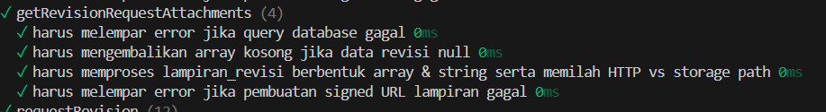 |
| C41-UT12 - C41-UT23 |     |
| C41-UT24 - C41-UT31 |     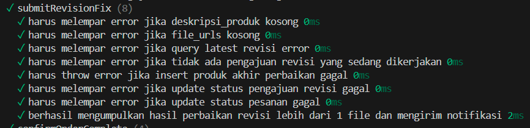 |
| C41 Coverage |    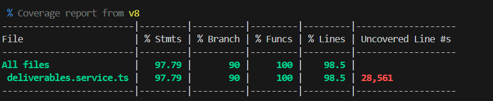 |
| C45-UT01 - C45-UT06 |     |
| C45-UT07 - C45-U08 |    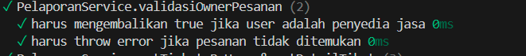|
| C45-UT09 - C45-UT11 |     |
| C45-UT12 - C45-UT13 |     |
| C45-UT14 - C45-UT15 |     |
| C45 Coverage |   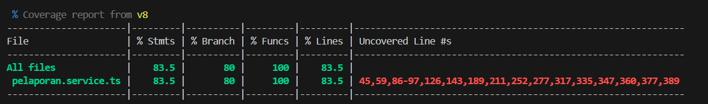 |
| C48-UT01 - C48-UT04 |     |
| C48-UT05 - C48-U09 |    |
| C48-UT10 - C48-UT13 |     |
| C48-UT14 - C48-UT15 |     |
| C48-UT16 - C48-UT19 |    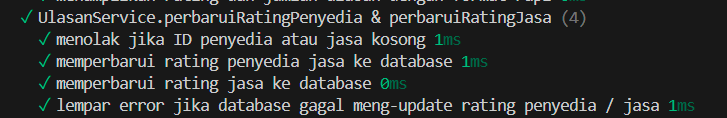 |
| C48-UT20 - C48-UT22 |     |
| C48-UT23 - C48-U25 |    |
| C48-UT26 - C48-UT31 |     |
| C48-UT33 - C48-UT35 |    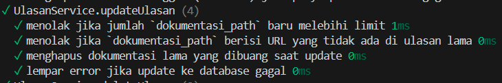 |
| C48-UT36 - C48-UT37 |     |
| C48 Coverage |    |
| C51-UT01 - C51-UT06 |     |
| C51-UT07 - C51-U011 |    |
| C51-UT12 - C51-UT13 |     |
| C51-UT14 - C51-UT15 |    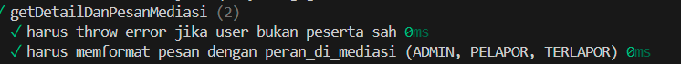 |
| C51-UT16 - C51-UT17 |     |
| C51 Coverage |   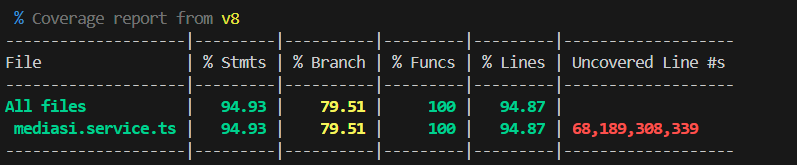 |
| C54-UT01 - C54-UT05 |    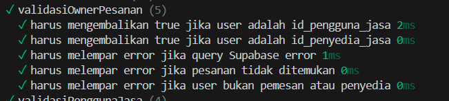 |
| C54-UT06 - C54-U09 |    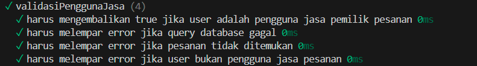|
| C54-UT10 - C54-UT13 |     |
| C54-UT14 - C54-UT19 |    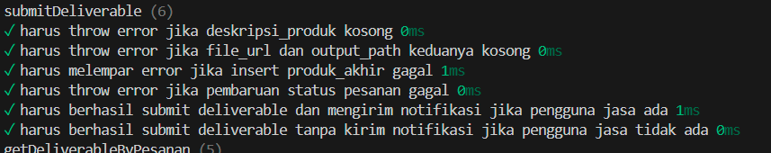 |
| C54-UT20 - C54-UT24 |    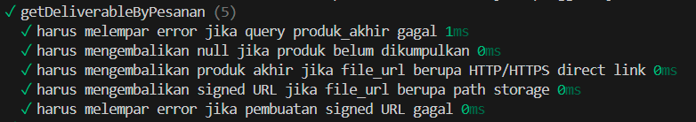 |
| C54-UT25 - C54-UT26 |     |
| C54-UT27 - C54-UT30 |    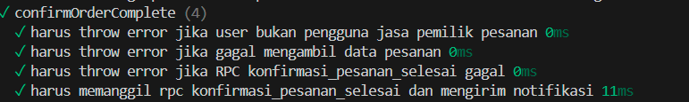 |
| C54-UT31 - C54-UT35 |    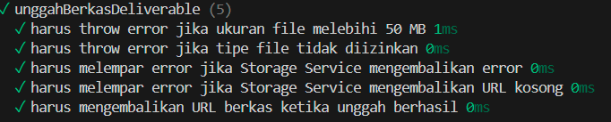 |
| C54 Coverage |    |
| UC11-T01 |      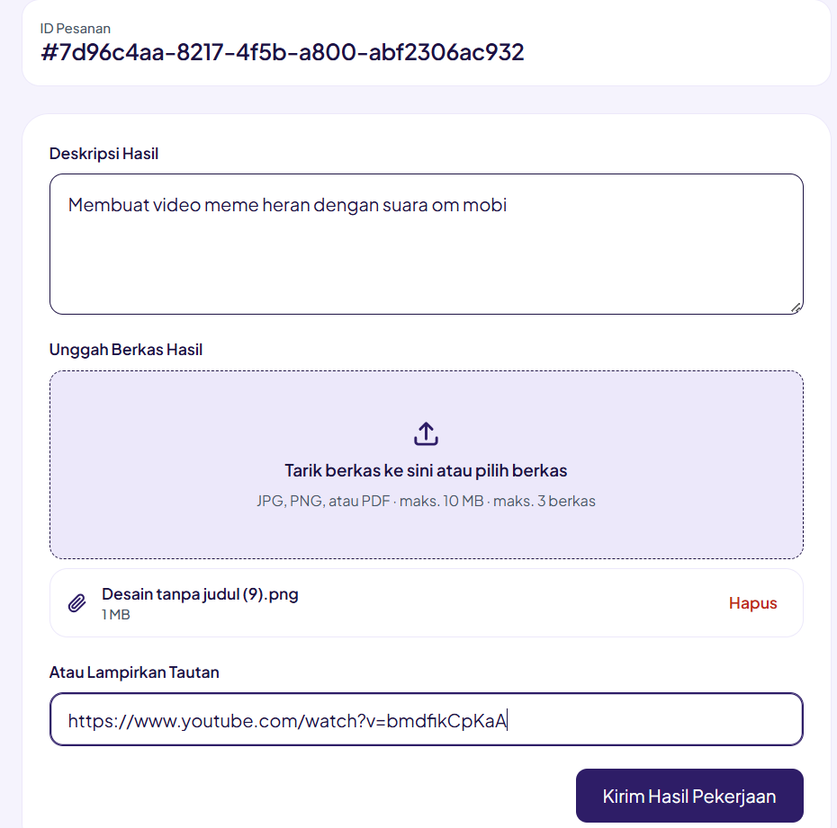   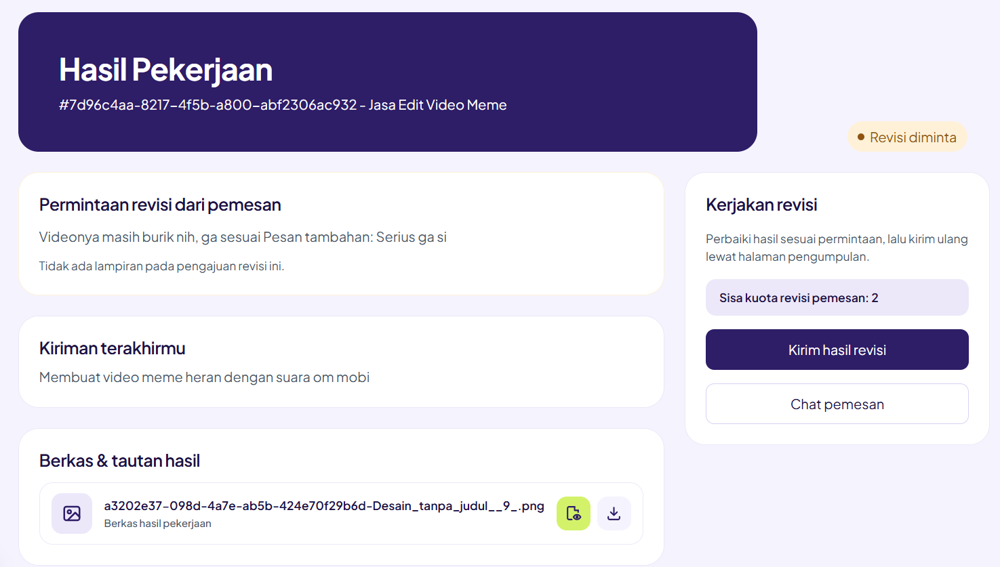   Sisi Pengguna :      Pengumpulan Revisi         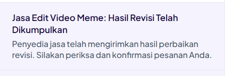   |
| UC11-T02 |      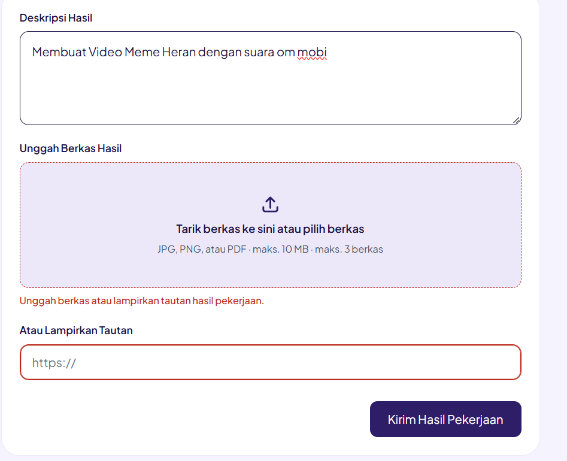  |
| UC11-T03 |        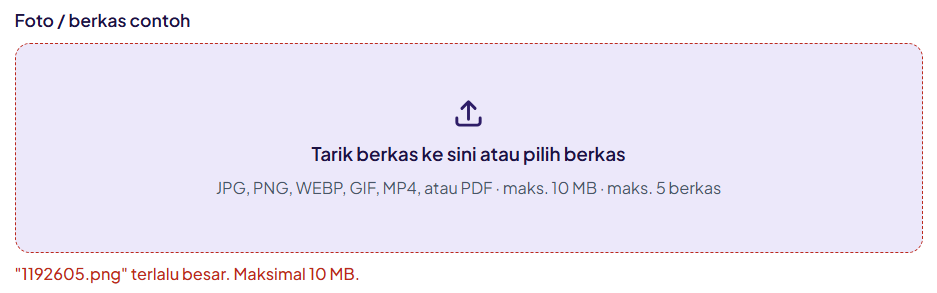 |
| UC12-T01 |         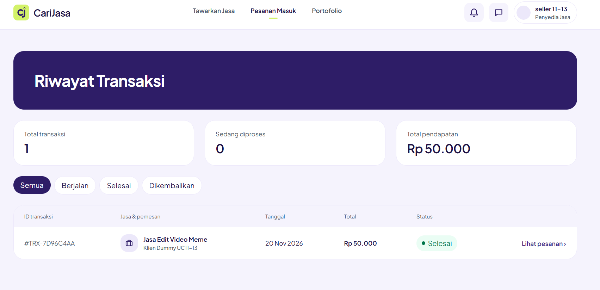     |
| UC12-T02 |        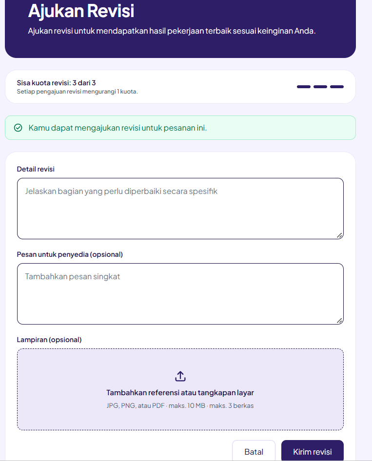     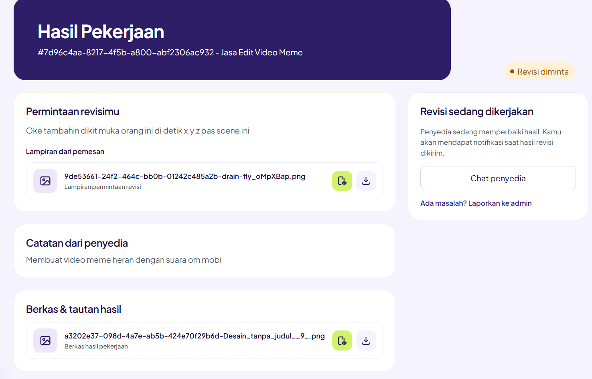      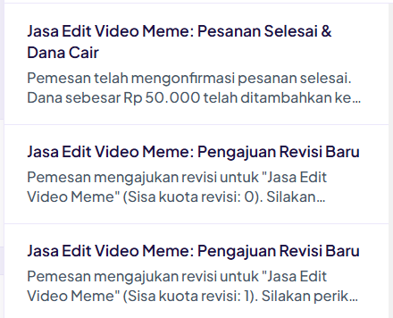   Penangan Error      |
| UC12-T03 |   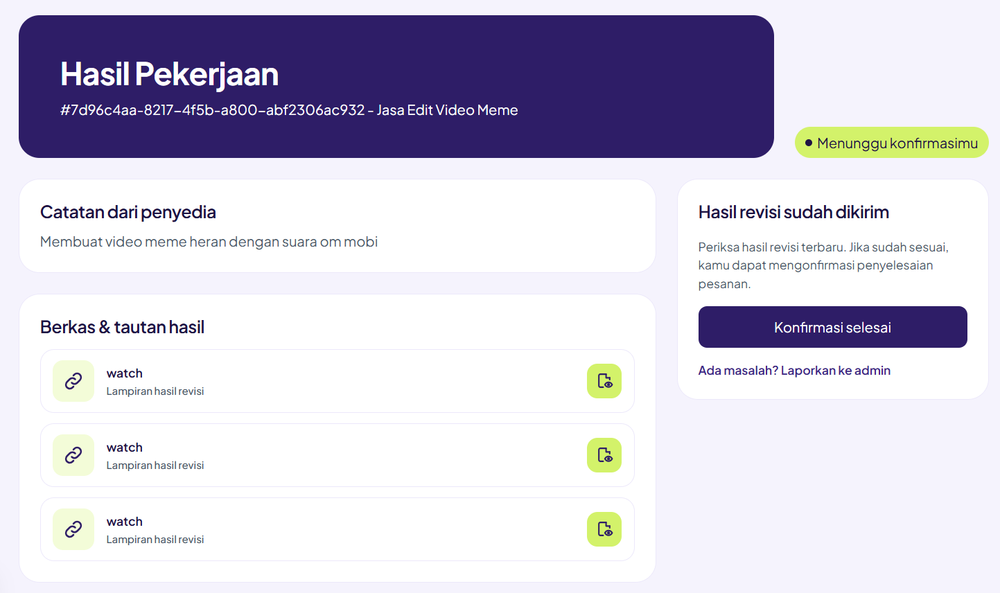               |
| UC13-T01 |        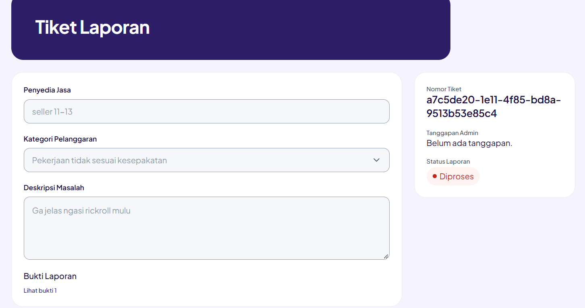  |
| UC13-T02 |             |
| UC14-T01 |         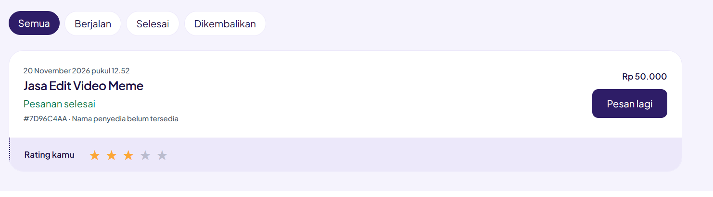      |
| UC14-T02 |          |
| KNF06-TC01 |  |
 

---

# BAB 5: Traceability

Petakan setiap KF ke KNF, use case, kelas perancangan, file implementasi, dan test case. Tabel traceability berikut akan menjadi sarana verifikasi KF. Setiap KF memiliki minimal satu test case dan dinyatakan terpenuhi apabila **seluruh** test case terkaitnya berkesimpulan `Pass`. KF yang tidak diimplementasikan tetap dicantumkan beserta alasannya.

Tabel 5.1. Matriks Kerunutan KF terhadap Implementasi dan Pengujian

| KF ID | KNF Terkait | Use Case ID | Kelas Terkait | Implementasi File Terkait | Test Case (UC) | Test Case (Unit/Integrasi/KNF) |
| :--- | :--- | :--- | :--- | :--- | :--- | :--- |
| *KF05* | *KNF01* | *UC03* | *C02 - Pesanan* | *`src/...`* | *UC03-TC01* | *C02-UT05, INT-TC04, KNF01-TC01* |
| *KF01* | *-* | *UC01 UC02* | *[C01 - Nama kelas] [C02 - Nama kelas]* | *[path/ke/file1] [path/ke/file2]* | *UC01-TC01, UC01-TC02 UC02-TC01* | *-* |
| *KF02* | *[KNFXX atau -]* | *[UCXX]* | *[CXX - Nama kelas]* | *[path/ke/file]* | *[UCXX-TCYY]* | *[CXX-UTYY, INT-TCYY, KNFXX-TCYY atau -]* |
| *KFXX* | *-* | *[UCXX atau -]* | *[CXX - Nama kelas atau -]* | *Tidak diimplementasikan: [alasan]* | *-* | *-* |
| *...* | *...* | *...* | *...* | *...* | *...* | *...* |

Tabel 5.2. Matriks Kerunutan KNF terhadap Pengujian

| ID KNF | Parameter | KF/UC Terkait | Test Case |
| :--- | :--- | :--- | :--- |
| *KNF01* | *Reliability* | *KF05 / UC03* | *KNF01-TC01* |
| *KNFXX* | *[Parameter]* | *[KFXX / UCXX atau -]* | *[KNFXX-TCYY]* |
| *...* | *...* | *...* | *...* |