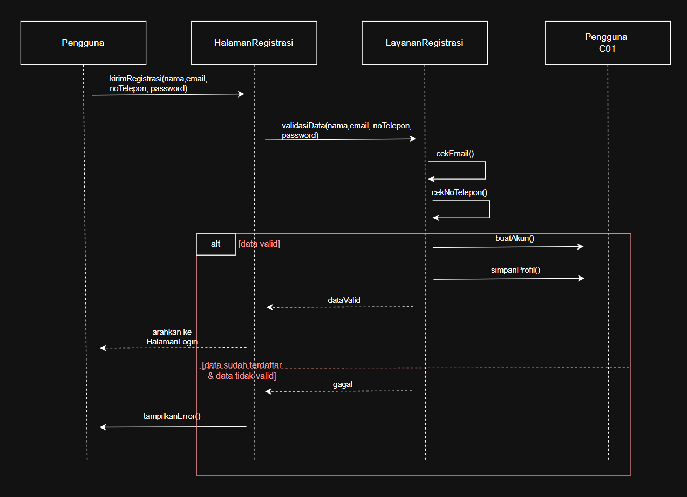
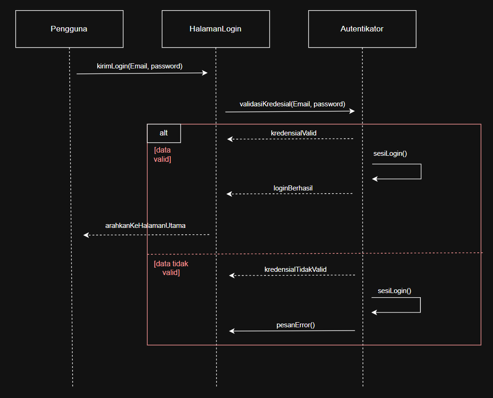
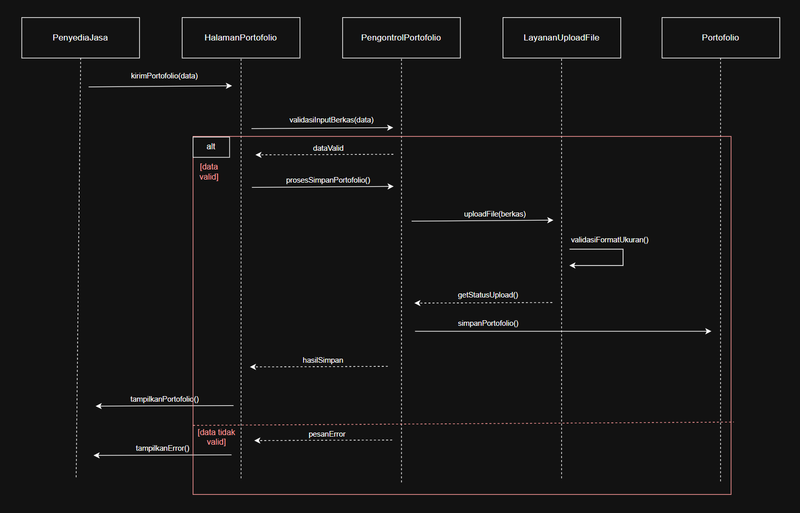

<h1>
IF2150 REKAYASA PERANGKAT LUNAK
 
TUGAS 5
 
DESKRIPSI PERANCANGAN PERANGKAT LUNAK (DPPL)
</h1>
 

## Cari Jasa
### *[Logo Perangkat Lunak]*

### Untuk: Kak Mikhael Andrian Yonatan

Dipersiapkan oleh:
| Informasi | Keterangan |
| --- | --- |
| Kelas | K01 |
| Kelompok | G03  |
| Nama Kelompok | MAYOOOOOR  |

| NIM | Nama |
|---|---|
| 13525031 | Revandra Zacky Maharta |
| 13525079 | Danesh Rasyad Damotino |
| 13525088 | Theresia Estelina Ratu Udju |
| 13525127 | Edward Terrance Lie |
| 13525130 | Necia Aurely Greva Dedevi |
---

## Daftar Perubahan

| Revisi | Deskripsi |
| :--- | :--- |
| Method Class | Penambahan Read Method di Class Pengguna |
| C19 dan C46 Class Diagram Method dan Atribut | Mengganti Isinya karena salah saat traceability di SKPL  |
| Add Atribut | Penambahan atribut daftarProduk di class PenyediaJasa  |
| Refactor Method C37 | ganti kirimHasil() menjadi klikKirimHasil()  |
| Add new Class | Class Pengumpulan Controller |  
| Refactor Class Diagram UC11 | Tambahin Class Baru beserta detailnya |
| Menghapus Method Class ProdukAhir | getDetailJasa --> getDetailProduk |  
| Menghapus dan menambah Method baru pada Class  HalamanPelaporan | tampilkanDeskripsiPelanggaran(), tampilkanNomorTiket(), tampilkanOpsiKategoriPelanggaran(), tampilkanTanggapanAdmin() ---> dihapus. Ditambahkan : tampilkanTiketdanTanggapan() |
| Add Argument | Menambahkan argumen pada:   C03: beriUlasan;   C31: updateStatusPesanan, C47: inputRatingBintang, inputKomentar, unggahDokumentasi, C48: validasiKelengkapanRating, validasiFormatBerkas, validasiPanjangKomentar, prosesUlasan, perbaruiRating |
| Method Class | Menambahkan submitUlasan method pada C47 |
| Method Class | Menambahkan catatRiwayatTransaksi method pada C32 |
| Method Class | Menambahkan getDetailTiket pada C45, tampilkanHalamanMediasi pada C53, UpdateStatusTiket pada C51 |
---

 

> **Petunjuk pengerjaan:** *[Silahkan hapus bagian ini setelah selesai mengerjakan]*
>
> Dokumen ini melanjutkan **Spesifikasi Kebutuhan Perangkat Lunak (SKPL)** dan **Arsitektur Perangkat Lunak (APL)**. Gunakan nama, ID, kebutuhan, dan use case yang konsisten dengan kedua dokumen tersebut. Contoh pola ID baru di bawah dapat disesuaikan dengan kesepakatan kelompok, ID yang sudah ada tetap dipertahankan.

 

---

# BAB 1: Pendahuluan

## 1.1 Tujuan Penulisan Dokumen
Dokumen Desain Perangkat Lunak (DPPL) ini disusun untuk merinci rancangan arsitektur, realisasi *use case*, serta pemodelan struktur kelas secara berorientasi objek untuk platform pencarian jasa digital **CariJasa**. Dokumen ini digunakan oleh tim pengembang sebagai pedoman utama untuk menyamakan pemahaman mengenai struktur teknis dan alur implementasi program.

## 1.2 Lingkup Masalah
CariJasa adalah platform *marketplace* jasa berbasis web yang dirancang untuk memudahkan pencarian dan penawaran jasa digital bagi masyarakat Indonesia. Aplikasi ini dibuat untuk mengatasi masalah informasi jasa yang saat ini masih tersebar di berbagai media sosial dan kanal lain, sehingga pengguna kesulitan mencari serta membandingkan tarif, keahlian, dan ulasan penyedia jasa secara mudah. Selain itu, platform ini hadir untuk membantu *freelancer* maupun penyedia jasa lokal memperoleh penghasilan tambahan tanpa harus terikat hubungan kerja tetap. Ruang lingkup aplikasi berfokus pada penyediaan daftar pilihan jasa, fitur pembanding jasa (*compare*), ruang kirim pesan langsung (*chat*), pembayaran digital yang aman, pengiriman hasil kerja dan pengajuan revisi, hingga pelaporan kendala serta bantuan penyelesaian masalah oleh admin.

## 1.3 Definisi, Istilah, dan Singkatan
Tabel 1.3. Definisi Istilah dan Singkatan

| Singkatan, Akronim, atau Istilah | Penjelasan |
| :--- | :--- |
| *P/L* | *Singkatan dari Perangkat Lunak, yaitu aplikasi yang memberikan perintah kepada komputer untuk menjalankan tugas tertentu.* |
| *SKPL* | *Singkatan dari Spesifikasi Kebutuhan Perangkat Lunak, yaitu dokumen yang merangkum kriteria-kriteria yang diperlukan untuk membangun aplikasi menjalankan tugasnya.* |
| *KF* | *Singkatan dari Kebutuhan Fungsional.* |
| *KNF* | *Singkatan dari Kebutuhan Non-Fungsional.* |
| *UC* | *Singkatan dari Use Case.* |
| *BCE* | *Singkatan dari Boundary-Controller-Entity*. pola arsitektur yang memisahkan sistem ke dalam tiga peran yaitu antarmuka (*Boundary*), pengendali logika (*Controller*), dan data (*Entity*). |
| *UML* | *Unified Modeling Language*, bahasa visual standar untuk mendokumentasikan artefak sistem perangkat lunak. |
| *Listing Jasa* | Produk jasa digital yang telah dipublikasikan oleh Penyedia Jasa dan tersedia untuk dipesan oleh Pengguna Jasa.|
| *Deliverables* | Berkas, dokumen, atau tautan hasil pekerjaan akhir yang diserahkan oleh Penyedia Jasa kepada Pengguna Jasa untuk dievaluasi. |
| *Bookmark* | Fitur untuk menandai dan menyimpan penawaran jasa ke dalam daftar tersimpan pengguna agar mudah diakses kembali. |
| *Ticketing* | Sistem pencatatan, pelacakan, dan penanganan tiket keluhan serta laporan sengketa transaksi pengguna oleh Admin. |

## 1.4 Aturan Penomoran

Tabel 1.4. Aturan Penomoran

| Hal/Bagian | Penomoran | Keterangan |
| :--- | :--- | :--- |
| *Kebutuhan Awal* | *RXX* | Nomor identifikasi kebutuhan mentah dari tahap elisitasi kebutuhan dengan format dua digit. |
| *Kebutuhan Fungsional* | *KFXX* | Nomor urut kebutuhan fungsional dengan format dua digit. |
| *Kebutuhan Non-Fungsional* | *KNFXX* | Nomor urut kebutuhan non-fungsional dengan format dua digit. | 
| *Use Case* | *UCXX* | Nomor urut kasus penggunaan sistem dengan format dua digit. |
| *Kelas* | *CXX* | Nomor identifikasi unik kelas analisis arsitektur BCE. |

## 1.5 Referensi
1. **SKPL:** [Spesifikasi Kebutuhan Perangkat Lunak](../M5/K01_G03_SKPL.md)
2. **APL:** [Arsitektur Perangkat Lunak](../M6/K01_G03_APL.md)
3. Badan Pusat Statistik. (2026). *Keadaan angkatan kerja di Indonesia Februari 2026* (Vol. 48, No. 1). Badan Pusat Statistik.
4. Craigslist. (2026). *Craigslist*. https://www.craigslist.org/
5. Fiverr International Ltd. (2026). *Fiverr*. https://www.fiverr.com/
6. Kementerian Perencanaan Pembangunan Nasional/Badan Perencanaan Pembangunan Nasional. (2025). *Indonesia VNR 2025: Voluntary National Review – Fostering inclusive growth: Advancing sustainable and resilient Indonesia*. Kementerian PPN/Bappenas.
7. United Nations Department of Economic and Social Affairs. (2026). *The Sustainable Development Goals report 2026*. United Nations. https://unstats.un.org/sdgs/report/2026/
8. Program Studi Teknik Informatika ITB. (2026). *Materi perkuliahan IF2150 Rekayasa Perangkat Lunak*. Edunex ITB. https://edunex.itb.ac.id/

## 1.6 Deskripsi Umum Dokumen (Ikhtisar)
Dokumen Desain Perangkat Lunak (DPPL) ini disusun dalam lima bab pembahasan. Bab 1 memaparkan fondasi penyusunan dokumen, meliputi tujuan penulisan, lingkup sistem CariJasa, definisi istilah teknis, konvensi penomoran, daftar referensi dokumen terkait, serta sistematika penulisan. Selanjutnya, Bab 2 menguraikan perancangan arsitektur sistem yang mencakup lingkungan implementasi, pola arsitektur acuan, identifikasi modul, serta model arsitektur perangkat lunak. Pada Bab 3, dijabarkan realisasi *use case* yang meliputi identifikasi kelas, *sequence diagram* untuk skenario normal dan alternatif, serta diagram kelas per *use case*. Pada Bab 4, disajikan diagram kelas keseluruhan beserta daftar lengkap atribut dan metode tiap kelas. Terakhir, Bab 5 menampilkan matriks kerunutan (*traceability*) untuk memetakan hubungan antara kelas dan *use case* terkait.

 

---

# BAB 2: Perancangan Arsitektur

## 2.1 Rancangan Lingkungan Implementasi

Tabel 2.1 Rancangan Lingkungan Implementasi Perangkat Lunak

| Komponen | Spesifikasi |
| :--- | :--- |
| Server | Lokal |
| Client | Web Browser Modern Berbasis Chromium |
| DBMS | PostGresSQL |
| OS | Cross-platform (Windows/Linux/MacOS/Android/IOS) melalui perangkat lunak browser modern |
| Development Tools | Visual Studio Code, Git, Github |
| Bahasa Pemrograman | Next.js |
| Filing System | NTFS |

## 2.2 Style/Pattern Arsitektur Acuan

### 2.2.1 Layered Architecture 
Layered Architecture adalah arsitektur yang membagi perangkat lunak menjadi beberapa *layer* (sub-bagian) berdasarkan masing-masing tanggung jawabnya. Setiap *layer* akan menyediakan *service* (layanan) bagi *layer* di atasnya dan menggunakan service dari layer di bawahnya melalui *interface* yang ditetapkan. Namun, layer dibawahnya tidak dapat menggunakan services dari layer di atasnya. Arsitektur ini dgunakan saat UI, business rule, dan akses penyimpanan membutuhkan batas (*boundary*) yang jelas untuk pengembangan implementasi di masa depan (*Scalability*)

Pada *Layered Architecture*
#### 1. Presentation Layer 

*Layer* yang meng-handle tampilan user interface dan interaksi (input dan tampilan informasi) ke pada user. 
Contohnya : 
- Halawan Web.
- Tampilan Mobile App.
- Desktop GUI 

#### 2. Business Layer
*Layer* yang memproses algoritma dan logika utama aplikasi, seperti logika bisnis, workflow, dan pemrosesan request dari user. Umumnya berada pada komponen controller
Contohnya : 
- Logika Validasi 
- Kalkulasi
- Algoritma Pemrosesan Query Pengguna

#### 3. Data Access Layer / Persistence Layer
*Layer* yang menerima data, menyimpan, dan mengatur data yang akan diletakkan di dalam database. Layer ini juga memastikan pemisahan terhadap hal-hal penting dalam data.
Contoh : 
- Query Database
- Caching
- API

#### 4. Database Layer
*Layer* penyimpanan data sesungguhnya tempat informasi disimpan. Biasanya berisikan data untuk masing-masing entitas yang dibuat.

Contoh : 
- Database Relasional (SQL, PostgreSQL)
- NoSQL (MongoDB)

#### Alasan Pemilihan Pattern
Perangkat Lunak CariJasa memiliki karakteristik berupa satu aplikasi web yang memiliki beberapa fitur terpisah yang digunakan untuk menjalankan layanan dengan baik. Perangkat lunak ini memerlukan beberapa karakteristik utama, seperti  Reliability, Security, dan Maintanaibility. Reliability diperlukan agar proses pencarian dapat dieksekusi dengan cepat dan tepat. Selain itu, perangkat lunak juga harus memastikan setiap respons dari server serta transaksi berjalan dengan baik. Kemudian, Security juga diperlukan karena setiap transaksi yang dilakukan berkaitan dengan ekonomi (uang) yang dipercayakan Pengguna Jasa maupun Penyedia Jasa, beserta keamanan kredensialnya. Terakhir, perangkat lunak juga harus dapat dikelola untuk memastikan keberjalana setiap fitur dengan baik. Oleh karena itu, diperlukan berbagai unit testing yang perlu dilakukan untuk setiap fitur yang ada. 

Perangkat Lunak CariJasa juga memiliki alur proses bisnis. Alur dimulai dengan registrasi pengguna, baik Pengguna Jasa, maupun Penyedia Jasa. Lalu Pengguna akan diminta untuk mengisi data diri dan portofolio (untuk Penyedia Jasa). Kemudian Pengguna Jasa dapat langsung mencari jasa yang mereka inginkan melalui search bar yang disediakan, juga menyimpan jasa yang menarik menggunakan *bookmark*. Penyedia Jasa dapat membuat postingan terkait jasa yang mereka tawarkan agar dapat digapai oleh pengguna. Kemudian, Pengguna Jasa dapat berkomunikasi melalui chat instan untuk bertanya sekaligus bernegosiasi kepada Penyedia Jasa. Setelah kedua pihak sepakat, Pengguna Jasa dapat melakukan transaksi serta pemesanan yang kemudian akan diproses dan dikerjakan oleh Penyedia Jasa. Setelah produk akhir dikirim, pengguna jasa dapat mengajukan revisi ataupun mengonfirmasi hasil pekerjaan yang dibuat. Setelah selesai, maka pengguna jasa dapat memberikan ulasan maupun laporan kepada admin lewat fitur ticketing. 

Dengan segala kebutuhan dan alur bisnis tersebut, *layered architecture* dipilih dengan alasan 

#### 1. Pemisahan Tanggung Jawab : 
Arsitektur ini membagi  sistem ke dalam lapisan yang jelas, seperti presentation layer, business layer, data access layer, dan database layer. Komponen ini, akan memastikan logika bisnis setiap fitur saling independen dan tidak tercampur aduk

#### 2. Kemudahan Pengujian :
Dengan perangkat lunak dibagi menjadi berbagai layer, developer dapat lebih mudah untuk melakukan tracing dan unit testing untuk setiap fitur yang dibuat. Hal ini akan memudahkan developer untuk memastikan keberjalanan tiap fitur berjalan secara simultan

#### 3. Keamanan yang lebih terjamin
Karena dilakukan pemisahan akses dan interaksi dari pengguna. Kondisi ini akan memperkecil risiko rusaknya integritas data, dan keamanan dalam transaksi secara ekonomi

<i>Gambar 2.2.1 Diagram Layered Architecture</i>

### 2.2.2 Client-Server Achitecture
Client-Server Architecture adalah sebuah pola arsitektur perangkat lunak yang membagi sistem menjadi dua bagian utama, yaitu *client* dan *server*. Kedua belah pihak saling berkomunikasi dan bertukar data melalui sebuah protokol jaringan, misalnya HTTP. Dalam penggunaannya, *client* yang biasanya berupa antarmuka pengguna seperti *web browser* atau aplikasi *mobile*, bertugas untuk mengirimkan *request* sesuai dengan keperluannya. Sementara itu, *server* yang merupakan tempat pemrosesan dan penyimpanan data, bertugas menerima *request*, memprosesnya, lalu mengirimkan kembali *response* kepada *client*.

### Alasan Pemilihan Pattern
1. Pengguna yang bertindak sebagai pihak *client* tidak perlu menanggung beban pemrosesan sistem pada perangkat mereka, *client* cukup menggunakan antarmuka untuk mengirimkan berbagai *request*, seperti pencarian, pemesanan, ataupun pengunggahan data, lalu beban komputasi mayoritas ditanggung oleh pihak *server*.
   
3. Untuk platform yang menangani berbagai data penting seperti informasi akun, transaksi, dan berkas, Client-Server Achitecture menempatkan *server* sebagai pusat penyimpanan dan logika utama. Hal tersebut memastikan setiap *request* yang dikirim oleh *client* dikelola dengan standar keamanan dan aturan yang sama sehingga integritas dan standar data tetap terjaga.
   
5. Dapat menghubungkan banyak pengguna yang tersebar di berbagai lokasi yang berbeda. Dengan memanfaatkan protokol jaringan seperti HTTP, sistem memungkinkan terjadinya komunikasi dan sinkronisasi data antarpengguna melalui perantara *server* sehingga interaksi seperti pertukaran pesan dan pengiriman notifikasi dapat berjalan dengan lancar.

<i>Gambar 2.2.2 Diagram Client-Server Architecture</i>

## 2.3 Identifikasi Komponen / Modul / Subsistem

Tabel 2.3. Identifikasi Komponen/Modul/Subsistem

| Nama Komponen/Modul/Subsistem | Kelas yang Dicakup (SKPL) | Jenis | Penjelasan |
| :--- | :--- | :--- | :--- |
| Subsistem Client Web | C04 (HalamanRegistrasi), C06 (HalamanLogin), C08 (HalamanPortofolio), C13 (HalamanUploadJasa), C15 (HalamanPencarian), C16 (HasilPencarian), C19 (HalamanDetailJasa), C21 (HalamanBookmark), C24 (HalamanChat), C28 (HalamanPemesanan), C29 (HalamanPembayaran), C30 (HalamanRiwayatTransaksi), C35 (HalamanKonfirmasi), C37 (HalamanPengumpulan), C38 (HalamanDeliverables), C40 (HalamanRequestRevisi), C44 (HalamanPelaporan), C47 (HalamanUlasan), C50 (HalamanPengajuanMediasi), C53 (HalamanDashboardAdmin) | CLIENT (PRESENTATION LAYER) | Menjalankan seluruh halaman tampilan web dan menerima input aksi pengguna di peramban. |
| Komponen UI Autentikasi dan Akun | C04 (HalamanRegistrasi), C06 (HalamanLogin) | CLIENT (PRESENTATION LAYER) | Menampilkan formulir pendaftaran dan autentikasi masuk akun pengguna. |
| Komponen UI Portofolio dan Penawaran Jasa | C08 (HalamanPortofolio), C13 (HalamanUploadJasa) | CLIENT (PRESENTATION LAYER) | Menampilkan formulir pembuatan jasa baru dan unggah portofolio pekerja. |
| Komponen UI Pencarian, Filter dan Komparasi | C15 (HalamanPencarian), C16 (HasilPencarian), C19 (HalamanDetailJasa), C21 (HalamanBookmark) | CLIENT (PRESENTATION LAYER) | Menampilkan pencarian, saringan hasil, detail, simpanan, dan pembanding jasa. |
| Komponen UI Komunikasi Langsung | C24 (HalamanChat) | CLIENT (PRESENTATION LAYER) | Menampilkan ruang percakapan obrolan langsung antar-pengguna. |
| Komponen UI Pemesanan dan Pembayaran | C28 (HalamanPemesanan), C29 (HalamanPembayaran), C30 (HalamanRiwayatTransaksi), C35 (HalamanKonfirmasi) | CLIENT (PRESENTATION LAYER) | Menampilkan formulir pemesanan, halaman pembayaran, riwayat transaksi, dan persetujuan pesanan. |
| Komponen UI Penyerahan Hasil dan Revisi | C37 (HalamanPengumpulan), C38 (HalamanDeliverables), C40 (HalamanRequestRevisi) | CLIENT (PRESENTATION LAYER) | Menampilkan pengiriman berkas hasil kerja dan formulir permintaan perbaikan pesanan. |
| Komponen UI Evaluasi dan Ulasan Layanan | C47 (HalamanUlasan) | CLIENT (PRESENTATION LAYER) | Menampilkan formulir pemberian nilai bintang serta ulasan pekerjaan. |
| Komponen UI Pengaduan, Mediasi dan Admin | C44 (HalamanPelaporan), C50 (HalamanPengajuanMediasi), C53 (HalamanDashboardAdmin) | CLIENT (PRESENTATION LAYER) | Menampilkan formulir laporan aduan, ruang mediasi sengketa, dan dasbor kerja admin. |
| Subsistem Server Aplikasi | C01 (Pengguna), C02 (PenyediaJasa), C03 (PenggunaJasa), C05 (LayananRegistrasi), C07 (Autentikator), C09 (Portofolio), C10 (PengontrolPortofolio), C11 (LayananUploadFile), C12 (Jasa), C14 (JasaController), C17 (LayananPencarian), C18 (LayananPembandingJasa), C20 (Bookmark), C22 (PengontrolBookmark), C23 (ChatRoom), C25 (LayananPesanInstan), C26 (LayananNotifikasiChat), C27 (Pesanan), C31 (PengontrolPesanan), C32 (PengontrolTransaksi), C33 (MetodePembayaran), C34 (RiwayatTransaksi), C36 (ProdukAkhir), C39 (PengajuanRevisi), C41 (RevisiHandler), C42 (PencairanDana), C43 (TiketLaporan), C45 (LaporanHandler), C46 (Ulasan), C48 (UlasanHandler), C49 (TanggapanLaporan), C51 (MediasiHandler), C52 (Admin) | SERVER (APPLICATION / BUSINESS TIER) | Mengolah logika sistem, aturan bisnis, alur transaksi, dan kendali data di server. |
| Modul Registrasi dan Akun | C01 (Pengguna), C02 (PenyediaJasa), C03 (PenggunaJasa), C05 (LayananRegistrasi), C07 (Autentikator), C52 (Admin) | SERVER (BUSINESS LAYER) | Mengurus pendaftaran akun, cek login kata sandi, dan pembagian hak akses pengguna. |
| Modul Pencarian dan Jasa | C09 (Portofolio), C10 (PengontrolPortofolio), C12 (Jasa), C14 (JasaController), C17 (LayananPencarian), C18 (LayananPembandingJasa), C20 (Bookmark), C22 (PengontrolBookmark) | SERVER (BUSINESS LAYER) | Mengurus penayangan jasa, pencarian kata kunci, perbandingan paket, dan simpanan jasa. |
| Modul Pemesanan dan Transaksi | C27 (Pesanan), C31 (PengontrolPesanan), C32 (PengontrolTransaksi), C33 (MetodePembayaran), C34 (RiwayatTransaksi), C36 (ProdukAkhir), C39 (PengajuanRevisi), C41 (RevisiHandler), C42 (PencairanDana) | SERVER (BUSINESS LAYER) | Mengatur siklus pesanan, keamanan titip uang, alur perbaikan tugas, dan pelepasan dana. |
| Modul Komunikasi | C23 (ChatRoom), C25 (LayananPesanInstan), C26 (LayananNotifikasiChat) | SERVER (BUSINESS LAYER) | Mengatur pengiriman pesan teks langsung dan penyampaian tanda notifikasi obrolan. |
| Modul Laporan dan Mediasi | C43 (TiketLaporan), C45 (LaporanHandler), C46 (Ulasan), C48 (UlasanHandler), C49 (TanggapanLaporan), C51 (MediasiHandler) | SERVER (BUSINESS LAYER) | Mengatur tiket aduan kendala, ruang obrolan penengah, ulasan penilaian, dan sanksi akun. |
| Modul Akses Berkas dan Media | C11 (LayananUploadFile) | SERVER (DATA ACCESS LAYER) | Mengatur validasi ukuran serta proses unggah dan unduh berkas media penyimpanan. |
| Komponen Penghubung Basis Data | Akses Basis Data (PostgreSQL) | SERVER (DATA ACCESS LAYER) | Menyediakan koneksi dan eksekusi perintah data antara logika server dan basis data. |
| Subsistem Database Terpusat | C01, C02, C03, C09, C12, C20, C23, C27, C33, C34, C36, C39, C42, C43, C46, C49 | DATABASE (DATA PERSISTENCE LAYER) | Menyimpan seluruh catatan data sistem secara permanen dalam satu basis data terpusat. |
| Data Pengguna, Data Penyedia Jasa, Data Pengguna Jasa | C01 (Pengguna), C02 (PenyediaJasa), C03 (PenggunaJasa) | DATABASE (DATA PERSISTENCE LAYER) | Menyimpan data profil akun pengguna, akun pekerja, akun pembeli, dan status akun. |
| Data Jasa dan Portofolio | C09 (Portofolio), C12 (Jasa), C20 (Bookmark) | DATABASE (DATA PERSISTENCE LAYER) | Menyimpan data daftar jasa penawaran, karya portofolio, dan daftar jasa yang disimpan. |
| Data Pesanan, Riwayat Transaksi, Produk Akhir | C27 (Pesanan), C33 (MetodePembayaran), C34 (RiwayatTransaksi), C36 (ProdukAkhir), C39 (PengajuanRevisi), C42 (PencairanDana) | DATABASE (DATA PERSISTENCE LAYER) | Menyimpan data pesanan kerja, pembayaran, riwayat transaksi, berkas hasil, dan perbaikan. |
| Data Komunikasi (Chat Room) | C23 (ChatRoom) | DATABASE (DATA PERSISTENCE LAYER) | Menyimpan data ruang percakapan dan seluruh rekaman riwayat pesan teks obrolan. |
| Data Laporan dan Tanggapan Laporan | C43 (TiketLaporan), C49 (TanggapanLaporan) | DATABASE (DATA PERSISTENCE LAYER) | Menyimpan data tiket laporan masalah pengguna, bukti aduan, dan keputusan tindakan admin. |
| Data Ulasan | C46 (Ulasan) | DATABASE (DATA PERSISTENCE LAYER) | Menyimpan data skor bintang penilaian pembeli, komentar evaluasi, dan bukti hasil kerja. |

## 2.4 Model Arsitektur Perangkat Lunak

### 2.4.1 Logical View

Logical View dapat menunjukkan bagian-bagian utama dalam sistem beserta fungsi dan hubungan antarkomponennya. View ini sesuai untuk aplikasi yang dikembangkan karena dapat memperlihatkan pembagian tanggung jawab setiap komponen sehingga alur kerja sistem dapat terlihat dengan lebih jelas.

<i>Gambar 2.4.1 Diagram Logical View</i>

---

### 2.4.2 Development View (Package Diagram)
Development view akan mendeskripsikan organisasi statis kode dalam package modul, subsistem, dan dependensi di dalam penerapannya. 

Package diagram adalah diagram yang menampilkan perencanaan dan pengorganisasikan elemen, modul, *package* dalam sebuah proyek perangkat lunak. Package diagram akan menampilkan structure dan dependensi antar subsistem maupun modul serta menampilkan perbedaan sudut pandang dari sistem.

<i>Gambar 2.4.2 Diagram Development View</i>

 

---

# BAB 3: Realisasi Use Case

## 3.1 Use Case Melakukan Registrasi Akun

**ID Use Case:** *UC01*  
**Nama Use Case:** *Melakukan Registrasi Akun*

### 3.1.1 Identifikasi Kelas

Identifikasi kelas yang terkait dengan use case tersebut. Kelas di tahap perancangan dapat berbeda dengan dengan kelas di tahap analisis. Dapat menggunakan tabel di bawah:

Tabel 3.1. Identifikasi Kelas Use Case [UC01]

| No | Nama Kelas Perancangan | Nama Kelas Analisis Terkait |
|:--- | :--- | :--- |
| 1 | *[Nama kelas perancangan]* | *[Nama kelas analisis pada SKPL]* |
| 2 | *[Nama kelas perancangan]* | *[Nama kelas analisis pada SKPL]* |
| ... | *...* | *...* |

### 3.1.2 Sequence Diagram

Buat *sequence diagram* untuk **setiap skenario use case**, mencakup skenario normal dan alternatif pada subbab 4.4 SKPL. Diagram melibatkan kelas-kelas yang telah diidentifikasi pada SKPL. 

- **Skenario Normal**

<i>Gambar 3.1.2 Sequence Diagram [UC01]</i>

### 3.1.3 Diagram Kelas

Buatlah diagram kelas untuk use case ini yang terdiri atas kelas-kelas dari 3.1.1. **Setiap kelas pada diagram wajib menampilkan atribut dan metode/operasi langsung di dalam kotak kelasnya**, sehingga tidak perlu membuat tabel daftar atribut dan metode per kelas pada subbab ini. Daftar lengkap atribut dan metode seluruh kelas disajikan pada Tabel 4.1 (Bab 4).

<i>Gambar X. Diagram Kelas [Nama Uce Case]</i>

Pada diagram, pastikan:
- Atribut dituliskan beserta visibilitas dan tipe datanya, misalnya `- email: String`.
- Operasi dituliskan beserta visibilitas, parameter, dan tipe kembaliannya, misalnya `+ login(email: String, password: String): Boolean`.
- Relasi antarkelas (asosiasi, agregasi, komposisi, generalisasi, dan dependensi) digambarkan lengkap dengan multiplisitas.
- Semua operasi yang dipanggil pada sequence diagram 3.1.2 (skenario normal dan alternatif) ada pada kelas yang bersangkutan.
- Kelas yang sama dengan kelas di use case lain memakai nama, atribut, dan metode yang konsisten.

## 3.2 Use Case Melakukan Login

**ID Use Case:** *UC02*  
**Nama Use Case:** *Melakukan Login*

### 3.2.1 Identifikasi Kelas

Identifikasi kelas yang terkait dengan use case tersebut. Kelas di tahap perancangan dapat berbeda dengan dengan kelas di tahap analisis. Dapat menggunakan tabel di bawah:

Tabel 3.2.1 Identifikasi Kelas Use Case [UC01]

| No | Nama Kelas Perancangan | Nama Kelas Analisis Terkait |
|:--- | :--- | :--- |
| 1 | *[Nama kelas perancangan]* | *[Nama kelas analisis pada SKPL]* |
| 2 | *[Nama kelas perancangan]* | *[Nama kelas analisis pada SKPL]* |
| ... | *...* | *...* |

### 3.2.2 Sequence Diagram

Buat *sequence diagram* untuk **setiap skenario use case**, mencakup skenario normal dan alternatif pada subbab 4.4 SKPL. Diagram melibatkan kelas-kelas yang telah diidentifikasi pada SKPL. 

- **Skenario Normal**

<i>Gambar 3.2.2 Sequence Diagram [UC02]</i>

### 3.2.3 Diagram Kelas

Buatlah diagram kelas untuk use case ini yang terdiri atas kelas-kelas dari 3.1.1. **Setiap kelas pada diagram wajib menampilkan atribut dan metode/operasi langsung di dalam kotak kelasnya**, sehingga tidak perlu membuat tabel daftar atribut dan metode per kelas pada subbab ini. Daftar lengkap atribut dan metode seluruh kelas disajikan pada Tabel 4.1 (Bab 4).

<i>Gambar X. Diagram Kelas [Nama Uce Case]</i>

Pada diagram, pastikan:
- Atribut dituliskan beserta visibilitas dan tipe datanya, misalnya `- email: String`.
- Operasi dituliskan beserta visibilitas, parameter, dan tipe kembaliannya, misalnya `+ login(email: String, password: String): Boolean`.
- Relasi antarkelas (asosiasi, agregasi, komposisi, generalisasi, dan dependensi) digambarkan lengkap dengan multiplisitas.
- Semua operasi yang dipanggil pada sequence diagram 3.1.2 (skenario normal dan alternatif) ada pada kelas yang bersangkutan.
- Kelas yang sama dengan kelas di use case lain memakai nama, atribut, dan metode yang konsisten.

## 3.3 Use Case Mengisi Portofolio

**ID Use Case:** *UC03*  
**Nama Use Case:** *Mengisi Portofolio*

### 3.3.1 Identifikasi Kelas

Identifikasi kelas yang terkait dengan use case tersebut. Kelas di tahap perancangan dapat berbeda dengan dengan kelas di tahap analisis. Dapat menggunakan tabel di bawah:

Tabel 3.3.1 Identifikasi Kelas Use Case [UC01]

| No | Nama Kelas Perancangan | Nama Kelas Analisis Terkait |
|:--- | :--- | :--- |
| 1 | *[Nama kelas perancangan]* | *[Nama kelas analisis pada SKPL]* |
| 2 | *[Nama kelas perancangan]* | *[Nama kelas analisis pada SKPL]* |
| ... | *...* | *...* |

### 3.3.2 Sequence Diagram

Buat *sequence diagram* untuk **setiap skenario use case**, mencakup skenario normal dan alternatif pada subbab 4.4 SKPL. Diagram melibatkan kelas-kelas yang telah diidentifikasi pada SKPL. 

- **Skenario Normal**

<i>Gambar 3.3.3 Sequence Diagram [UC02]</i>

### 3.3.3 Diagram Kelas

Buatlah diagram kelas untuk use case ini yang terdiri atas kelas-kelas dari 3.1.1. **Setiap kelas pada diagram wajib menampilkan atribut dan metode/operasi langsung di dalam kotak kelasnya**, sehingga tidak perlu membuat tabel daftar atribut dan metode per kelas pada subbab ini. Daftar lengkap atribut dan metode seluruh kelas disajikan pada Tabel 4.1 (Bab 4).

<i>Gambar X. Diagram Kelas [Nama Uce Case]</i>

Pada diagram, pastikan:
- Atribut dituliskan beserta visibilitas dan tipe datanya, misalnya `- email: String`.
- Operasi dituliskan beserta visibilitas, parameter, dan tipe kembaliannya, misalnya `+ login(email: String, password: String): Boolean`.
- Relasi antarkelas (asosiasi, agregasi, komposisi, generalisasi, dan dependensi) digambarkan lengkap dengan multiplisitas.
- Semua operasi yang dipanggil pada sequence diagram 3.1.2 (skenario normal dan alternatif) ada pada kelas yang bersangkutan.
- Kelas yang sama dengan kelas di use case lain memakai nama, atribut, dan metode yang konsisten.

## 3.4 Use Case Mengunggah Penawaran Jasa

**ID Use Case:** UC04  
**Nama Use Case:** Mengunggah Penawaran Jasa

### 3.4.1 Identifikasi Kelas
Tabel 3.4. Identifikasi Kelas Use Case [UC04]

| No | Nama Kelas Perancangan | Nama Kelas Analisis Terkait |
|:--- | :--- | :--- |
| 1 | *[Nama kelas perancangan]* | *[Nama kelas analisis pada SKPL]* |
| 2 | *[Nama kelas perancangan]* | *[Nama kelas analisis pada SKPL]* |
| ... | *...* | *...* |

### 3.4.2 Sequence Diagram

- **Skenario Normal dan Alternatif**

<i>Gambar X. Sequence Diagram Mengunggah Penawaran Jasa [UC04]</i>

### 3.4.3 Diagram Kelas

Buatlah diagram kelas untuk use case ini yang terdiri atas kelas-kelas dari 3.1.1. **Setiap kelas pada diagram wajib menampilkan atribut dan metode/operasi langsung di dalam kotak kelasnya**, sehingga tidak perlu membuat tabel daftar atribut dan metode per kelas pada subbab ini. Daftar lengkap atribut dan metode seluruh kelas disajikan pada Tabel 4.1 (Bab 4).

<i>Gambar X. Diagram Kelas Mengunggah Penawaran Jasa [UC04]</i>

Pada diagram, pastikan:
- Atribut dituliskan beserta visibilitas dan tipe datanya, misalnya `- email: String`.
- Operasi dituliskan beserta visibilitas, parameter, dan tipe kembaliannya, misalnya `+ login(email: String, password: String): Boolean`.
- Relasi antarkelas (asosiasi, agregasi, komposisi, generalisasi, dan dependensi) digambarkan lengkap dengan multiplisitas.
- Semua operasi yang dipanggil pada sequence diagram 3.1.2 (skenario normal dan alternatif) ada pada kelas yang bersangkutan.
- Kelas yang sama dengan kelas di use case lain memakai nama, atribut, dan metode yang konsisten.

## 3.5 Use Case Mencari Penawaran Jasa

**ID Use Case:** UC05  
**Nama Use Case:** Mencari Penawaran Jasa

### 3.5.1 Identifikasi Kelas
Tabel 3.5. Identifikasi Kelas Use Case [UC05]

| No | Nama Kelas Perancangan | Nama Kelas Analisis Terkait |
|:--- | :--- | :--- |
| 1 | *[Nama kelas perancangan]* | *[Nama kelas analisis pada SKPL]* |
| 2 | *[Nama kelas perancangan]* | *[Nama kelas analisis pada SKPL]* |
| ... | *...* | *...* |

### 3.5.2 Sequence Diagram

- **Skenario Normal dan Alternatif**

<i>Gambar X. Sequence Diagram Mencari Penawaran Jasa [UC05]</i>

### 3.5.3 Diagram Kelas

Buatlah diagram kelas untuk use case ini yang terdiri atas kelas-kelas dari 3.1.1. **Setiap kelas pada diagram wajib menampilkan atribut dan metode/operasi langsung di dalam kotak kelasnya**, sehingga tidak perlu membuat tabel daftar atribut dan metode per kelas pada subbab ini. Daftar lengkap atribut dan metode seluruh kelas disajikan pada Tabel 4.1 (Bab 4).

<i>Gambar X. Diagram Kelas Mencari Penawaran Jasa [UC05]</i>

Pada diagram, pastikan:
- Atribut dituliskan beserta visibilitas dan tipe datanya, misalnya `- email: String`.
- Operasi dituliskan beserta visibilitas, parameter, dan tipe kembaliannya, misalnya `+ login(email: String, password: String): Boolean`.
- Relasi antarkelas (asosiasi, agregasi, komposisi, generalisasi, dan dependensi) digambarkan lengkap dengan multiplisitas.
- Semua operasi yang dipanggil pada sequence diagram 3.1.2 (skenario normal dan alternatif) ada pada kelas yang bersangkutan.
- Kelas yang sama dengan kelas di use case lain memakai nama, atribut, dan metode yang konsisten.

## 3.8 Use Case Melakukan Komunikasi

**ID Use Case:** *UC08*  
**Nama Use Case:** *Melakukan Komunikasi*

### 3.8.1 Identifikasi Kelas
Tabel 3.8. Identifikasi Kelas Use Case [UC08]

| No | Nama Kelas Perancangan | Nama Kelas Analisis Terkait |
|:--- | :--- | :--- |
| 1 | ChatRoom | ChatRoom |
| 2 | HalamanChat | HalamanChat |
| 3 | LayananPesanInstan | LayananPesanInstan |
| 4 | LayananNotifikasiChat | LayananNotifikasiChat |

### 3.8.2 Sequence Diagram

- **Skenario Normal**

<i>Gambar 3.8.2 Sequence Diagram [UC08]</i>

### 3.8.3 Diagram Kelas

<i>Gambar 3.8.3 Diagram Kelas Melakukan Komunikasi</i>

## 3.9 Use Case Melakukan Pemesanan Jasa

**ID Use Case:** *UC09*  
**Nama Use Case:** *Melakukan Pemesanan Jasa*

### 3.9.1 Identifikasi Kelas

Tabel 3.9. Identifikasi Kelas Use Case [UC09]

| No | Nama Kelas Perancangan | Nama Kelas Analisis Terkait |
|:--- | :--- | :--- |
| 1 | Pesanan | Pesanan |
| 2 | HalamanPemesanan | HalamanPemesanan |
| 3 | HalamanPembayaran | HalamanPembayaran |
| 4 |HalamanRiwayatTransaksi | HalamanRiwayatTransaksi |
| 5 | PengontrolPesanan | PengontrolPesanan |
| 6 | PengontrolTransaksi | PengontrolTransaksi |
| 7 | MetodePembayaran | MetodePembayaran |
| 8 | RiwayatTransaksi | RiwayatTransaksi |

### 3.9.2 Sequence Diagram

- **Skenario Normal**

<i>Gambar 3.9.2 Sequence Diagram [UC09]</i>

### 3.9.3 Diagram Kelas

<i>Gambar 3.9.3 Diagram Kelas Melakukan Pemesanan Jasa</i>

## 3.10 Use Case Melakukan Konfirmasi Pesanan

**ID Use Case:** *UC10*  
**Nama Use Case:** *Melakukan Konfirmasi Pesanan*

### 3.10.1 Identifikasi Kelas

Tabel 3.10. Identifikasi Kelas Use Case [UC10]

| No | Nama Kelas Perancangan | Nama Kelas Analisis Terkait |
|:--- | :--- | :--- |
| 1 | Pesanan | Pesanan |
| 2 | PengontrolPesanan | PengontrolPesanan |
| 3 | PengontrolTransaksi | PengontrolTransaksi |
| 4 | MetodePembayaran | MetodePembayaran |
| 5 | RiwayatTransaksi | RiwayatTransaksi |
| 6 | HalamanKonfirmasi | HalamanKonfirmasi |

### 3.10.2 Sequence Diagram

- **Skenario Normal**

<i>Gambar 3.10.2 Sequence Diagram [UC10]</i>

### 3.10.3 Diagram Kelas

<i>Gambar 3.10.3 Diagram Kelas Melakukan Konfirmasi Pesanan</i>

## 3.11 Use Case Menyerahkan Hasil Pekerjaan

**ID Use Case:** UC11  
**Nama Use Case:** Menyerahkan Hasil Pekerjaan

### 3.11.1 Identifikasi Kelas

Identifikasi kelas yang terkait dengan use case tersebut. Kelas di tahap perancangan dapat berbeda dengan dengan kelas di tahap analisis. Dapat menggunakan tabel di bawah:

Tabel 3.1. Identifikasi Kelas Use Case [UC11]

| No | Nama Kelas Perancangan | Nama Kelas Analisis Terkait |
|:--- | :--- | :--- |
| 1 | UploadFileHandler | LayananUploadFile |
| 2 | HalamanPengumpulan | HalamanPengumpulan |
| 3 | FinalProduct | ProdukAkhir |
| 4 | PenyediaJasa | PenyediaJasa|
| 5 | PengumpulanController | PengumpulanController |

### 3.11.2 Sequence Diagram

Buat *sequence diagram* untuk **setiap skenario use case**, mencakup skenario normal dan alternatif pada subbab 4.4 SKPL. Diagram melibatkan kelas-kelas yang telah diidentifikasi pada SKPL. 

- **Skenario Keseluruhan**

<i>Gambar 3.11 Sequence Diagram [UC11]</i>

### 3.11.3 Diagram Kelas

Buatlah diagram kelas untuk use case ini yang terdiri atas kelas-kelas dari 3.1.1. **Setiap kelas pada diagram wajib menampilkan atribut dan metode/operasi langsung di dalam kotak kelasnya**, sehingga tidak perlu membuat tabel daftar atribut dan metode per kelas pada subbab ini. Daftar lengkap atribut dan metode seluruh kelas disajikan pada Tabel 4.1 (Bab 4).

<i>Gambar 11. Diagram Kelas Menyerahkan Hasil pekerjaan</i>

---

## 3.12 Use Case UC12

**ID Use Case:** UC12

**Nama Use Case:** Mengonfirmasi Hasil Pekerjaan   

### 3.12.1 Identifikasi Kelas

Identifikasi kelas yang terkait dengan use case tersebut. Kelas di tahap perancangan dapat berbeda dengan dengan kelas di tahap analisis. Dapat menggunakan tabel di bawah:

Tabel 3.1. Identifikasi Kelas Use Case [UC12]

| No | Nama Kelas Perancangan | Nama Kelas Analisis Terkait |
|:--- | :--- | :--- |
| 1 | HalamanDeliverables | HalamanDeliverables |
| 2 | PengontrolPesanan | PengontrolPesanan |
| 3 | Pesanan | Pesanan |
| 4 | PengontrolTransaksi | PengontrolTransaksi |
| 5 | PencairanDana | PencairanDana | 
| 6 | PenyediaJasa | PenyediaJasa |
| 7 | PenggunaJasa | PenggunaJasa |
| 8 | RevisiHandler| RevisiHandler|
| 9 | HalamanRequestRevisi | HalamanRequestRevisi | 
| 10| PengajuanRevisi | PengajuanRevisi |

### 3.1.2 Sequence Diagram

Buat *sequence diagram* untuk **setiap skenario use case**, mencakup skenario normal dan alternatif pada subbab 4.4 SKPL. Diagram melibatkan kelas-kelas yang telah diidentifikasi pada SKPL. 

- **Skenario Normal**

<i>Gambar 23. Sequence Diagram UC12 </i>

- **Skenario Alternatif : Mengajukan Revisi**

<i>Gambar 24. Sequence Diagram UC12 - Mengajukan Revisi</i>

### 3.1.3 Diagram Kelas

Buatlah diagram kelas untuk use case ini yang terdiri atas kelas-kelas dari 3.1.1. **Setiap kelas pada diagram wajib menampilkan atribut dan metode/operasi langsung di dalam kotak kelasnya**, sehingga tidak perlu membuat tabel daftar atribut dan metode per kelas pada subbab ini. Daftar lengkap atribut dan metode seluruh kelas disajikan pada Tabel 4.1 (Bab 4).

<i>Gambar 25. Diagram Kelas Mengonfirmasi Hasil Pekerjaan</i>

Pada diagram, pastikan:
- Atribut dituliskan beserta visibilitas dan tipe datanya, misalnya `- email: String`.
- Operasi dituliskan beserta visibilitas, parameter, dan tipe kembaliannya, misalnya `+ login(email: String, password: String): Boolean`.
- Relasi antarkelas (asosiasi, agregasi, komposisi, generalisasi, dan dependensi) digambarkan lengkap dengan multiplisitas.
- Semua operasi yang dipanggil pada sequence diagram 3.1.2 (skenario normal dan alternatif) ada pada kelas yang bersangkutan.
- Kelas yang sama dengan kelas di use case lain memakai nama, atribut, dan metode yang konsisten.
---

## 3.13 Use Case Melaporkan Pengguna Lain

**ID Use Case:** UC13

**Nama Use Case:** Melaporkan Pengguna Lain

### 3.13.1 Identifikasi Kelas

Identifikasi kelas yang terkait dengan use case tersebut. Kelas di tahap perancangan dapat berbeda dengan dengan kelas di tahap analisis. Dapat menggunakan tabel di bawah:

Tabel 3.1. Identifikasi Kelas Use Case [UC13]

| No | Nama Kelas Perancangan | Nama Kelas Analisis Terkait |
|:--- | :--- | :--- |
| 1 | HalamanPelaporan | HalamanPelaporan |
| 2 | LaporanHandler | LaporanHandler |
| 3 | TiketLaporan | PenggunaJasa |
| 4 | Pengguna | Pengguna (Inheritance with PenggunaJasa dan PenyediaJasa) |

### 3.13.2 Sequence Diagram

Buat *sequence diagram* untuk **setiap skenario use case**, mencakup skenario normal dan alternatif pada subbab 4.4 SKPL. Diagram melibatkan kelas-kelas yang telah diidentifikasi pada SKPL. 

- **Skenario Normal**

<i>Gambar 26. Sequence Diagram [UC13]</i>

### 3.13.3 Diagram Kelas

Buatlah diagram kelas untuk use case ini yang terdiri atas kelas-kelas dari 3.1.1. **Setiap kelas pada diagram wajib menampilkan atribut dan metode/operasi langsung di dalam kotak kelasnya**, sehingga tidak perlu membuat tabel daftar atribut dan metode per kelas pada subbab ini. Daftar lengkap atribut dan metode seluruh kelas disajikan pada Tabel 4.1 (Bab 4).

<i>Gambar X. Diagram Kelas [Nama Uce Case]</i>

Pada diagram, pastikan:
- Atribut dituliskan beserta visibilitas dan tipe datanya, misalnya `- email: String`.
- Operasi dituliskan beserta visibilitas, parameter, dan tipe kembaliannya, misalnya `+ login(email: String, password: String): Boolean`.
- Relasi antarkelas (asosiasi, agregasi, komposisi, generalisasi, dan dependensi) digambarkan lengkap dengan multiplisitas.
- Semua operasi yang dipanggil pada sequence diagram 3.1.2 (skenario normal dan alternatif) ada pada kelas yang bersangkutan.
- Kelas yang sama dengan kelas di use case lain memakai nama, atribut, dan metode yang konsisten.
---

## 3.14 Use Case Memberikan Ulasan terhadap Jasa yang Dipesan

**ID Use Case:** *UC14*  
**Nama Use Case:** *Memberikan Ulasan terhadap Jasa yang Dipesan*

### 3.14.1 Identifikasi Kelas

Tabel 3.1. Identifikasi Kelas Use Case [UC014]

| No | Nama Kelas Perancangan | Nama Kelas Analisis Terkait |
|:--- | :--- | :--- |
| 1 | PenggunaJasa | PenggunaJasa |
| 2 | HalamanRiwayatTransaksi | HalamanRiwayatTransaksi |
| 3 | HalamanUlasan | HalamanUlasan |
| 4 | UlasanHandler | UlasanHandler |
| 5 | PengontrolPesanan | PengontrolPesanan |
| 6 | Pesanan | Pesanan |
| 7 | PengontrolTransaksi | PengontrolTransaksi |
| 8 | Ulasan | Ulasan |
| 9 | RiwayatTransaksi | RiwayatTransaksi |

### 3.14.2 Sequence Diagram

- **Skenario Normal**

<i>Gambar 3.1.2 Sequence Diagram [UC014]</i>

### 3.14.3 Diagram Kelas

<i>Gambar X. Diagram Kelas [UC14]</i>

---

## 3.15 Use Case Memproses Laporan

**ID Use Case:** *UC15*  
**Nama Use Case:** *Memproses Laporan*

### 3.15.1 Identifikasi Kelas

Tabel 3.1. Identifikasi Kelas Use Case [UC015]

| No | Nama Kelas Perancangan | Nama Kelas Analisis Terkait |
|:--- | :--- | :--- |
| 1 | Admin | Admin |
| 2 | HalamanDashboardAdmin | HalamanDashboardAdmin |
| 3 | LaporanHandler | LaporanHandler |
| 4 | TiketLaporan | TiketLaporan |
| 5 | TanggapanLaporan | TanggapanLaporan |

### 3.15.2 Sequence Diagram

- **Skenario Normal**

<i>Gambar 3.1.2 Sequence Diagram [UC015]</i>

### 3.15.3 Diagram Kelas

<i>Gambar X. Diagram Kelas [UC15]</i>

---

## 3.16 Use Case Memproses Laporan

**ID Use Case:** *UC16*  
**Nama Use Case:** *Melakukan Proses Mediasi*

### 3.16.1 Identifikasi Kelas

Tabel 3.1. Identifikasi Kelas Use Case [UC016]

| No | Nama Kelas Perancangan | Nama Kelas Analisis Terkait |
|:--- | :--- | :--- |
| 1 | Admin | Admin |
| 2 | HalamanDashboardAdmin | HalamanDashboardAdmin |
| 3 | LaporanHandler | LaporanHandler |
| 4 | TiketLaporan | TiketLaporan |
| 5 | HalamanPengajuanMediasi | HalamanPengajuanMediasi |
| 6 | MediasiHandler | MediasiHandler |

### 3.16.2 Sequence Diagram

- **Skenario Normal**

<i>Gambar 3.1.2 Sequence Diagram [UC016]</i>

### 3.16.3 Diagram Kelas

<i>Gambar X. Diagram Kelas [UC16]</i>

---

# BAB 4: Diagram Kelas Keseluruhan

## 4.1 Diagram Kelas

**Bagian ini diisi dengan diagram kelas keseluruhan.**

<i>Gambar 4.1. Diagram Kelas Perancangan Keseluruhan [Nama P/L]</i>

Tabel 4.1. Daftar Kelas Perancangan Keseluruhan

| ID Kelas | Nama Kelas | Atribut | Metode/Operasi |
| :--- | :--- | :--- | :--- |
| C01 | Pengguna | - nama : string   - email : string     # password : string   - statusOnline : boolean   - statusAkun : boolean   - sanksi : string   - daftarProduk : list of string |   + buatAkun() : void   - simpanProfil() : void   + login() : void   + setStatusAkun() : void   + setSanksi() : void   + getNama() : string    + getEmail() : string   + getStatusOnline() : string   + getStatusAkun() : boolean   | 
| C02 | PenyediaJasa | - idPenyediaJasa : string   - daftarPenawaranJasa : list of string   - pengalaman : list of string   - prestasi : list of string   - daftarProduk : list of string |   + isiPortofolio()   + unggahPortofolio()   + tambahPenawaranJasa() : void   + bukaNotifikasiPesanan()   + terimaPesanan()   + tolakPesanan(),   + saveProdukAkhir(idProduk : string, idPenyediaJasa : string) : void   + getStatusPengerjaan() : boolean   + kumpulkanRevisi()   + cekPengirimanDana()   + getRevisi()   + getIdPenyediaJasa() : string   + getdaftarPenawaranJasa : list of string   + getPengalamandanPrestasi() : list of string   |
| C03 | PenggunaJasa | - idPenggunaJasa   - daftarJasa   - minatkategoriJasa   - statusKonfirmasi |   + cariJasa()   + gunakanFilter()   + bukaDetailJasa()   + bukaDaftarBoomark()   + pilihJasa()   + isiFormPemesanan()   + getStatusPengerjaan()   + getDeliverables()   + selesaikanPesanan()   + ajukanRevisi()   + beriUlasan(idPesanan: integer)   + beriPenilaian()   + pilihMetodePembayaran()   + getIdPenyediaJasa()   + getMinatKategoriJasa   + getStatusKonfirmasi    |
| C04      | HalamanRegistrasi       |   - formRegistrasi   - pesanError    |   + tampilkanForm()   + kirimRegistrasi()   + tampilkanError()  |
| C05      | LayananRegistrasi       | -                                                                       |   + validasiData()   + cekEmail()   + cekNoTelepon()   + registrasiPengguna()   |
| C06      | HalamanLogin             | - inputEmail   - inputPassword   - pesanError |   + tampilkanForm()   + kirimLogin()   +  pesanError()   |
| C07      | Autentikator             | -                                     |   + validasiKredensial()   + sesiLogin()             |
| C08      | HalamanPortofolio        |   - formPortofolio   - pesanError        |   + tampilkanPortofolio()   + tampilkanForm()   +  kirimPortofolio()   + tampilkanError()   |
| C09      | Portofolio               |   - judul   - deskripsi   - berkasPendukung   |   + simpanPortofolio()   |
| C10      | PengontrolPortofolio     | -                                 |   + validasiInputBerkas()   + SimpanPortofolio()  |
| C11      | LayananUploadFile        | -                                 |   + getStatusUpload() : boolean   + validasiFormatUkuran(file : FILE) : boolean   + saveDeliverables(file :FILE) : string    + uploadFile() : void |
| C12 | Jasa | - idJasa   - idPenyediaJasa   -  namaJasa   -  deskripsi   -  kategori   - harga   - statusAktif |   + simpanJasa() : void   + dapatkanDetailJasa()   + perbaruiJasa()   + hapusJasa()   |
| C13 | HalamanUploadJasa | - formNamaJasa   - formKategori   - formDeskripsi   - formHarga   - inputUploadBerkas   - tombolUnggah   - pesanError |    + klikUnggah()   +  tampilkanPesanError()   + tampilkanNotifikasiBerhasil()   |
| C14 | JasaController | - |   + ambilDetailJasa()   + validasiDataJasa() : boolean   + simpanPenawaranJasa() : void |
| C15 | HalamanPencarian |   - searchBar   - filterHarga   - filterDurasi   - filterRating   - tombolCari   - pesanError |   + inputKataKunci() : void   + klikCari() : void   + tampilkanPesanError(pesan : string) : void |
| C16 | HasilPencarian |   - daftarListingJasa   - tombolBandingkan |   + tampilkanDaftarHasil()   + pilihJasaUntukDibandingkan()   + klikBandingkan() |
| C17 | LayananPencarian | - |   + cariJasaBerdasarkanKeyword()   + terapkanFilterPencarian() |
| C18 | LayananPembandingJasa | - |   + bandingkanSpesifikasiJasa() |
| C19 | HalamanDetailJasa |   - tampilanDeskripsi   - tampilanHarga   - infoProfilPenyedia   - tampilanRiwayatUlasan,   -pesanError |   + tampilkanDetailJasa()   +  tampilkanPesanError() |
| C20 | Bookmark |   - idBookmark   - idPenggunaJasa   - idJasa   - waktuDisimpan   - daftarBookmark |   + simpanBookmark()   + hapusBookmark()   + lihatBookmark() |
| C21 | HalamanBookmark |   - daftarJasaTersimpan   - ikonBookmarkAktif   - ikonBookmarkNonaktif   - tombolHapusBookmark |   + tampilkanDaftarTersimpan()   + klikIkonBookmark()   + klikIkonHapus()   + tampilkanNotifikasi() |
| C22 | PengontrolBookmark | - |   + tambahDataBookmark()   + hapusDataBookmark()   + ambilDaftarBookmarkPengguna() |
| C23 | ChatRoom |   - idChatRoom   - idAnggota   - riwayatPesan   - waktuDibuat |   + getRiwayatPesan()   - simpanPesan()   + getidChatRoom()   + getidAnggota() |
| C24 | HalamanChat | - idSesiChat   - inputPesan   - statusKoneksi |   + tampilkanMenuChat()   + tampilkanRiwayatPesan()   + inputPesan()   + tombolKirimTerklik()   + tampilkanPesanError()   + tampilkanStatusBelumTerkirim() |
| C25 | LayananPesanInstan | - |   + buatSesiChat()   + validasiInputPesan()   + kirimPesan()   + simpanKeDatabase()   + updateStatusBaca() |
| C26 | LayananNotifikasiChat | - |   + kirimNotifikasiPesan()   + tampilkanPopUpNotifikasi() |
| C27 | Pesanan |   - idPesanan : string   - idPenggunaJasa : string   - idPenyediaJasa : string   - idJasa : string   - brief : string   - totalBiaya : string   - statusPesanan : boolean |    + setStatusDiproses() : void   + setStatusSelesai(): void |
| C28 | HalamanPemesanan |   - idJasaDipilih : string   - briefPemesanan : element |   + tampilkanFormPemesanan() : void   + inputBriefPemesanan() : void   + tombolPesanTerklik() : void |
| C29 | HalamanPembayaran |   - totalHarga   - idMetodePembayaran |   + tampilkanPilihanPembayaran()   + tampilkanRincianPembayaran()   + tombolBayarTerklik()   + tampilkanNotifikasiBerhasil() |
| C30 | HalamanRiwayatTransaksi |   - idTransaksi |   + tampilkanRiwayatTransaksi() |
| C31 | PengontrolPesanan | - |   + buatPesananBaru() : boolean   +  hitungTotalBiaya() : double   + updateStatusPesanan(idPesanan: integer, status: STATUS) : void   + getDetailPesanan() : string |
| C32 | PengontrolTransaksi | - |   + prosesPembayaran() : void   + validasiPembayaran() : boolean   +  updateStatusPembayaran() : void   + setPencairanDana(selesai : boolean) : void   + catatRiwayatTransaksi(idPesanan) : void |
| C33 | MetodePembayaran |   - idMetode   - namaMetode   - nomorRekeningVA |   + getDetailMetode() |
| C34 | RiwayatTransaksi |   - idRiwayat : string   - idPesanan : string   - tanggalTransaksi : DATE   - statusTransaksi : boolean |   + simpanTransaksi() : void |
| C35 | HalamanKonfirmasi |   - idPesanan   - detailBrief |   + tampilkanDetailPesanan()   + tombolTerimaTerklik()   + tombolTolakTerklik()   + tampilkanStatusPesanan() |
| C36 | ProdukAkhir |   -idProdukAkhir : string   - idPesanan : string   - outputpath : string   - deskripsiProdukAkhir : string   - tanggalPengumpulan : list of short   - statusPemeriksaan : boolean   - fileURL : string |   + simpanProdukAkhir(deskripsi : string, filepath : string, link : string) : void    + updateStatusPengerjaan()   + getDetailProduk()  | 
| C37 | HalamanPengumpulan |   - deskripsiHasil : string   - fileURL : string   - tombolKirim : void   - pesanError : string  |   + tampilkanFormPengumpulan() : void   + inputDeskripsiHasil() : string   + unggahDeliverables() : FILE   + tampilkanPesanError(pesanError : string) : void   + klikKirimHasil() : boolean   + inputLink() : string   + tampilkanStatusPengiriman(terkirim : boolean) : void |
| C38 | HalamanDeliverables |   - deskripsiHasil : element   - fileURL : string   - tombolKonfirmasi : element   - tombolRevisi : element   - jumlahRevisi : int   - pesanError : string   - tombolBantuan : element   - lampiranDeliverables : FILE |   + tampilkanDeliverables() : void   + ajukanRevisi() : void   + konfirmasiPesanan() : void   + tampilkanError(msg : string) : void  |
| C39 | PengajuanRevisi |   - deskripsiRevisi : string   - jmlRevisiTersedia : int   - lampiranRevisi : FILE   - idRevisi : string   - idPesanan : string   - statusPengerjaan : string|   + getDetailRevisi() : string  |
| C40 | HalamanRequestRevisi |   - formRevisi : element   - detailRevisi : element   - kuotaRevisi : int   - tombolRevisi : elemt   - pesanUntukPenyedia : string |   + tampilkanformRevisi() : void   + tampilkanFieldPengisianRevisi() : void   + tampilkanKuotaRevisi() : void   + kirimRevisi() : void   + tampilkanPesan() : void  |
| C41 | RevisiHandler | - |   + isRevisiRequestValid() : void   +  sendRevisi() : void   + sendNotifikasiRevisi() : void   + updateStatusPengerjaan() : void  |
| C42 | PencairanDana |   - stateTransaksi : boolean   - statePencairanDana : boolean | - |
| C43 | TiketLaporan | - idTiket : string   - deskripsiLaporan : string   - urlBukti : string   - lampiranBukti : FILE   - statusTiket : boolean   - TanggapanAdmin : string | + getDetailTiket() : void   + createTiket() : void   +  UpdateStatusTiket() : void   +  saveTanggapan() : void   + saveStatusTindakan() : void  |
| C44 | HalamanPelaporan |   - formLaporan : element   - kategoriPelanggaran : element   - deskripsiPelanggaran : element   - kolomBukti : element   - statusLaporan : boolean   - noTiket : string   - pesanError : string   - tanggapanAdmin : string |   + tampilkanFormLaporan() : void   +  tampilkanTiketdanTanggapan() : void    + tampilkanPesanError() : void  | 
| C45 | LaporanHandler  | - | + validasiFormatLaporan() : boolean   + kirimNotifAdmin() : void   + simpanData() : void   + banPengguna() : void   + skorsPengguna() : void   + kirimTanggapan() : void   + saveTanggapan() : void   + saveLaporan() : void   + updateStatusTiket() : void   + getDetailTiket() : void |
| C46 | Ulasan |   - idUlasan : string   - idPesanan : string   - idPenyediaJasa : string   - rating : integer   - komentar : string   - dokumentasi : FILE |   + simpanUlasan() : void   + getDetailUlasan() |
| C47 | HalamanUlasan |   - rating : integer   - teksKomentar : string   - fileDokumentasi : FILE   - pesanError : string |   + tampilkanFormUlasan() : void   + inputRatingBintang(rating: integer) : void   + inputKomentar(teksKomentar: string) : void   + unggahDokumentasi(fileDokumentasi: FILE) : void   + submitUlasan() : void   + tampilkanPesanError() : void   + tampilkanNotifikasiBerhasil() : void |
| C48 | UlasanHandler | - |   + validasiKelengkapanRating(rating: integer) : boolean   + validasiFormatBerkas(fileDokumentasi: FILE) : boolean   + validasiPanjangKomentar(teksKomentar: string) : boolean   + prosesUlasan(idPesanan: integer, rating: integer, teksKomentar: string, fileDokumentasi: FILE) : void   + perbaruiRating(idPenyediaJasa: integer, rating: integer) : void |
| C49 | TanggapanLaporan | - idTanggapan : string   - idTiket : string   - jenisTindakan : TINDAKAN   - catatanTanggapan : string |   - catatKeputusanTindakan() : void   - getDetailTanggapan() : void |
| C50 | HalamanPengajuanMediasi | + detailPelaporan   + riwayatPesan   + opsiTindakan   + pesanError | - |
| C51 | MediasiHandler | - idSesiMediasi : string | - inputTindakan() : void   - akhiriMediasi() : void   - tampilkanPesanError(pesanError: string) : void   - tampilkanNotifikasiSelesai() : void   + UpdateStatusTiket() : void |
| C52 | Admin | - idAdmin : string | + mulaiMediasi() : void   + bukaTiketLaporan() : void   + selesaikanLaporan() : void   + kirimPesanMediasi() : void   + pilihJenisTindakan() : void   + akhiriMediasi() : void |
| C53 | HalamanDashboardAdmin | - daftarTiket : list of TiketLaporan   - detailTiket : TiketLaporan   - opsiTindakan : TINDAKAN   - pesanError : string | + tampilkanDetailTiket() : void   + inputTindakan() : void   + selesaikanTiket() : void   + mulaiMediasi() : void   + tampilkanPesanError() : void   + tampilkanHalamanMediasi() : void |
| C54 | PengumpulanController | - |   + validasiDeskripsi() : boolean   + validasiPengumpulan() : boolean |

 

---

# BAB 5: Matriks Kerunutan

Tabel 5.1. Matriks Kerunutan Kelas terhadap Use Case

| Kelas | Use Case Terkait |
| :--- | :--- |
| C01 - Pengguna | UC01 - Melakukan Registrasi Akun   UC02 - Melakukan Login   UC08 - Melakukan Komunikasi   UC13 - Melaporkan Pengguna Lain | 
| C02 - PenyediaJasa | UC01 - Melakukan Registrasi Akun   UC02 - Melakukan Login   UC03 - Mengisi Portofolio   UC04 - Mengunggah Penawaran Jasa   UC06 - Melihat Informasi Jasa   UC08 - Melakukan Komunikasi   UC10 - Melakukan Konfirmasi Pesanan   UC11 - Menyerahkan hasil Pekerjaan   UC12 - Mengonfirmasi Hasil Pekerjaan   UC13 - Melaporkan Pengguna Lain |
| C03 - PenggunaJasa | UC01 - Melakukan Registrasi Akun   UC02 - Melakukan Login   UC05 - Mencari Penawaran Jasa   UC06 - Melihat Informasi Jasa   UC07 - Menggunakan Bookmark	   UC08 - Melakukan Komunikasi   UC09 - Melakukan Pemesanan Jasa   UC12 - Mengonfirmasi Hasil Pekerjaan   UC13 - Melaporkan Pengguna Lain   UC14 - Memberikan Ulasan terhadap Jasa yang Dipesan |
| C04 - HalamanRegistrasi | UC01 - Melakukan Registrasi Akun |
| C05 - LayananRegistrasi | UC01 - Melakukan Registrasi Akun |
| C06 - HalamanLogin | UC02 - Melakukan Login |
| C07 - Autentikator | UC02 - Melakukan Login |
| C08 - HalamanPortofolio | UC03 - Mengisi Portofolio |
| C09 - Portofolio | UC03 - Mengisi Portofolio |
| C10 - PengontrolPortofolio | UC03 - Mengisi Portofolio |
| C11 - LayananUploadFile | UC03 - Mengisi Portofolio   UC04 - Mengunggah Penawaran Jasa   UC11 - Menyerahkan hasil Pekerjaan |
| C12 - Jasa | UC04 - Mengunggah Penawaran Jasa   UC05 - Mencari Penawaran Jasa   UC06 - Melihat Informasi Jasa   UC07 - Menggunakan Bookmark	 |
| C13 - HalamanUploadJasa | UC04 - Mengunggah Penawaran Jasa |
| C14 - JasaController | UC04 - Mengunggah Penawaran Jasa   UC06 - Melihat Informasi Jasa |
| C15 - HalamanPencarian | UC05 - Mencari Penawaran Jasa |
| C16 - HasilPencarian | UC05 - Mencari Penawaran Jasa |
| C17 - LayananPencarian | UC05 - Mencari Penawaran Jasa |
| C18 - LayananPembandingJasa | UC05 - Mencari Penawaran Jasa |
| C19 - HalamanDetailJasa | UC06 - Melihat Informasi Jasa |
| C20 - Bookmark | UC07 - Menggunakan Bookmark	 |
| C21 - HalamanBookmark | UC07 - Menggunakan Bookmark	 |
| C22 - PengontrolBookmark | UC07 - Menggunakan Bookmark	 |
| C23 - ChatRoom | UC08 - Melakukan Komunikasi   UC16 - Melakukan Proses Mediasi |
| C24 - HalamanChat | UC08 - Melakukan Komunikasi   UC16 - Melakukan Proses Mediasi |
| C25 - LayananPesanInstan | UC08 - Melakukan Komunikasi   UC16 - Melakukan Proses Mediasi |
| C26 - LayananNotifikasiChat | UC08 - Melakukan Komunikasi   UC16 - Melakukan Proses Mediasi |
| C27 - Pesanan | UC09 - Melakukan Pemesanan Jasa   UC10 - Melakukan Konfirmasi Pesanan   UC12 - Mengonfirmasi Hasil Pekerjaan   UC14 - Memberikan Ulasan terhadap Jasa yang Dipesan |
| C28 - HalamanPemesanan | UC09 - Melakukan Pemesanan Jasa |
| C29 - HalamanPembayaran | UC09 - Melakukan Pemesanan Jasa |
| C30 - HalamanRiwayatTransaksi | UC09 - Melakukan Pemesanan Jasa   UC14 - Memberikan Ulasan terhadap Jasa yang Dipesan |
| C31 - PengontrolPesanan | UC09 - Melakukan Pemesanan Jasa   UC10 - Melakukan Konfirmasi Pesanan   UC12 - Mengonfirmasi Hasil Pekerjaan   UC14 - Memberikan Ulasan terhadap Jasa yang Dipesan |
| C32 - PengontrolTransaksi | UC09 - Melakukan Pemesanan Jasa   UC10 - Melakukan Konfirmasi Pesanan   UC12 - Mengonfirmasi Hasil Pekerjaan   UC14 - Memberikan Ulasan terhadap Jasa yang Dipesan |
| C33 - MetodePembayaran | UC09 - Melakukan Pemesanan Jasa   UC10 - Melakukan Konfirmasi Pesanan |
| C34 - RiwayatTransaksi | UC09 - Melakukan Pemesanan Jasa   UC10 - Melakukan Konfirmasi Pesanan   UC14 - Memberikan Ulasan terhadap Jasa yang Dipesan |
| C35 - HalamanKonfirmasi | UC10 - Melakukan Konfirmasi Pesanan |
| C36 - ProdukAkhir | UC11 - Menyerahkan hasil Pekerjaan | 
| C37 - HalamanPengumpulan | UC11 - Menyerahkan hasil Pekerjaan |
| C38 - HalamanDeliverables | UC12 - Mengonfirmasi Hasil Pekerjaan |
| C39 - PengajuanRevisi | UC12 - Mengonfirmasi Hasil Pekerjaan |
| C40 - HalamanRequestRevisi | UC12 - Mengonfirmasi Hasil Pekerjaan |
| C41 - RevisiHandler | UC12 - Mengonfirmasi Hasil Pekerjaan |
| C42 - PencairanDana | UC12 - Mengonfirmasi Hasil Pekerjaan |
| C43 - TiketLaporan | UC13 - Melaporkan Pengguna Lain   UC15 - 	Memproses Laporan   UC16 - Melakukan Proses Mediasi |
| C44 - HalamanPelaporan | UC13 - Melaporkan Pengguna Lain |
| C45 - LaporanHandler | UC13 - Melaporkan Pengguna Lain   UC15 - 	Memproses Laporan   UC16 - Melakukan Proses Mediasi |
| C46 - Ulasan | UC06 - Melihat Informasi Jasa   UC14 - Memberikan Ulasan terhadap Jasa yang Dipesan |
| C47 - HalamanUlasan | UC14 - Memberikan Ulasan terhadap Jasa yang Dipesan |
| C48 - UlasanHandler | UC14 - Memberikan Ulasan terhadap Jasa yang Dipesan |
| C49 - TanggapanLaporan | UC15 - 	Memproses Laporan   UC16 - Melakukan Proses Mediasi |
| C50 - HalamanPengajuanMediasi | UC16 - Melakukan Proses Mediasi |
| C51 - MediasiHandler | UC16 - Melakukan Proses Mediasi |
| C52 - Admin | UC15 - 	Memproses Laporan   UC16 - Melakukan Proses Mediasi |
| C53 - HalamanDashboardAdmin | UC15 - 	Memproses Laporan   UC16 - Melakukan Proses Mediasi |
