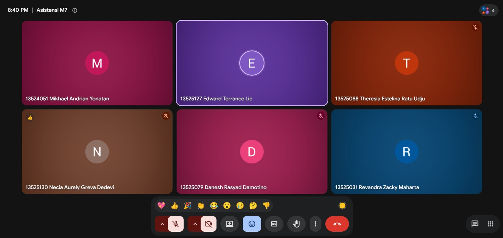

# Form Asistensi

## Tugas Besar IF2150 - Rekayasa Perangkat Lunak

| Informasi | Keterangan |
| --- | --- |
| **Hari** | Minggu |
| **Tanggal** | 18/10/2026 |
| **Kelas** | K01 |
| **Nomor Kelompok** | G03  |
| **Nama Kelompok** | MAYOOOOOR  |
| **Nama Perangkat Lunak** | CariJasa  |
| **Dokumen** | K01_G03_DPPL.md  |

### Anggota Kelompok

| NIM | Nama |
|---|---|
| 13525031 | Revandra Zacky Maharta |
| 13525079 | Danesh Rasyad Damotino |
| 13525088 | Theresia Estelina Ratu Udju |
| 13525127 | Edward Terrance Lie |
| 13525130 | Necia Aurely Greva Dedevi |

### Catatan

| Catatan |
| --- |
| 1. Private dan public sebenarnya ga terlalu relevan di web. Itu cuma ngejelasin atribut atau method tersebut bisa diakes dimana aja. |
| 2. Untuk skenario alternatif boleh pake alt aja di sequence diagram, tapi kalau kepanjangan dipisah aja diagramnya.|
| 3. Atribut dan method yang dimasukin ke class diagram cuma yang dipake pada use case terkait. |
| 4. neg pada sequence diagram itu merupakan alternatif dari nulis alt. |
| 5. create pada sequence diagram itu membuat entity baru. |
| 6. Method yang ada pada entity class itu sebenarnya bukan method asli, tapi cuma menggambarkan kalau entity tersebut bisa diapain aja. Method aslinya sebenarnya dipegang controllernya. |

## Dokumentasi

<!--  -->

  

  <i>Gambar 1. Dokumentasi kegiatan asistensi.</i>

