<h1>
IF2150 REKAYASA PERANGKAT LUNAK
<br>
TUGAS 5
<br>
DESKRIPSI PERANCANGAN PERANGKAT LUNAK (DPPL)
</h1>
<br>

## CariJasa
<p align="left">

</p>

### Untuk: Mikhael Andrian Yonatan

Dipersiapkan oleh:
| Informasi | Keterangan |
| :--- | :--- |
| Kelas | K-01 |
| Kelompok | G-03  |

| NIM | Nama |
|---|---|
| 13525031 | Revandra Zacky Maharta |
| 13525079 | Danesh Rasyad Damotino |
| 13525088 | Theresia Estelina Ratu Udju |
| 13525127 | Edward Terrance Lie |
| 13525130 | Necia Aurely Greva Dedevi |
---

## Daftar Perubahan

| Revisi | Deskripsi |
| :--- | :--- |
| Logo CariJasa | Mengganti Logo CariJasa |
| Tambah Parameter Method di C17 | Tambah Parameter Keyword String C17   |
| Menambah Parameter kebanyakan method di setiap class | -  |
| ... |  |

---

<br>

> **Petunjuk pengerjaan:** *[Silahkan hapus bagian ini setelah selesai mengerjakan]*
>
> Dokumen ini melanjutkan **Deskripsi Perancangan Perangkat Lunak**. Gunakan nama, ID, kebutuhan, dan use case yang konsisten dengan kedua dokumen tersebut. Contoh pola ID baru di bawah dapat disesuaikan dengan kesepakatan kelompok, ID yang sudah ada tetap dipertahankan.

<br>

---


# BAB 1: Pendahuluan

## 1.1 Tujuan Penulisan Dokumen
Dokumen Desain Perangkat Lunak (DPPL) ini disusun untuk merinci rancangan arsitektur, realisasi *use case*, serta pemodelan struktur kelas secara berorientasi objek untuk platform pencarian jasa digital **CariJasa**. Dokumen ini digunakan oleh tim pengembang sebagai pedoman utama untuk menyamakan pemahaman mengenai struktur teknis dan alur implementasi program.

## 1.2 Lingkup Masalah
CariJasa adalah platform *marketplace* jasa berbasis web yang dirancang untuk memudahkan pencarian dan penawaran jasa digital bagi masyarakat Indonesia. Aplikasi ini dibuat untuk mengatasi masalah informasi jasa yang saat ini masih tersebar di berbagai media sosial dan kanal lain, sehingga pengguna kesulitan mencari serta membandingkan tarif, keahlian, dan ulasan penyedia jasa secara mudah. Selain itu, platform ini hadir untuk membantu *freelancer* maupun penyedia jasa lokal memperoleh penghasilan tambahan tanpa harus terikat hubungan kerja tetap. Ruang lingkup aplikasi berfokus pada penyediaan daftar pilihan jasa, fitur pembanding jasa (*compare*), ruang kirim pesan langsung (*chat*), pembayaran digital yang aman, pengiriman hasil kerja dan pengajuan revisi, hingga pelaporan kendala serta bantuan penyelesaian masalah oleh admin.


## 1.3 Definisi, Istilah, dan Singkatan
Tabel 1.3. Definisi Istilah dan Singkatan

| Singkatan, Akronim, atau Istilah | Penjelasan |
| :--- | :--- |
| *P/L* | *Singkatan dari Perangkat Lunak, yaitu aplikasi yang memberikan perintah kepada komputer untuk menjalankan tugas tertentu.* |
| *SKPL* | *Singkatan dari Spesifikasi Kebutuhan Perangkat Lunak, yaitu dokumen yang merangkum kriteria-kriteria yang diperlukan untuk membangun aplikasi menjalankan tugasnya.* |
| *KF* | *Singkatan dari Kebutuhan Fungsional.* |
| *KNF* | *Singkatan dari Kebutuhan Non-Fungsional.* |
| *UC* | *Singkatan dari Use Case.* |
| *BCE* | *Singkatan dari Boundary-Controller-Entity*. pola arsitektur yang memisahkan sistem ke dalam tiga peran yaitu antarmuka (*Boundary*), pengendali logika (*Controller*), dan data (*Entity*). |
| *UML* | *Unified Modeling Language*, bahasa visual standar untuk mendokumentasikan artefak sistem perangkat lunak. |
| *Listing Jasa* | Produk jasa digital yang telah dipublikasikan oleh Penyedia Jasa dan tersedia untuk dipesan oleh Pengguna Jasa.|
| *Deliverables* | Berkas, dokumen, atau tautan hasil pekerjaan akhir yang diserahkan oleh Penyedia Jasa kepada Pengguna Jasa untuk dievaluasi. |
| *Bookmark* | Fitur untuk menandai dan menyimpan penawaran jasa ke dalam daftar tersimpan pengguna agar mudah diakses kembali. |
| *Ticketing* | Sistem pencatatan, pelacakan, dan penanganan tiket keluhan serta laporan sengketa transaksi pengguna oleh Admin. |

## 1.4 Aturan Penomoran

Tabel 1.4. Aturan Penomoran

| Hal/Bagian | Penomoran | Keterangan |
| :--- | :--- | :--- |
| *Kebutuhan Awal* | *RXX* | Nomor identifikasi kebutuhan mentah dari tahap elisitasi kebutuhan dengan format dua digit. |
| *Kebutuhan Fungsional* | *KFXX* | Nomor urut kebutuhan fungsional dengan format dua digit. |
| *Kebutuhan Non-Fungsional* | *KNFXX* | Nomor urut kebutuhan non-fungsional dengan format dua digit. | 
| *Use Case* | *UCXX* | Nomor urut kasus penggunaan sistem dengan format dua digit. |
| *Kelas* | *CXX* | Nomor identifikasi unik kelas analisis arsitektur BCE. |
| *Algoritma* | *Algo-XXYY* | Nomor identifikasi unik algoritma dari sebuah kelas dengan XX adalah nomor kelas dan YY adalah nomor algoritma |
| *Query* | *Q-XXYY* | Nomor identifikasi unik query dari sebuah kelas dengan XX adalah nomor kelas dan YY adalah nomor algoritma |

## 1.5 Referensi
1. **SKPL:** [Spesifikasi Kebutuhan Perangkat Lunak](../M5/K01_G03_SKPL.md)
2. **APL:** [Arsitektur Perangkat Lunak](../M6/K01_G03_APL.md)
3. Badan Pusat Statistik. (2026). *Keadaan angkatan kerja di Indonesia Februari 2026* (Vol. 48, No. 1). Badan Pusat Statistik.
4. Craigslist. (2026). *Craigslist*. https://www.craigslist.org/
5. Fiverr International Ltd. (2026). *Fiverr*. https://www.fiverr.com/
6. Kementerian Perencanaan Pembangunan Nasional/Badan Perencanaan Pembangunan Nasional. (2025). *Indonesia VNR 2025: Voluntary National Review – Fostering inclusive growth: Advancing sustainable and resilient Indonesia*. Kementerian PPN/Bappenas.
7. United Nations Department of Economic and Social Affairs. (2026). *The Sustainable Development Goals report 2026*. United Nations. https://unstats.un.org/sdgs/report/2026/
8. Program Studi Teknik Informatika ITB. (2026). *Materi perkuliahan IF2150 Rekayasa Perangkat Lunak*. Edunex ITB. https://edunex.itb.ac.id/

## 1.6 Deskripsi Umum Dokumen (Ikhtisar)
Dokumen Desain Perangkat Lunak (DPPL) ini disusun dalam lima bab pembahasan. Bab 1 memaparkan fondasi penyusunan dokumen, meliputi tujuan penulisan, lingkup sistem CariJasa, definisi istilah teknis, konvensi penomoran, daftar referensi dokumen terkait, serta sistematika penulisan. Selanjutnya, Bab 2 menguraikan perancangan arsitektur sistem yang mencakup lingkungan implementasi, pola arsitektur acuan, identifikasi modul, serta model arsitektur perangkat lunak. Pada Bab 3, dijabarkan realisasi *use case* yang meliputi identifikasi kelas, *sequence diagram* untuk skenario normal dan alternatif, serta diagram kelas per *use case*. Pada Bab 4, disajikan diagram kelas keseluruhan beserta daftar lengkap atribut dan metode tiap kelas. Terakhir, Bab 5 menampilkan matriks kerunutan (*traceability*) untuk memetakan hubungan antara kelas dan *use case* terkait.

<br>

---

# BAB 2: Perancangan Arsitektur

## 2.1 Rancangan Lingkungan Implementasi

Tabel 2.1 Rancangan Lingkungan Implementasi Perangkat Lunak

| Komponen | Spesifikasi |
| :--- | :--- |
| Server | Lokal |
| Client | Web Browser Modern Berbasis Chromium |
| DBMS | PostGresSQL |
| OS | Cross-platform (Windows/Linux/MacOS/Android/IOS) melalui perangkat lunak browser modern |
| Development Tools | Visual Studio Code, Git, Github |
| Bahasa Pemrograman | Next.js |
| Filing System | NTFS |

## 2.2 Style/Pattern Arsitektur Acuan

### 2.2.1 Layered Architecture 
Layered Architecture adalah arsitektur yang membagi perangkat lunak menjadi beberapa *layer* (sub-bagian) berdasarkan masing-masing tanggung jawabnya. Setiap *layer* akan menyediakan *service* (layanan) bagi *layer* di atasnya dan menggunakan service dari layer di bawahnya melalui *interface* yang ditetapkan. Namun, layer dibawahnya tidak dapat menggunakan services dari layer di atasnya. Arsitektur ini dgunakan saat UI, business rule, dan akses penyimpanan membutuhkan batas (*boundary*) yang jelas untuk pengembangan implementasi di masa depan (*Scalability*)

Pada *Layered Architecture*
#### 1. Presentation Layer 

*Layer* yang meng-handle tampilan user interface dan interaksi (input dan tampilan informasi) ke pada user. 
Contohnya : 
- Halawan Web.
- Tampilan Mobile App.
- Desktop GUI 

#### 2. Business Layer
*Layer* yang memproses algoritma dan logika utama aplikasi, seperti logika bisnis, workflow, dan pemrosesan request dari user. Umumnya berada pada komponen controller
Contohnya : 
- Logika Validasi 
- Kalkulasi
- Algoritma Pemrosesan Query Pengguna

#### 3. Data Access Layer / Persistence Layer
*Layer* yang menerima data, menyimpan, dan mengatur data yang akan diletakkan di dalam database. Layer ini juga memastikan pemisahan terhadap hal-hal penting dalam data.
Contoh : 
- Query Database
- Caching
- API

#### 4. Database Layer
*Layer* penyimpanan data sesungguhnya tempat informasi disimpan. Biasanya berisikan data untuk masing-masing entitas yang dibuat.

Contoh : 
- Database Relasional (SQL, PostgreSQL)
- NoSQL (MongoDB)

#### Alasan Pemilihan Pattern
Perangkat Lunak CariJasa memiliki karakteristik berupa satu aplikasi web yang memiliki beberapa fitur terpisah yang digunakan untuk menjalankan layanan dengan baik. Perangkat lunak ini memerlukan beberapa karakteristik utama, seperti  Reliability, Security, dan Maintanaibility. Reliability diperlukan agar proses pencarian dapat dieksekusi dengan cepat dan tepat. Selain itu, perangkat lunak juga harus memastikan setiap respons dari server serta transaksi berjalan dengan baik. Kemudian, Security juga diperlukan karena setiap transaksi yang dilakukan berkaitan dengan ekonomi (uang) yang dipercayakan Pengguna Jasa maupun Penyedia Jasa, beserta keamanan kredensialnya. Terakhir, perangkat lunak juga harus dapat dikelola untuk memastikan keberjalana setiap fitur dengan baik. Oleh karena itu, diperlukan berbagai unit testing yang perlu dilakukan untuk setiap fitur yang ada. 

Perangkat Lunak CariJasa juga memiliki alur proses bisnis. Alur dimulai dengan registrasi pengguna, baik Pengguna Jasa, maupun Penyedia Jasa. Lalu Pengguna akan diminta untuk mengisi data diri dan portofolio (untuk Penyedia Jasa). Kemudian Pengguna Jasa dapat langsung mencari jasa yang mereka inginkan melalui search bar yang disediakan, juga menyimpan jasa yang menarik menggunakan *bookmark*. Penyedia Jasa dapat membuat postingan terkait jasa yang mereka tawarkan agar dapat digapai oleh pengguna. Kemudian, Pengguna Jasa dapat berkomunikasi melalui chat instan untuk bertanya sekaligus bernegosiasi kepada Penyedia Jasa. Setelah kedua pihak sepakat, Pengguna Jasa dapat melakukan transaksi serta pemesanan yang kemudian akan diproses dan dikerjakan oleh Penyedia Jasa. Setelah produk akhir dikirim, pengguna jasa dapat mengajukan revisi ataupun mengonfirmasi hasil pekerjaan yang dibuat. Setelah selesai, maka pengguna jasa dapat memberikan ulasan maupun laporan kepada admin lewat fitur ticketing. 

Dengan segala kebutuhan dan alur bisnis tersebut, *layered architecture* dipilih dengan alasan 

#### 1. Pemisahan Tanggung Jawab : 
Arsitektur ini membagi  sistem ke dalam lapisan yang jelas, seperti presentation layer, business layer, data access layer, dan database layer. Komponen ini, akan memastikan logika bisnis setiap fitur saling independen dan tidak tercampur aduk

#### 2. Kemudahan Pengujian :
Dengan perangkat lunak dibagi menjadi berbagai layer, developer dapat lebih mudah untuk melakukan tracing dan unit testing untuk setiap fitur yang dibuat. Hal ini akan memudahkan developer untuk memastikan keberjalanan tiap fitur berjalan secara simultan

#### 3. Keamanan yang lebih terjamin
Karena dilakukan pemisahan akses dan interaksi dari pengguna. Kondisi ini akan memperkecil risiko rusaknya integritas data, dan keamanan dalam transaksi secara ekonomi

<p align="center">

</p>
<p align="center">
<i>Gambar 2.2.1 Diagram Layered Architecture</i>

### 2.2.2 Client-Server Achitecture
Client-Server Architecture adalah sebuah pola arsitektur perangkat lunak yang membagi sistem menjadi dua bagian utama, yaitu *client* dan *server*. Kedua belah pihak saling berkomunikasi dan bertukar data melalui sebuah protokol jaringan, misalnya HTTP. Dalam penggunaannya, *client* yang biasanya berupa antarmuka pengguna seperti *web browser* atau aplikasi *mobile*, bertugas untuk mengirimkan *request* sesuai dengan keperluannya. Sementara itu, *server* yang merupakan tempat pemrosesan dan penyimpanan data, bertugas menerima *request*, memprosesnya, lalu mengirimkan kembali *response* kepada *client*.

### Alasan Pemilihan Pattern
1. Pengguna yang bertindak sebagai pihak *client* tidak perlu menanggung beban pemrosesan sistem pada perangkat mereka, *client* cukup menggunakan antarmuka untuk mengirimkan berbagai *request*, seperti pencarian, pemesanan, ataupun pengunggahan data, lalu beban komputasi mayoritas ditanggung oleh pihak *server*.
   
3. Untuk platform yang menangani berbagai data penting seperti informasi akun, transaksi, dan berkas, Client-Server Achitecture menempatkan *server* sebagai pusat penyimpanan dan logika utama. Hal tersebut memastikan setiap *request* yang dikirim oleh *client* dikelola dengan standar keamanan dan aturan yang sama sehingga integritas dan standar data tetap terjaga.
   
5. Dapat menghubungkan banyak pengguna yang tersebar di berbagai lokasi yang berbeda. Dengan memanfaatkan protokol jaringan seperti HTTP, sistem memungkinkan terjadinya komunikasi dan sinkronisasi data antarpengguna melalui perantara *server* sehingga interaksi seperti pertukaran pesan dan pengiriman notifikasi dapat berjalan dengan lancar.

<p align="center">
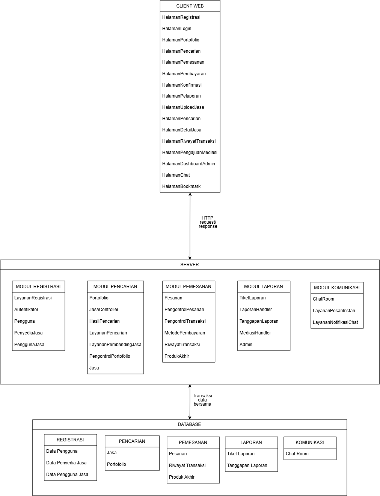
</p>
<p align="center">
<i>Gambar 2.2.2 Diagram Client-Server Architecture</i>

## 2.3 Identifikasi Komponen / Modul / Subsistem

Tabel 2.3. Identifikasi Komponen/Modul/Subsistem

| Nama Komponen/Modul/Subsistem | Kelas yang Dicakup (SKPL) | Jenis | Penjelasan |
| :--- | :--- | :--- | :--- |
| Subsistem Client Web | C04 (HalamanRegistrasi), C06 (HalamanLogin), C08 (HalamanPortofolio), C13 (HalamanUploadJasa), C15 (HalamanPencarian), C16 (HasilPencarian), C19 (HalamanDetailJasa), C21 (HalamanBookmark), C24 (HalamanChat), C28 (HalamanPemesanan), C29 (HalamanPembayaran), C30 (HalamanRiwayatTransaksi), C35 (HalamanKonfirmasi), C37 (HalamanPengumpulan), C38 (HalamanDeliverables), C40 (HalamanRequestRevisi), C44 (HalamanPelaporan), C47 (HalamanUlasan), C50 (HalamanPengajuanMediasi), C53 (HalamanDashboardAdmin) | CLIENT (PRESENTATION LAYER) | Menjalankan seluruh halaman tampilan web dan menerima input aksi pengguna di peramban. |
| Komponen UI Autentikasi dan Akun | C04 (HalamanRegistrasi), C06 (HalamanLogin) | CLIENT (PRESENTATION LAYER) | Menampilkan formulir pendaftaran dan autentikasi masuk akun pengguna. |
| Komponen UI Portofolio dan Penawaran Jasa | C08 (HalamanPortofolio), C13 (HalamanUploadJasa) | CLIENT (PRESENTATION LAYER) | Menampilkan formulir pembuatan jasa baru dan unggah portofolio pekerja. |
| Komponen UI Pencarian, Filter dan Komparasi | C15 (HalamanPencarian), C16 (HasilPencarian), C19 (HalamanDetailJasa), C21 (HalamanBookmark) | CLIENT (PRESENTATION LAYER) | Menampilkan pencarian, saringan hasil, detail, simpanan, dan pembanding jasa. |
| Komponen UI Komunikasi Langsung | C24 (HalamanChat) | CLIENT (PRESENTATION LAYER) | Menampilkan ruang percakapan obrolan langsung antar-pengguna. |
| Komponen UI Pemesanan dan Pembayaran | C28 (HalamanPemesanan), C29 (HalamanPembayaran), C30 (HalamanRiwayatTransaksi), C35 (HalamanKonfirmasi) | CLIENT (PRESENTATION LAYER) | Menampilkan formulir pemesanan, halaman pembayaran, riwayat transaksi, dan persetujuan pesanan. |
| Komponen UI Penyerahan Hasil dan Revisi | C37 (HalamanPengumpulan), C38 (HalamanDeliverables), C40 (HalamanRequestRevisi) | CLIENT (PRESENTATION LAYER) | Menampilkan pengiriman berkas hasil kerja dan formulir permintaan perbaikan pesanan. |
| Komponen UI Evaluasi dan Ulasan Layanan | C47 (HalamanUlasan) | CLIENT (PRESENTATION LAYER) | Menampilkan formulir pemberian nilai bintang serta ulasan pekerjaan. |
| Komponen UI Pengaduan, Mediasi dan Admin | C44 (HalamanPelaporan), C50 (HalamanPengajuanMediasi), C53 (HalamanDashboardAdmin) | CLIENT (PRESENTATION LAYER) | Menampilkan formulir laporan aduan, ruang mediasi sengketa, dan dasbor kerja admin. |
| Subsistem Server Aplikasi | C01 (Pengguna), C02 (PenyediaJasa), C03 (PenggunaJasa), C05 (LayananRegistrasi), C07 (Autentikator), C09 (Portofolio), C10 (PengontrolPortofolio), C11 (LayananUploadFile), C12 (Jasa), C14 (JasaController), C17 (LayananPencarian), C18 (LayananPembandingJasa), C20 (Bookmark), C22 (PengontrolBookmark), C23 (ChatRoom), C25 (LayananPesanInstan), C26 (LayananNotifikasiChat), C27 (Pesanan), C31 (PengontrolPesanan), C32 (PengontrolTransaksi), C33 (MetodePembayaran), C34 (RiwayatTransaksi), C36 (ProdukAkhir), C39 (PengajuanRevisi), C41 (RevisiHandler), C42 (PencairanDana), C43 (TiketLaporan), C45 (LaporanHandler), C46 (Ulasan), C48 (UlasanHandler), C49 (TanggapanLaporan), C51 (MediasiHandler), C52 (Admin) | SERVER (APPLICATION / BUSINESS TIER) | Mengolah logika sistem, aturan bisnis, alur transaksi, dan kendali data di server. |
| Modul Registrasi dan Akun | C01 (Pengguna), C02 (PenyediaJasa), C03 (PenggunaJasa), C05 (LayananRegistrasi), C07 (Autentikator), C52 (Admin) | SERVER (BUSINESS LAYER) | Mengurus pendaftaran akun, cek login kata sandi, dan pembagian hak akses pengguna. |
| Modul Pencarian dan Jasa | C09 (Portofolio), C10 (PengontrolPortofolio), C12 (Jasa), C14 (JasaController), C17 (LayananPencarian), C18 (LayananPembandingJasa), C20 (Bookmark), C22 (PengontrolBookmark) | SERVER (BUSINESS LAYER) | Mengurus penayangan jasa, pencarian kata kunci, perbandingan paket, dan simpanan jasa. |
| Modul Pemesanan dan Transaksi | C27 (Pesanan), C31 (PengontrolPesanan), C32 (PengontrolTransaksi), C33 (MetodePembayaran), C34 (RiwayatTransaksi), C36 (ProdukAkhir), C39 (PengajuanRevisi), C41 (RevisiHandler), C42 (PencairanDana) | SERVER (BUSINESS LAYER) | Mengatur siklus pesanan, keamanan titip uang, alur perbaikan tugas, dan pelepasan dana. |
| Modul Komunikasi | C23 (ChatRoom), C25 (LayananPesanInstan), C26 (LayananNotifikasiChat) | SERVER (BUSINESS LAYER) | Mengatur pengiriman pesan teks langsung dan penyampaian tanda notifikasi obrolan. |
| Modul Laporan dan Mediasi | C43 (TiketLaporan), C45 (LaporanHandler), C46 (Ulasan), C48 (UlasanHandler), C49 (TanggapanLaporan), C51 (MediasiHandler) | SERVER (BUSINESS LAYER) | Mengatur tiket aduan kendala, ruang obrolan penengah, ulasan penilaian, dan sanksi akun. |
| Modul Akses Berkas dan Media | C11 (LayananUploadFile) | SERVER (DATA ACCESS LAYER) | Mengatur validasi ukuran serta proses unggah dan unduh berkas media penyimpanan. |
| Komponen Penghubung Basis Data | Akses Basis Data (PostgreSQL) | SERVER (DATA ACCESS LAYER) | Menyediakan koneksi dan eksekusi perintah data antara logika server dan basis data. |
| Subsistem Database Terpusat | C01, C02, C03, C09, C12, C20, C23, C27, C33, C34, C36, C39, C42, C43, C46, C49 | DATABASE (DATA PERSISTENCE LAYER) | Menyimpan seluruh catatan data sistem secara permanen dalam satu basis data terpusat. |
| Data Pengguna, Data Penyedia Jasa, Data Pengguna Jasa | C01 (Pengguna), C02 (PenyediaJasa), C03 (PenggunaJasa) | DATABASE (DATA PERSISTENCE LAYER) | Menyimpan data profil akun pengguna, akun pekerja, akun pembeli, dan status akun. |
| Data Jasa dan Portofolio | C09 (Portofolio), C12 (Jasa), C20 (Bookmark) | DATABASE (DATA PERSISTENCE LAYER) | Menyimpan data daftar jasa penawaran, karya portofolio, dan daftar jasa yang disimpan. |
| Data Pesanan, Riwayat Transaksi, Produk Akhir | C27 (Pesanan), C33 (MetodePembayaran), C34 (RiwayatTransaksi), C36 (ProdukAkhir), C39 (PengajuanRevisi), C42 (PencairanDana) | DATABASE (DATA PERSISTENCE LAYER) | Menyimpan data pesanan kerja, pembayaran, riwayat transaksi, berkas hasil, dan perbaikan. |
| Data Komunikasi (Chat Room) | C23 (ChatRoom) | DATABASE (DATA PERSISTENCE LAYER) | Menyimpan data ruang percakapan dan seluruh rekaman riwayat pesan teks obrolan. |
| Data Laporan dan Tanggapan Laporan | C43 (TiketLaporan), C49 (TanggapanLaporan) | DATABASE (DATA PERSISTENCE LAYER) | Menyimpan data tiket laporan masalah pengguna, bukti aduan, dan keputusan tindakan admin. |
| Data Ulasan | C46 (Ulasan) | DATABASE (DATA PERSISTENCE LAYER) | Menyimpan data skor bintang penilaian pembeli, komentar evaluasi, dan bukti hasil kerja. |


## 2.4 Model Arsitektur Perangkat Lunak

### 2.4.1 Logical View

Logical View dapat menunjukkan bagian-bagian utama dalam sistem beserta fungsi dan hubungan antarkomponennya. View ini sesuai untuk aplikasi yang dikembangkan karena dapat memperlihatkan pembagian tanggung jawab setiap komponen sehingga alur kerja sistem dapat terlihat dengan lebih jelas.

<p align="center">
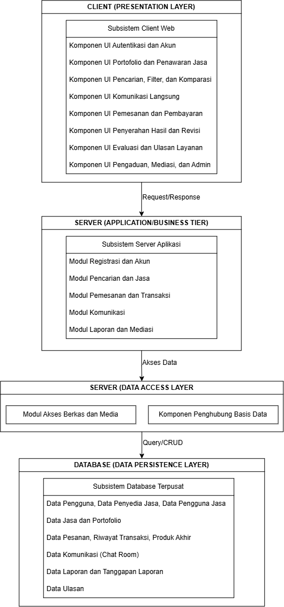
</p>
<p align="center">
<i>Gambar 2.4.1 Diagram Logical View</i>
</p>

---

### 2.4.2 Development View (Package Diagram)
Development view akan mendeskripsikan organisasi statis kode dalam package modul, subsistem, dan dependensi di dalam penerapannya. 


Package diagram adalah diagram yang menampilkan perencanaan dan pengorganisasikan elemen, modul, *package* dalam sebuah proyek perangkat lunak. Package diagram akan menampilkan structure dan dependensi antar subsistem maupun modul serta menampilkan perbedaan sudut pandang dari sistem.

<p align="center">

</p>
<p align="center">
<i>Gambar 2.4.2 Diagram Development View</i>
</p>

<br>

---


# BAB 3: Realisasi Use Case

## 3.1 Use Case Melakukan Registrasi Akun

**ID Use Case:** *UC01*  
**Nama Use Case:** *Melakukan Registrasi Akun*

### 3.1.1 Identifikasi Kelas

Tabel 3.1. Identifikasi Kelas Use Case [UC01]

| No | Nama Kelas Perancangan | Nama Kelas Analisis Terkait |
|:--- | :--- | :--- |
| 1 | Pengguna | Pengguna |
| 2 | PenyediaJasa | PenyediaJasa |
| 3 | PenggunaJasa | PenggunaJasa |
| 4 | HalamanRegistrasi | HalamanRegistrasi |
| 5 | LayananRegistrasi | LayananRegistrasi |

### 3.1.2 Sequence Diagram

- **Skenario Normal**

<p align="center">
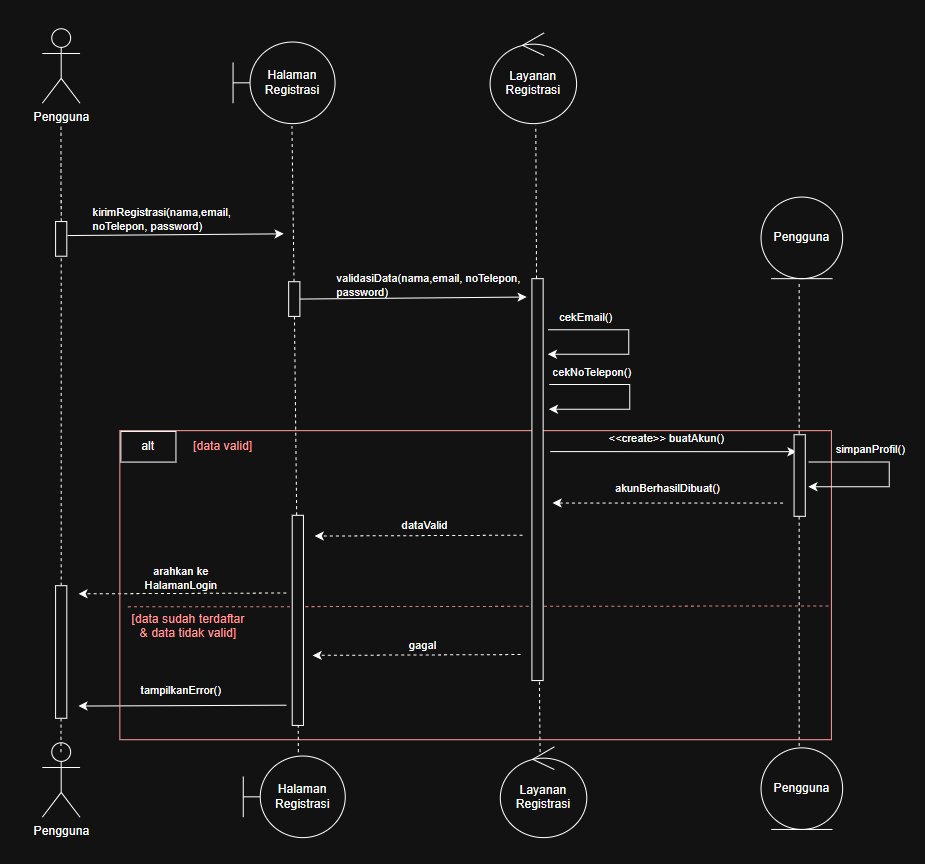
</p>
<p align="center">
<i>Gambar 3.1.2 Sequence Diagram [UC01]</i>
</p>


### 3.1.3 Diagram Kelas

<p align="center">
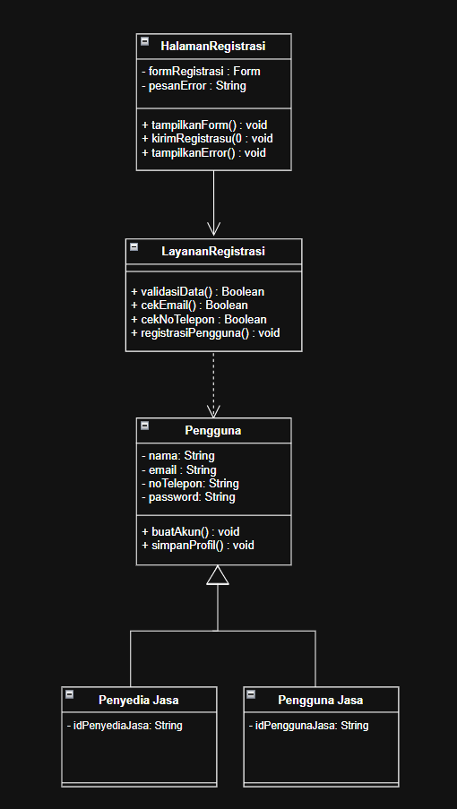
</p>
<p align="center">
<i>Gambar 3.1.3. Diagram Kelas Melakukan Registrasi Akun</i>
</p>

---

## 3.2 Use Case Melakukan Login

**ID Use Case:** *UC02*  
**Nama Use Case:** *Melakukan Login*

### 3.2.1 Identifikasi Kelas

Tabel 3.2.1 Identifikasi Kelas Use Case [UC01]

| No | Nama Kelas Perancangan | Nama Kelas Analisis Terkait |
|:--- | :--- | :--- |
| 1 | Pengguna | Pengguna |
| 2 | PenyediaJasa | PenyediaJasa |
| 3 | PenggunaJasa | PenggunaJasa |
| 4 | HalamanLogin | HalamanLogin |
| 5 | Autentikator | Autentikator |

### 3.2.2 Sequence Diagram
- **Skenario Normal**

<p align="center">
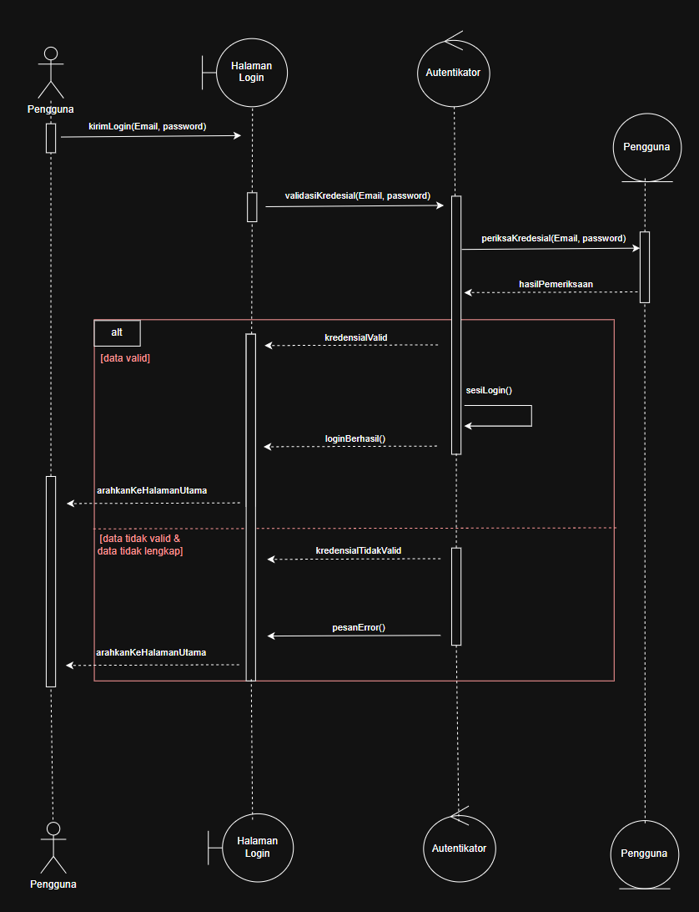
</p>
<p align="center">
<i>Gambar 3.2.2 Sequence Diagram [UC02]</i>
</p>


### 3.2.3 Diagram Kelas

<p align="center">
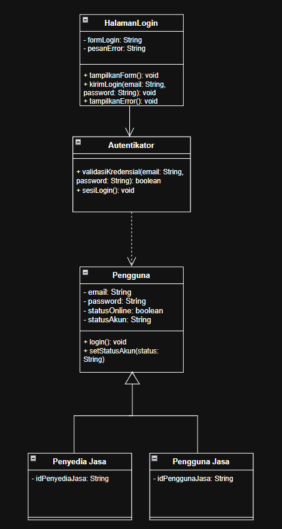
</p>
<p align="center">
<i>Gambar 3.2.3. Diagram Kelas Melakukan Login</i>
</p>

---

## 3.3 Use Case Mengisi Portofolio

**ID Use Case:** *UC03*  
**Nama Use Case:** *Mengisi Portofolio*

### 3.3.1 Identifikasi Kelas

Tabel 3.3.1 Identifikasi Kelas Use Case [UC01]

| No | Nama Kelas Perancangan | Nama Kelas Analisis Terkait |
|:--- | :--- | :--- |
| 1 | PenyediaJasa | PenyediaJasa |
| 2 | Portofolio | Portofolio |
| 3 | HalamanPortofolio | HalamanPortofolio |
| 4 | PengontrolPortofolio | PengontrolPortofolio |
| 5 | LayananUploadFile | LayananUploadFile |


### 3.3.2 Sequence Diagram

- **Skenario Normal**

<p align="center">
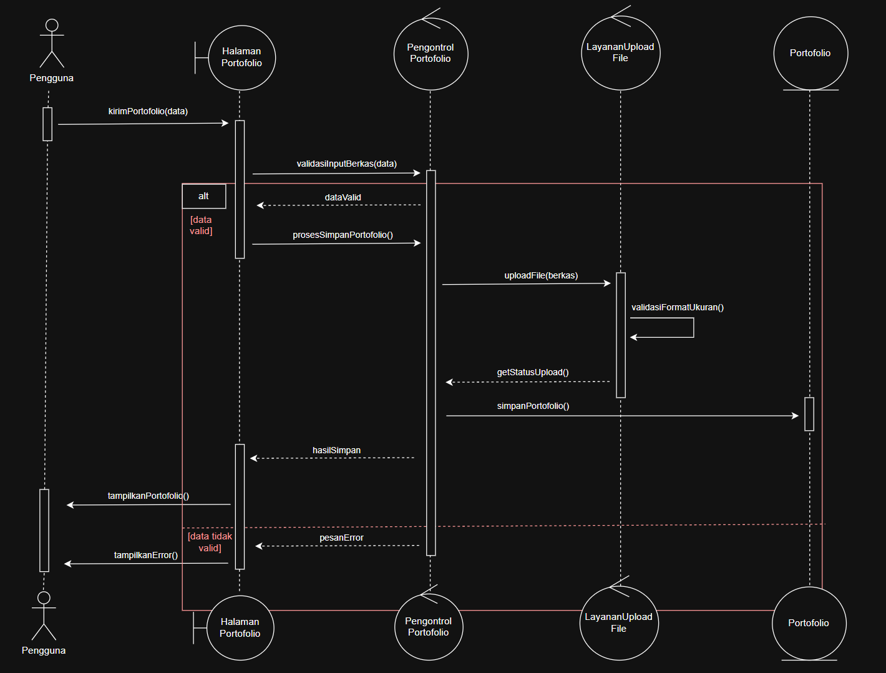
</p>
<p align="center">
<i>Gambar 3.3.2 Sequence Diagram [UC03]</i>
</p>


### 3.3.3 Diagram Kelas

<p align="center">
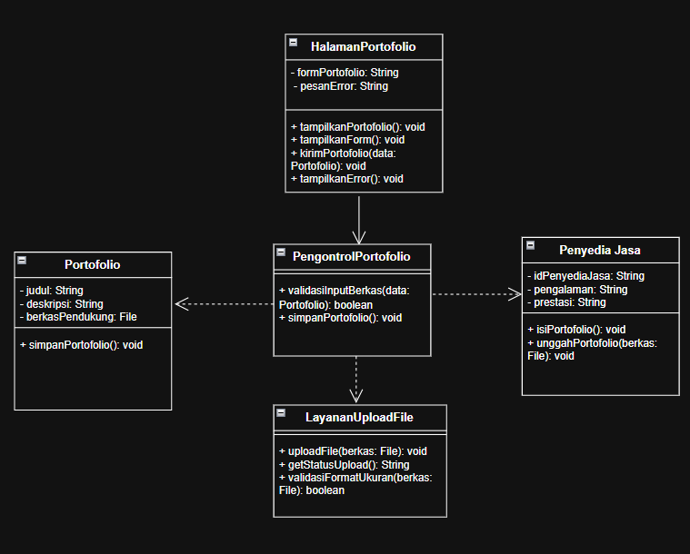
</p>
<p align="center">
<i>Gambar 3.3.3. Diagram Kelas Mengisi Portofolio</i>
</p>

---

## 3.4 Use Case Mengunggah Penawaran Jasa

**ID Use Case:** UC04  
**Nama Use Case:** Mengunggah Penawaran Jasa

### 3.4.1 Identifikasi Kelas
Tabel 3.4 Identifikasi Kelas Use Case [UC04]

| No | Nama Kelas Perancangan | Nama Kelas Analisis Terkait |
|:--- | :--- | :--- |
| 1 | HalamanUploadJasa | HalamanUploadJasa |
| 2 | JasaController | JasaController |
| 3 | LayananUploadFile | LayananUploadFile |
| 4 | Jasa | Jasa |
| 5 | PenyediaJasa | PenyediaJasa |

### 3.4.2 Sequence Diagram

- **Skenario Normal dan Alternatif**

<p align="center">
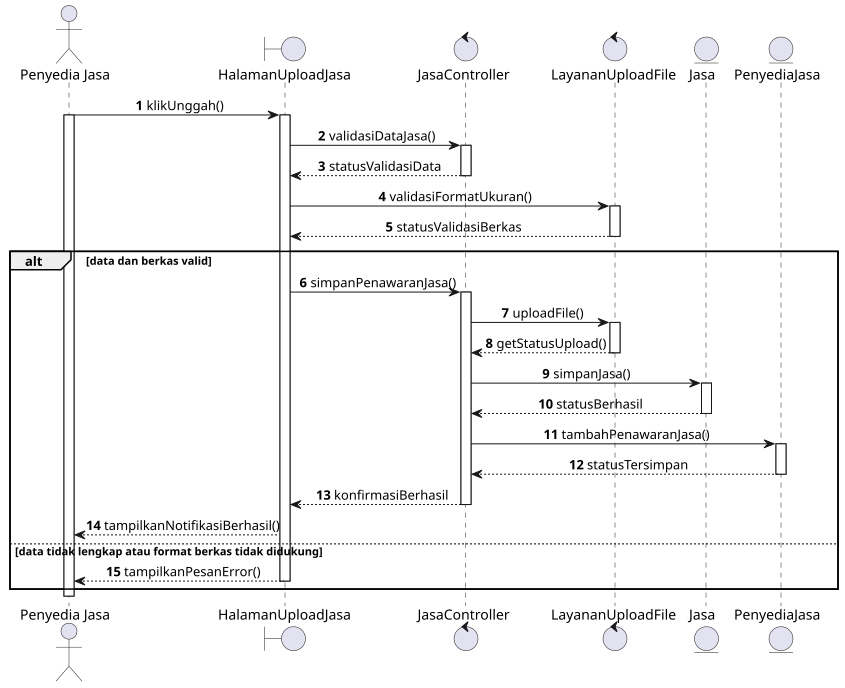
</p>
<p align="center">
<i>Gambar 3.4.1 Sequence Diagram Mengunggah Penawaran Jasa [UC04]</i>
</p>

### 3.4.3 Diagram Kelas
<p align="center">
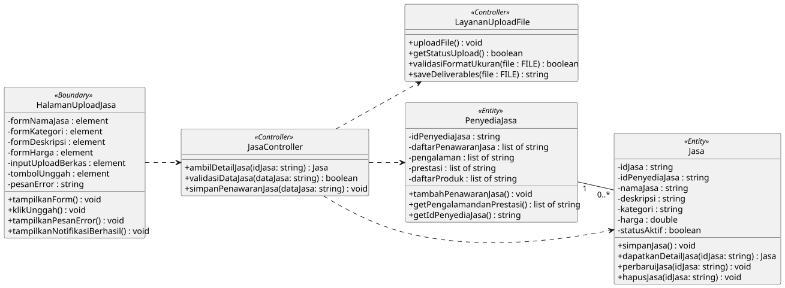
</p>
<p align="center">
<i>Gambar 3.4.2 Diagram Kelas Mengunggah Penawaran Jasa [UC04]</i>
</p>

---

## 3.5 Use Case Mencari Penawaran Jasa

**ID Use Case:** UC05  
**Nama Use Case:** Mencari Penawaran Jasa

### 3.5.1 Identifikasi Kelas
Tabel 3.5 Identifikasi Kelas Use Case [UC05]

| No | Nama Kelas Perancangan | Nama Kelas Analisis Terkait |
|:--- | :--- | :--- |
| 1 | HalamanPencarian | HalamanPencarian |
| 2 | HasilPencarian | HasilPencarian |
| 3 | LayananPencarian | LayananPencarian |
| 4 | LayananPembandingJasa | LayananPembandingJasa |
| 5 | Jasa | Jasa |
| 6 | PenggunaJasa | PenggunaJasa |

### 3.5.2 Sequence Diagram

- **Skenario Normal dan Alternatif**

<p align="center">
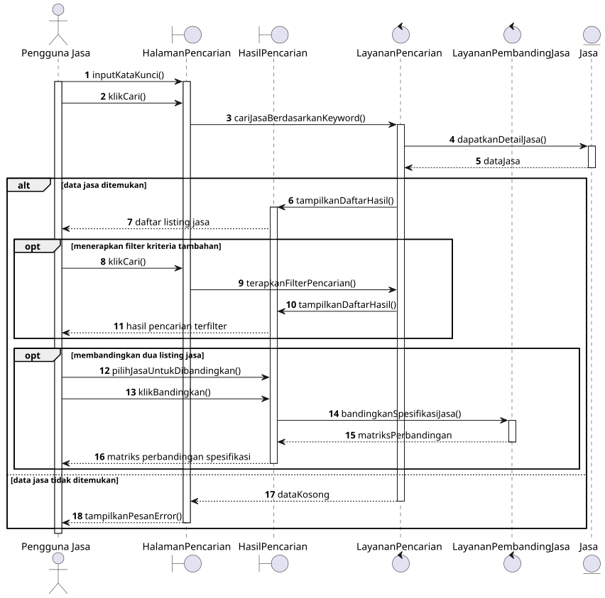
</p>
<p align="center">
<i>Gambar 3.5.1 Sequence Diagram Mencari Penawaran Jasa [UC05]</i>
</p>

### 3.5.3 Diagram Kelas

<p align="center">
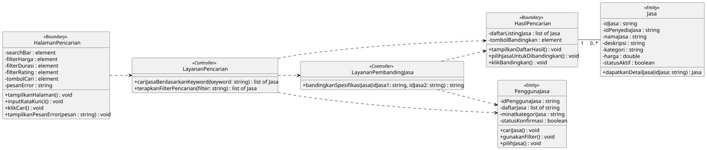
</p>
<p align="center">
<i>Gambar 3.5.2 Diagram Kelas Mencari Penawaran Jasa [UC05]</i>
</p>

---

## 3.6 Use Case Melihat Informasi Jasa

**ID Use Case:** UC06
**Nama Use Case:** Melihat Informasi Jasa

### 3.6.1 Identifikasi Kelas
Tabel 3.6 Identifikasi Kelas Use Case [UC06]

| No | Nama Kelas Perancangan | Nama Kelas Analisis Terkait |
|:--- | :--- | :--- |
| 1 | HalamanDetailJasa | HalamanDetailJasa |
| 2 | JasaController | JasaController |
| 3 | Jasa | Jasa |
| 4 | Ulasan | Ulasan |
| 5 | PenggunaJasa | PenggunaJasa |
| 6 | PenyediaJasa | PenyediaJasa |

### 3.6.2 Sequence Diagram

- **Skenario Normal dan Alternatif**

<p align="center">
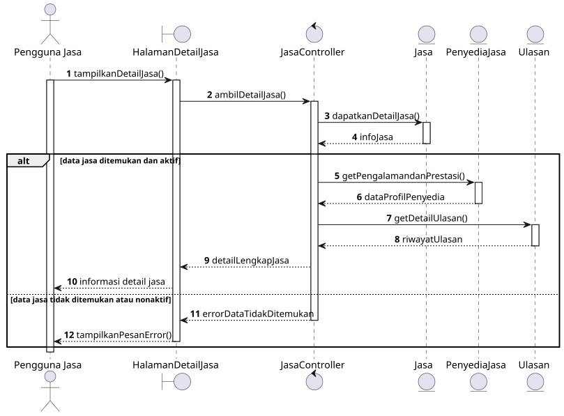
</p>
<p align="center">
<i>Gambar 3.6.1 Sequence Diagram Melihat Informasi Jasa [UC06]</i>
</p>

### 3.6.3 Diagram Kelas

<p align="center">
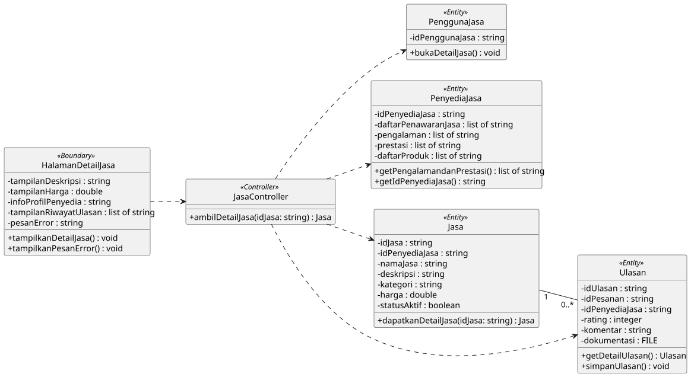
</p>
<p align="center">
<i>Gambar 3.6.2 Diagram Kelas Melihat Informasi Jasa [UC06]</i>
</p>

---

## 3.7 Use Case Menggunakan Bookmark

**ID Use Case:** UC07
**Nama Use Case:** Menggunakan Bookmark

### 3.7.1 Identifikasi Kelas
Tabel 3.7 Identifikasi Kelas Use Case [UC07]

| No | Nama Kelas Perancangan | Nama Kelas Analisis Terkait |
|:--- | :--- | :--- |
| 1 | HalamanBookmark | HalamanBookmark |
| 2 | PengontrolBookmark | PengontrolBookmark |
| 3 | Bookmark | Bookmark |
| 4 | Jasa | Jasa |
| 5 | PenggunaJasa | PenggunaJasa |

### 3.7.2 Sequence Diagram

- **Skenario Normal dan Alternatif**

<p align="center">
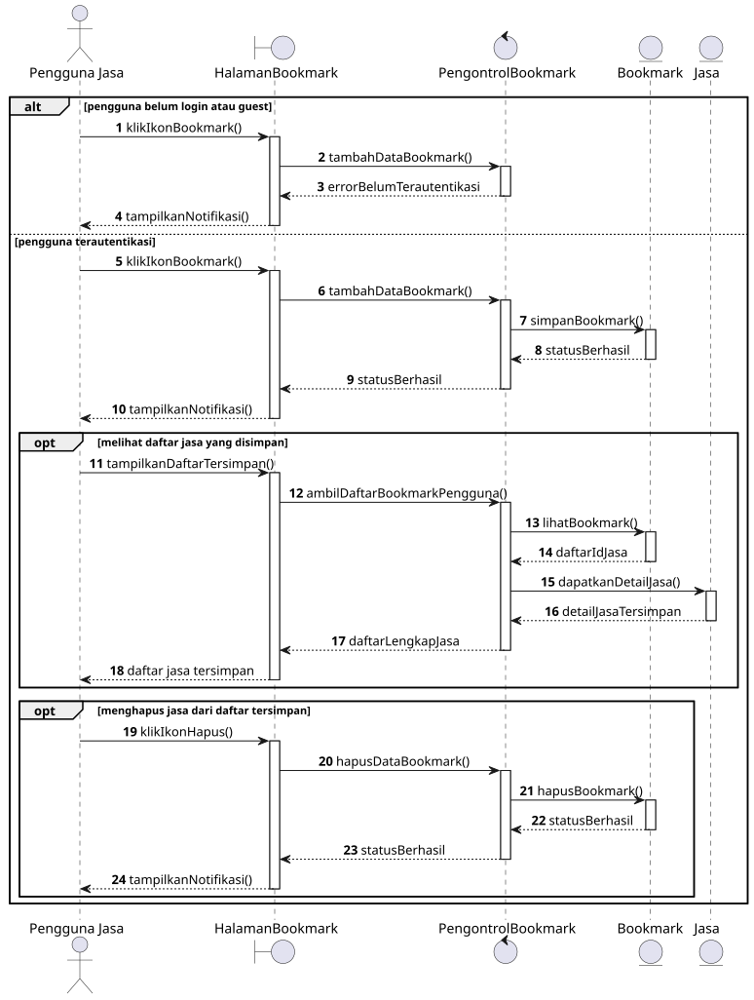
</p>
<p align="center">
<i>Gambar 3.7.1 Sequence Diagram Menggunakan Bookmark [UC07]</i>
</p>

### 3.7.3 Diagram Kelas

<p align="center">
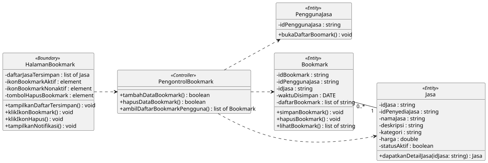
</p>
<p align="center">
<i>Gambar 3.7.2 Diagram Kelas Menggunakan Bookmark [UC07]</i>
</p>

---

## 3.8 Use Case Melakukan Komunikasi

**ID Use Case:** *UC08*  
**Nama Use Case:** *Melakukan Komunikasi*

### 3.8.1 Identifikasi Kelas
Tabel 3.8. Identifikasi Kelas Use Case [UC08]

| No | Nama Kelas Perancangan | Nama Kelas Analisis Terkait |
|:--- | :--- | :--- |
| 1 | ChatRoom | ChatRoom |
| 2 | HalamanChat | HalamanChat |
| 3 | LayananPesanInstan | LayananPesanInstan |
| 4 | LayananNotifikasiChat | LayananNotifikasiChat |

### 3.8.2 Sequence Diagram

- **Skenario Normal**

<p align="center">
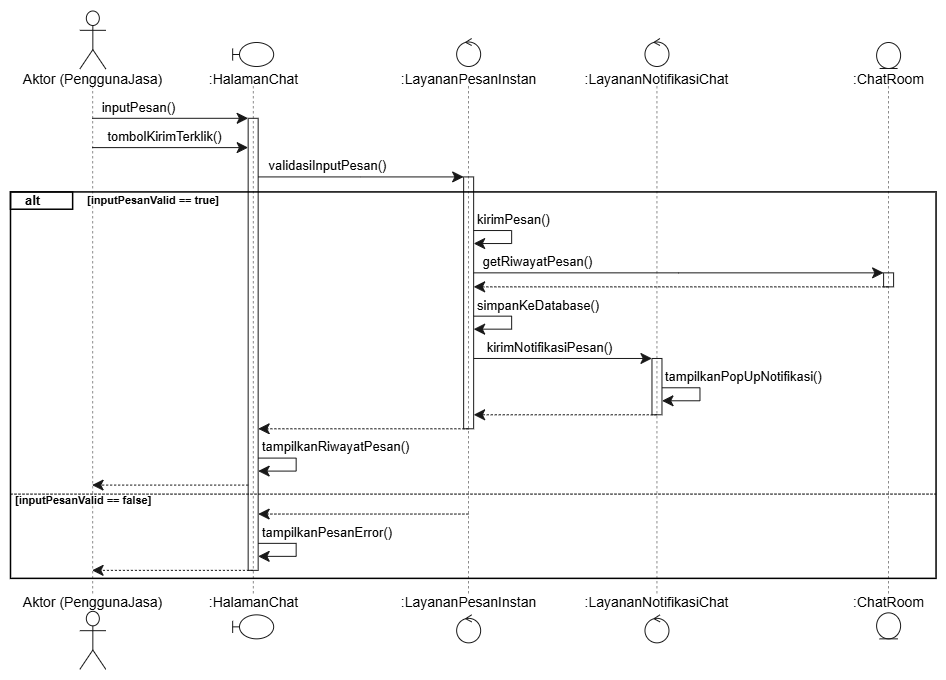
</p>
<p align="center">
<i>Gambar 3.8.2 Sequence Diagram [UC08]</i>
</p>


### 3.8.3 Diagram Kelas

<p align="center">
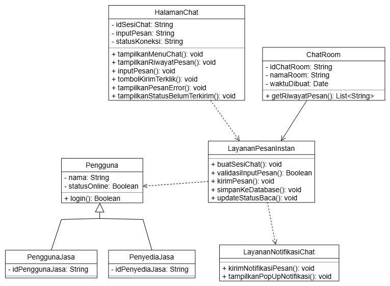
</p>
<p align="center">
<i>Gambar 3.8.3 Diagram Kelas Melakukan Komunikasi</i>
</p>

---

## 3.9 Use Case Melakukan Pemesanan Jasa

**ID Use Case:** *UC09*  
**Nama Use Case:** *Melakukan Pemesanan Jasa*

### 3.9.1 Identifikasi Kelas

Tabel 3.9. Identifikasi Kelas Use Case [UC09]

| No | Nama Kelas Perancangan | Nama Kelas Analisis Terkait |
|:--- | :--- | :--- |
| 1 | Pesanan | Pesanan |
| 2 | HalamanPemesanan | HalamanPemesanan |
| 3 | HalamanPembayaran | HalamanPembayaran |
| 4 |HalamanRiwayatTransaksi | HalamanRiwayatTransaksi |
| 5 | PengontrolPesanan | PengontrolPesanan |
| 6 | PengontrolTransaksi | PengontrolTransaksi |
| 7 | MetodePembayaran | MetodePembayaran |
| 8 | RiwayatTransaksi | RiwayatTransaksi |

### 3.9.2 Sequence Diagram

- **Skenario Normal**

<p align="center">
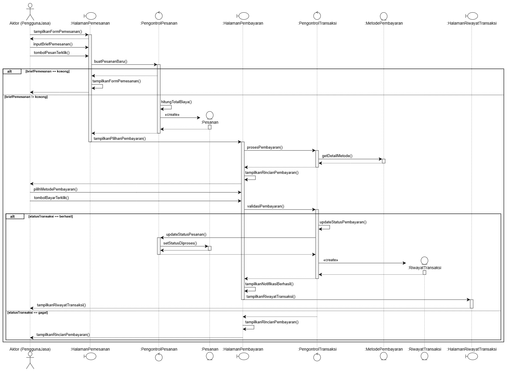
</p>
<p align="center">
<i>Gambar 3.9.2 Sequence Diagram [UC09]</i>
</p>

### 3.9.3 Diagram Kelas

<p align="center">
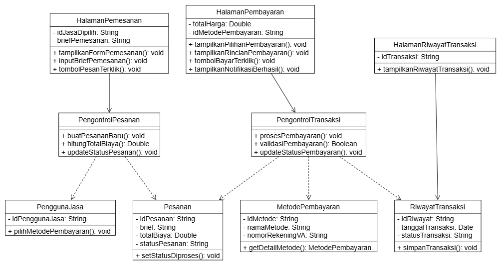
</p>
<p align="center">
<i>Gambar 3.9.3 Diagram Kelas Melakukan Pemesanan Jasa</i>
</p>

---

## 3.10 Use Case Melakukan Konfirmasi Pesanan

**ID Use Case:** *UC10*  
**Nama Use Case:** *Melakukan Konfirmasi Pesanan*

### 3.10.1 Identifikasi Kelas

Tabel 3.10. Identifikasi Kelas Use Case [UC10]

| No | Nama Kelas Perancangan | Nama Kelas Analisis Terkait |
|:--- | :--- | :--- |
| 1 | Pesanan | Pesanan |
| 2 | PengontrolPesanan | PengontrolPesanan |
| 3 | PengontrolTransaksi | PengontrolTransaksi |
| 4 | MetodePembayaran | MetodePembayaran |
| 5 | RiwayatTransaksi | RiwayatTransaksi |
| 6 | HalamanKonfirmasi | HalamanKonfirmasi |

### 3.10.2 Sequence Diagram

- **Skenario Normal**

<p align="center">
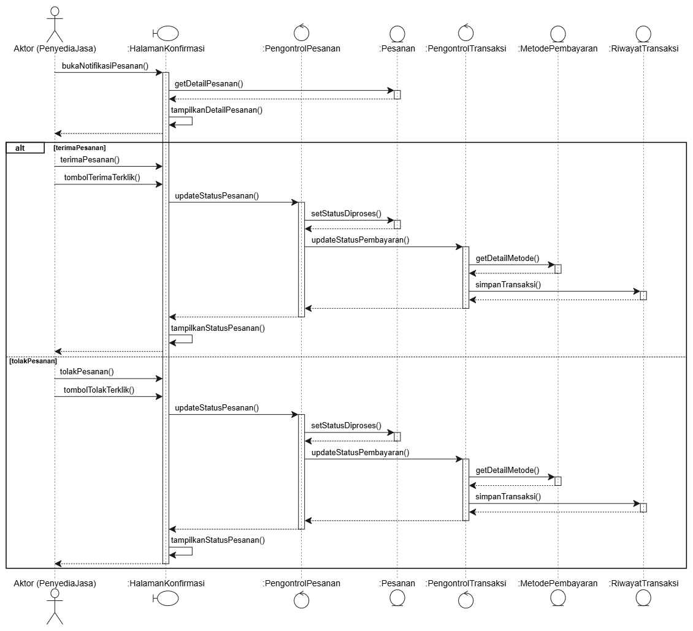
</p>
<p align="center">
<i>Gambar 3.10.2 Sequence Diagram [UC10]</i>
</p>


### 3.10.3 Diagram Kelas

<p align="center">
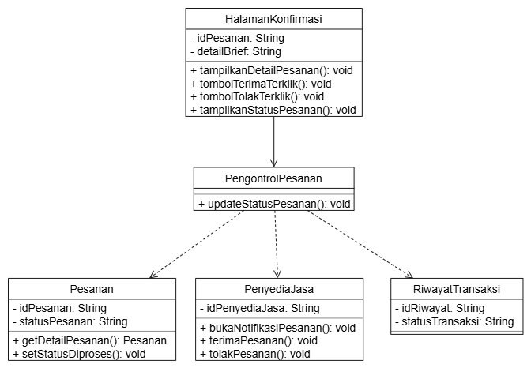
</p>
<p align="center">
<i>Gambar 3.10.3 Diagram Kelas Melakukan Konfirmasi Pesanan</i>
</p>

---

## 3.11 Use Case Menyerahkan Hasil Pekerjaan

**ID Use Case:** UC11  
**Nama Use Case:** Menyerahkan Hasil Pekerjaan

### 3.11.1 Identifikasi Kelas

Tabel 3.11. Identifikasi Kelas Use Case [UC11]

| No | Nama Kelas Perancangan | Nama Kelas Analisis Terkait |
|:--- | :--- | :--- |
| 1 | UploadFileHandler | LayananUploadFile |
| 2 | HalamanPengumpulan | HalamanPengumpulan |
| 3 | FinalProduct | ProdukAkhir |
| 4 | PenyediaJasa | PenyediaJasa|
| 5 | PengumpulanController | PengumpulanController |

### 3.11.2 Sequence Diagram

- **Skenario Keseluruhan**

<p align="center">
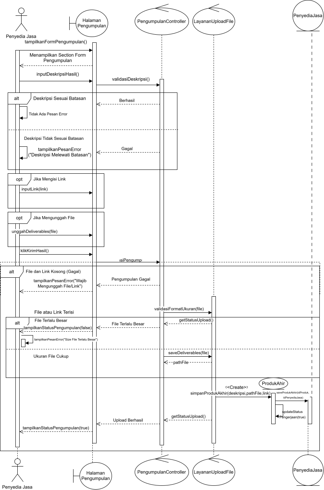
</p>
<p align="center">
<i>Gambar 3.11.1 Sequence Diagram [UC11]</i>
</p>


### 3.11.3 Diagram Kelas

<p align="center">
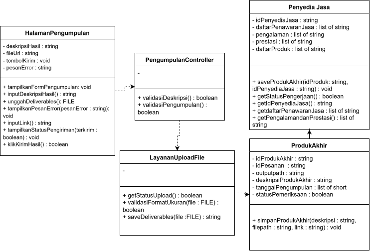
</p>
<p align="center">
<i>Gambar 3.11.2 Diagram Kelas Menyerahkan Hasil pekerjaan</i>
</p>

---

## 3.12 Use Case UC12

**ID Use Case:** UC12

**Nama Use Case:** Mengonfirmasi Hasil Pekerjaan   

### 3.12.1 Identifikasi Kelas

Tabel 3.12. Identifikasi Kelas Use Case [UC12]

| No | Nama Kelas Perancangan | Nama Kelas Analisis Terkait |
|:--- | :--- | :--- |
| 1 | HalamanDeliverables | HalamanDeliverables |
| 2 | PengontrolPesanan | PengontrolPesanan |
| 3 | Pesanan | Pesanan |
| 4 | PengontrolTransaksi | PengontrolTransaksi |
| 5 | PencairanDana | PencairanDana | 
| 6 | PenyediaJasa | PenyediaJasa |
| 7 | PenggunaJasa | PenggunaJasa |
| 8 | RevisiHandler| RevisiHandler|
| 9 | HalamanRequestRevisi | HalamanRequestRevisi | 
| 10| PengajuanRevisi | PengajuanRevisi |

### 3.12.2 Sequence Diagram

- **Skenario Normal**

<p align="center">
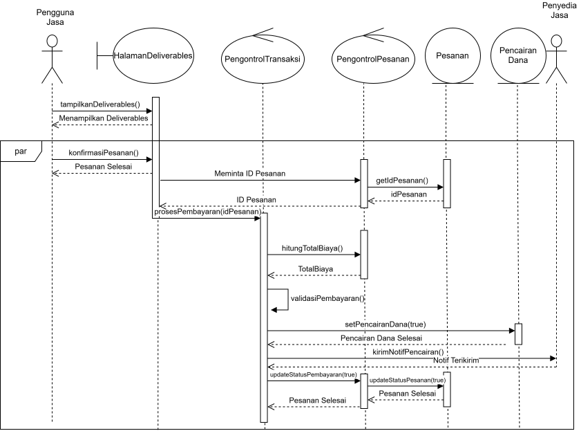
</p>
<p align="center">
<i>Gambar 3.12.1 Sequence Diagram UC12 </i>
</p>

- **Skenario Alternatif : Mengajukan Revisi**

<p align="center">
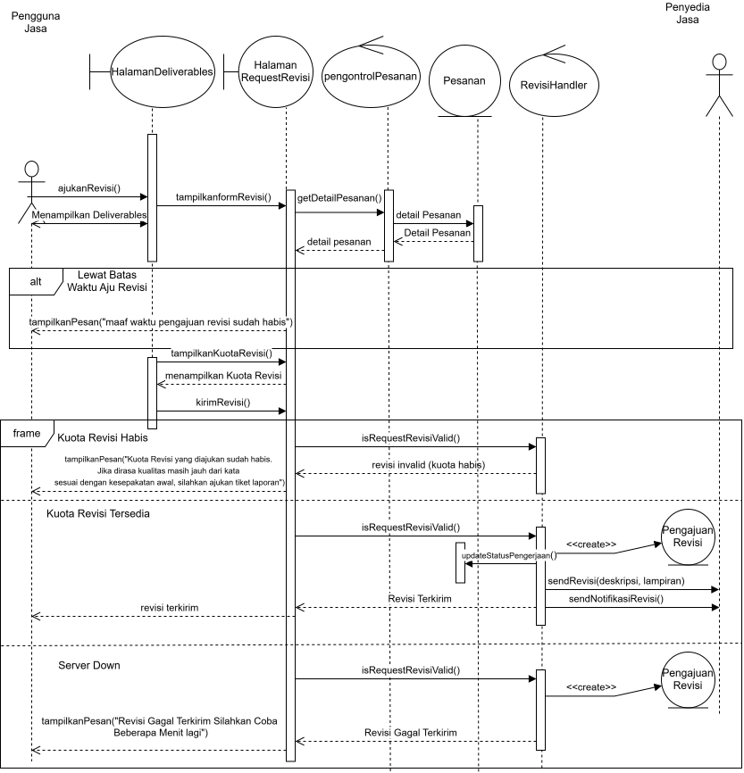
</p>
<p align="center">
<i>Gambar 3.12.2 Sequence Diagram UC12 - Mengajukan Revisi</i>
</p>

### 3.12.3 Diagram Kelas

<p align="center">
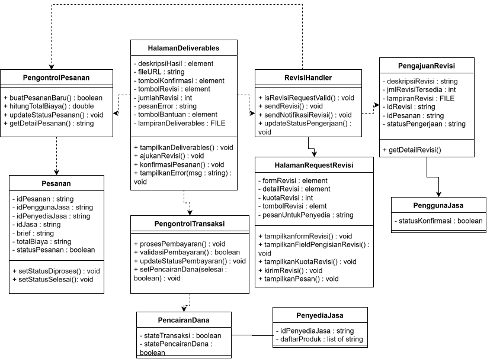
</p>
<p align="center">
<i>Gambar 3.12.3 Diagram Kelas Mengonfirmasi Hasil Pekerjaan</i>
</p>

## 3.13 Use Case Melaporkan Pengguna Lain

**ID Use Case:** UC13

**Nama Use Case:** Melaporkan Pengguna Lain

### 3.13.1 Identifikasi Kelas

Tabel 3.1. Identifikasi Kelas Use Case [UC13]

| No | Nama Kelas Perancangan | Nama Kelas Analisis Terkait |
|:--- | :--- | :--- |
| 1 | HalamanPelaporan | HalamanPelaporan |
| 2 | LaporanHandler | LaporanHandler |
| 3 | TiketLaporan | PenggunaJasa |
| 4 | Pengguna | Pengguna (Inheritance with PenggunaJasa dan PenyediaJasa) |

### 3.13.2 Sequence Diagram

- **Skenario Normal**

<p align="center">
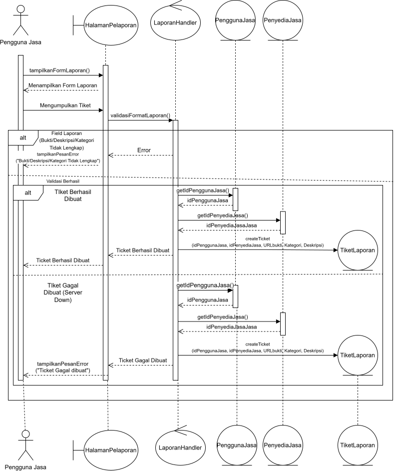
</p>
<p align="center">
<i>Gambar 3.13.1 Sequence Diagram [UC13]</i>
</p>

### 3.13.3 Diagram Kelas

<p align="center">
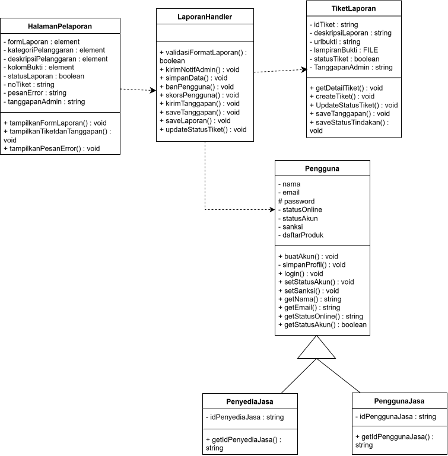
</p>
<p align="center">
<i>Gambar 3.13.2 Diagram Kelas [Nama Uce Case]</i>
</p>

## 3.14 Use Case Memberikan Ulasan terhadap Jasa yang Dipesan

**ID Use Case:** *UC14*  
**Nama Use Case:** *Memberikan Ulasan terhadap Jasa yang Dipesan*

### 3.14.1 Identifikasi Kelas

Tabel 3.14. Identifikasi Kelas Use Case [UC014]

| No | Nama Kelas Perancangan | Nama Kelas Analisis Terkait |
|:--- | :--- | :--- |
| 1 | PenggunaJasa | PenggunaJasa |
| 2 | HalamanRiwayatTransaksi | HalamanRiwayatTransaksi |
| 3 | HalamanUlasan | HalamanUlasan |
| 4 | UlasanHandler | UlasanHandler |
| 5 | PengontrolPesanan | PengontrolPesanan |
| 6 | Pesanan | Pesanan |
| 7 | PengontrolTransaksi | PengontrolTransaksi |
| 8 | Ulasan | Ulasan |
| 9 | RiwayatTransaksi | RiwayatTransaksi |

### 3.14.2 Sequence Diagram

- **Skenario Normal**

<p align="center">
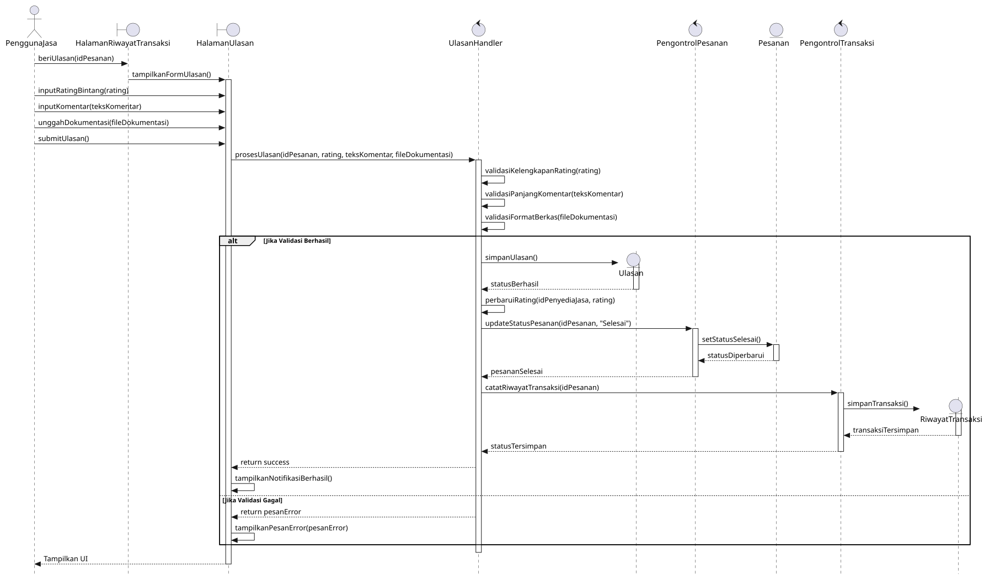
</p>
<p align="center">
<i>Gambar 3.14.1 Sequence Diagram [UC014]</i>
</p>


### 3.14.3 Diagram Kelas


<p align="center">
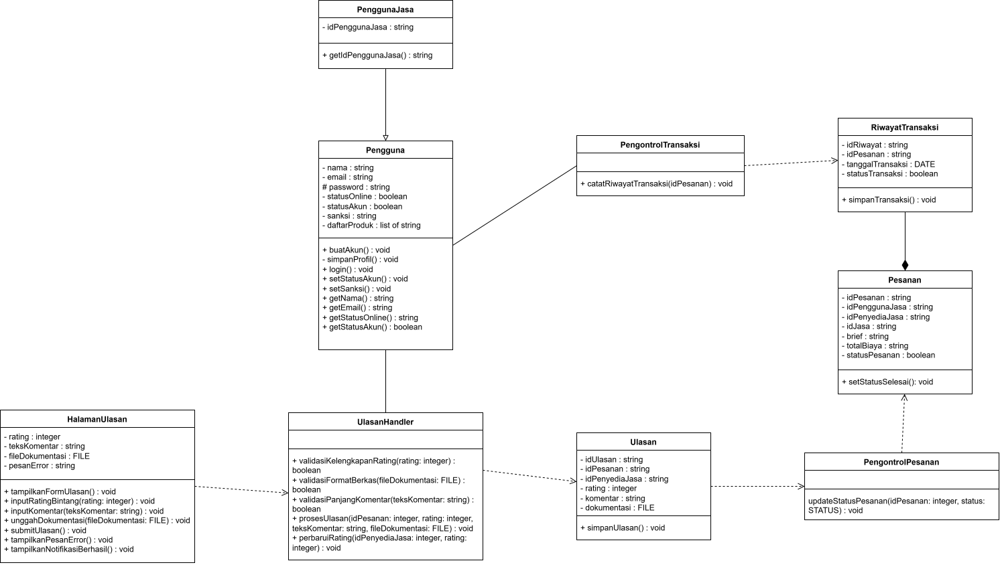
</p>
<p align="center">
<i>Gambar 3.14.2 Diagram Kelas [UC14]</i>
</p>

---

## 3.15 Use Case Memproses Laporan

**ID Use Case:** *UC15*  
**Nama Use Case:** *Memproses Laporan*

### 3.15.1 Identifikasi Kelas

Tabel 3.15. Identifikasi Kelas Use Case [UC015]

| No | Nama Kelas Perancangan | Nama Kelas Analisis Terkait |
|:--- | :--- | :--- |
| 1 | Admin | Admin |
| 2 | HalamanDashboardAdmin | HalamanDashboardAdmin |
| 3 | LaporanHandler | LaporanHandler |
| 4 | TiketLaporan | TiketLaporan |
| 5 | TanggapanLaporan | TanggapanLaporan |

### 3.15.2 Sequence Diagram

- **Skenario Normal**

<p align="center">
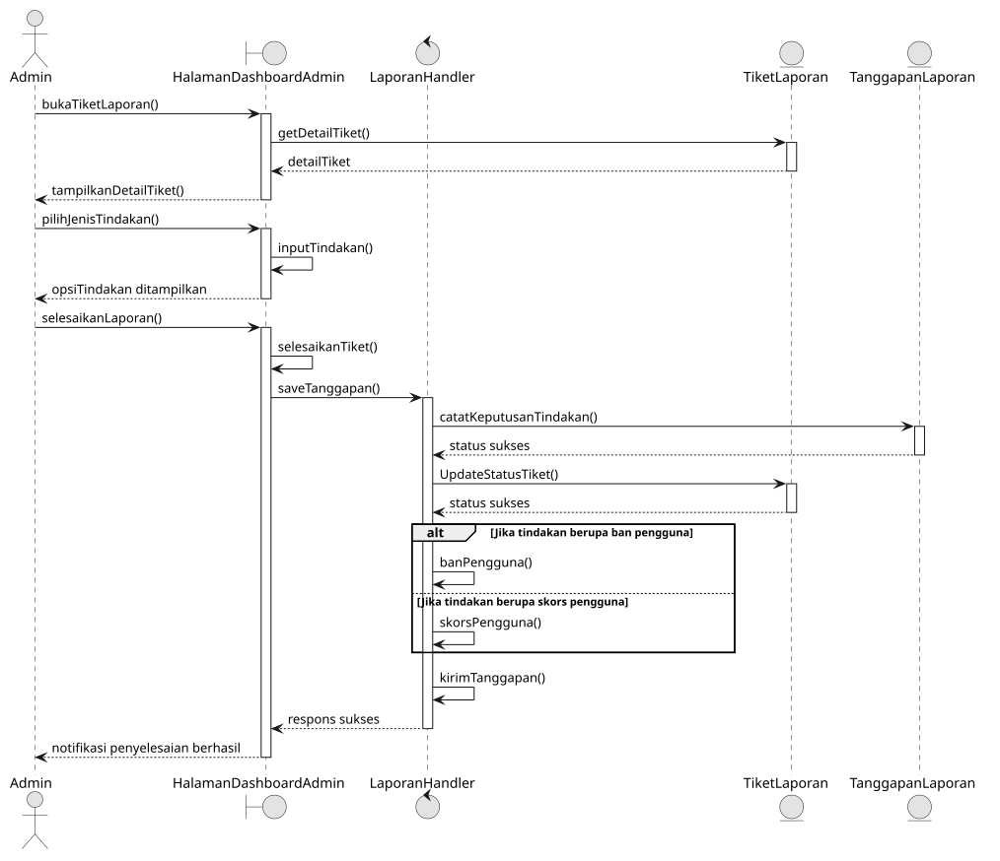
</p>
<p align="center">
<i>Gambar 3.15.1 Sequence Diagram [UC015]</i>
</p>


### 3.15.3 Diagram Kelas

<p align="center">
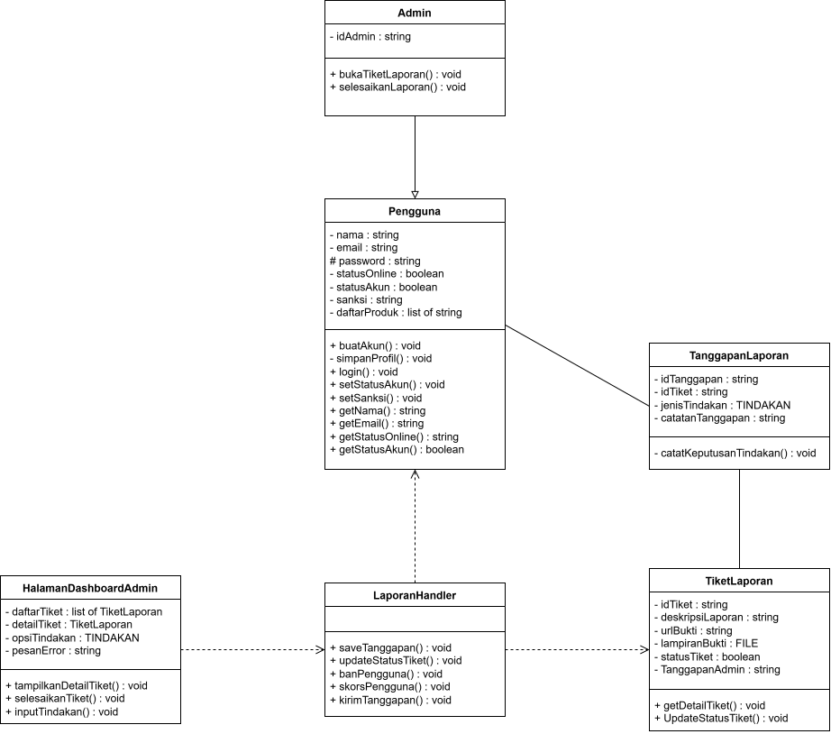
</p>
<p align="center">
<i>Gambar 3.15.2 Diagram Kelas [UC15]</i>
</p>

---

## 3.16 Use Case Memproses Laporan

**ID Use Case:** *UC16*  
**Nama Use Case:** *Melakukan Proses Mediasi*

### 3.16.1 Identifikasi Kelas

Tabel 3.16. Identifikasi Kelas Use Case [UC016]

| No | Nama Kelas Perancangan | Nama Kelas Analisis Terkait |
|:--- | :--- | :--- |
| 1 | Admin | Admin |
| 2 | HalamanDashboardAdmin | HalamanDashboardAdmin |
| 3 | LaporanHandler | LaporanHandler |
| 4 | TiketLaporan | TiketLaporan |
| 5 | HalamanPengajuanMediasi | HalamanPengajuanMediasi |
| 6 | MediasiHandler | MediasiHandler |

### 3.16.2 Sequence Diagram

- **Skenario Normal**

<p align="center">

</p>
<p align="center">
<i>Gambar 3.16.1 Sequence Diagram [UC016]</i>
</p>


### 3.16.3 Diagram Kelas

<p align="center">
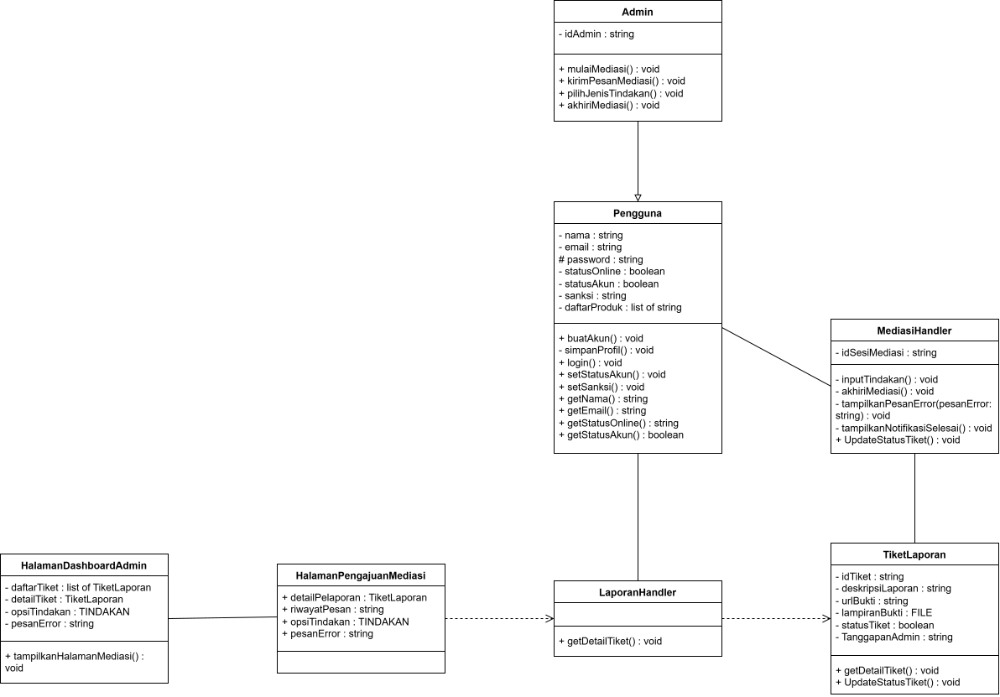
</p>
<p align="center">
<i>Gambar 3.16.2 Diagram Kelas [UC16]</i>
</p>
---

# BAB 4: Diagram Kelas Keseluruhan

## 4.1 Diagram Kelas

**Bagian ini diisi dengan diagram kelas keseluruhan.**

<p align="center">

</p>
<p align="center">
<i>Gambar 4.1. Diagram Kelas Perancangan Keseluruhan [Nama P/L]</i>
</p>

Tabel 4.1. Daftar Kelas Perancangan Keseluruhan

| ID Kelas | Nama Kelas | Atribut | Metode/Operasi |
| :--- | :--- | :--- | :--- |
| C01 | Pengguna | - nama : string <br> - email : string <br>   # password : string <br> - statusOnline : boolean <br> - statusAkun : boolean <br> - sanksi : string <br> - daftarProduk : list of string | <br> + buatAkun() : void <br> - simpanProfil() : void <br> + login() : void <br> + setStatusAkun() : void <br> + setSanksi() : void <br> + getNama() : string  <br> + getEmail() : string <br> + getStatusOnline() : string <br> + getStatusAkun() : boolean <br> | 
| C02 | PenyediaJasa | - idPenyediaJasa : string <br> - daftarPenawaranJasa : list of string <br> - pengalaman : list of string <br> - prestasi : list of string <br> - daftarProduk : list of string | <br> + isiPortofolio() : void <br> + unggahPortofolio() : void <br> + tambahPenawaranJasa() : void <br> + bukaNotifikasiPesanan() : void <br> + terimaPesanan() : void <br> + tolakPesanan() : void <br> + saveProdukAkhir(idProduk : string, idPenyediaJasa : string) : void <br> + getStatusPengerjaan() : boolean <br> + kumpulkanRevisi() : void <br> + cekPengirimanDana() : void <br> + getRevisi() : void <br> + getIdPenyediaJasa() : string <br> + getdaftarPenawaranJasa : list of string <br> + getPengalamandanPrestasi() : list of string <br> |
| C03 | PenggunaJasa | - idPenggunaJasa : string <br> - daftarJasa : list of string <br> - minatkategoriJasa : list of string <br> - statusKonfirmasi : boolean | <br> + cariJasa() : void <br> + gunakanFilter() : void <br> + bukaDetailJasa() : void <br> + bukaDaftarBoomark() : void <br> + pilihJasa() :void <br> + isiFormPemesanan() : void <br> + getStatusPengerjaan() : string <br> + getDeliverables() : list ofstring <br> + selesaikanPesanan() : void <br> + ajukanRevisi() : void <br> + beriUlasan(idPesanan: integer) : void <br> + beriPenilaian() : void <br> + pilihMetodePembayaran() : void <br> + getIdPenyediaJasa() : string <br> + getMinatKategoriJasa() : list of string <br> + getStatusKonfirmasi() : boolean <br>  |
| C04      | HalamanRegistrasi       |<br>  - formRegistrasi : Form <br> - pesanError : String  | <br> + tampilkanForm() : void <br> + kirimRegistrasi() : void <br> + tampilkanError() : void |
| C05      | LayananRegistrasi       | -                                                                       | <br> + validasiData() : boolean <br> + cekEmail() : boolean <br> + cekNoTelepon() : boolean <br> + registrasiPengguna() : void |
| C06      | HalamanLogin             | <br> - pesanError : string <br> - formLogin : string | <br> + tampilkanForm() : void <br> + kirimLogin(email : String) : void <br> +  tampilkanError() : void  |
| C07      | Autentikator             | -                                     | + validasiKredensial(email : String, password : String) <br> + sesiLogin() : void           <br> |
| C08      | HalamanPortofolio        | <br> - formPortofolio : string <br> - pesanError : string        | <br> + tampilkanPortofolio() : void  <br> +  kirimPortofolio(data : Portofolio) : void <br> + tampilkanError() : void <br> |
| C09      | Portofolio               | <br> - judul : string <br> - deskripsi : string <br> - berkasPendukung : FILE  | <br> + simpanPortofolio() : void <br> |
| C10      | PengontrolPortofolio     | -                                 | <br> + validasiInputBerkas(data : Portofolio) : boolean <br> + simpanPortofolio() : void <br>|
| C11      | LayananUploadFile        | -                                 | <br> + getStatusUpload() : String <br> + validasiFormatUkuran(file : FILE) : boolean <br> + saveDeliverables(file :FILE) : string  <br> + uploadFile(berkas: FILE) : void |
| C12 | Jasa | - idJasa : string <br> - idPenyediaJasa : string <br> -  namaJasa : string <br> -  deskripsi : string <br> -  kategori : string <br> - harga : double <br> - statusAktif : boolean | <br> + simpanJasa() : void <br> + dapatkanDetailJasa(idJasa : string) : Jasa <br> + perbaruiJasa(idJasa : string) : void <br> + hapusJasa(idJasa : string) : void <br> |
| C13 | HalamanUploadJasa | - formNamaJasa : void <br> - formKategori : void <br> - formDeskripsi : void <br> - formHarga : void <br> - inputUploadBerkas : void <br> - tombolUnggah : void <br> - pesanError : string |  <br> + klikUnggah() : void <br> +  tampilkanPesanError() : void <br> + tampilkanNotifikasiBerhasil() : void <br> |
| C14 | JasaController | - | <br> + ambilDetailJasa(idJasa: string) : Jasa <br> + validasiDataJasa(dataJasa : string) : boolean <br> + simpanPenawaranJasa(dataJasa : string) : void |
| C15 | HalamanPencarian | <br> - searchBar : void <br> - filterHarga : void <br> - filterDurasi : void <br> - filterRating : void <br> - tombolCari : void <br> - pesanError : string | <br> + inputKataKunci() : void <br> + klikCari() : void <br> + tampilkanPesanError(pesan : string) : void |
| C16 | HasilPencarian | <br> - daftarListingJasa : list of jasa <br> - tombolBandingkan : void | <br> + tampilkanDaftarHasil() : void <br> + pilihJasaUntukDibandingkan() : void <br> + klikBandingkan() : void |
| C17 | LayananPencarian | - | <br> +cariJasaBerdasarkanKeyword(keyword : string) : list of Jasa <br> + terapkanFilterPencarian(filter : string, keyword : string) : list of Jasa |
| C18 | LayananPembandingJasa | - | <br> + bandingkanSpesifikasiJasa(idJasa1 : string, idJasa2 : string) : string |
| C19 | HalamanDetailJasa | <br> - tampilanDeskripsi : string <br> - tampilanHarga : double <br> - infoProfilPenyedia : string <br> - tampilanRiwayatUlasan : list of string <br> - pesanError : string | <br> + tampilkanDetailJasa() : void <br> +  tampilkanPesanError() : void |
| C20 | Bookmark | <br> - idBookmark : string <br> - idPenggunaJasa : string <br> - idJasa : string <br> - waktuDisimpan : Date <br> - daftarBookmark : list of bookmark | <br> + simpanBookmark(idPenggunaJasa : string, idJasa : string) <br> + hapusBookmark(idBookmark : string, idPenggunaJasa : string) : boolean <br> + lihatBookmark(idPenggunaJasa : string) : list of Bookmark |
| C21 | HalamanBookmark | <br> - daftarJasaTersimpan : list of Jasa <br> - ikonBookmarkAktif : void <br> - ikonBookmarkNonaktif : void <br> - tombolHapusBookmark : void | <br> + tampilkanDaftarTersimpan() : void  <br> + klikIkonBookmark() : void <br> + klikIkonHapus() : void <br> + tampilkanNotifikasi() : void |
| C22 | PengontrolBookmark | - | <br> + tambahDataBookmark() : boolean <br> + hapusDataBookmark() : boolean <br> + ambilDaftarBookmarkPengguna() : list of Bookmark |
| C23 | ChatRoom | <br> - idChatRoom : string <br> - idAnggota : string <br> - riwayatPesan : list of string <br> - waktuDibuat : Date | <br> + getRiwayatPesan(idChatroom : string) : list of pesan <br> + simpanPesan(pesan : string) : void <br> + getidChatRoom(idPenggunaJasa : string,idPenyediaJasa : string) : string <br> + getidAnggota(idChatRoom : string) : string |
| C24 | HalamanChat | - idSesiChat : string <br> - inputPesan : string <br> - statusKoneksi : string | <br> + tampilkanMenuChat() : void <br> + tampilkanRiwayatPesan() : void <br> + inputPesan() : void <br> + tombolKirimTerklik() : void <br> + tampilkanPesanError() : void <br> + tampilkanStatusBelumTerkirim() : void |
| C25 | LayananPesanInstan | - | <br> + buatSesiChat(idPenggunaJasa : string, idPenyediaJasa) : void <br> + validasiInputPesan(pesan : string) : boolean <br> + kirimPesan(pesan : string) : void <br> + simpanKeDatabase(idChatroom : string, idPengirim : string, pesan : string) : void <br> +  updateStatusBaca(idChatroom : string, idPengguna : string) : boolean |
| C26 | LayananNotifikasiChat | - | <br> + kirimNotifikasiPesan(idPesan : string, idPengirim : string, idPenerima : string) : void <br> + tampilkanPopUpNotifikasi(device : string, pengirim : string, pesan : string) : void  |
| C27 | Pesanan | <br> - idPesanan : string <br> - idPenggunaJasa : string <br> - idPenyediaJasa : string <br> - idJasa : string <br> - brief : string <br> - totalBiaya : double <br> - statusPesanan : boolean |  <br> + setStatusDiproses(idPesanan : string) : void <br> + setStatusSelesai(idPesanan : string) : void  <br> + setStatus(idPesanan : string, status : string) : void |
| C28 | HalamanPemesanan | <br> - idJasaDipilih : string <br> - briefPemesanan : string | <br> + tampilkanFormPemesanan() : void <br> + inputBriefPemesanan() : void <br> + tombolPesanTerklik() : void |
| C29 | HalamanPembayaran | <br> - totalHarga : Double <br> - idMetodePembayaran : string | <br> + tampilkanPilihanPembayaran() : void <br> + tampilkanRincianPembayaran() : void <br> + tombolBayarTerklik() : void <br> + tampilkanNotifikasiBerhasil() : void |
| C30 | HalamanRiwayatTransaksi | <br> - idTransaksi : string | <br> + tampilkanRiwayatTransaksi() : void |
| C31 | PengontrolPesanan | - | <br> + buatPesananBaru(briefPesanan : string, idJasa : string, idPenggunaJasa : string) : Pesanan <br> +   hitungTotalBiaya(idJasa) : double <br> + updateStatusPesanan(idPesanan: string, status: string) : void <br> + getDetailPesanan(idPesanan : string) : string |
| C32 | PengontrolTransaksi | - | <br> + prosesPembayaran(idPesanan : string, idMetode : string) : boolean <br> + validasiPembayaran(idPesanan : string) : boolean <br> +setPencairanDana(idPesanan : string, selesai : boolean) : boolean <br> +  updateStatusPembayaran(idPesanan : string, status : string) : boolean<br> + catatRiwayatTransaksi(idPesanan : string) : void |
| C33 | MetodePembayaran | <br> - idMetode : string <br> - namaMetode : string <br> - nomorRekeningVA : string | <br> + getDetailMetode(idMetode : string)  : MetodePembayaran |
| C34 | RiwayatTransaksi | <br> - idRiwayat : string <br> - idPesanan : string <br> - tanggalTransaksi : DATE <br> - statusTransaksi : boolean | <br> + simpanTransaksi() : void |
| C35 | HalamanKonfirmasi | <br> - idPesanan : string <br> - detailBrief : string | <br> + tampilkanDetailPesanan() : void <br> + tombolTerimaTerklik() : void <br> + tombolTolakTerklik() : void <br> + tampilkanStatusPesanan() : void |
| C36 | ProdukAkhir | <br> -idProdukAkhir : string <br> - idPesanan : string <br> - outputpath : string <br> - deskripsiProdukAkhir : string  <br>- tanggalPengumpulan : Date <br> - statusPemeriksaan : boolean <br> - fileURL : string | <br> + simpanProdukAkhir(deskripsi : string, filepath : string, link : string) : void  <br> + updateStatusPengerjaan() <br> + getDetailProduk()  | 
| C37 | HalamanPengumpulan | <br> - deskripsiHasil : string <br> - fileURL : string <br> - tombolKirim : void <br> - pesanError : string  | <br> + tampilkanFormPengumpulan() : void <br> + inputDeskripsiHasil() : string <br> + unggahDeliverables() : FILE <br> + tampilkanPesanError(pesanError : string) : void <br> + klikKirimHasil() : boolean <br> + inputLink() : string <br> + tampilkanStatusPengiriman(terkirim : boolean) : void |
| C38 | HalamanDeliverables | <br> - deskripsiHasil : void <br> - fileURL : string <br> - tombolKonfirmasi : void <br> - tombolRevisi : void <br> - jumlahRevisi : int <br> - pesanError : string <br> - tombolBantuan : void <br> - lampiranDeliverables : FILE | <br> + tampilkanDeliverables() : void <br> + ajukanRevisi() : void <br> + konfirmasiPesanan() : void <br> + tampilkanError(msg : string) : void  |
| C39 | PengajuanRevisi | <br> - deskripsiRevisi : string <br> - jmlRevisiTersedia : int <br> - lampiranRevisi : FILE <br> - idRevisi : string <br> - idPesanan : string <br> - statusPengerjaan : string| <br> + getDetailRevisi() : string  |
| C40 | HalamanRequestRevisi | <br> - formRevisi : void <br> - detailRevisi : void <br> - kuotaRevisi : int <br> - tombolRevisi : elemt <br> - pesanUntukPenyedia : string | <br> + tampilkanformRevisi() : void <br> + tampilkanFieldPengisianRevisi() : void <br> + tampilkanKuotaRevisi() : void <br> + kirimRevisi() : void <br> + tampilkanPesan() : void  |
| C41 | RevisiHandler | - | <br> + isRevisiRequestValid() : void <br> +  sendRevisi() : void <br> + sendNotifikasiRevisi() : void <br> + updateStatusPengerjaan() : void  |
| C42 | PencairanDana | <br> - stateTransaksi : boolean <br> - statePencairanDana : boolean | - |
| C43 | TiketLaporan | - idTiket : string <br> - deskripsiLaporan : string <br> - urlBukti : string <br> - lampiranBukti : FILE <br> - statusTiket : boolean <br> - TanggapanAdmin : string | + getDetailTiket() : void <br> + createTiket() : void <br> +  UpdateStatusTiket() : void <br> +  saveTanggapan() : void <br> + saveStatusTindakan() : void  |
| C44 | HalamanPelaporan | <br> - formLaporan : void <br> - kategoriPelanggaran : void <br> - deskripsiPelanggaran : void <br> - kolomBukti : void <br> - statusLaporan : boolean <br> - noTiket : string <br> - pesanError : string <br> - tanggapanAdmin : string | <br> + tampilkanFormLaporan() : void <br> +  tampilkanTiketdanTanggapan() : void <br>  + tampilkanPesanError() : void  | 
| C45 | LaporanHandler  | - | + validasiFormatLaporan() : boolean <br> + kirimNotifAdmin() : void <br> + simpanData() : void <br> + banPengguna() : void <br> + skorsPengguna() : void <br> + kirimTanggapan() : void <br> + saveTanggapan() : void <br> + saveLaporan() : void <br> + updateStatusTiket() : void <br> + getDetailTiket() : void |
| C46 | Ulasan | <br> - idUlasan : string <br> - idPesanan : string <br> - idPenyediaJasa : string <br> - rating : integer <br> - komentar : string <br> - dokumentasi : FILE | <br> + simpanUlasan() : void <br> + getDetailUlasan() |
| C47 | HalamanUlasan | <br> - rating : integer <br> - teksKomentar : string <br> - fileDokumentasi : FILE <br> - pesanError : string | <br> + tampilkanFormUlasan() : void <br> + inputRatingBintang(rating: integer) : void <br> + inputKomentar(teksKomentar: string) : void <br> + unggahDokumentasi(fileDokumentasi: FILE) : void <br> + submitUlasan() : void <br> + tampilkanPesanError() : void <br> + tampilkanNotifikasiBerhasil() : void |
| C48 | UlasanHandler | - | <br> + validasiKelengkapanRating(rating: integer) : boolean <br> + validasiFormatBerkas(fileDokumentasi: FILE) : boolean <br> + validasiPanjangKomentar(teksKomentar: string) : boolean <br> + prosesUlasan(idPesanan: integer, rating: integer, teksKomentar: string, fileDokumentasi: FILE) : void <br> + perbaruiRating(idPenyediaJasa: integer, rating: integer) : void |
| C49 | TanggapanLaporan | - idTanggapan : string <br> - idTiket : string <br> - jenisTindakan : TINDAKAN <br> - catatanTanggapan : string | <br> - catatKeputusanTindakan() : void <br> - getDetailTanggapan() : void |
| C50 | HalamanPengajuanMediasi | + detailPelaporan <br> + riwayatPesan <br> + opsiTindakan <br> + pesanError | - |
| C51 | MediasiHandler | - idSesiMediasi : string | - inputTindakan() : void <br> - akhiriMediasi() : void <br> - tampilkanPesanError(pesanError: string) : void <br> - tampilkanNotifikasiSelesai() : void <br> + UpdateStatusTiket() : void |
| C52 | Admin | - idAdmin : string | + mulaiMediasi() : void <br> + bukaTiketLaporan() : void <br> + selesaikanLaporan() : void <br> + kirimPesanMediasi() : void <br> + pilihJenisTindakan() : void <br> + akhiriMediasi() : void |
| C53 | HalamanDashboardAdmin | - daftarTiket : list of TiketLaporan <br> - detailTiket : TiketLaporan <br> - opsiTindakan : TINDAKAN <br> - pesanError : string | + tampilkanDetailTiket() : void <br> + inputTindakan() : void <br> + selesaikanTiket() : void <br> + mulaiMediasi() : void <br> + tampilkanPesanError() : void <br> + tampilkanHalamanMediasi() : void |
| C54 | PengumpulanController | - | <br> + validasiDeskripsi() : boolean <br> + validasiPengumpulan() : boolean |

---

# BAB 5: Perancangan Rinci Kelas

Tabel 5.1. Daftar Kelas Perancangan dan Kelas Analisis Terkait

| No | Nama Kelas Perancangan | Nama Kelas Analisis Terkait |
| :--- | :--- | :--- |
| 1 | Pengguna  | Pengguna |
| 2 | PenyediaJasa  | PenyediaJasa |
| 3 | PenggunaJasa  | PenggunaJasa |
| 4 | HalamanRegistrasi  | HalamanRegistrasi |
| 5 | LayananRegistrasi | LayananRegistrasi |
| 6 | HalamanLogin  | HalamanLogin |
| 7 | Autentikator  | Autentikator |
| 8 | HalamanPortofolio  | HalamanPortofolio |
| 9 | Portofolio  | Portofolio |
| 10 | PengontrolPortofolio  | PengontrolPortofolio |
| 11 | LayananUploadFile  | LayananUploadFile |
| 12 | Jasa  | Jasa |
| 13 | HalamanUploadJasa  | HalamanUploadJasa |
| 14 | JasaController  | JasaController |
| 15 | HalamanPencarian  | HalamanPencarian |
| 16 | HasilPencarian  | HasilPencarian |
| 17 | LayananPencarian  | LayananPencarian |
| 18 | LayananPembandingJasa  | LayananPembandingJasa |
| 19 | HalamanDetailJasa  | HalamanDetailJasa |
| 20 | Bookmark  | Bookmark |
| 21 | HalamanBookmark  | HalamanBookmark |
| 22 | PengontrolBookmark  | PengontrolBookmark |
| 23 | ChatRoom  | ChatRoom |
| 24 | HalamanChat  | HalamanChat |
| 25 | LayananPesanInstan  | LayananPesanInstan |
| 26 | LayananNotifikasiChat  | LayananNotifikasiChat |
| 27 | Pesanan  | Pesanan |
| 28 | HalamanPemesanan  | HalamanPemesanan |
| 29 | HalamanPembayaran  | HalamanPembayaran |
| 30 | HalamanRiwayatTransaksi  | HalamanRiwayatTransaksi |
| 31 | PengontrolPesanan  | PengontrolPesanan |
| 32 | PengontrolTransaksi  | PengontrolTransaksi |
| 33 | MetodePembayaran  | MetodePembayaran |
| 34 | RiwayatTransaksi  | RiwayatTransaksi |
| 35 | HalamanKonfirmasi  | HalamanKonfirmasi |
| 36 | ProdukAkhir  | ProdukAkhir |
| 37 | HalamanPengumpulan  | HalamanPengumpulan |
| 38 | HalamanDeliverables  | HalamanDeliverables |
| 39 | PengajuanRevisi  | PengajuanRevisi |
| 40 | HalamanRequestRevisi  | HalamanRequestRevisi |
| 41 | RevisiHandler  | RevisiHandler |
| 42 | PencairanDana  | PencairanDana |
| 43 | TiketLaporan  | TiketLaporan |
| 44 | HalamanPelaporan | HalamanPelaporan |
| 45 | LaporanHandler | LaporanHandler |
| 46 | Ulasan | Ulasan |
| 47 | HalamanUlasan  | HalamanUlasan |
| 48 | UlasanHandler  | UlasanHandler |
| 49 | TanggapanLaporan  | TanggapanLaporan |
| 50 | HalamanPengajuanMediasi | HalamanPengajuanMediasi |
| 51 | MediasiHandler | MediasiHandler |
| 52 | Admin  | Admin |
| 53 | HalamanDashboardAdmin | HalamanDashboardAdmin |
| 54 | PengumpulanController | PengumpulanController |

## 5.1 Kelas Pengguna

**Nama Kelas:** Pengguna  
**ID Kelas:** C01

Tabel 5.1.1. Operasi Kelas Pengguna

| Nama Operasi | Visibility (private, public) | Keterangan |
| :--- | :--- | :--- |
| + buatAkun() : void | public | |
| - simpanProfil() : void | private | |
| + login() : void | public | |
| + setStatusAkun() : void | public | |
| + setSanksi() : void | public | |
| + getNama() : string | public | |
| + getEmail() : string | public | |
| + getStatusOnline() : string | public | |
| + getStatusAkun() : boolean | public | |

Tabel 5.1.2. Atribut Kelas Pengguna

| Nama Atribut | Visibility (private, public) | Tipe |
| :--- | :--- | :--- |
| nama | private | string |
| email | private | string |
| password | protected | string |
| statusOnline | private | boolean |
| statusAkun | private | boolean |
| sanksi | private | string |
| daftarProduk | private | list of string |

### 5.1.1 Algoritma/Query
**Nama Kelas:** Pengguna
**Nama Operasi:** buatAkun(nama : string, email : string, noTelepon : string, password : string) : void
**ID Algoritma:** Algo-0101

```Pseudocode
Input : nama : string, email : string, noTelepon : string, password : string
Output : void

1. IF nama == NULL OR email == NULL OR password == NULL THEN
2.     THROW Exception "Data akun tidak lengkap"
3. Jalankan Query [Q-0101] dengan parameter nama, email, noTelepon, hashedPassword
4. Simpan status eksekusi query ke dalam variabel statusInsert
5. IF statusInsert == false THEN
6.     THROW Exception "Gagal membuat akun pengguna"
7. statusOnline = false
8. statusAkun = true
```
Tabel 5.1.3. Query Operasi buatAkun

| No Query | Query | Keterangan |
| :--- | :--- | :--- |
| Q-0101 | INSERT INTO pengguna (nama, email, no_telepon, password, status_online, status_akun, sanksi) <br> VALUES (%nama%, %email%, %noTelepon%, %hashedPassword%, false, true, NULL); | Menambahkan data akun pengguna baru dengan *hashed password* ke database |

### 5.1.2 Algoritma/Query
**Nama Kelas:** Pengguna
**Nama Operasi:** login(email : string, password : string) : boolean
**ID Algoritma:** Algo-0102

```Pseudocode
Input : email : string, password : string
Output : boolean

1. IF email == NULL OR password == NULL THEN
2.     RETURN false
3. Jalankan Query [Q-0102] dengan parameter email
4. Simpan hasil query ke dalam variabel dataPengguna
5. IF dataPengguna == NULL THEN
6.     RETURN false
7. isPasswordValid = verifikasiPassowrd(password, dataPengguna.password)
8. IF isPasswordValid == true AND dataPengguna.statusAkun == true THEN
9.     Jalankan Query [Q-0103] dengan parameter email
10.    Simpan status eksekusi query ke dalam variabel statusUpdate
11.    IF statusUpdate == true THEN
12.        statusOnline = true
13.        RETURN true
14.    ELSE
15.        RETURN false
16. ELSE
17.    RETURN false
```
Tabel 5.1.4. Query Operasi login

| No Query | Query | Keterangan |
| :--- | :--- | :--- |
| Q-0102 | SELECT id_pengguna, email, password, status_akun <br> FROM pengguna <br> WHERE email = %email% <br> LIMIT 1; | Mengambil data id pengguna, hash password, dan status akun pengguna berdasarkan email |
| Q-0103 | UPDATE pengguna <br> SET status_online = true <br> WHERE email = %email%; | Memperbarui status *online* pengguna menjadi aktif saat berhasil masuk |

### 5.1.3 Algoritma/Query
**Nama Kelas:** Pengguna
**Nama Operasi:** simpanProfil(email : string, nama : string, noTelepon : string) : void
**ID Algoritma:** Algo-0103

```Pseudocode
Input : nama : string, noTelepon : string
Output : void

1. IF nama == NULL THEN
2.      THROW Exception "Nama tidak boleh kosong"
3. Jalankan Query [Q-0104] dengan parameter nama, noTelepon, email
4. Simpan status eksekusi query ke dalam variabel statusUpdate
5. IF statusUpdate == false THEN
6.      THROW Exception "Gagal memperbarui data profil pengguna"
```
Tabel 5.1.5. Query Operasi simpanProfil

| No Query | Query | Keterangan |
| :--- | :--- | :--- |
| Q-0104 | UPDATE pengguna <br> SET nama = %nama%, no_telepon = %noTelepon% <br> WHERE email = %email%; | Memperbarui informasi nama dan nomor telepon pengguna berdasarkan alamat email |

### 5.1.4 Algoritma/Query
**Nama Kelas:** Pengguna  
**Nama Operasi:** setStatusAkun(email : string, statusAkun : boolean) : void  
**ID Algoritma:** Algo-0104

```Pseudocode
Input : email : string, statusAkun : boolean
Output : void

1. IF email == NULL THEN
2.     THROW Exception "Email pengguna tidak valid"
3. Jalankan Query [Q-0105] dengan parameter statusAkun, email
4. Simpan status eksekusi query ke dalam variabel statusUpdate
5. IF statusUpdate == false THEN
6.     THROW Exception "Gagal memperbarui status keaktifan akun"
```
Tabel 5.1.6. Query Operasi setStatusAkun

| No Query | Query | Keterangan |
| :--- | :--- | :--- |
| Q-0105 | UPDATE pengguna <br> SET status_akun = %statusAkun% <br> WHERE email = %email%; | Mengubah status keaktifan akun pengguna berdasarkan alamat email |

### 5.1.5 Algoritma/Query
**Nama Kelas:** Pengguna  
**Nama Operasi:** setSanksi(email : string, sanksi : string) : void 
**ID Algoritma:** Algo-0105

```Pseudocode
Input : email : string, sanksi : string
Output : void

1. IF email == NULL THEN
2.     THROW Exception "Email pengguna tidak valid"
3. Jalankan Query [Q-0106] dengan parameter sanksi, email
4. Simpan status eksekusi query ke dalam variabel statusUpdate
5. IF statusUpdate == false THEN
6.     THROW Exception "Gagal memperbarui catatan sanksi akun"
```
Tabel 5.1.7. Query Operasi setSanksi

| No Query | Query | Keterangan |
| :--- | :--- | :--- |
| Q-0106 | UPDATE pengguna <br> SET sanksi = %sanksi% <br> WHERE email = %email%; | Menetapkan atau memperbarui status sanksi pelanggaran pengguna berdasarkan alamat email |

### 5.1.6 Algoritma/Query
**Nama Kelas:** Pengguna  
**Nama Operasi:** getNama() : string  
**ID Algoritma:** Algo-0106  

```Pseudocode
Input : void
Output : string

1. RETURN nama
```

### 5.1.7 Algoritma/Query
**Nama Kelas:** Pengguna  
**Nama Operasi:** getEmail() : string  
**ID Algoritma:** Algo-0107  

```Pseudocode
Input : void
Output : string

1. RETURN email
```

### 5.1.8 Algoritma/Query
**Nama Kelas:** Pengguna  
**Nama Operasi:** getStatusOnline() : string  
**ID Algoritma:** Algo-0108  

```Pseudocode
Input : void
Output : string

1. IF statusOnline == true THEN
2.     RETURN "Online"
3. ELSE
4.     RETURN "Offline"
```

### 5.1.9 Algoritma/Query
**Nama Kelas:** Pengguna  
**Nama Operasi:** getStatusAkun() : boolean  
**ID Algoritma:** Algo-0109  

```Pseudocode
Input : void
Output : boolean

1. RETURN statusAkun
```

## 5.2 Kelas PenyediaJasa (C02)
**Nama Kelas:** PenyediaJasa  
**ID Kelas:** C02  

Tabel 5.2.1. Operasi Kelas PenyediaJasa

| Nama Operasi | Visibility (private, public) | Keterangan |
| :--- | :--- | :--- |
| isiPortofolio(idPenyediaJasa : string, pengalaman : string, prestasi : string) : void | public | Memperbarui riwayat pengalaman dan prestasi kerja penyedia jasa ke basis data |
| unggahPortofolio(idPenyediaJasa : string, berkasPortofolio : file) : void | public | Menambahkan berkas portofolio pendukung milik penyedia jasa ke basis data |
| tambahPenawaranJasa(idPenyediaJasa : string, idJasa : string) : void | public | Menghubungkan entitas penawaran jasa ke profil penyedia jasa terkait |
| bukaNotifikasiPesanan(idPenyediaJasa : string) : void | public | Mengambil daftar notifikasi pesanan masuk untuk penyedia jasa |
| terimaPesanan(idPesanan : string, idPenyediaJasa : string) : void | public | Menyetujui pesanan pekerjaan yang masuk dari pengguna jasa |
| tolakPesanan(idPesanan : string, idPenyediaJasa : string) : void | public | Menolak pesanan pekerjaan yang diajukan oleh pengguna jasa |
| saveProdukAkhir(idProduk : string, idPenyediaJasa : string) : void | public | Menyimpan data penyerahan berkas produk akhir pekerjaan |
| getStatusPengerjaan(idPesanan : string) : boolean | public | Mengambil status pengerjaan pesanan saat ini |
| kumpulkanRevisi(idPesanan : string, idPenyediaJasa : string) : void | public | Memperbarui status penyerahan revisi hasil pekerjaan ke basis data |
| cekPengirimanDana(idPesanan : string) : void | public | Mengambil informasi status pencairan dana transaksi dari pesanan yang selesai |
| getRevisi(idPesanan : string) : void | public | Mengambil detail catatan revisi yang diajukan oleh pengguna jasa |
| getIdPenyediaJasa() : string | public | Mengambil identifier unik penyedia jasa |
| getDaftarPenawaranJasa() : list of string | public | Mengambil daftar ID jasa yang ditawarkan oleh penyedia jasa |
| getPengalamandanPrestasi() : list of string | public | Mengambil daftar riwayat pengalaman dan prestasi penyedia jasa |

Tabel 5.2.2. Atribut Kelas PenyediaJasa

| Nama Atribut | Visibility (private, public) | Tipe |
| :--- | :--- | :--- |
| idPenyediaJasa | private | string |
| daftarPenawaranJasa | private | list of string |
| pengalaman | private | list of string |
| prestasi | private | list of string |
| daftarProduk | private | list of string |

### 5.2.1 Algoritma/Query
**Nama Kelas:** PenyediaJasa  
**Nama Operasi:** isiPortofolio(idPenyediaJasa : string, pengalaman : string, prestasi : string) : void  
**ID Algoritma:** Algo-0201  

```Pseudocode
Input : idPenyediaJasa : string, pengalaman : string, prestasi : string
Output : void

1. IF idPenyediaJasa == NULL THEN
2.     THROW Exception "ID Penyedia Jasa tidak valid"
3. Jalankan Query [Q-0201] dengan parameter pengalaman, prestasi, idPenyediaJasa
4. Simpan status eksekusi query ke dalam variabel statusUpdate
5. IF statusUpdate == false THEN
6.     THROW Exception "Gagal memperbarui portofolio penyedia jasa"
```

Tabel 5.2.3. Query Operasi isiPortofolio

| No Query | Query | Keterangan |
| :--- | :--- | :--- |
| Q-0201 | UPDATE penyedia_jasa <br> SET pengalaman = %pengalaman%, prestasi = %prestasi% <br> WHERE id_penyedia_jasa = %idPenyediaJasa%; | Memperbarui data pengalaman dan prestasi penyedia jasa berdasarkan ID Penyedia Jasa |

### 5.2.2 Algoritma/Query
**Nama Kelas:** PenyediaJasa  
**Nama Operasi:** unggahPortofolio(idPenyediaJasa : string, berkasPortofolio : file) : void  
**ID Algoritma:** Algo-0202  

```Pseudocode
Input : idPenyediaJasa : string, berkasPortofolio : file
Output : void

1. IF idPenyediaJasa == NULL OR berkasPortofolio == NULL THEN
2.     THROW Exception "Data portofolio tidak lengkap"
3. Jalankan Query [Q-0202] dengan parameter idPenyediaJasa, berkasPortofolio
4. Simpan status eksekusi query ke dalam variabel statusInsert
5. IF statusInsert == false THEN
6.     THROW Exception "Gagal mengunggah berkas portofolio"
```

Tabel 5.2.4. Query Operasi unggahPortofolio

| No Query | Query | Keterangan |
| :--- | :--- | :--- |
| Q-0202 | INSERT INTO portofolio (id_penyedia_jasa, berkas_pendukung) <br> VALUES (%idPenyediaJasa%, %berkasPortofolio%); | Menyimpan berkas portofolio penyedia jasa ke basis data |

### 5.2.3 Algoritma/Query
**Nama Kelas:** PenyediaJasa  
**Nama Operasi:** tambahPenawaranJasa(idPenyediaJasa : string, idJasa : string) : void  
**ID Algoritma:** Algo-0203  

```Pseudocode
Input : idPenyediaJasa : string, idJasa : string
Output : void

1. IF idPenyediaJasa == NULL OR idJasa == NULL THEN
2.     THROW Exception "Data penawaran jasa tidak valid"
3. Jalankan Query [Q-0203] dengan parameter idPenyediaJasa, idJasa
4. Simpan status eksekusi query ke dalam variabel statusUpdate
5. IF statusUpdate == false THEN
6.     THROW Exception "Gagal menambahkan penawaran jasa"
```

Tabel 5.2.5. Query Operasi tambahPenawaranJasa

| No Query | Query | Keterangan |
| :--- | :--- | :--- |
| Q-0203 | UPDATE jasa <br> SET id_penyedia_jasa = %idPenyediaJasa% <br> WHERE id_jasa = %idJasa%; | Menetapkan ID penyedia jasa pada baris data penawaran jasa terkait di basis data |

### 5.2.4 Algoritma/Query
**Nama Kelas:** PenyediaJasa  
**Nama Operasi:** bukaNotifikasiPesanan(idPenyediaJasa : string) : void  
**ID Algoritma:** Algo-0204  

```Pseudocode
Input : idPenyediaJasa : string
Output : void

1. IF idPenyediaJasa == NULL THEN
2.     THROW Exception "ID Penyedia Jasa tidak valid"
3. Jalankan Query [Q-0204] dengan parameter idPenyediaJasa
4. Simpan hasil query ke dalam variabel daftarNotifikasi
```

Tabel 5.2.6. Query Operasi bukaNotifikasiPesanan

| No Query | Query | Keterangan |
| :--- | :--- | :--- |
| Q-0204 | SELECT id_pesanan, id_pengguna_jasa, status_pesanan, waktu_dibuat <br> FROM pesanan <br> WHERE id_penyedia_jasa = %idPenyediaJasa% AND status_pesanan = 'Menunggu Konfirmasi' <br> ORDER BY waktu_dibuat DESC; | Mengambil daftar pesanan baru yang membutuhkan respons penyedia jasa |

### 5.2.5 Algoritma/Query
**Nama Kelas:** PenyediaJasa  
**Nama Operasi:** terimaPesanan(idPesanan : string, idPenyediaJasa : string) : void  
**ID Algoritma:** Algo-0205  

```Pseudocode
Input : idPesanan : string, idPenyediaJasa : string
Output : void

1. IF idPesanan == NULL OR idPenyediaJasa == NULL THEN
2.     THROW Exception "Identitas pesanan tidak valid"
3. Jalankan Query [Q-0205] dengan parameter idPesanan, idPenyediaJasa
4. Simpan status eksekusi query ke dalam variabel statusUpdate
5. IF statusUpdate == false THEN
6.     THROW Exception "Gagal menyetujui pesanan"
```

Tabel 5.2.7. Query Operasi terimaPesanan

| No Query | Query | Keterangan |
| :--- | :--- | :--- |
| Q-0205 | UPDATE pesanan <br> SET status_pesanan = 'Diproses' <br> WHERE id_pesanan = %idPesanan% AND id_penyedia_jasa = %idPenyediaJasa%; | Mengubah status pesanan menjadi diproses oleh penyedia jasa |

### 5.2.6 Algoritma/Query
**Nama Kelas:** PenyediaJasa  
**Nama Operasi:** tolakPesanan(idPesanan : string, idPenyediaJasa : string) : void  
**ID Algoritma:** Algo-0206  

```Pseudocode
Input : idPesanan : string, idPenyediaJasa : string
Output : void

1. IF idPesanan == NULL OR idPenyediaJasa == NULL THEN
2.     THROW Exception "Identitas pesanan tidak valid"
3. Jalankan Query [Q-0206] dengan parameter idPesanan, idPenyediaJasa
4. Simpan status eksekusi query ke dalam variabel statusUpdate
5. IF statusUpdate == false THEN
6.     THROW Exception "Gagal menolak pesanan"
```

Tabel 5.2.8. Query Operasi tolakPesanan

| No Query | Query | Keterangan |
| :--- | :--- | :--- |
| Q-0206 | UPDATE pesanan <br> SET status_pesanan = 'Ditolak' <br> WHERE id_pesanan = %idPesanan% AND id_penyedia_jasa = %idPenyediaJasa%; | Mengubah status pesanan menjadi ditolak oleh penyedia jasa |

### 5.2.7 Algoritma/Query
**Nama Kelas:** PenyediaJasa  
**Nama Operasi:** saveProdukAkhir(idProduk : string, idPenyediaJasa : string) : void  
**ID Algoritma:** Algo-0207  

```Pseudocode
Input : idProduk : string, idPenyediaJasa : string
Output : void

1. IF idProduk == NULL OR idPenyediaJasa == NULL THEN
2.     THROW Exception "Parameter produk akhir tidak valid"
3. Jalankan Query [Q-0207] dengan parameter idProduk, idPenyediaJasa
4. Simpan status eksekusi query ke dalam variabel statusUpdate
5. IF statusUpdate == false THEN
6.     THROW Exception "Gagal menyimpan relasi produk akhir"
```

Tabel 5.2.9. Query Operasi saveProdukAkhir

| No Query | Query | Keterangan |
| :--- | :--- | :--- |
| Q-0207 | UPDATE penyedia_jasa <br> SET daftar_produk = array_append(daftar_produk, %idProduk%) <br> WHERE id_penyedia_jasa = %idPenyediaJasa%; | Menambahkan ID produk akhir ke dalam daftar produk milik penyedia jasa di basis data |

### 5.2.8 Algoritma/Query
**Nama Kelas:** PenyediaJasa  
**Nama Operasi:** getStatusPengerjaan(idPesanan : string) : boolean  
**ID Algoritma:** Algo-0208  

```Pseudocode
Input : idPesanan : string
Output : boolean

1. IF idPesanan == NULL THEN
2.     RETURN false
3. Jalankan Query [Q-0208] dengan parameter idPesanan
4. Simpan hasil query ke dalam variabel statusPengerjaan
5. IF statusPengerjaan == NULL THEN
6.     RETURN false
7. IF statusPengerjaan.status_pesanan == 'Diproses' THEN
8.     RETURN true
9. ELSE
10.    RETURN false
```

Tabel 5.2.10. Query Operasi getStatusPengerjaan

| No Query | Query | Keterangan |
| :--- | :--- | :--- |
| Q-0208 | SELECT status_pesanan <br> FROM pesanan <br> WHERE id_pesanan = %idPesanan% <br> LIMIT 1; | Mengambil status pengerjaan pesanan saat ini dari basis data |

### 5.2.9 Algoritma/Query
**Nama Kelas:** PenyediaJasa  
**Nama Operasi:** kumpulkanRevisi(idPesanan : string, idPenyediaJasa : string) : void  
**ID Algoritma:** Algo-0209  

```Pseudocode
Input : idPesanan : string, idPenyediaJasa : string
Output : void

1. IF idPesanan == NULL OR idPenyediaJasa == NULL THEN
2.     THROW Exception "Parameter revisi tidak valid"
3. Jalankan Query [Q-0209] dengan parameter idPesanan
4. Simpan status eksekusi query ke dalam variabel statusUpdate
5. IF statusUpdate == false THEN
6.     THROW Exception "Gagal mengumpulkan berkas revisi"
```

Tabel 5.2.11. Query Operasi kumpulkanRevisi

| No Query | Query | Keterangan |
| :--- | :--- | :--- |
| Q-0209 | UPDATE pengajuan_revisi <br> SET status_pengerjaan = 'Revisi Dikumpulkan' <br> WHERE id_pesanan = %idPesanan%; | Memperbarui status revisi menjadi telah dikumpulkan kembali oleh penyedia jasa |

### 5.2.10 Algoritma/Query
**Nama Kelas:** PenyediaJasa  
**Nama Operasi:** cekPengirimanDana(idPesanan : string) : void  
**ID Algoritma:** Algo-0210  

```Pseudocode
Input : idPesanan : string
Output : void

1. IF idPesanan == NULL THEN
2.     THROW Exception "ID Pesanan tidak valid"
3. Jalankan Query [Q-0210] dengan parameter idPesanan
4. Simpan hasil query ke dalam variabel statusDana
```

Tabel 5.2.12. Query Operasi cekPengirimanDana

| No Query | Query | Keterangan |
| :--- | :--- | :--- |
| Q-0210 | SELECT status_transaksi <br> FROM riwayat_transaksi <br> WHERE id_pesanan = %idPesanan% <br> LIMIT 1; | Mengambil status verifikasi pencairan dana hasil pekerjaan pesanan |

### 5.2.11 Algoritma/Query
**Nama Kelas:** PenyediaJasa  
**Nama Operasi:** getRevisi(idPesanan : string) : void  
**ID Algoritma:** Algo-0211  

```Pseudocode
Input : idPesanan : string
Output : void

1. IF idPesanan == NULL THEN
2.     THROW Exception "ID Pesanan tidak valid"
3. Jalankan Query [Q-0211] dengan parameter idPesanan
4. Simpan hasil query ke dalam variabel detailRevisi
```

Tabel 5.2.13. Query Operasi getRevisi

| No Query | Query | Keterangan |
| :--- | :--- | :--- |
| Q-0211 | SELECT deskripsi_revisi, lampiran_revisi <br> FROM pengajuan_revisi <br> WHERE id_pesanan = %idPesanan% <br> LIMIT 1; | Mengambil deskripsi instruksi dan berkas lampiran revisi dari pengguna jasa |

### 5.2.12 Algoritma/Query
**Nama Kelas:** PenyediaJasa  
**Nama Operasi:** getIdPenyediaJasa() : string  
**ID Algoritma:** Algo-0212  

```Pseudocode
Input : void
Output : string

1. RETURN idPenyediaJasa
```

### 5.2.13 Algoritma/Query
**Nama Kelas:** PenyediaJasa  
**Nama Operasi:** getdaftarPenawaranJasa() : list of string  
**ID Algoritma:** Algo-0213  

```Pseudocode
Input : void
Output : list of string

1. RETURN daftarPenawaranJasa
```

### 5.2.14 Algoritma/Query
**Nama Kelas:** PenyediaJasa  
**Nama Operasi:** getPengalamandanPrestasi() : list of string  
**ID Algoritma:** Algo-0214  

```Pseudocode
Input : void
Output : list of string

1. daftarGabungan = gabungList(pengalaman, prestasi)
2. RETURN daftarGabungan
```

## 5.3 Kelas PenggunaJasa

**Nama Kelas:** PenggunaJasa  
**ID Kelas:** C03  

Tabel 5.3.1. Operasi Kelas PenggunaJasa

| Nama Operasi | Visibility (private, public) | Keterangan |
| :--- | :--- | :--- |
| cariJasa(keyword : string) : void | public | Mencari penawaran jasa berdasarkan kata kunci dan menyimpannya ke daftar jasa |
| gunakanFilter(filter : string) : void | public | Menerapkan penyaringan kategori dan memperbarui daftar jasa yang ditampilkan |
| bukaDetailJasa(idJasa : string) : void | public | Mengambil informasi terperinci suatu jasa untuk ditampilkan ke antarmuka detail |
| bukaDaftarBoomark(idPenggunaJasa : string) : void | public | Mengambil seluruh penawaran jasa yang disimpan bookmark ke dalam daftar jasa |
| pilihJasa(idJasa : string) : void | public | Memilih penawaran jasa aktif untuk dilanjutkan ke proses pemesanan |
| isiFormPemesanan(idPenggunaJasa : string, idJasa : string, brief : string) : void | public | Menyimpan data formulir pemesanan awal pengguna jasa ke database |
| getStatusPengerjaan(idPesanan : string) : string | public | Mengambil deskripsi status tahapan pengerjaan pesanan dari database |
| getDeliverables(idPesanan : string) : list of string | public | Mengambil berkas atau tautan hasil pekerjaan akhir dari database |
| selesaikanPesanan(idPesanan : string, idPenggunaJasa : string) : void | public | Menyetujui hasil akhir pesanan dan memperbarui status konfirmasi |
| ajukanRevisi(idPesanan : string, deskripsiRevisi : string) : void | public | Menambahkan data pengajuan revisi pekerjaan pesanan ke database |
| beriUlasan(idPesanan : integer) : void | public | Memvalidasi status pesanan sebelum mengarahkan ke formulir ulasan |
| beriPenilaian(idPesanan : string, idPenyediaJasa : string, rating : integer, komentar : string) : void | public | Menyimpan penilaian bintang dan catatan evaluasi pekerjaan ke database |
| pilihMetodePembayaran(idPesanan : string, idMetode : string) : void | public | Menetapkan metode pembayaran yang dipilih pengguna jasa pada pesanan |
| getIdPenggunaJasa() : string | public | Mengambil identifier unik pengguna jasa |
| getMinatKategoriJasa() : list of string | public | Mengambil daftar preferensi kategori jasa pengguna jasa |
| getStatusKonfirmasi() : boolean | public | Mengambil status konfirmasi persetujuan pengguna jasa saat ini |

Tabel 5.3.2. Atribut Kelas PenggunaJasa

| Nama Atribut | Visibility (private, public) | Tipe |
| :--- | :--- | :--- |
| idPenggunaJasa | private | string |
| daftarJasa | private | list of string |
| minatKategoriJasa | private | list of string |
| statusKonfirmasi | private | boolean |

### 5.3.1 Algoritma/Query
**Nama Kelas:** PenggunaJasa  
**Nama Operasi:** cariJasa(keyword : string) : void  
**ID Algoritma:** Algo-0301  

```Pseudocode
Input : keyword : string
Output : void

1. IF keyword == NULL OR len(keyword) < 3 THEN
2.     THROW Exception "Kata kunci pencarian minimal 3 karakter"
3. Jalankan Query [Q-0301] dengan parameter keyword
4. Simpan hasil query ke dalam variabel daftarHasilJasa
5. daftarJasa = daftarHasilJasa
```

Tabel 5.3.3. Query Operasi cariJasa

| No Query | Query | Keterangan |
| :--- | :--- | :--- |
| Q-0301 | SELECT id_jasa <br> FROM jasa <br> WHERE status_aktif = true AND (nama_jasa ILIKE '%' \|\| %keyword% \|\| '%' OR deskripsi ILIKE '%' \|\| %keyword% \|\| '%') <br> LIMIT 20; | Mengambil daftar ID jasa aktif yang sesuai dengan kata kunci pencarian dari database |

### 5.3.2 Algoritma/Query
**Nama Kelas:** PenggunaJasa  
**Nama Operasi:** gunakanFilter(filter : string) : void  
**ID Algoritma:** Algo-0302  

```Pseudocode
Input : filter : string
Output : void

1. Jalankan Query [Q-0302] dengan parameter filter
2. Simpan hasil query ke dalam variabel daftarJasaTerfilter
3. daftarJasa = daftarJasaTerfilter
```

Tabel 5.3.4. Query Operasi gunakanFilter

| No Query | Query | Keterangan |
| :--- | :--- | :--- |
| Q-0302 | SELECT id_jasa <br> FROM jasa <br> WHERE status_aktif = true AND (%filter% IS NULL OR %filter% = '' OR kategori = %filter%) <br> LIMIT 20; | Mengambil daftar ID jasa yang sesuai dengan kriteria filter kategori dari database |

### 5.3.3 Algoritma/Query
**Nama Kelas:** PenggunaJasa  
**Nama Operasi:** bukaDetailJasa(idJasa : string) : void  
**ID Algoritma:** Algo-0303  

```Pseudocode
Input : idJasa : string
Output : void

1. IF idJasa == NULL THEN
2.     THROW Exception "ID Jasa tidak valid"
3. Jalankan Query [Q-0303] dengan parameter idJasa
4. Simpan hasil query ke dalam variabel detailJasa
5. IF detailJasa == NULL THEN
6.     THROW Exception "Data jasa tidak ditemukan"
7. HalamanDetailJasa.tampilkanDetailJasa(detailJasa)
```

Tabel 5.3.5. Query Operasi bukaDetailJasa

| No Query | Query | Keterangan |
| :--- | :--- | :--- |
| Q-0303 | SELECT id_jasa, id_penyedia_jasa, nama_jasa, deskripsi, kategori, harga <br> FROM jasa <br> WHERE id_jasa = %idJasa% <br> LIMIT 1; | Mengambil rincian informasi penawaran jasa berdasarkan ID Jasa dari database |

### 5.3.4 Algoritma/Query
**Nama Kelas:** PenggunaJasa  
**Nama Operasi:** bukaDaftarBoomark(idPenggunaJasa : string) : void  
**ID Algoritma:** Algo-0304  

```Pseudocode
Input : idPenggunaJasa : string
Output : void

1. IF idPenggunaJasa == NULL THEN
2.     THROW Exception "ID Pengguna Jasa tidak valid"
3. Jalankan Query [Q-0304] dengan parameter idPenggunaJasa
4. Simpan hasil query ke dalam variabel daftarBookmarkJasa
5. daftarJasa = daftarBookmarkJasa
```

Tabel 5.3.6. Query Operasi bukaDaftarBoomark

| No Query | Query | Keterangan |
| :--- | :--- | :--- |
| Q-0304 | SELECT id_jasa <br> FROM bookmark <br> WHERE id_pengguna_jasa = %idPenggunaJasa% <br> ORDER BY waktu_disimpan DESC; | Mengambil daftar ID jasa yang disimpan pada bookmark milik pengguna jasa dari database |

### 5.3.5 Algoritma/Query
**Nama Kelas:** PenggunaJasa  
**Nama Operasi:** pilihJasa(idJasa : string) : void  
**ID Algoritma:** Algo-0305  

```Pseudocode
Input : idJasa : string
Output : void

1. IF idJasa == NULL THEN
2.     THROW Exception "Jasa yang dipilih tidak valid"
3. Jalankan Query [Q-0305] dengan parameter idJasa
4. Simpan hasil query ke dalam variabel dataJasa
5. IF dataJasa == NULL THEN
6.     THROW Exception "Jasa tidak ditemukan atau sedang tidak aktif"
7. HalamanPemesanan.tampilkanFormPemesanan(dataJasa)
```

Tabel 5.3.7. Query Operasi pilihJasa

| No Query | Query | Keterangan |
| :--- | :--- | :--- |
| Q-0305 | SELECT id_jasa, harga, id_penyedia_jasa <br> FROM jasa <br> WHERE id_jasa = %idJasa% AND status_aktif = true <br> LIMIT 1; | Memvalidasi keberadaan dan status keaktifan jasa yang dipilih pengguna jasa di database |

### 5.3.6 Algoritma/Query
**Nama Kelas:** PenggunaJasa  
**Nama Operasi:** isiFormPemesanan(idPenggunaJasa : string, idJasa : string, brief : string) : void  
**ID Algoritma:** Algo-0306  

```Pseudocode
Input : idPenggunaJasa : string, idJasa : string, brief : string
Output : void

1. IF idPenggunaJasa == NULL OR idJasa == NULL OR brief == NULL THEN
2.     THROW Exception "Data pemesanan tidak lengkap"
3. Jalankan Query [Q-0306] dengan parameter idPenggunaJasa, idJasa, brief
4. Simpan status eksekusi query ke dalam variabel statusInsert
5. IF statusInsert == false THEN
6.     THROW Exception "Gagal menyimpan formulir pemesanan"
```

Tabel 5.3.8. Query Operasi isiFormPemesanan

| No Query | Query | Keterangan |
| :--- | :--- | :--- |
| Q-0306 | INSERT INTO pesanan (id_pengguna_jasa, id_jasa, brief, status_pesanan) <br> VALUES (%idPenggunaJasa%, %idJasa%, %brief%, 'Menunggu Pembayaran'); | Menambahkan baris pesanan baru berdasarkan formulir pemesanan pengguna jasa ke database |

### 5.3.7 Algoritma/Query
**Nama Kelas:** PenggunaJasa  
**Nama Operasi:** getStatusPengerjaan(idPesanan : string) : string  
**ID Algoritma:** Algo-0307  

```Pseudocode
Input : idPesanan : string
Output : string

1. IF idPesanan == NULL THEN
2.     RETURN ""
3. Jalankan Query [Q-0307] dengan parameter idPesanan
4. Simpan hasil query ke dalam variabel dataPesanan
5. IF dataPesanan == NULL THEN
6.     RETURN "Tidak Ditemukan"
7. RETURN dataPesanan.status_pesanan
```

Tabel 5.3.9. Query Operasi getStatusPengerjaan

| No Query | Query | Keterangan |
| :--- | :--- | :--- |
| Q-0307 | SELECT status_pesanan <br> FROM pesanan <br> WHERE id_pesanan = %idPesanan% <br> LIMIT 1; | Mengambil status tahapan pengerjaan pesanan saat ini dari database |

### 5.3.8 Algoritma/Query
**Nama Kelas:** PenggunaJasa  
**Nama Operasi:** getDeliverables(idPesanan : string) : list of string  
**ID Algoritma:** Algo-0308  

```Pseudocode
Input : idPesanan : string
Output : list of string

1. IF idPesanan == NULL THEN
2.     RETURN NULL
3. Jalankan Query [Q-0308] dengan parameter idPesanan
4. Simpan hasil query ke dalam variabel daftarBerkas
5. RETURN daftarBerkas
```

Tabel 5.3.10. Query Operasi getDeliverables

| No Query | Query | Keterangan |
| :--- | :--- | :--- |
| Q-0308 | SELECT file_url <br> FROM produk_akhir <br> WHERE id_pesanan = %idPesanan%; | Mengambil seluruh berkas deliverables hasil pekerjaan pesanan dari database |

### 5.3.9 Algoritma/Query
**Nama Kelas:** PenggunaJasa  
**Nama Operasi:** selesaikanPesanan(idPesanan : string, idPenggunaJasa : string) : void  
**ID Algoritma:** Algo-0309  

```Pseudocode
Input : idPesanan : string, idPenggunaJasa : string
Output : void

1. IF idPesanan == NULL OR idPenggunaJasa == NULL THEN
2.     THROW Exception "Parameter penyelesaian pesanan tidak valid"
3. Jalankan Query [Q-0309] dengan parameter idPesanan, idPenggunaJasa
4. Simpan status eksekusi query ke dalam variabel statusUpdate
5. IF statusUpdate == false THEN
6.     THROW Exception "Gagal menyelesaikan pesanan"
7. statusKonfirmasi = true
```

Tabel 5.3.11. Query Operasi selesaikanPesanan

| No Query | Query | Keterangan |
| :--- | :--- | :--- |
| Q-0309 | UPDATE pesanan <br> SET status_pesanan = 'Selesai' <br> WHERE id_pesanan = %idPesanan% AND id_pengguna_jasa = %idPenggunaJasa%; | Mengubah status pesanan menjadi selesai setelah disetujui pengguna jasa di database |

### 5.3.10 Algoritma/Query
**Nama Kelas:** PenggunaJasa  
**Nama Operasi:** ajukanRevisi(idPesanan : string, deskripsiRevisi : string) : void  
**ID Algoritma:** Algo-0310  

```Pseudocode
Input : idPesanan : string, deskripsiRevisi : string
Output : void

1. IF idPesanan == NULL OR deskripsiRevisi == NULL THEN
2.     THROW Exception "Data pengajuan revisi tidak lengkap"
3. Jalankan Query [Q-0310] dengan parameter idPesanan, deskripsiRevisi
4. Simpan status eksekusi query ke dalam variabel statusInsert
5. IF statusInsert == false THEN
6.     THROW Exception "Gagal mengajukan revisi"
7. statusKonfirmasi = false
```

Tabel 5.3.12. Query Operasi ajukanRevisi

| No Query | Query | Keterangan |
| :--- | :--- | :--- |
| Q-0310 | INSERT INTO pengajuan_revisi (id_pesanan, deskripsi_revisi, status_pengerjaan) <br> VALUES (%idPesanan%, %deskripsiRevisi%, 'Menunggu Revisi'); | Menyimpan rekaman pengajuan revisi baru untuk pesanan terkait ke database |

### 5.3.11 Algoritma/Query
**Nama Kelas:** PenggunaJasa  
**Nama Operasi:** beriUlasan(idPesanan : integer) : void  
**ID Algoritma:** Algo-0311  

```Pseudocode
Input : idPesanan : integer
Output : void

1. IF idPesanan == NULL THEN
2.     THROW Exception "ID Pesanan tidak valid"
3. Jalankan Query [Q-0311] dengan parameter idPesanan
4. Simpan hasil query ke dalam variabel dataPesanan
5. IF dataPesanan == NULL OR dataPesanan.status_pesanan != 'Selesai' THEN
6.     THROW Exception "Ulasan hanya dapat diberikan pada pesanan yang telah selesai"
7. HalamanUlasan.tampilkanFormUlasan(idPesanan)
```

Tabel 5.3.13. Query Operasi beriUlasan

| No Query | Query | Keterangan |
| :--- | :--- | :--- |
| Q-0311 | SELECT id_pesanan, status_pesanan <br> FROM pesanan <br> WHERE id_pesanan = %idPesanan% <br> LIMIT 1; | Memverifikasi kelayakan status pesanan sebelum formulir ulasan ditampilkan dari database |

### 5.3.12 Algoritma/Query
**Nama Kelas:** PenggunaJasa  
**Nama Operasi:** beriPenilaian(idPesanan : string, idPenyediaJasa : string, rating : integer, komentar : string) : void  
**ID Algoritma:** Algo-0312  

```Pseudocode
Input : idPesanan : string, idPenyediaJasa : string, rating : integer, komentar : string
Output : void

1. IF idPesanan == NULL OR idPenyediaJasa == NULL OR rating == NULL THEN
2.     THROW Exception "Data penilaian tidak lengkap"
3. Jalankan Query [Q-0312] dengan parameter idPesanan, idPenyediaJasa, rating, komentar
4. Simpan status eksekusi query ke dalam variabel statusInsert
5. IF statusInsert == false THEN
6.     THROW Exception "Gagal menyimpan ulasan dan penilaian"
```

Tabel 5.3.14. Query Operasi beriPenilaian

| No Query | Query | Keterangan |
| :--- | :--- | :--- |
| Q-0312 | INSERT INTO ulasan (id_pesanan, id_penyedia_jasa, rating, komentar) <br> VALUES (%idPesanan%, %idPenyediaJasa%, %rating%, %komentar%); | Menyimpan nilai rating bintang dan catatan evaluasi pekerjaan ke database |

### 5.3.13 Algoritma/Query
**Nama Kelas:** PenggunaJasa  
**Nama Operasi:** pilihMetodePembayaran(idPesanan : string, idMetode : string) : void  
**ID Algoritma:** Algo-0313  

```Pseudocode
Input : idPesanan : string, idMetode : string
Output : void

1. IF idPesanan == NULL OR idMetode == NULL THEN
2.     THROW Exception "Parameter pembayaran tidak valid"
3. Jalankan Query [Q-0313] dengan parameter idMetode, idPesanan
4. Simpan status eksekusi query ke dalam variabel statusUpdate
5. IF statusUpdate == false THEN
6.     THROW Exception "Gagal memperbarui metode pembayaran"
```

Tabel 5.3.15. Query Operasi pilihMetodePembayaran

| No Query | Query | Keterangan |
| :--- | :--- | :--- |
| Q-0313 | UPDATE pesanan <br> SET id_metode_pembayaran = %idMetode% <br> WHERE id_pesanan = %idPesanan%; | Menetapkan ID metode pembayaran yang dipilih pengguna jasa pada pesanan di database |

### 5.3.14 Algoritma/Query
**Nama Kelas:** PenggunaJasa  
**Nama Operasi:** getIdPenggunaJasa() : string  
**ID Algoritma:** Algo-0314  

```Pseudocode
Input : void
Output : string

1. RETURN idPenggunaJasa
```

### 5.3.15 Algoritma/Query
**Nama Kelas:** PenggunaJasa  
**Nama Operasi:** getMinatKategoriJasa() : list of string  
**ID Algoritma:** Algo-0315  

```Pseudocode
Input : void
Output : list of string

1. RETURN minatKategoriJasa
```

### 5.3.16 Algoritma/Query
**Nama Kelas:** PenggunaJasa  
**Nama Operasi:** getStatusKonfirmasi() : boolean  
**ID Algoritma:** Algo-0316  

```Pseudocode
Input : void
Output : boolean

1. RETURN statusKonfirmasi
```

## 5.5 Kelas LayananRegistrasi

**Nama Kelas:** LayananRegistrasi  
**ID Kelas:** C05  

Tabel 5.5.1. Operasi Kelas LayananRegistrasi

| Nama Operasi | Visibility (private, public) | Keterangan |
| :--- | :--- | :--- |
| validasiData(data : object) : boolean | public | Memvalidasi kelengkapan dan format seluruh data masukan formulir registrasi |
| cekEmail(email : string) : boolean | public | Memeriksa apakah alamat email pengguna sudah terdaftar pada database |
| cekNoTelepon(noTelepon : string) : boolean | public | Memeriksa apakah nomor telepon pengguna sudah terdaftar pada database |
| registrasiPengguna(nama : string, email : string, noTelepon : string, pass : string) : void | public | Mengatur validasi duplikasi data dan mendelegasikan pembuatan akun ke kelas Pengguna |

Tabel 5.5.2. Atribut Kelas LayananRegistrasi

| Nama Atribut | Visibility (private, public) | Tipe |
| :--- | :--- | :--- |
| - | - | - |

### 5.5.1 Algoritma/Query
**Nama Kelas:** LayananRegistrasi  
**Nama Operasi:** validasiData(data : object) : boolean  
**ID Algoritma:** Algo-0501  

```Pseudocode
Input : data : object
Output : boolean

1. IF data == NULL THEN
2.     RETURN false
3. IF data.nama == NULL OR data.email == NULL OR data.noTelepon == NULL OR data.pass == NULL THEN
4.     RETURN false
5. IF len(data.pass) < 8 THEN
6.     RETURN false
7. RETURN true
```

### 5.5.2 Algoritma/Query
**Nama Kelas:** LayananRegistrasi  
**Nama Operasi:** cekEmail(email : string) : boolean  
**ID Algoritma:** Algo-0502  

```Pseudocode
Input : email : string
Output : boolean

1. IF email == NULL THEN
2.     RETURN false
3. Jalankan Query [Q-0501] dengan parameter email
4. Simpan hasil query ke dalam variabel dataPengguna
5. IF dataPengguna != NULL THEN
6.     RETURN true
7. ELSE
8.     RETURN false
```

Tabel 5.5.3. Query Operasi cekEmail

| No Query | Query | Keterangan |
| :--- | :--- | :--- |
| Q-0501 | SELECT email <br> FROM pengguna <br> WHERE email = %email% <br> LIMIT 1; | Memeriksa keberadaan alamat email pada tabel pengguna di database |

### 5.5.3 Algoritma/Query
**Nama Kelas:** LayananRegistrasi  
**Nama Operasi:** cekNoTelepon(noTelepon : string) : boolean  
**ID Algoritma:** Algo-0503  

```Pseudocode
Input : noTelepon : string
Output : boolean

1. IF noTelepon == NULL THEN
2.     RETURN false
3. Jalankan Query [Q-0502] dengan parameter noTelepon
4. Simpan hasil query ke dalam variabel dataPengguna
5. IF dataPengguna != NULL THEN
6.     RETURN true
7. ELSE
8.     RETURN false
```

Tabel 5.5.4. Query Operasi cekNoTelepon

| No Query | Query | Keterangan |
| :--- | :--- | :--- |
| Q-0502 | SELECT no_telepon <br> FROM pengguna <br> WHERE no_telepon = %noTelepon% <br> LIMIT 1; | Memeriksa keberadaan nomor telepon pada tabel pengguna di database |

### 5.5.4 Algoritma/Query
**Nama Kelas:** LayananRegistrasi  
**Nama Operasi:** registrasiPengguna(nama : string, email : string, noTelepon : string, pass : string) : void  
**ID Algoritma:** Algo-0504  

```Pseudocode
Input : nama : string, email : string, noTelepon : string, pass : string
Output : void

1. IF cekEmail(email) == true THEN
2.     THROW Exception "Email sudah terdaftar"
3. IF cekNoTelepon(noTelepon) == true THEN
4.     THROW Exception "Nomor telepon sudah terdaftar"
5. hashPassword = enkripsiPassword(pass)
6. Panggil Pengguna.buatAkun(nama, email, noTelepon, hashPassword)
```

## 5.7 Kelas Autentikator
**Nama Kelas:** Autentikator  
**ID Kelas:** C07  

Tabel 5.7.1. Operasi Kelas Autentikator

| Nama Operasi | Visibility (private, public) | Keterangan |
| :--- | :--- | :--- |
| validasiKredensial(email : string, password : string) : boolean | public | Memvalidasi kecocokan email dan kata sandi pengguna dengan memanggil operasi login pada kelas Pengguna |
| sesiLogin() : void | public | Menginisialisasi dan menyimpan status sesi login aktif pengguna ke dalam sistem |

Tabel 5.7.2. Atribut Kelas Autentikator

| Nama Atribut | Visibility (private, public) | Tipe |
| :--- | :--- | :--- |
| - | - | - |

### 5.7.1 Algoritma/Query
**Nama Kelas:** Autentikator  
**Nama Operasi:** validasiKredensial(email : string, password : string) : boolean  
**ID Algoritma:** Algo-0701  

```Pseudocode
Input : email : string, password : string
Output : boolean

1. IF email == NULL OR password == NULL THEN
2.     RETURN false
3. statusValid = Pengguna.login(email, password)
4. IF statusValid == true THEN
5.     sesiLogin()
6.     RETURN true
7. ELSE
8.     RETURN false
```

### 5.7.2 Algoritma/Query
**Nama Kelas:** Autentikator  
**Nama Operasi:** sesiLogin() : void  
**ID Algoritma:** Algo-0702  

```Pseudocode
Input : void
Output : void

1. Inisialisasi token autentikasi sesi pengguna
2. Simpan data sesi ke dalam session storage sistem
3. Tetapkan status sesi pengguna menjadi aktif
```

## 5.9 Kelas Portofolio

**Nama Kelas:** Portofolio  
**ID Kelas:** C09  

Tabel 5.9.1. Operasi Kelas Portofolio

| Nama Operasi | Visibility (private, public) | Keterangan |
| :--- | :--- | :--- |
| simpanPortofolio() : void | public | Menyimpan data karya portofolio baru ke dalam database |

Tabel 5.9.2. Atribut Kelas Portofolio

| Nama Atribut | Visibility (private, public) | Tipe |
| :--- | :--- | :--- |
| judul | private | string |
| deskripsi | private | string |
| berkasPendukung | private | FILE |

### 5.9.1 Algoritma/Query
**Nama Kelas:** Portofolio  
**Nama Operasi:** simpanPortofolio() : void  
**ID Algoritma:** Algo-0901  

```Pseudocode
Input : void
Output : void

1. IF this.judul == NULL OR this.berkasPendukung == NULL THEN
2.     THROW Exception "Data portofolio tidak lengkap"
3. Jalankan Query [Q-0901] dengan parameter judul, deskripsi, berkasPendukung
4. Simpan status eksekusi query ke dalam variabel statusInsert
5. IF statusInsert == false THEN
6.     THROW Exception "Gagal menyimpan portofolio ke database"
```

Tabel 5.9.3. Query Operasi simpanPortofolio

| No Query | Query | Keterangan |
| :--- | :--- | :--- |
| Q-0901 | INSERT INTO portofolio (judul, deskripsi, berkas_pendukung) <br> VALUES (%judul%, %deskripsi%, %berkasPendukung%); | Menyimpan data karya portofolio baru ke dalam database |

## 5.10 Kelas PengontrolPortofolio

**Nama Kelas:** PengontrolPortofolio  
**ID Kelas:** C10  

Tabel 5.10.1. Operasi Kelas PengontrolPortofolio

| Nama Operasi | Visibility (private, public) | Keterangan |
| :--- | :--- | :--- |
| validasiInputBerkas(data : Portofolio) : boolean | public | Memvalidasi kesesuaian format dan batasan ukuran berkas pendukung pada data portofolio |
| simpanPortofolio(data : Portofolio) : void | public | Mengorkestrasi validasi, pengunggahan berkas fisik, dan pendelegasian penyimpanan portofolio ke database |

Tabel 5.10.2. Atribut Kelas PengontrolPortofolio

| Nama Atribut | Visibility (private, public) | Tipe |
| :--- | :--- | :--- |
| - | - | - |

### 5.10.1 Algoritma/Query
**Nama Kelas:** PengontrolPortofolio  
**Nama Operasi:** validasiInputBerkas(data : Portofolio) : boolean  
**ID Algoritma:** Algo-1001  

```Pseudocode
Input : data : Portofolio
Output : boolean

1. IF data == NULL OR data.berkasPendukung == NULL THEN
2.     RETURN false
3. statusValid = LayananUploadFile.validasiFormatUkuran(data.berkasPendukung)
4. RETURN statusValid
```

### 5.10.2 Algoritma/Query
**Nama Kelas:** PengontrolPortofolio  
**Nama Operasi:** simpanPortofolio(data : Portofolio) : void  
**ID Algoritma:** Algo-1002  

```Pseudocode
Input : data : Portofolio
Output : void

1. IF validasiInputBerkas(data) == false THEN
2.     THROW Exception "Format atau ukuran berkas portofolio tidak valid"
3. LayananUploadFile.uploadFile(data.berkasPendukung)
4. Panggil data.simpanPortofolio()
```

## 5.11 Kelas LayananUploadFile

**Nama Kelas:** LayananUploadFile  
**ID Kelas:** C11  

Tabel 5.11.1. Operasi Kelas LayananUploadFile

| Nama Operasi | Visibility (private, public) | Keterangan |
| :--- | :--- | :--- |
| getStatusUpload() : string | public | Mengambil status kondisi kesiapan dan keberhasilan proses pengunggahan berkas |
| validasiFormatUkuran(file : FILE) : boolean | public | Memvalidasi tipe MIME dan batasan ukuran maksimal berkas yang diunggah |
| saveDeliverables(file : FILE) : string | public | Menyimpan berkas hasil pekerjaan akhir ke penyimpanan server dan mengembalikan path berkas |
| uploadFile(berkas : FILE) : void | public | Mengunggah dan menyimpan berkas fisik pendukung ke sistem penyimpanan server |

Tabel 5.11.2. Atribut Kelas LayananUploadFile

| Nama Atribut | Visibility (private, public) | Tipe |
| :--- | :--- | :--- |
| - | - | - |

### 5.11.1 Algoritma/Query
**Nama Kelas:** LayananUploadFile  
**Nama Operasi:** getStatusUpload() : string  
**ID Algoritma:** Algo-1101  

```Pseudocode
Input : void
Output : string

1. status = periksaStatusLayananPenyimpanan()
2. RETURN status
```

### 5.11.2 Algoritma/Query
**Nama Kelas:** LayananUploadFile  
**Nama Operasi:** validasiFormatUkuran(file : FILE) : boolean  
**ID Algoritma:** Algo-1102  

```Pseudocode
Input : file : FILE
Output : boolean

1. IF file == NULL THEN
2.     RETURN false
3. IF file.ukuran > 10485760 THEN
4.     RETURN false
5. formatValid = ["image/jpeg", "image/png", "application/pdf", "application/zip"]
6. IF file.tipe NOT IN formatValid THEN
7.     RETURN false
8. RETURN true
```

### 5.11.3 Algoritma/Query
**Nama Kelas:** LayananUploadFile  
**Nama Operasi:** saveDeliverables(file : FILE) : string  
**ID Algoritma:** Algo-1103  

```Pseudocode
Input : file : FILE
Output : string

1. IF file == NULL THEN
2.     THROW Exception "Berkas deliverables tidak boleh kosong"
3. IF validasiFormatUkuran(file) == false THEN
4.     THROW Exception "Format atau ukuran berkas deliverables tidak valid"
5. namaUnik = generateNamaUnik(file.nama)
6. pathTujuan = "/storage/deliverables/" + namaUnik
7. statusSimpan = simpanBerkasKeStorage(file, pathTujuan)
8. IF statusSimpan == false THEN
9.     THROW Exception "Gagal menyimpan berkas deliverables ke penyimpanan"
10. RETURN pathTujuan
```

### 5.11.4 Algoritma/Query
**Nama Kelas:** LayananUploadFile  
**Nama Operasi:** uploadFile(berkas : FILE) : void  
**ID Algoritma:** Algo-1104  

```Pseudocode
Input : berkas : FILE
Output : void

1. IF berkas == NULL THEN
2.     THROW Exception "Berkas unggahan tidak boleh kosong"
3. IF validasiFormatUkuran(berkas) == false THEN
4.     THROW Exception "Format atau ukuran berkas unggahan tidak valid"
5. namaUnik = generateNamaUnik(berkas.nama)
6. pathTujuan = "/storage/uploads/" + namaUnik
7. statusSimpan = simpanBerkasKeStorage(berkas, pathTujuan)
8. IF statusSimpan == false THEN
9.     THROW Exception "Gagal mengunggah berkas ke penyimpanan"
```

## 5.12 Kelas Jasa

**Nama Kelas:** Jasa  
**ID Kelas:** C12  

Tabel 5.12.1. Operasi Kelas Jasa

| Nama Operasi | Visibility (private, public) | Keterangan |
| :--- | :--- | :--- |
| simpanJasa() : void | public | Menyimpan data penawaran jasa baru ke dalam database |
| dapatkanDetailJasa(idJasa : string) : Jasa | public | Mengambil informasi detail penawaran jasa berdasarkan ID jasa dari database |
| perbaruiJasa(idJasa : string) : void | public | Memperbarui rincian informasi penawaran jasa yang tersimpan di database berdasarkan ID jasa |
| hapusJasa(idJasa : string) : void | public | Menonaktifkan status penawaran jasa secara lunak (soft delete) di database |

Tabel 5.12.2. Atribut Kelas Jasa

| Nama Atribut | Visibility (private, public) | Tipe |
| :--- | :--- | :--- |
| idJasa | private | string |
| idPenyediaJasa | private | string |
| namaJasa | private | string |
| deskripsi | private | string |
| kategori | private | string |
| harga | private | double |
| statusAktif | private | boolean |

### 5.12.1 Algoritma/Query
**Nama Kelas:** Jasa  
**Nama Operasi:** simpanJasa() : void  
**ID Algoritma:** Algo-1201  

```Pseudocode
Input : void
Output : void

1. IF this.namaJasa == NULL OR this.harga == NULL THEN
2.     THROW Exception "Data jasa tidak lengkap"
3. Jalankan Query [Q-1201] dengan parameter this.idPenyediaJasa, this.namaJasa, this.deskripsi, this.kategori, this.harga, this.statusAktif
4. Simpan status eksekusi query ke dalam variabel statusInsert
5. IF statusInsert == false THEN
6.     THROW Exception "Gagal menyimpan jasa ke database"
```

Tabel 5.12.3. Query Operasi simpanJasa

| No Query | Query | Keterangan |
| :--- | :--- | :--- |
| Q-1201 | INSERT INTO jasa (id_penyedia_jasa, nama_jasa, deskripsi, kategori, harga, status_aktif) <br> VALUES (%idPenyediaJasa%, %namaJasa%, %deskripsi%, %kategori%, %harga%, %statusAktif%); | Menyimpan data penawaran jasa baru ke dalam database |

### 5.12.2 Algoritma/Query
**Nama Kelas:** Jasa  
**Nama Operasi:** dapatkanDetailJasa(idJasa : string) : Jasa  
**ID Algoritma:** Algo-1202  

```Pseudocode
Input : idJasa : string
Output : Jasa

1. IF idJasa == NULL THEN
2.     THROW Exception "ID Jasa tidak valid"
3. Jalankan Query [Q-1202] dengan parameter idJasa
4. Simpan hasil query ke dalam variabel detailJasa
5. IF detailJasa == NULL THEN
6.     THROW Exception "Data jasa tidak ditemukan"
7. RETURN detailJasa
```

Tabel 5.12.4. Query Operasi dapatkanDetailJasa

| No Query | Query | Keterangan |
| :--- | :--- | :--- |
| Q-1202 | SELECT id_jasa, id_penyedia_jasa, nama_jasa, deskripsi, kategori, harga, status_aktif <br> FROM jasa <br> WHERE id_jasa = %idJasa% <br> LIMIT 1; | Mengambil rincian informasi penawaran jasa berdasarkan ID jasa dari database |

### 5.12.3 Algoritma/Query
**Nama Kelas:** Jasa  
**Nama Operasi:** perbaruiJasa(idJasa : string) : void  
**ID Algoritma:** Algo-1203  

```Pseudocode
Input : idJasa : string
Output : void

1. IF idJasa == NULL THEN
2.     THROW Exception "ID Jasa tidak valid"
3. Jalankan Query [Q-1203] dengan parameter this.namaJasa, this.deskripsi, this.kategori, this.harga, this.statusAktif, idJasa
4. Simpan status eksekusi query ke dalam variabel statusUpdate
5. IF statusUpdate == false THEN
6.     THROW Exception "Gagal memperbarui data jasa"
```

Tabel 5.12.5. Query Operasi perbaruiJasa

| No Query | Query | Keterangan |
| :--- | :--- | :--- |
| Q-1203 | UPDATE jasa <br> SET nama_jasa = %namaJasa%, deskripsi = %deskripsi%, kategori = %kategori%, harga = %harga%, status_aktif = %statusAktif% <br> WHERE id_jasa = %idJasa%; | Memperbarui data penawaran jasa pada database berdasarkan ID jasa |

### 5.12.4 Algoritma/Query
**Nama Kelas:** Jasa  
**Nama Operasi:** hapusJasa(idJasa : string) : void  
**ID Algoritma:** Algo-1204  

```Pseudocode
Input : idJasa : string
Output : void

1. IF idJasa == NULL THEN
2.     THROW Exception "ID Jasa tidak valid"
3. Jalankan Query [Q-1204] dengan parameter idJasa
4. Simpan status eksekusi query ke dalam variabel statusUpdate
5. IF statusUpdate == false THEN
6.     THROW Exception "Gagal menonaktifkan penawaran jasa"
```

Tabel 5.12.6. Query Operasi hapusJasa

| No Query | Query | Keterangan |
| :--- | :--- | :--- |
| Q-1204 | UPDATE jasa <br> SET status_aktif = false <br> WHERE id_jasa = %idJasa%; | Menonaktifkan status keaktifan jasa (soft delete) di database |

## 5.14 Kelas JasaController

**Nama Kelas:** JasaController  
**ID Kelas:** C14  

Tabel 5.14.1. Operasi Kelas JasaController

| Nama Operasi | Visibility (private, public) | Keterangan |
| :--- | :--- | :--- |
| ambilDetailJasa(idJasa : string) : Jasa | public | Mengambil informasi detail suatu jasa dengan mendelegasikan ke entitas Jasa |
| validasiDataJasa(dataJasa : object) : boolean | public | Memvalidasi kelengkapan atribut dan kelayakan nilai harga pada penawaran jasa |
| simpanPenawaranJasa(dataJasa : object) : void | public | Mengatur validasi, penyimpanan data jasa baru, dan pembaruan relasi penawaran pada penyedia jasa |

Tabel 5.14.2. Atribut Kelas JasaController

| Nama Atribut | Visibility (private, public) | Tipe |
| :--- | :--- | :--- |
| - | - | - |

### 5.14.1 Algoritma/Query
**Nama Kelas:** JasaController  
**Nama Operasi:** ambilDetailJasa(idJasa : string) : Jasa  
**ID Algoritma:** Algo-1401  

```Pseudocode
Input : idJasa : string
Output : Jasa

1. IF idJasa == NULL THEN
2.     THROW Exception "ID Jasa tidak valid"
3. detailJasa = Jasa.dapatkanDetailJasa(idJasa)
4. IF detailJasa == NULL THEN
5.     THROW Exception "Data jasa tidak ditemukan"
6. RETURN detailJasa
```

### 5.14.2 Algoritma/Query
**Nama Kelas:** JasaController  
**Nama Operasi:** validasiDataJasa(dataJasa : object) : boolean  
**ID Algoritma:** Algo-1402  

```Pseudocode
Input : dataJasa : object
Output : boolean

1. IF dataJasa == NULL THEN
2.     RETURN false
3. IF dataJasa.namaJasa == NULL OR dataJasa.kategori == NULL OR dataJasa.harga == NULL THEN
4.     RETURN false
5. IF dataJasa.harga <= 0 THEN
6.     RETURN false
7. RETURN true
```

### 5.14.3 Algoritma/Query
**Nama Kelas:** JasaController  
**Nama Operasi:** simpanPenawaranJasa(dataJasa : object) : void  
**ID Algoritma:** Algo-1403  

```Pseudocode
Input : dataJasa : object
Output : void

1. IF validasiDataJasa(dataJasa) == false THEN
2.     THROW Exception "Data penawaran jasa tidak valid atau tidak lengkap"
3. IF dataJasa.berkasPendukung != NULL THEN
4.     LayananUploadFile.uploadFile(dataJasa.berkasPendukung)
5. jasaBaru = new Jasa(dataJasa.idPenyediaJasa, dataJasa.namaJasa, dataJasa.deskripsi, dataJasa.kategori, dataJasa.harga, true)
6. jasaBaru.simpanJasa()
7. PenyediaJasa.tambahPenawaranJasa(dataJasa.idPenyediaJasa, jasaBaru.idJasa)
```

## 5.16 Kelas HasilPencarian
**Nama Kelas:** HasilPencarian
**ID Kelas:** C16

Tabel 5.16.1. Operasi Kelas HasilPencarian

| Nama Operasi | Visibility (private, public) | Keterangan |
| --- | --- | --- |
| *[Signature operasi, termasuk parameter dan tipe kembalian]* | *[Visibility]* | *[Tanggung jawab operasi]* |
| *...* | *...* | *...* |

Tabel 5.16.2. Atribut Kelas HasilPencarian

| Nama Atribut | Visibility (private, public) | Tipe |
| --- | --- | --- |
| *[Nama atribut]* | *[Visibility]* | *[Tipe sesuai bahasa pemrograman yang digunakan]* |
| *...* | *...* | *...* |

### 5.16.1 Algoritma/Query
**Nama Kelas:** HasilPencarian
**Nama Operasi:** *[Signature operasi]*
**ID Algoritma:** *[Algo-001]*

```text
[Tuliskan pseudocode algoritma operasi di sini.]

```

## 5.4 Kelas HalamanRegistrasi

**Nama Kelas:** HalamanRegistrasi  
**ID Kelas:** C04

Tabel 5.4.1. Operasi Kelas HalamanRegistrasi

| Nama Operasi | Visibility (private, public) | Keterangan |
| :--- | :--- | :--- |
| tampilkanForm() : void | public | Menampilkan halaman registrasi: nama, email, nomor telepon, dan kata sandi. |
| kirimRegistrasi() : void | public | Menangani aksi tombol "Daftar" dan mengirim data registrasi untuk divalidasi. |
| tampilkanError() : void | public | Menampilkan pesan kesalahan validasi atau data yang sudah terdaftar. |

Tabel 5.4.2. Atribut Kelas HalamanRegistrasi

| Nama Atribut | Visibility (private, public) | Tipe |
| :--- | :--- | :--- |
| formRegistrasi | private | Form |
| pesanError | private | String |

### 5.4.1 Algoritma/Query

**Nama Kelas:** HalamanRegistrasi  
**Nama Operasi:** kirimRegistrasi() : void  
**ID Algoritma:** Algo-0401

```text
PROSEDUR kirimRegistrasi()
    JIKA tidak LayananRegistrasi.validasiData() MAKA
        tampilkanError()                  
        KELUAR
    LayananRegistrasi.cekEmail()
    LayananRegistrasi.cekNoTelepon()
    JIKA email atau nomor telepon sudah terdaftar MAKA
        tampilkanError()                 
        KELUAR
    LayananRegistrasi.registrasiPengguna()
    tampilkan notifikasi registrasi berhasil, lalu arahkan ke halaman login
```

## 5.6 Kelas HalamanLogin

**Nama Kelas:** HalamanLogin  
**ID Kelas:** C06

Tabel 5.6.1. Operasi Kelas HalamanLogin

| Nama Operasi | Visibility (private, public) | Keterangan |
| :--- | :--- | :--- |
| tampilkanForm() : void | public | Menampilkan halaman login: email dan kata sandi. |
| kirimLogin(email : String) : void | public | Menangani aksi tombol "Login" dan mengirim kredensial untuk divalidasi. |
| tampilkanError() : void | public | Menampilkan pesan kesalahan kredensial atau data login tidak lengkap. |

Tabel 5.6.2. Atribut Kelas HalamanLogin

| Nama Atribut | Visibility (private, public) | Tipe |
| :--- | :--- | :--- |
| pesanError | private | string |
| formLogin | private | string |

### 5.6.1 Algoritma/Query

**Nama Kelas:** HalamanLogin  
**Nama Operasi:** kirimLogin(email : String) : void  
**ID Algoritma:** Algo-0601

```text
PROSEDUR kirimLogin(email)
    JIKA email atau kata sandi kosong MAKA
        tampilkanError()                  
        KELUAR
    Autentikator.validasiKredensial(email, password)
    JIKA email atau kata sandi tidak sesuai dengan akun terdaftar MAKA
        tampilkanError()                  
        KELUAR
    Autentikator.sesiLogin()
    arahkan pengguna ke halaman utama CariJasa
```

## 5.8 Kelas HalamanPortofolio

**Nama Kelas:** HalamanPortofolio  
**ID Kelas:** C08

Tabel 5.8.1. Operasi Kelas HalamanPortofolio

| Nama Operasi | Visibility (private, public) | Keterangan |
| :--- | :--- | :--- |
| tampilkanPortofolio() : void | public | Menampilkan portofolio Penyedia Jasa pada halaman profil. |
| kirimPortofolio(data : Portofolio) : void | public | Menangani aksi tombol "Simpan" dan mengirim data portofolio untuk divalidasi dan disimpan. |
| tampilkanError() : void | public | Menampilkan pesan kesalahan (data atau berkas tidak lengkap atau tidak sesuai). |

Tabel 5.8.2. Atribut Kelas HalamanPortofolio

| Nama Atribut | Visibility (private, public) | Tipe |
| :--- | :--- | :--- |
| formPortofolio | private | string |
| pesanError | private | string |

### 5.8.1 Algoritma/Query

**Nama Kelas:** HalamanPortofolio  
**Nama Operasi:** kirimPortofolio(data : Portofolio) : void  
**ID Algoritma:** Algo-0801

```text
PROSEDUR kirimPortofolio(data)
    JIKA tidak PengontrolPortofolio.validasiInputBerkas(data) MAKA
        tampilkanError()                   
        sesuai
        KELUAR
    JIKA data memiliki berkas pendukung MAKA
        LayananUploadFile.validasiFormatUkuran(file)
        LayananUploadFile.uploadFile(file)
    PengontrolPortofolio.simpanPortofolio()
    tampilkanPortofolio()               
```

## 5.13 Kelas HalamanUploadJasa

**Nama Kelas:** HalamanUploadJasa  
**ID Kelas:** C13

Tabel 5.13.1. Operasi Kelas HalamanUploadJasa

| Nama Operasi | Visibility (private, public) | Keterangan |
| :--- | :--- | :--- |
| klikUnggah() : void | public | Menangani aksi tombol "Unggah" dan memproses penyimpanan penawaran jasa. |
| tampilkanPesanError() : void | public | Menampilkan peringatan data tidak lengkap atau format berkas tidak didukung. |
| tampilkanNotifikasiBerhasil() : void | public | Menampilkan notifikasi bahwa penawaran jasa berhasil diunggah. |

Tabel 5.13.2. Atribut Kelas HalamanUploadJasa

| Nama Atribut | Visibility (private, public) | Tipe |
| :--- | :--- | :--- |
| formNamaJasa | private | void |
| formKategori | private | void |
| formDeskripsi | private | void |
| formHarga | private | void |
| inputUploadBerkas | private | void |
| tombolUnggah | private | void |
| pesanError | private | string |

### 5.13.1 Algoritma/Query

**Nama Kelas:** HalamanUploadJasa  
**Nama Operasi:** klikUnggah() : void  
**ID Algoritma:** Algo-1301

```text
PROSEDUR klikUnggah()
    statusValidasiData   <- JasaController.validasiDataJasa(dataJasa)
    statusValidasiBerkas <- LayananUploadFile.validasiFormatUkuran(berkas)
    JIKA data dan berkas valid MAKA
        JasaController.simpanPenawaranJasa(dataJasa)
        LayananUploadFile.uploadFile(berkas)
        LayananUploadFile.getStatusUpload()
        Jasa.simpanJasa()
        PenyediaJasa.tambahPenawaranJasa()
        tampilkanNotifikasiBerhasil()     
    JIKA TIDAK MAKA                     
        tampilkanPesanError()
```

## 5.15 Kelas HalamanPencarian

**Nama Kelas:** HalamanPencarian  
**ID Kelas:** C15

Tabel 5.15.1. Operasi Kelas HalamanPencarian

| Nama Operasi | Visibility (private, public) | Keterangan |
| :--- | :--- | :--- |
| inputKataKunci() : void | public | Menerima kata kunci pencarian jasa. |
| klikCari() : void | public | Menangani aksi tombol "Cari", termasuk penerapan filter harga, durasi, dan rating. |
| tampilkanPesanError(pesan : string) : void | public | Menampilkan pesan saat jasa tidak ditemukan. |

Tabel 5.15.2. Atribut Kelas HalamanPencarian

| Nama Atribut | Visibility (private, public) | Tipe |
| :--- | :--- | :--- |
| searchBar | private | void |
| filterHarga | private | void |
| filterDurasi | private | void |
| filterRating | private | void |
| tombolCari | private | void |
| pesanError | private | string |

### 5.15.1 Algoritma/Query

**Nama Kelas:** HalamanPencarian  
**Nama Operasi:** klikCari() : void  
**ID Algoritma:** Algo-1501

```text
PROSEDUR klikCari()
    dataJasa <- LayananPencarian.cariJasaBerdasarkanKeyword(keyword)   
    JIKA data jasa ditemukan MAKA
        HasilPencarian.tampilkanDaftarHasil()
        JIKA filter kriteria tambahan digunakan MAKA
        LayananPencarian.terapkanFilterPencarian(filter)
        HasilPencarian.tampilkanDaftarHasil()                         
    JIKA TIDAK MAKA
        tampilkanPesanError(pesan)                                     
```

## 5.17 Kelas LayananPencarian (C17)

**Nama Kelas:** LayananPencarian 
**ID Kelas:** C17

Tabel 5.17.1. Operasi Kelas [LayananPencarian]

| Nama Operasi | Visibility (private, public) | Keterangan |
| :--- | :--- | :--- |
| cariJasaBerdasarkanKeyword(keyword : string) : list of Jasa | public | mencari jasa berdasarkan keyword yang dimasukkan pengguna |
| terapkanFilterPencarian(filter : string) : list of Jasa | public | menerapkan pencarian sesuai dengan filter yang diterapkan |
 

### 5.17.1 Algoritma/Query

Bagian ini diisi untuk kerangka algoritma proses yang dianggap cukup penting. Algoritma dapat dituliskan sebagai *pseudocode*. Implementasi *skeleton code* juga dapat digunakan untuk kelas yang sudah terdefinisi pada bahasa pemrograman tertentu.

**Nama Kelas:** Layanan Pencarian
**Nama Operasi:** cariJasaBerdasarkanKeyword(keyword : string) : list of Jasa  
**ID Algoritma:** Algo-1701

```Pseudocode
Input : keyword (string)
Ouput : list of Jasa || pesanError
1. If keyword = null or len(keyword)< 3 then
    Throw Exception “Keyword Pencarian Minimal 3 karakter”
2. Jalankan Query Q-1701 dengan parameter keyword 
3. simpan hasil pencarian ke dalam daftarJasa {variabel sementara}
4. If len(daftarJasa) != 0 then
5.    Jasa.dapatkanDetailJasa(daftarJasa)
6.    HasilPencarian.tampilkanDaftarHasil(daftarJasa)
7.    return daftarJasa
8. Else then 
9.    HalamanPencarian.tampilkanPesanError()
10.    return "dataKosong" {Pesan Error Data Tidak Ditemukan}
```

Jika operasi mengacu pada query tertentu, lengkapi tabel berikut. 

Tabel 5.17.1. Query Operasi [Nama Operasi]

| No Query | Query | Keterangan |
| :--- | :--- | :--- |
| Q-1701 | `SELECT * FROM jasa`<br>`WHERE nama_jasa LIKE '%keyword%'`<br>`.. OR deskripsi LIKE '%keyword%'`<br>`ORDER BY`<br>`.. CASE WHEN nama_jasa LIKE '%keyword%' THEN 1`<br>`.. ELSE 2 END ASC`<br>`LIMIT 20` | Mencari 20 data jasa teratas berdasarkan relevansi nama jasa yang dicari |


### 5.17.2 Algoritma/Query

**Nama Kelas:** LayananPencarian

**Nama Operasi:** terapkanFilterPencarian(filter : string,keyword : string) : list of Jasa

**ID Algoritma:** Algo-1702

```Pseudocode
Input : filter (string)
Ouput : list of Jasa || pesanError
1. Parse parameter filter menjadi kriteria pencarian
2. Jalankan Query Q-1702 dengan parameter keyword dan filter 
3. simpan hasil pencarian ke dalam daftarJasaTerfilter {variabel sementara}
4. If len(daftarJasaTerfilter) != 0 then
5.    Jasa.dapatkanDetailJasa(daftarJasa)
6.    HasilPencarian.tampilkanDaftarHasil(daftarJasa)
7.    return daftarJasa
8. Else then 
9.    HalamanPencarian.tampilkanPesanError()
10.    return "dataKosong" {Pesan Error Data Tidak Ditemukan}
```

Jika operasi mengacu pada query tertentu, lengkapi tabel berikut. 

Tabel 5.17.2. Query Operasi terapkanFilterPencarian(filter : string, keyword : string) : list of Jasa

| No Query | Query | Keterangan |
| :--- | :--- | :--- |
| Q-1701 | SELECT * FROM jasa WHERE status_aktif = true AND (nama_jasa ILIKE %keyword% OR deskripsi ILIKE %keyword%) AND (%kategori% IS NULL OR kategori = %kategori%) AND (%hargaMin% IS NULL OR harga >= %hargaMin%) AND (%hargaMax% IS NULL OR harga <= %hargaMax%) AND (%rating% IS NULL OR rating >= %ratingMin%) AND (%ratingMax% IS NULL OR rating <= %ratingMax%) ORDER BY waktuDibuat DESC LIMIT 20 | Mencari 20 data jasa teratas berdasarkan relevansi filter yang diberikan |

## 5.18 Kelas LayananPembandingJasa (C18)

**Nama Kelas:** LayananPembandingJasa
**ID Kelas:** C18

Tabel 5.18.1. Operasi Kelas LayananPembandingJasa

| Nama Operasi | Visibility (private, public) | Keterangan |
| :--- | :--- | :--- |
| + bandingkanSpesifikasiJasa(idJasa1 : string, idJasa2 : string) : string | public | Membandingkan dua jasa yang diminati pengguna  |


### 5.18.1 Algoritma/Query

Bagian ini diisi untuk kerangka algoritma proses yang dianggap cukup penting. Algoritma dapat dituliskan sebagai *pseudocode*. Implementasi *skeleton code* juga dapat digunakan untuk kelas yang sudah terdefinisi pada bahasa pemrograman tertentu.

**Nama Kelas:** LayananPembandingJasa
**Nama Operasi:** + bandingkanSpesifikasiJasa(idJasa1 : string, idJasa2 : string) : string  
**ID Algoritma:** Algo-1801

```text
Input : idJasa1 : string dan idJasa2 : string
Output : string
1. Jalankan Query Q-1801 dengan parameter idJasa1 
2. Jalankan Query Q-1801 dengan parameter idJasa2
3. simpan Detail Jasa ke-1 pada Variabel detailJasa1 dan Jasa ke-2 pada detailJasa2
4. Bandingkan Statistik pada kedua Jasa, seperti rating, harga, keypoints yang ditawarkan, dll.
5. Format hasil perbandingan menjadi matriksPerbandingan (teks ringkasan / JSON)
6. HasilPencarian.TampilkanHasilPerbandingan()
7. return hasilperbandingan
```

Jika operasi mengacu pada query tertentu, lengkapi tabel berikut. 

Tabel 5.18.1. Query Operasi [Nama Operasi]

| No Query | Query | Keterangan |
| :--- | :--- | :--- |
| Q-1801 | SELECT * FROM jasa WHERE id_jasa = %idJasa% AND status_aktif = true | Mengambil detail spesifikasi data jasa aktif berdasarkan ID Jasa yang dipilih untuk dibandingkan. |

## 5.19 Kelas HalamanDetailJasa

**Nama Kelas:** HalamanDetailJasa  
**ID Kelas:** C19

Tabel 5.19.1. Operasi Kelas HalamanDetailJasa

| Nama Operasi | Visibility (private, public) | Keterangan |
| :--- | :--- | :--- |
| tampilkanDetailJasa() : void | public | Menampilkan deskripsi, harga, profil penyedia, dan riwayat ulasan jasa. |
| tampilkanPesanError() : void | public | Menampilkan pesan saat data jasa tidak ditemukan atau nonaktif. |

Tabel 5.19.2. Atribut Kelas HalamanDetailJasa

| Nama Atribut | Visibility (private, public) | Tipe |
| :--- | :--- | :--- |
| tampilanDeskripsi | private | string |
| tampilanHarga | private | double |
| infoProfilPenyedia | private | string |
| tampilanRiwayatUlasan | private | list of string |
| pesanError | private | string |

### 5.19.1 Algoritma/Query

**Nama Kelas:** HalamanDetailJasa  
**Nama Operasi:** tampilkanDetailJasa() : void  
**ID Algoritma:** Algo-1901

```text
PROSEDUR tampilkanDetailJasa()
    infoJasa <- JasaController.ambilDetailJasa(idJasa)       
    JIKA data jasa ditemukan dan aktif MAKA
        dataProfilPenyedia <- PenyediaJasa.getPengalamandanPrestasi()
        riwayatUlasan      <- Ulasan.getDetailUlasan()
        tampilkan informasi detail jasa (deskripsi, harga, profil penyedia, riwayat ulasan)
    JIKA TIDAK MAKA                                           
        tampilkanPesanError()
```


## 5.20 Kelas Bookmark (C20)

**Nama Kelas:** Bookmark
**ID Kelas:** C20

Tabel 5.20.1. Operasi Kelas Bookmark

| Nama Operasi | Visibility (private, public) | Keterangan |
| :--- | :--- | :--- |
| simpanBookmark(idPenggunaJasa : string, idJasa : string) : boolean | public | menyimpan bookmark  |
| hapusBookmark(idBookmark : string, idPenggunaJasa : string) : boolean | public | menghapus bookmark |
| lihatBookmark(idPenggunaJasa : string) : list of Bookmark | public | melihat daftar bookmark yang dimiliki |

Tabel 5.20.2. Atribut Kelas Bookmark

| Nama Atribut | Visibility (private, public) | Tipe |
| :--- | :--- | :--- |
| idBookmark | private | string |
| idPenggunaJasa  | private | string |
| idJasa  | private | string |
| waktuDisimpan  Date | private | Date |
| daftarBookmark | private | list of Bookmark  |


### 5.20.1 Algoritma/Query

Bagian ini diisi untuk kerangka algoritma proses yang dianggap cukup penting. Algoritma dapat dituliskan sebagai *pseudocode*. Implementasi *skeleton code* juga dapat digunakan untuk kelas yang sudah terdefinisi pada bahasa pemrograman tertentu.

**Nama Kelas:** Bookmark
**Nama Operasi:** simpanBookmark(idPenggunaJasa : string, idJasa : string)
**ID Algoritma:** Algo-2001

```text
Input : idPenggunaJasa : string dan idJasa : string
Output : boolean
1. Simpan Waktu bookmark dibuat dalam variabel sementara date
2. Jalankan Query Q-2001 dengan parameter idJasa, idPenggunaJasa, dan date
3. simpan hasil kembalian dari Query Q-2001 ke variabel idBookmarkBaru
4. if idBookmarkBaru != kosong then
5.   return true
6. else then
7.   return false
```

Jika operasi mengacu pada query tertentu, lengkapi tabel berikut. 

Tabel 5.20.1. Query Operasi Bookmark

| No Query | Query | Keterangan |
| :--- | :--- | :--- |
| Q-2001 | INSERT INTO bookmark (idPenggunaJasa, idJasa, waktuDibuat) VALUES (%idPenggunaJasa%, %idJasa%,%date%) RETURN idBookmark | Membentuk bookmark dan menghasilkan idBookmark |

### 5.20.2 Algoritma/Query

Bagian ini diisi untuk kerangka algoritma proses yang dianggap cukup penting. Algoritma dapat dituliskan sebagai *pseudocode*. Implementasi *skeleton code* juga dapat digunakan untuk kelas yang sudah terdefinisi pada bahasa pemrograman tertentu.

**Nama Kelas:** Bookmark
**Nama Operasi:** hapusBookmark(idBookmark : string, idPenggunaJasa : string) : boolean
**ID Algoritma:** Algo-2002

```text
Input : idPenggunaJasa : string dan idBookmark : string
Output : boolean
1. Jalankan Query Q-2002 dengan parameter idBookmark, idPenggunaJasa
2. Simpan hasil kembalian query ke variabel idBookmarkDihapus
3. if idBookmarkDihapus != kosong then
4.   return false
5. else then
6.   return true
```

Jika operasi mengacu pada query tertentu, lengkapi tabel berikut. 

Tabel 5.20.2. Query Operasi Bookmark

| No Query | Query | Keterangan |
| :--- | :--- | :--- |
| Q-2002 | DELETE From Bookmark WHERE idBookmark = %idBookmark% AND idPenggunaJasa = %idPenggunaJasa% RETURN idBookmarkTerhapus | Menghapus Bookmark |


### 5.20.3 Algoritma/Query

**Nama Kelas:** Bookmark
**Nama Operasi:** lihatBookmark(idPenggunaJasa : string) : list of Bookmark
**ID Algoritma:** Algo-2003

```text
Input : idPenggunaJasa : string 
Output : list of Bookmark
1. Jalankan Query Q-2003 dengan parameter idPenggunaJasa
2. Simpan hasil kembalian query ke variabel daftarBookmarkJasa
3. if daftarBookmarkJasa == kosong then
4.   return null
5. else then
6.   return daftarBookmarkJasa
```

Jika operasi mengacu pada query tertentu, lengkapi tabel berikut. 

Tabel 5.20.3. Query Operasi Bookmark

| No Query | Query | Keterangan |
| :--- | :--- | :--- |
| Q-2003 | SELECT * FROM Bookmark WHERE idPenggunaJasa = %idPenggunaJasa% ORDER BY waktuDibuat DESC; | Menampilkan Hasil Bookmark yang telah disimpan |

<br>

## 5.21 Kelas HalamanBookmark

**Nama Kelas:** HalamanBookmark  
**ID Kelas:** C21

Tabel 5.21.1. Operasi Kelas HalamanBookmark

| Nama Operasi | Visibility (private, public) | Keterangan |
| :--- | :--- | :--- |
| tampilkanDaftarTersimpan() : void | public | Menampilkan daftar jasa yang disimpan pengguna ("Jasa Tersimpan"). |
| klikIkonBookmark() : void | public | Menangani aksi menyimpan jasa melalui ikon bookmark. |
| klikIkonHapus() : void | public | Menangani aksi menghapus jasa dari daftar tersimpan. |
| tampilkanNotifikasi() : void | public | Menampilkan notifikasi berhasil disimpan, berhasil dihapus, atau permintaan login. |

Tabel 5.21.2. Atribut Kelas HalamanBookmark

| Nama Atribut | Visibility (private, public) | Tipe |
| :--- | :--- | :--- |
| daftarJasaTersimpan | private | list of Jasa |
| ikonBookmarkAktif | private | void |
| ikonBookmarkNonaktif | private | void |
| tombolHapusBookmark | private | void |

### 5.21.1 Algoritma/Query

**Nama Kelas:** HalamanBookmark  
**Nama Operasi:** klikIkonBookmark() : void  
**ID Algoritma:** Algo-2101

```text
PROSEDUR klikIkonBookmark()
    PengontrolBookmark.tambahDataBookmark()
    Bookmark.simpanBookmark()
    tampilkanNotifikasi()               
```

### 5.21.2 Algoritma/Query

**Nama Kelas:** HalamanBookmark  
**Nama Operasi:** tampilkanDaftarTersimpan() : void  
**ID Algoritma:** Algo-2102

```text
PROSEDUR tampilkanDaftarTersimpan()
    PengontrolBookmark.ambilDaftarBookmarkPengguna()
        daftarIdJasa <- Bookmark.lihatBookmark()
        UNTUK SETIAP idJasa DALAM daftarIdJasa
        detailJasaTersimpan <- Jasa.dapatkanDetailJasa(idJasa)
    daftarJasaTersimpan <- daftar lengkap jasa
    tampilkan daftarJasaTersimpan
```

### 5.21.3 Algoritma/Query

**Nama Kelas:** HalamanBookmark  
**Nama Operasi:** klikIkonHapus() : void  
**ID Algoritma:** Algo-2103

```text
PROSEDUR klikIkonHapus()
    PengontrolBookmark.hapusDataBookmark()
        Bookmark.hapusBookmark()
    tampilkanNotifikasi()               
```

## 5.22 Kelas PengontrolBookmark (C22)

**Nama Kelas:** PengontrolBookmark
**ID Kelas:** C22

Tabel 5.22.1. Operasi Kelas [PengontrolBookmark]

| Nama Operasi | Visibility (private, public) | Keterangan |
| :--- | :--- | :--- |
| tambahDataBookmark(idPeggunaJasa : string, idJasa : string) : boolean | public | menambahkan data bookmark |
| hapusDataBookmark(idBookmark : string, idPenggunaJasa : string) : boolean | public | menghapus bookmark |
| ambilDaftarBookmarkPengguna(idPenggunaJasa : string) : list of Bookmark  | public | mengambil daftar bookmark |
 

### 5.22.1 Algoritma/Query

Bagian ini diisi untuk kerangka algoritma proses yang dianggap cukup penting. Algoritma dapat dituliskan sebagai *pseudocode*. Implementasi *skeleton code* juga dapat digunakan untuk kelas yang sudah terdefinisi pada bahasa pemrograman tertentu.

**Nama Kelas:** PengontrolBookmark
**Nama Operasi:** tambahDataBookmark(idPeggunaJasa : string, idJasa : string) : boolean  
**ID Algoritma:** Algo-2201

```Pseudocode
INPUT: idPenggunaJasa (string), idJasa (string)
OUTPUT: boolean

1. if idPenggunaJasa ==NULL OR idJasa == NULL THEN
2.     THROW Exception "Parameter input tidak valid"
3. statusSimpan = Bookmark.simpanBookmark(idPenggunaJasa, idJasa)
4.
5. if statusSimpan == true THEN
6.     HalamanBookmark.tampilkanNotifikasi("Bookmark berhasil disimpan")
7.    RETURN true
8. ELSE
9.    HalamanBookmark.tampilkanNotifikasi("Gagal menyimpan bookmark")
10.    RETURN false
```

### 5.22.2 Algoritma/Query

**Nama Kelas:** PengontrolBookmark
**Nama Operasi:** hapusDataBookmark(idBookmark : string, idPenggunaJasa : string) : boolean
**ID Algoritma:** Algo-2202

```Pseudocode 
Input : idBookmark : string, idPenggunaJasa : string
Ouput : boolean
1. IF idBookmark KOSONG ATAU idPenggunaJasa KOSONG THEN
2.     THROW Exception "Parameter input tidak valid"
3. statusDelete = Bookmark.hapusBookmark(idBookmark,idPenggunaJasa)
4.
5. IF statusSimpan == true THEN
6.     HalamanBookmark.tampilkanNotifikasi("Bookmark berhasil dihapus")
7.    RETURN true
8. ELSE
9.    HalamanBookmark.tampilkanNotifikasi("Gagal menghapus bookmark silahkan coba lagi")
10.    RETURN false
```


### 5.22.3 Algoritma/Query

**Nama Kelas:** PengontrolBookmark 
**Nama Operasi:** ambilDaftarBookmarkPengguna(idPenggunaJasa : string) : list of Bookmark 
**ID Algoritma:** Algo-2203

```Pseudocode Belom
Input : idPenggunaJasa(string)
Ouput : list of Bookmark || pesanError
1. IF idPenggunaJasa KOSONG THEN 
2.    THROW Exception "Parameter input tidak valid"
3. daftarBookmark = Bookmark.lihatBookmark(idPenggunaJasa)
4. IF daftarBookmark == NULL THEN
5.   HalamanBookmark.tampilkanNotifikasi("Bookmark Kosong")
6.   return NULL
7. ELSE THEN 
8.   HalamanBookmark.tampilkanDaftarTersimpan()
9.   return daftarBookmark 
```

## 5.23 Kelas Chatroom (C23)

**Nama Kelas:** Chatroom
**ID Kelas:** C23

Tabel 5.23.1. Operasi Kelas Bookmark

| Nama Operasi | Visibility (private, public) | Keterangan |
| :--- | :--- | :--- |
| getRiwayatPesan(idChatroom : string) : list of pesan | public | mendapatkan riwayat pesan |
| simpanPesan(pesan : string) : void | public | menyimpan pesan |
| getidChatRoom(idPenggunaJasa : string, idPenyediaJasa : string) : string | public | mendapatkan idChatroom |
| getidAnggota(idChatRoom : string) : string | public | mendapatkan idAnggota |

Tabel 5.23.2. Atribut Kelas Bookmark

| Nama Atribut | Visibility (private, public) | Tipe |
| :--- | :--- | :--- |
| idChatRoom | private | string |
| idAnggota  | private | string |
| riwayatPesan  | private | list of string |
| waktuDibuat | private | Date |


### 5.23.1 Algoritma/Query

Bagian ini diisi untuk kerangka algoritma proses yang dianggap cukup penting. Algoritma dapat dituliskan sebagai *pseudocode*. Implementasi *skeleton code* juga dapat digunakan untuk kelas yang sudah terdefinisi pada bahasa pemrograman tertentu.

**Nama Kelas:** Chatroom
**Nama Operasi:** getRiwayatPesan(idChatroom : string) : list of pesan
**ID Algoritma:** Algo-2301

```text
Input : idChatroom (string)
Output : list of pesan
1. Jalankan Query Q-2301 dengan parameter idChatroom
2. simpan hasil kembalian dari Query Q-2301 ke variabel RiwayatPesan
3. IF riwayatPesan TIDAK KOSONG THEN
4.     RETURN riwayatPesan
5. ELSE
6.     RETURN null
```

Jika operasi mengacu pada query tertentu, lengkapi tabel berikut. 

Tabel 5.23.1. Query Operasi Chatroom

| No Query | Query | Keterangan |
| :--- | :--- | :--- |
| Q-2301 | SELECT * FROM Pesan WHERE idChatroom = %idChatroom% ORDER BY waktuDibuat ASC | Mengambil seluruh baris riwayat pesan berdasarkan ID Chatroom yang diurutkan kronologis dari pesan tertua ke terbaru. |


### 5.23.2 Algoritma/Query

Bagian ini diisi untuk kerangka algoritma proses yang dianggap cukup penting. Algoritma dapat dituliskan sebagai *pseudocode*. Implementasi *skeleton code* juga dapat digunakan untuk kelas yang sudah terdefinisi pada bahasa pemrograman tertentu.

**Nama Kelas:** Chatroom
**Nama Operasi:** simpanPesan(pesan : string) : void
**ID Algoritma:** Algo-2302

```text
Input : Pesan (string)
Output : boolean
1. Jalankan Query Q-2302 dengan parameter Pesan
2. Simpan hasil kembalian query ke variabel Pesan
3. IF PESAN == null THEN
4.   HalamanChat.tampilkanPesanError("Pesan Tidak Berhasil Tersimpan")
5.  return false
6. else then
7.   return true
```

Jika operasi mengacu pada query tertentu, lengkapi tabel berikut. 

Tabel 5.23.2. Query Operasi Chatroom

| No Query | Query | Keterangan |
| :--- | :--- | :--- |
| Q-2302 | INSERT INTO RiwayatPesan (idPesan, idPengguna, waktuDibuat, Pesan) VALUES (%idPesan%, %idPenggunaJasa%,%date%, %pesan%) RETURN Pesan  | Menyimpan Pesan yang baru dikirim |


### 5.23.3 Algoritma/Query

**Nama Kelas:** Chatroom
**Nama Operasi:** getidChatRoom(idPenggunaJasa : string, idPenyediaJasa : string) : string
**ID Algoritma:** Algo-2303

```text
Input : idPenggunaJasa : string dan idPenyediaJasa : string
Output : list of Bookmark
1. Jalankan Query Q-2303 dengan parameter idPenggunaJasa dan idPenyediaJasa
2. Simpan hasil kembalian query ke variabel idChatRoom
3. IF idChatRoom == kosong THEN
4.   Jalankan Query [Q-2303] dengan parameter idPenggunaJasa dan idPenyediaJasa
5.     Simpan ID yang baru terbentuk ke variabel idChatroomBaru
6.    RETURN idChatroomBaru
7. else THEN
8.   return idChatRoom
```

Jika operasi mengacu pada query tertentu, lengkapi tabel berikut. 

Tabel 5.23.3. Query Operasi Chatroom

| No Query | Query | Keterangan |
| :--- | :--- | :--- |
| Q-2303 | SELECT id_chatroom FROM chatroom WHERE id_pengguna_jasa = %idPenggunaJasa% AND id_penyedia_jasa = %idPenyediaJasa% LIMIT 1; | Mengambil idChatRoom |
| Q-2304 | INSERT INTO chatroom (id_pengguna_jasa, id_penyedia_jasa, created_at) VALUES (%idPenggunaJasa%, %idPenyediaJasa%, NOW()) RETURNING id_chatroom; | Membuat Entitas Chatroom yang baru |


### 5.23.4 Algoritma/Query

**Nama Kelas:** Chatroom
**Nama Operasi:** getidAnggota(idChatRoom : string) : string
**ID Algoritma:** Algo-2304

```text
Input : idChatRoom : string
Output : list of Bookmark
1. Jalankan Query Q-2305 dengan parameter idChatRoom
2. Simpan hasil kembalian query ke variabel idAnggota
3. if idAnggota == kosong then
4.   return null
5. else then
6.   return idChatRoom
```

Jika operasi mengacu pada query tertentu, lengkapi tabel berikut. 

Tabel 5.23.3. Query Operasi Bookmark

| No Query | Query | Keterangan |
| :--- | :--- | :--- |
| Q-2305 | SELECT idAnggota FROM ChatRoom WHERE idChatRoom = %idChatRoom% LIMIT 1; | Mengambil idAnggota yang ada di dalam ChatRoom |

## 5.24 Kelas HalamanChat

**Nama Kelas:** HalamanChat  
**ID Kelas:** C24

Tabel 5.24.1. Operasi Kelas HalamanChat

| Nama Operasi | Visibility (private, public) | Keterangan |
| :--- | :--- | :--- |
| tampilkanMenuChat() : void | public | Menampilkan menu chat beserta riwayat pesan jika ada. |
| tampilkanRiwayatPesan() : void | public | Menampilkan riwayat pesan pada ruang obrolan. |
| inputPesan() : void | public | Menerima pesan yang diketik pengguna. |
| tombolKirimTerklik() : void | public | Menangani aksi tombol kirim pesan. |
| tampilkanPesanError() : void | public | Menampilkan pesan kesalahan saat input pesan tidak valid. |
| tampilkanStatusBelumTerkirim() : void | public | Menampilkan ikon atau notifikasi bahwa pesan belum terkirim. |

Tabel 5.24.2. Atribut Kelas HalamanChat

| Nama Atribut | Visibility (private, public) | Tipe |
| :--- | :--- | :--- |
| idSesiChat | private | string |
| inputPesan | private | string |
| statusKoneksi | private | string |

### 5.24.1 Algoritma/Query

**Nama Kelas:** HalamanChat  
**Nama Operasi:** tombolKirimTerklik() : void  
**ID Algoritma:** Algo-2401

```text
PROSEDUR tombolKirimTerklik()
    inputPesanValid <- LayananPesanInstan.validasiInputPesan()
    JIKA inputPesanValid MAKA
        LayananPesanInstan.kirimPesan()
        ChatRoom.getRiwayatPesan()
        LayananPesanInstan.simpanKeDatabase()
        LayananNotifikasiChat.kirimNotifikasiPesan()
        LayananNotifikasiChat.tampilkanPopUpNotifikasi()
        tampilkanRiwayatPesan()
    JIKA TIDAK MAKA
        tampilkanPesanError()
    JIKA koneksi internet terputus saat mengirim MAKA          
        tampilkanStatusBelumTerkirim()
```

## 5.25 Kelas LayananPesanInstan (C25)

**Nama Kelas:** LayananPesanInstan
**ID Kelas:** C25

Tabel 5.25.1. Operasi Kelas [LayananPesanInstan]

| Nama Operasi | Visibility (private, public) | Keterangan |
| :--- | :--- | :--- |
| buatSesiChat(idPenggunaJasa : string, idPenyediaJasa) : void   | public | membuat sesiChat |
| validasiInputPesan(pesan : string) : boolean | public | memvalidasi input pesan yang diberikan pengguna |
| kirimPesan(pesan : string) : void  | public | mengirim pesan (menyimpan ke riwayat pesan) |
| simpanKeDatabase(idChatroom : string, idPengirim : string, pesan : string) : void | public | menyimpan chat ke database |
| updateStatusBaca(idChatroom : string, idPengguna : string) : boolean | public | mengupdate statusBaca pengguna |
 

### 5.25.1 Algoritma/Query

Bagian ini diisi untuk kerangka algoritma proses yang dianggap cukup penting. Algoritma dapat dituliskan sebagai *pseudocode*. Implementasi *skeleton code* juga dapat digunakan untuk kelas yang sudah terdefinisi pada bahasa pemrograman tertentu.

**Nama Kelas:** LayananPesanInstan
**Nama Operasi:** buatSesiChat(idPenggunaJasa : string, idPenyediaJasa) : void  
**ID Algoritma:** Algo-2501

```Pseudocode
INPUT: idPenggunaJasa (string), idPenyediaJasa (string)
OUTPUT: void
1. idPenggunaJasa = PenggunaJasa.getIdPenggunaJasa()
2. idPenyediaJasa = PenyediaJasa.getIdPenyediaJasa()
3. idChatRoom = ChatRoom.getIdChatRoom(idPenggunaJasa, idPenyediaJasa)
4. HalamanChat.tampilkanMenuChat()
```

### 5.25.2 Algoritma/Query

Bagian ini diisi untuk kerangka algoritma proses yang dianggap cukup penting. Algoritma dapat dituliskan sebagai *pseudocode*. Implementasi *skeleton code* juga dapat digunakan untuk kelas yang sudah terdefinisi pada bahasa pemrograman tertentu.

**Nama Kelas:** LayananPesanInstan
**Nama Operasi:** validasiInputPesan(pesan : string) : boolean
**ID Algoritma:** Algo-2502

```Pseudocode
INPUT: pesan (string)
OUTPUT: boolean

1. pesanBersih = trim(pesan)
2. IF len(pesanBersih) == 0 THEN
3.     tampilkanPesanError("tidak dapat mengirim pesan kosong")
4.     return false
5. ELSE IF len(pesanBersih) > 1000 THEN
6.     tampilkanPesanError("tidak dapat mengirim pesan lebih dari 1000 karakter")
7.     return false
8. ELSE 
9.    return true
```

### 5.25.3 Algoritma/Query

Bagian ini diisi untuk kerangka algoritma proses yang dianggap cukup penting. Algoritma dapat dituliskan sebagai *pseudocode*. Implementasi *skeleton code* juga dapat digunakan untuk kelas yang sudah terdefinisi pada bahasa pemrograman tertentu.

**Nama Kelas:** LayananPesanInstan
**Nama Operasi:** kirimPesan(pesan : string) : void  
**ID Algoritma:** Algo-2503

```Pseudocode
INPUT: pesan (string)
OUTPUT: void
1. idPengguna = Pengguna.getIdPengguna()
2. idChatRoom = ChatRoom.getIdChatroom()
3. riwayatPesan = ChatRoom.getRiwayatPesan(idChatRoom)
4. IF validasiInput(pesan) THEN
5.   simpanKeDatabase(pesan)
6.   newRiwayatPesan = ChatRoom.getRiwayatPesan(idChatRoom)
7.   IF len(newRiwayatPesan)<= len(riwayatPesan) THEN
8.       HalamanChat.tampilkanPesanError("Pesan Belum Terkirim Silahkan coba lagi")
9. ELSE THEN
10.   HalamanChat.tampilkanPesanError("Pesan Belum Terkirim Silahkan coba lagi")
```

### 5.25.4 Algoritma/Query

Bagian ini diisi untuk kerangka algoritma proses yang dianggap cukup penting. Algoritma dapat dituliskan sebagai *pseudocode*. Implementasi *skeleton code* juga dapat digunakan untuk kelas yang sudah terdefinisi pada bahasa pemrograman tertentu.

**Nama Kelas:** LayananPesanInstan
**Nama Operasi:** simpanKeDatabase(idChatroom : string, idPengirim : string, pesan : string) : void
**ID Algoritma:** Algo-2504

```Pseudocode
INPUT: idChatroom (string), idPengirim (string), isiPesan (string)
OUTPUT: boolean


1. idPesan = Pesan.simpanPesan(idChatroom, idPengirim, isiPesan)
2.
3. JIKA idPesan != NULL THEN
4.    RETURN true
5. ELSE
6.    RETURN false
END ALGORITHM
```

### 5.25.5 Algoritma/Query

Bagian ini diisi untuk kerangka algoritma proses yang dianggap cukup penting. Algoritma dapat dituliskan sebagai *pseudocode*. Implementasi *skeleton code* juga dapat digunakan untuk kelas yang sudah terdefinisi pada bahasa pemrograman tertentu.

**Nama Kelas:** LayananPesanInstan
**Nama Operasi:** updateStatusBaca(idChatroom : string, idPengguna : string) : boolean
**ID Algoritma:** Algo-2505

```Pseudocode
INPUT: idChatroom (string), idPengguna (string)
OUTPUT: boolean

1. JIKA idChatroom == NULL ATAU idPengguna == NULL THEN
2.     THROW Exception "Parameter tidak valid"
3. ENDIF
4.
5. statusUpdate = Pesan.perbaruiStatusDibaca(idChatroom, idPengguna)
6.
7. JIKA statusUpdate == true THEN
8.    HalamanChat.tampilkanStatusDibaca()
9.    RETURN true
10. ELSE
11.    RETURN false
12. ENDIF

```

## 5.26 Kelas LayananPesanInstan (C25)

**Nama Kelas:** LayananNotiifikasiChat
**ID Kelas:** C26

Tabel 5.26.1. Operasi Kelas [LayananNotiifikasiChat]

| Nama Operasi | Visibility (private, public) | Keterangan |
| :--- | :--- | :--- |
| kirimNotifikasiPesan(idPesan : string, idPengirim : string, idPenerima : string) : void | public  | mengirim notifikasi pesan |
| tampilkanPopUpNotifikasi(device : string, pengirim : string, pesan : string) : void| public  | mengirimkan Pop Up Notifikasinya | 
 

### 5.26.1 Algoritma/Query

Bagian ini diisi untuk kerangka algoritma proses yang dianggap cukup penting. Algoritma dapat dituliskan sebagai *pseudocode*. Implementasi *skeleton code* juga dapat digunakan untuk kelas yang sudah terdefinisi pada bahasa pemrograman tertentu.

**Nama Kelas:** LayananNotifikasiChat
**Nama Operasi:** kirimNotifikasiPesan(idPesan : string, idPengirim : string, idPenerima : string) : void
**ID Algoritma:** Algo-2601

```Pseudocode
INPUT: void
OUTPUT: void
1. IF idPesan == NULL OR idPengirim == NULL or idPenerima == NULL THEN
2.    Throw Exception "Parameter tidak valid" 
3. detailPesan = Pesan.getDetailPesan(idPesan)
4. namaPengirim = Pesan.getNama(idPengirim)
5. deviceToken = Pengguna.getDeviceToken(idPenerima)
6. tampilkanPopUpNotifikasi(deviceToken, namaPengirim, detailPesan.isiPesan)
```

### 5.26.2 Algoritma/Query

Bagian ini diisi untuk kerangka algoritma proses yang dianggap cukup penting. Algoritma dapat dituliskan sebagai *pseudocode*. Implementasi *skeleton code* juga dapat digunakan untuk kelas yang sudah terdefinisi pada bahasa pemrograman tertentu.

**Nama Kelas:** LayananNotiifikasiChat
**Nama Operasi:** tampilkanPopUpNotifikasi(device : string, pengirim : string, pesan : string) : void
**ID Algoritma:** Algo-2602

```Pseudocode
1. PushNotificationService.send(deviceToken, namaPengirim, detailPesan.isiPesan)
```

## 5.27 Kelas Pesanan (C27)

**Nama Kelas:** Chatroom
**ID Kelas:** C27

Tabel 5.27.1. Operasi Kelas Pesanan

| Nama Operasi | Visibility (private, public) | Keterangan |
| :--- | :--- | :--- |
| setStatusDiproses(idPesanan : string) : void | public | mengupdate status pengerjaan menjadi diproses|
| setStatusSelesai(idPesanan: string) : void | public | mengupdate status pengerjaan menjadi selesai |
| setStatus(idPesanan: string, status : string) : void | public | mengupdate status pengerjaan menjadi sesuai parameter |

Tabel 5.27.2. Atribut Kelas Pesanan

| Nama Atribut | Visibility (private, public) | Tipe |
| :--- | :--- | :--- |
| idPesanan | private | string |
| idPenggunaJasa  | private | string |
| idPenyediaJasa | private | string |
| idJasa | private | string |
| brief | private | string|
| totalBiaya | private | double |
| statusPesanan | private | string |


### 5.27.1 Algoritma/Query

Bagian ini diisi untuk kerangka algoritma proses yang dianggap cukup penting. Algoritma dapat dituliskan sebagai *pseudocode*. Implementasi *skeleton code* juga dapat digunakan untuk kelas yang sudah terdefinisi pada bahasa pemrograman tertentu.

**Nama Kelas:** Pesanan
**Nama Operasi:** setStatusDiproses(idPesanan : string) : void
**ID Algoritma:** Algo-2701

```text
Input : idPesanan (string)
Output : void
1. Jalankan Query Q-2701 dengan parameter idPesanan
```

Jika operasi mengacu pada query tertentu, lengkapi tabel berikut. 

Tabel 5.27.1. Query Operasi Pesanan

| No Query | Query | Keterangan |
| :--- | :--- | :--- |
| Q-2701 | UPDATE Pesanan <br> SET statusPengerjaan = "Diproses" WHERE idPesanan = %idPesanan%| Mengupdate Status Pengerjaan |


### 5.27.2 Algoritma/Query

Bagian ini diisi untuk kerangka algoritma proses yang dianggap cukup penting. Algoritma dapat dituliskan sebagai *pseudocode*. Implementasi *skeleton code* juga dapat digunakan untuk kelas yang sudah terdefinisi pada bahasa pemrograman tertentu.

**Nama Kelas:** Pesanan
**Nama Operasi:** setStatusSelesai(idPesanan : string) : void
**ID Algoritma:** Algo-2702

```text
Input : idPesanan
Output : void
1. Jalankan Query Q-2702 dengan parameter idPesanan
```

Jika operasi mengacu pada query tertentu, lengkapi tabel berikut. 

Tabel 5.27.2. Query Operasi Pesanan

| No Query | Query | Keterangan |
| :--- | :--- | :--- |
| Q-2702 | UPDATE Pesanan <br> SET statusPengerjaan = "Selesai" WHERE idPesanan = %idPesanan%| Mengupdate Status Pengerjaan |

### 5.27.3 Algoritma/Query

Bagian ini diisi untuk kerangka algoritma proses yang dianggap cukup penting. Algoritma dapat dituliskan sebagai *pseudocode*. Implementasi *skeleton code* juga dapat digunakan untuk kelas yang sudah terdefinisi pada bahasa pemrograman tertentu.

**Nama Kelas:** Pesanan
**Nama Operasi:** setStatus(idPesanan : string, status : string) : void
**ID Algoritma:** Algo-2703

```text
Input : idPesanan (string), status (string)
Output : void
1. Jalankan Query Q-2703 dengan parameter idPesanan dan status
```

Jika operasi mengacu pada query tertentu, lengkapi tabel berikut. 

Tabel 5.27.3. Query Operasi Pesanan

| No Query | Query | Keterangan |
| :--- | :--- | :--- |
| Q-2703 | UPDATE Pesanan <br> SET statusPengerjaan = %status% WHERE idPesanan = %idPesanan%| Mengupdate Status Pengerjaan |

## 5.28 Kelas HalamanPemesanan

**Nama Kelas:** HalamanPemesanan  
**ID Kelas:** C28

Tabel 5.28.1. Operasi Kelas HalamanPemesanan

| Nama Operasi | Visibility (private, public) | Keterangan |
| :--- | :--- | :--- |
| tampilkanFormPemesanan() : void | public | Menampilkan formulir pemesanan jasa. |
| inputBriefPemesanan() : void | public | Menerima brief pemesanan dari Pengguna Jasa. |
| tombolPesanTerklik() : void | public | Menangani aksi tombol pesan dan membuat pesanan baru. |

Tabel 5.28.2. Atribut Kelas HalamanPemesanan

| Nama Atribut | Visibility (private, public) | Tipe |
| :--- | :--- | :--- |
| idJasaDipilih | private | string |
| briefPemesanan | private | string |

### 5.28.1 Algoritma/Query

**Nama Kelas:** HalamanPemesanan  
**Nama Operasi:** tombolPesanTerklik() : void  
**ID Algoritma:** Algo-2801

```text
PROSEDUR tombolPesanTerklik()
    PengontrolPesanan.buatPesananBaru()
    JIKA briefPemesanan kosong MAKA
        tampilkanFormPemesanan()          
        KELUAR
    PengontrolPesanan.hitungTotalBiaya()
    buat Pesanan
    HalamanPembayaran.tampilkanPilihanPembayaran()
```

---

## 5.29 Kelas HalamanPembayaran

**Nama Kelas:** HalamanPembayaran  
**ID Kelas:** C29

Tabel 5.29.1. Operasi Kelas HalamanPembayaran

| Nama Operasi | Visibility (private, public) | Keterangan |
| :--- | :--- | :--- |
| tampilkanPilihanPembayaran() : void | public | Menampilkan metode pembayaran yang tersedia. |
| tampilkanRincianPembayaran() : void | public | Menampilkan rincian pembayaran dan total harga. |
| tombolBayarTerklik() : void | public | Menangani aksi tombol bayar. |
| tampilkanNotifikasiBerhasil() : void | public | Menampilkan notifikasi bahwa pembayaran berhasil. |

Tabel 5.29.2. Atribut Kelas HalamanPembayaran

| Nama Atribut | Visibility (private, public) | Tipe |
| :--- | :--- | :--- |
| totalHarga | private | Double |
| idMetodePembayaran | private | string |

### 5.29.1 Algoritma/Query

**Nama Kelas:** HalamanPembayaran  
**Nama Operasi:** tampilkanPilihanPembayaran() : void  
**ID Algoritma:** Algo-2901

```text
PROSEDUR tampilkanPilihanPembayaran()
    PengontrolTransaksi.prosesPembayaran()
        MetodePembayaran.getDetailMetode()
    tampilkanRincianPembayaran()
```

### 5.29.2 Algoritma/Query

**Nama Kelas:** HalamanPembayaran  
**Nama Operasi:** tombolBayarTerklik() : void  
**ID Algoritma:** Algo-2902

```text
PROSEDUR tombolBayarTerklik()
    statusTransaksi <- PengontrolTransaksi.validasiPembayaran()
    JIKA statusTransaksi berhasil MAKA
        PengontrolTransaksi.updateStatusPembayaran()
        PengontrolPesanan.updateStatusPesanan()
        Pesanan.setStatusDiproses()
        buat RiwayatTransaksi
        tampilkanNotifikasiBerhasil()
        HalamanRiwayatTransaksi.tampilkanRiwayatTransaksi()
    JIKA gagal MAKA
        tampilkanRincianPembayaran()      
```

## 5.30 Kelas HalamanRiwayatTransaksi

**Nama Kelas:** HalamanRiwayatTransaksi  
**ID Kelas:** C30

Tabel 5.30.1. Operasi Kelas HalamanRiwayatTransaksi

| Nama Operasi | Visibility (private, public) | Keterangan |
| :--- | :--- | :--- |
| tampilkanRiwayatTransaksi() : void | public | Menampilkan daftar transaksi yang telah dilakukan beserta harga dan status transaksi (UC09, UC14). |

Tabel 5.30.2. Atribut Kelas HalamanRiwayatTransaksi

| Nama Atribut | Visibility (private, public) | Tipe |
| :--- | :--- | :--- |
| idTransaksi | private | string |
| daftarPesananSelesai | private | list of Pesanan |

### 5.30.1 Algoritma/Query

**Nama Kelas:** HalamanRiwayatTransaksi  
**Nama Operasi:** tampilkanRiwayatTransaksi() : void  
**ID Algoritma:** Algo-3001

```text
PROSEDUR tampilkanRiwayatTransaksi()
    tampilkan daftar transaksi beserta harga dan status transaksi
    SAAT PenggunaJasa memilih "Beri Ulasan" pada pesanan dalam daftarPesananSelesai
        PenggunaJasa.beriUlasan(idPesanan)           
        HalamanUlasan.tampilkanFormUlasan()
```

## 5.31 Kelas PengontrolPesanan (C31)

**Nama Kelas:** PengontrolPesanan
**ID Kelas:** C31

Tabel 5.31.1. Operasi Kelas [PengontrolPesanan]

| Nama Operasi | Visibility (private, public) | Keterangan |
| :--- | :--- | :--- |
| buatPesananBaru(briefPesanan : string, idJasa : string, idPenggunaJasa : string) : Pesanan | public | Membuat Pesanan Baru |
| hitungTotalBiaya(idJasa) : double | public | menghitung biaya pesanan |
| updateStatusPesanan(idPesanan: integer, status: string) : void | public | mengubah status pesanan |
| getDetailPesanan(idPesanan : string) : string | public | mendapatkan detail pesanan |
 

### 5.31.1 Algoritma/Query

Bagian ini diisi untuk kerangka algoritma proses yang dianggap cukup penting. Algoritma dapat dituliskan sebagai *pseudocode*. Implementasi *skeleton code* juga dapat digunakan untuk kelas yang sudah terdefinisi pada bahasa pemrograman tertentu.

**Nama Kelas:** PengontrolPesanan
**Nama Operasi:** buatPesananBaru(briefPesanan : string, idJasa : string, idPenggunaJasa : string) : Pesanan
**ID Algoritma:** Algo-3101

```Pseudocode
INPUT: briefPesanan : string, idJasa : string, idPenggunaJasa : string
OUTPUT: Pesanan
1. IF briefPesanan == NULL  THEN
2.   Throw Exception "Pesanan tidak Valid"
3. idPesanan = Pesanan.getIdPesanan()
4. totalBiaya = hitungTotalBiaya(idJasa)
5. idPenyediaJasa = Jasa.dapatkanDetailJasa(idJasa).idPenyediaJasa
6. Jalankan Query Q-3101 dengan parameter briefPesanan,idJasa, idPesanan, idPenyediaJasa dan totalBiaya
7. RETURN Pesanan

```
| No Query | Query | Keterangan |
| :--- | :--- | :--- |
| Q-3101 | INSERT INTO Pesanan (idPenggunaJasa, idJasa, totalBiaya, idPenyediaJasa, statusPesanan, waktuDibuat) VALUES (%idPenggunaJasa%, %idJasa%,totalBiaya%, %idPenyediaJasa%, "Menunggu Pembayaran", %NOW()) RETURN Pesanan | Mengupdate Status Pengerjaan |


### 5.31.2 Algoritma/Query

Bagian ini diisi untuk kerangka algoritma proses yang dianggap cukup penting. Algoritma dapat dituliskan sebagai *pseudocode*. Implementasi *skeleton code* juga dapat digunakan untuk kelas yang sudah terdefinisi pada bahasa pemrograman tertentu.

**Nama Kelas:** PengontrolPesanan
**Nama Operasi:** hitungTotalBiaya(idJasa) : double
**ID Algoritma:** Algo-3102

```Pseudocode
INPUT: idJasa (string)
OUTPUT : double
1. IF (idJasa == NULL) THEN
2.   Throw Exception "idJasa tidak valid"
3. detailJasa = Jasa.dapatkanDetailJasa(idJasa)
4. totalBiaya = detailJasa.harga
5. return totalBiaya
```

### 5.31.3 Algoritma/Query

Bagian ini diisi untuk kerangka algoritma proses yang dianggap cukup penting. Algoritma dapat dituliskan sebagai *pseudocode*. Implementasi *skeleton code* juga dapat digunakan untuk kelas yang sudah terdefinisi pada bahasa pemrograman tertentu.

**Nama Kelas:** PengontrolPesanan
**Nama Operasi:** updateStatusPesanan(idPesanan: string, status: string) : void 
**ID Algoritma:** Algo-3103

```Pseudocode
INPUT: idPesanan : string, status : string
OUTPUT: void
1. IF status == "Selesai" THEN
2.   Pesanan.setStatusSelesai(idPesanan)
3. ELSE IF status == "Diproses"
4.   Pesanan.setStatusDiproses(idPesanan)
5. ELSE
6.   Pesanan.setStatus(idPesanan, status)
```

### 5.31.4 Algoritma/Query

Bagian ini diisi untuk kerangka algoritma proses yang dianggap cukup penting. Algoritma dapat dituliskan sebagai *pseudocode*. Implementasi *skeleton code* juga dapat digunakan untuk kelas yang sudah terdefinisi pada bahasa pemrograman tertentu.

**Nama Kelas:** PengontrolPesanan
**Nama Operasi:** getDetailPesanan(idPesanan : string) : string
**ID Algoritma:** Algo-3104

```Pseudocode
INPUT: idPesanan (string)
OUTPUT: string
1. IF idPesanan == NULL THEN
2.   Throw Exception "idPesanan tidak valid"
3. Jalankan Query Q-3102 dengan parameter idPesanan
4. simpan hasil query pada variabel detailPesanan
5. return detailPesanan

```
| No Query | Query | Keterangan |
| :--- | :--- | :--- |
| Q-3102 | SELECT * FROM Pesanan WHERE idPesanan = %idPesanan% | Mengupdate Status Pengerjaan |

## 5.31 Kelas PengontrolPesanan (C31)

**Nama Kelas:** PengontrolPesanan
**ID Kelas:** C31

Tabel 5.31.1. Operasi Kelas [PengontrolPesanan]

| Nama Operasi | Visibility (private, public) | Keterangan |
| :--- | :--- | :--- |
| buatPesananBaru() : void | public | Membuat Pesanan Baru |
| hitungTotalBiaya() : double | public | menghitung biaya pesanan |
| updateStatusPesanan(idPesanan: integer, status: STATUS) : void | public | mengubah status pesanan |
|getDetailPesanan() : string | public | mendapatkan detail pesanan |
 


## 5.32 Kelas PengontrolTransaksi (C32)

**Nama Kelas:** PengontrolTransaksi
**ID Kelas:** C32

Tabel 5.32.1. Operasi Kelas [PengontrolTransaksi]

| Nama Operasi | Visibility (private, public) | Keterangan |
| :--- | :--- | :--- |
| prosesPembayaran(idPesanan : string, idMetode : string) : boolean | public | Memproses Pembayaran |
| validasiPembayaran(idPesanan : string) : boolean | public | memvalidasi apakah pembayaran berhasil dilakukan  |
|  setPencairanDana(idPesanan : string, selesai : boolean) : boolean | public | melakukan pencairan dana |
|updateStatusPembayaran(idPesanan : string, status : string) : boolean | public |mengupdate status pembayaran |
|catatRiwayatTransaksi(idPesanan : string) : void | public | mencatat riwayat transaksi|
 

### 5.32.1 Algoritma/Query

Bagian ini diisi untuk kerangka algoritma proses yang dianggap cukup penting. Algoritma dapat dituliskan sebagai *pseudocode*. Implementasi *skeleton code* juga dapat digunakan untuk kelas yang sudah terdefinisi pada bahasa pemrograman tertentu.

**Nama Kelas:** PengontrolTransaksi
**Nama Operasi:** prosesPembayaran(idPesanan : string, idMetode : string) : boolean
**ID Algoritma:** Algo-3201

```Pseudocode
INPUT: idPesanan (string), idMetode (string)
OUTPUT: boolean

1. IF idPesanan == NULL ATAU idMetode == NULL THEN
2.     THROW Exception "Parameter pembayaran tidak valid"
3. detailMetode = MetodePembayaran.getDetailMetode(idMetode)
4.
5. IF detailMetode != NULL THEN
6.    isUpdated = updateStatusPembayaran(idPesanan, "MENUNGGU_PEMBAYARAN")
7.    RETURN isUpdated
8. ELSE
9.    RETURN false

```

### 5.32.2 Algoritma/Query

Bagian ini diisi untuk kerangka algoritma proses yang dianggap cukup penting. Algoritma dapat dituliskan sebagai *pseudocode*. Implementasi *skeleton code* juga dapat digunakan untuk kelas yang sudah terdefinisi pada bahasa pemrograman tertentu.

**Nama Kelas:** PengontrolTransaksi
**Nama Operasi:** validasiPembayaran(idPesanan : string) : boolean
**ID Algoritma:** Algo-3202

```Pseudocode

INPUT: idPesanan (string)
OUTPUT: boolean

1. Jalankan Query [Q-3201] dengan parameter idPesanan
2. Simpan hasil query ke dalam variabel statusBayar
4.
5. IF statusBayar == "LUNAS" ATAU statusBayar == "SUCCESS" THEN
6.    catatRiwayatTransaksi(idPesanan)
8.     RETURN true
9. ELSE
10.    RETURN false
```

| No Query | Query | Keterangan |
| :--- | :--- | :--- |
| Q-3201 |SELECT status_pembayaran FROM pesanan WHERE idPesanan = %idPesanan% LIMIT 1; | Mengambil status pembayaran pesanan saat ini untuk proses validasi. |

### 5.32.3 Algoritma/Query

Bagian ini diisi untuk kerangka algoritma proses yang dianggap cukup penting. Algoritma dapat dituliskan sebagai *pseudocode*. Implementasi *skeleton code* juga dapat digunakan untuk kelas yang sudah terdefinisi pada bahasa pemrograman tertentu.

**Nama Kelas:** PengontrolTransaksi
**Nama Operasi:** setPencairanDana(idPesanan : string, selesai : boolean) : boolean
**ID Algoritma:** Algo-3203

```Pseudocode
INPUT: idPesanan (string), selesai (boolean)
OUTPUT: boolean

1. IF selesai == true THEN
2.     Jalankan Query [Q-3202] dengan parameter idPesanan
3.     Simpan hasil kembalian query ke variabel idPencairan
4.     
5.     IF idPencairan !=NULL THEN
6.         RETURN true
7.     ELSE
8.         RETURN false
9. RETURN false

```
| No Query | Query | Keterangan |
| :--- | :--- | :--- |
| Q-3202 | UPDATE pesanan SET statusPencairan = true, waktuPencairan = NOW() WHERE idPesanan = %idPesanan% RETURN idPesanan | Mengubah status pencairan dana ke penyedia jasa menjadi selesai |

### 5.32.4 Algoritma/Query

Bagian ini diisi untuk kerangka algoritma proses yang dianggap cukup penting. Algoritma dapat dituliskan sebagai *pseudocode*. Implementasi *skeleton code* juga dapat digunakan untuk kelas yang sudah terdefinisi pada bahasa pemrograman tertentu.

**Nama Kelas:** PengontrolTransaksi
**Nama Operasi:** updateStatusPembayaran(idPesanan : string, status : string) : boolean
**ID Algoritma:** Algo-3204

```Pseudocode
INPUT: idPesanan (string), status (string)
OUTPUT: boolean

1. Jalankan Query [Q-3203] dengan parameter idPesanan dan status
2. Simpan hasil query ke dalam variabel idUpdated
3.
4. JIKA idUpdated TIDAK KOSONG THEN
5.     RETURN true
6. ELSE
7.     RETURN false

```
| No Query | Query | Keterangan |
| :--- | :--- | :--- |
| Q-3202 | UPDATE pesanan SET statusPesanan = %status% WHERE idPesanan = %idPesanan% RETURN idPesanan | Memperbarui status pembayaran pada data pesanan di database |

### 5.32.5 Algoritma/Query

Bagian ini diisi untuk kerangka algoritma proses yang dianggap cukup penting. Algoritma dapat dituliskan sebagai *pseudocode*. Implementasi *skeleton code* juga dapat digunakan untuk kelas yang sudah terdefinisi pada bahasa pemrograman tertentu.

**Nama Kelas:** PengontrolTransaksi
**Nama Operasi:** catatRiwayatTransaksi(idPesanan : string) : boolean
**ID Algoritma:** Algo-3205

```Pseudocode
INPUT: idPesanan (string)
OUTPUT: boolean

1. // Memanggil method simpanTransaksi milik Entity RiwayatTransaksi (Algo-3401)
2. VAR isSukses = RiwayatTransaksi.simpanTransaksi(idPesanan, true)
3. RETURN isSukses
```


## 5.33 Kelas MetodePembayaran (C33)

**Nama Kelas:** MetodePembayaran
**ID Kelas:** C33

Tabel 5.33.1. Operasi Kelas [MetodePembayaran]

| Nama Operasi | Visibility (private, public) | Keterangan |
| :--- | :--- | :--- |
| getDetailMetode(idMetode : string) : MetodePembayaran | public | Mendapatkan Detail Metode Pembayaran |

 
Tabel 5.33.2. Atribut Kelas MetodePembayaran

| Nama Atribut | Visibility (private, public) | Tipe |
| :--- | :--- | :--- |
| idMetode | private | string |
| namaMetode | private | string |
| nomorRekeningVA | private | string |


### 5.33.1 Algoritma/Query

Bagian ini diisi untuk kerangka algoritma proses yang dianggap cukup penting. Algoritma dapat dituliskan sebagai *pseudocode*. Implementasi *skeleton code* juga dapat digunakan untuk kelas yang sudah terdefinisi pada bahasa pemrograman tertentu.

**Nama Kelas:** MetodePembayaran
**Nama Operasi:** getDetailMetode(idMetode : string)
**ID Algoritma:** Algo-3301

```Pseudocode
INPUT: idMetode : string
OUTPUT: detailMetode (MetodePembayaran) ATAU null

1. JIKA idMetode == NULL THEN
2.     THROW Exception "ID Metode Pembayaran tidak valid"
3. Jalankan Query [Q-3301] dengan parameter idMetode
4. Simpan hasil query ke dalam variabel detailMetode
7.
8. JIKA detailMetode != NULL THEN
9.     RETURN detailMetode
10. ELSE
11.    RETURN null

```
| No Query | Query | Keterangan |
| :--- | :--- | :--- |
| Q-3301 | SELECT id_metode, nama_metode, nomor_rekening_va FROM metode_pembayaran WHERE id_metode = %idMetode% LIMIT 1; | Mendapatkan DetailMetode sesuai dengan id yang diberikan |


## 5.34 Kelas RiwayatTransaksi (C34)

**Nama Kelas:** RiwayatTransaksi
**ID Kelas:** C34

Tabel 5.34.1. Operasi Kelas [RiwayatTransaksi]

| Nama Operasi | Visibility (private, public) | Keterangan |
| :--- | :--- | :--- |
| simpanTransaksi(idPesanan : string, statusTransaksi : boolean) : boolean | public | Menyimpan data hasil transaksi baru ke dalam riwayat |

 
Tabel 5.34.2. Atribut Kelas MetodePembayaran

| Nama Atribut | Visibility (private, public) | Tipe |
| :--- | :--- | :--- |
| idRiwayat | private | string |
| idPesanan | private | string |
| tanggalTransaksi | private | DATE |
| statusTransaksi | private | boolean |


### 5.34.1 Algoritma/Query

Bagian ini diisi untuk kerangka algoritma proses yang dianggap cukup penting. Algoritma dapat dituliskan sebagai *pseudocode*. Implementasi *skeleton code* juga dapat digunakan untuk kelas yang sudah terdefinisi pada bahasa pemrograman tertentu.

**Nama Kelas:** RiwayatTransaksi
**Nama Operasi:** simpanTransaksi(idPesanan : string, statusTransaksi : boolean) : boolean
**ID Algoritma:** Algo-3401

```Pseudocode
INPUT: idPesanan (string), statusTransaksi (boolean)
OUTPUT: boolean 

1. IF idPesanan KOSONG THEN
2.     THROW Exception "ID Pesanan tidak valid"
3. 
4.
5. tanggalTransaksi = Waktu_Sekarang()
6.
7. Jalankan Query [Q-3401] dengan parameter idPesanan, tanggalTransaksi, dan statusTransaksi
8. Simpan hasil query ke dalam variabel idRiwayatBaru
9.
10. JIKA idRiwayatBaru != NULL THEN
11.     RETURN true
12. ELSE
13.     RETURN false
14. 

```
| No Query | Query | Keterangan |
| :--- | :--- | :--- |
| Q-3401 | INSERT INTO riwayat_transaksi (id_pesanan, tanggal_transaksi, status_transaksi) VALUES (%idPesanan%, NOW(), %statusTransaksi%) RETURNING id_riwayat; | Memasukkan baris data riwayat transaksi baru ke dalam database dan mengembalikan ID riwayat yang baru saja terbentuk. |

## 5.35 Kelas HalamanKonfirmasi

**Nama Kelas:** HalamanKonfirmasi  
**ID Kelas:** C35

Tabel 5.35.1. Operasi Kelas HalamanKonfirmasi

| Nama Operasi | Visibility (private, public) | Keterangan |
| :--- | :--- | :--- |
| tampilkanDetailPesanan() : void | public | Menampilkan detail pesanan (brief) saat Penyedia Jasa membuka notifikasi pesanan. |
| tombolTerimaTerklik() : void | public | Menangani aksi Penyedia Jasa menerima pesanan. |
| tombolTolakTerklik() : void | public | Menangani aksi Penyedia Jasa menolak pesanan. |
| tampilkanStatusPesanan() : void | public | Menampilkan status pesanan (diterima dan diproses, atau ditolak). |

Tabel 5.35.2. Atribut Kelas HalamanKonfirmasi

| Nama Atribut | Visibility (private, public) | Tipe |
| :--- | :--- | :--- |
| idPesanan | private | string |
| detailBrief | private | string |

### 5.35.1 Algoritma/Query

**Nama Kelas:** HalamanKonfirmasi  
**Nama Operasi:** tampilkanDetailPesanan() : void  
**ID Algoritma:** Algo-3501

```text
PROSEDUR tampilkanDetailPesanan()
    detailBrief <- PengontrolPesanan.getDetailPesanan()     
    getDetailPesanan()
    tampilkanDetailPesanan()
```


### 5.35.2 Algoritma/Query

**Nama Kelas:** HalamanKonfirmasi  
**Nama Operasi:** tombolTerimaTerklik() : void  
**ID Algoritma:** Algo-3502

```text
PROSEDUR tombolTerimaTerklik()
    PenyediaJasa.terimaPesanan()
    PengontrolPesanan.updateStatusPesanan()
        Pesanan.setStatusDiproses()
        PengontrolTransaksi.updateStatusPembayaran()
        MetodePembayaran.getDetailMetode()
        buat RiwayatTransaksi
    tampilkanStatusPesanan()                                
```


### 5.35.3 Algoritma/Query

**Nama Kelas:** HalamanKonfirmasi  
**Nama Operasi:** tombolTolakTerklik() : void  
**ID Algoritma:** Algo-3503

```text
PROSEDUR tombolTolakTerklik()
    PenyediaJasa.tolakPesanan()
    PengontrolPesanan.updateStatusPesanan()
        PengontrolTransaksi.updateStatusPembayaran()           
        buat RiwayatTransaksi
    tampilkanStatusPesanan()                                 
```

## 5.36 Kelas ProdukAkhir

**Nama Kelas:** ProdukAkhir  
**ID Kelas:** C36

Tabel 5.36.1. Operasi Kelas C36

| Nama Operasi | Visibility (private, public) | Keterangan |
| :--- | :--- | :--- |
| simpanProdukAkhir(deskripsi : string, filepath : string, link : string) : void | public | Menyimpan rincian hasil pekerjaan (produk akhir) beserta URL atau path file ke dalam *database*. |
| updateStatusPengerjaan() : void | public | Memperbarui status pemeriksaan produk akhir. |
| getDetailProduk() : string | public | Mengembalikan data dan informasi lengkap dari produk akhir yang dikumpulkan. |

Tabel 5.36.2. Atribut Kelas ProdukAkhir

| Nama Atribut | Visibility (private, public) | Tipe |
| :--- | :--- | :--- |
| idProdukAkhir | private | string |
| idPesanan | private | string |
| outputpath | private | string |
| deskripsiProdukAkhir | private | string |
| tanggalPengumpulan | private | DATE |
| statusPemeriksaan | private | boolean |
| fileURL | private | string |

### 5.36.1 Algoritma/Query

**Nama Kelas:** ProdukAkhir     
**Nama Operasi:** simpanProdukAkhir     
**ID Algoritma:** Algo-3601

```pseudocode
INPUT: deskripsi (string), filepath (string), link (string)
OUTPUT: void

1. IF deskripsi EMPTY OR filepath EMPTY OR link EMPTY THEN
2.      THROW Exception "Parameter input tidak valid."
3.
4. idProdukAkhir = GENERATE_UUID()
5. idPesanan = Session.getCurrentPesananId()
6. tanggalPengumpulan = GET_CURRENT_DATE()
7. statusPemeriksaan = false
8.
9. hasilQuery = EXECUTE Query Q-3601 WITH (idProdukAkhirBaru, idPesananAktif, filepath, deskripsi, tanggalSekarang, statusAwal, link)
10.
11. IF hasilQuery == true THEN
12.      RETURN
13.  ELSE
14.      THROW Exception "Gagal menyimpan data produk akhir."
```

Tabel 5.36.3. Query Operasi simpanProdukAkhir

| No Query | Query | Keterangan |
| :--- | :--- | :--- |
| Q-3601 | INSERT INTO produk_akhir (id_produk_akhir, id_pesanan, outputpath, deskripsi_produk, tanggal_pengumpulan, status_pemeriksaan, file_url) VALUES (?, ?, ?, ?, ?, ?, ?); | Menyimpan produk akhir ke dalam *database* terpusat. |

### 5.36.2 Algoritma/Query

**Nama Kelas:** ProdukAkhir     
**Nama Operasi:** updateStatusPengerjaan    
**ID Algoritma:** Algo-3602

```pseudocode
INPUT: void
OUTPUT: void

1. idProdukAkhir = Session.getCurrentProdukAkhirId()
2. 
3. hasilQuery = EXECUTE Q-3602 WITH (idProdukAkhir)
4. 
5. IF hasilQuery == true THEN
6.      RETURN
7. ELSE
8.      THROW Exception "Gagal memperbarui status pengerjaan."
```

Tabel 5.36.4. Query Operasi simpanProdukAkhir

| No Query | Query | Keterangan |
| :--- | :--- | :--- |
| Q-3602 | UPDATE produk_akhir SET status_pemeriksaan = true WHERE id_produk_akhir = ?; | Memperbarui status produk akhir menjadi sudah diperiksa/selesai. |

### 5.36.3 Algoritma/Query

**Nama Kelas:** ProdukAkhir     
**Nama Operasi:** getDetailProduk    
**ID Algoritma:** Algo-3603

```pseudocode
INPUT: void
OUTPUT: string

1. idProdukAkhir = Session.getCurrentProdukAkhirId()
2. 
3. hasilQuery = EXECUTE Q-3603 WITH (idProdukAkhir)
4.
5. IF hasilQuery IS NOT EMPTY THEN
6.      data = FORMAT_TO_JSON(hasilQuery.outputpath, hasilQuery.deskripsi_produk, hasilQuery.tanggal_pengumpulan, hasilQuery.status_pemeriksaan, hasilQuery.file_url)
7.      RETURN data
8. ELSE
9.      RETURN ""
```

Tabel 5.36.5. Query Operasi simpanProdukAkhir

| No Query | Query | Keterangan |
| :--- | :--- | :--- |
| Q-3603 | SELECT outputpath, deskripsi_produk, tanggal_pengumpulan, status_pemeriksaan, file_url FROM produk_akhir WHERE id_produk_akhir = ?; | Mengambil seluruh informasi mengenai produk akhir untuk dikembalikan dalam bentuk string. |

## 5.37 Kelas HalamanPengumpulan

**Nama Kelas:** HalamanPengumpulan  
**ID Kelas:** C37

Tabel 5.37.1. Operasi Kelas HalamanPengumpulan

| Nama Operasi | Visibility (private, public) | Keterangan |
| :--- | :--- | :--- |
| tampilkanFormPengumpulan() : void | public | Menampilkan halaman detail pekerjaan dan tempat pengumpulan hasil kerja. |
| inputDeskripsiHasil() : string | public | Menerima deskripsi singkat hasil pekerjaan. |
| unggahDeliverables() : FILE | public | Menerima berkas hasil pekerjaan yang diunggah. |
| inputLink() : string | public | Menerima tautan hasil pekerjaan sebagai alternatif berkas. |
| klikKirimHasil() : boolean | public | Menangani aksi "Kirim Hasil Pekerjaan" dan mengembalikan keberhasilan pengiriman. |
| tampilkanStatusPengiriman(terkirim : boolean) : void | public | Menampilkan notifikasi status pengiriman hasil pekerjaan. |
| tampilkanPesanError(pesanError : string) : void | public | Menampilkan pesan kesalahan (data tidak lengkap, ukuran berkas, koneksi). |

Tabel 5.37.2. Atribut Kelas HalamanPengumpulan

| Nama Atribut | Visibility (private, public) | Tipe |
| :--- | :--- | :--- |
| deskripsiHasil | private | string |
| fileURL | private | string |
| tombolKirim | private | void |
| pesanError | private | string |

### 5.37.1 Algoritma/Query

**Nama Kelas:** HalamanPengumpulan  
**Nama Operasi:** inputDeskripsiHasil() : string  
**ID Algoritma:** Algo-3701

```text
FUNGSI inputDeskripsiHasil() : string
    PengumpulanController.validasiDeskripsi()
    JIKA deskripsi tidak sesuai batasan MAKA
        tampilkanPesanError("Deskripsi Melewati Batasan")
```


### 5.37.2 Algoritma/Query

**Nama Kelas:** HalamanPengumpulan  
**Nama Operasi:** klikKirimHasil() : boolean  
**ID Algoritma:** Algo-3702

```text
FUNGSI klikKirimHasil() : boolean
    PengumpulanController.validasiPengumpulan()
    JIKA file kosong DAN link kosong MAKA
        tampilkanPesanError("Unggah Berkas atau Isi Tautan")
        KEMBALIKAN false
    JIKA file tidak kosong MAKA
        LayananUploadFile.validasiFormatUkuran(file)
        JIKA file terlalu besar MAKA                         
        tampilkanStatusPengiriman(false)
        tampilkanPesanError("Size File Terlalu Besar")
        KEMBALIKAN false
        pathFile <- LayananUploadFile.saveDeliverables(file)
    ProdukAkhir.simpanProdukAkhir(deskripsi, pathFile, link)   
    PenyediaJasa.saveProdukAkhir(idProduk, idPenyediaJasa)
    ProdukAkhir.updateStatusPengerjaan(true)
    tampilkanStatusPengiriman(true)                        
    KEMBALIKAN true
```

## 5.38 Kelas HalamanDeliverables

**Nama Kelas:** HalamanDeliverables  
**ID Kelas:** C38

Tabel 5.38.1. Operasi Kelas HalamanDeliverables

| Nama Operasi | Visibility (private, public) | Keterangan |
| :--- | :--- | :--- |
| tampilkanDeliverables() : void | public | Menampilkan hasil pekerjaan, lampiran, status pekerjaan, dan jumlah revisi. |
| ajukanRevisi() : void | public | Menangani aksi Pengguna Jasa mengajukan revisi, dengan batas kuota revisi. |
| konfirmasiPesanan() : void | public | Menangani aksi Pengguna Jasa mengonfirmasi hasil dan menandai pesanan "Selesai". |
| tampilkanError(msg : string) : void | public | Menampilkan pesan kesalahan (kuota revisi habis, koneksi gagal). |

Tabel 5.38.2. Atribut Kelas HalamanDeliverables

| Nama Atribut | Visibility (private, public) | Tipe |
| :--- | :--- | :--- |
| deskripsiHasil | private | void |
| fileURL | private | string |
| tombolKonfirmasi | private | void |
| tombolRevisi | private | void |
| jumlahRevisi | private | int |
| pesanError | private | string |
| tombolBantuan | private | void |
| lampiranDeliverables | private | FILE |

### 5.38.1 Algoritma/Query

**Nama Kelas:** HalamanDeliverables  
**Nama Operasi:** konfirmasiPesanan() : void  
**ID Algoritma:** Algo-3801

```text
PROSEDUR konfirmasiPesanan()
    idPesanan <- PengontrolPesanan, melalui Pesanan.getIdPesanan()
    PengontrolTransaksi.prosesPembayaran(idPesanan)
        PengontrolPesanan.hitungTotalBiaya()
        PengontrolTransaksi.validasiPembayaran()
        PengontrolTransaksi.setPencairanDana(true)            
        kirim notifikasi pencairan ke PenyediaJasa
        PengontrolTransaksi.updateStatusPembayaran(true)
        PengontrolPesanan.updateStatusPesanan(true)           
    JIKA server tidak merespons > 10 detik MAKA             
        tampilkanError("Proses Konfirmasi Gagal. Periksa koneksi internet Anda dan coba lagi.")
```


### 5.38.2 Algoritma/Query

**Nama Kelas:** HalamanDeliverables  
**Nama Operasi:** ajukanRevisi() : void  
**ID Algoritma:** Algo-3802

```text
PROSEDUR ajukanRevisi()
    PenggunaJasa.ajukanRevisi()
    HalamanRequestRevisi.tampilkanformRevisi()
```

## 5.39 Kelas PengajuanRevisi

**Nama Kelas:** PengajuanRevisi     
**ID Kelas:** C39

Tabel 5.39.1. Operasi Kelas C39

| Nama Operasi | Visibility (private, public) | Keterangan |
| :--- | :--- | :--- |
| getDetailRevisi() : string | public | Mengambil detail informasi pengajuan revisi (deskripsi masalah, sisa kuota revisi, dan lampiran). |

Tabel 5.39.2. Atribut Kelas PengajuanRevisi

| Nama Atribut | Visibility (private, public) | Tipe |
| :--- | :--- | :--- |
| deskripsiRevisi | private | string |
| jmlRevisiTersedia | private | int |
| lampiranRevisi | private | FILE |
| idRevisi | private | string |
| idPesanan | private | string |
| statusPengerjaan | private | string |

### 5.39.1 Algoritma/Query

**Nama Kelas:** PengajuanRevisi     
**Nama Operasi:** getDetailRevisi        
**ID Algoritma:** Algo-3901

```pseudocode
INPUT: void
OUTPUT: string

1. idRevisi = Session.getCurrentRevisiId()
2. 
3. hasilQuery = EXECUTE Q-3901 WITH (idRevisi)
4.
5. IF hasilQuery IS NOT EMPTY THEN
6.      data = FORMAT_TO_JSON(hasilQuery.deskripsi_revisi, hasilQuery.jml_revisi_tersedia, hasilQuery.lampiran_revisi, hasilQuery.status_pengerjaan)
7.      RETURN data
8. ELSE
9.      RETURN ""
```

Tabel 5.39.1.1. Query Operasi getDetailRevisi

| No Query | Query | Keterangan |
| :--- | :--- | :--- |
| Q-C3901 | SELECT deskripsi_revisi, jml_revisi_tersedia, lampiran_revisi, status_pengerjaan FROM pengajuan_revisi WHERE id_revisi = ?; | Mengambil detail informasi revisi berdasarkan ID revisi yang dipanggil. |

## 5.40 Kelas HalamanRequestRevisi

**Nama Kelas:** HalamanRequestRevisi  
**ID Kelas:** C40

Tabel 5.40.1. Operasi Kelas HalamanRequestRevisi

| Nama Operasi | Visibility (private, public) | Keterangan |
| :--- | :--- | :--- |
| tampilkanformRevisi() : void | public | Menampilkan form revisi beserta detail pekerjaan. |
| tampilkanFieldPengisianRevisi() : void | public | Menampilkan kolom pengisian permintaan revisi. |
| tampilkanKuotaRevisi() : void | public | Menampilkan informasi sisa kuota revisi. |
| kirimRevisi() : void | public | Menangani aksi "Ajukan Revisi" dan meneruskannya ke Penyedia Jasa. |
| tampilkanPesan() : void | public | Menampilkan pesan error atau pesan untuk Penyedia Jasa. |

Tabel 5.40.2. Atribut Kelas HalamanRequestRevisi

| Nama Atribut | Visibility (private, public) | Tipe |
| :--- | :--- | :--- |
| formRevisi | private | void |
| detailRevisi | private | void |
| kuotaRevisi | private | int |
| tombolRevisi | private | element |
| pesanUntukPenyedia | private | string |

### 5.40.1 Algoritma/Query

**Nama Kelas:** HalamanRequestRevisi  
**Nama Operasi:** tampilkanformRevisi() : void  
**ID Algoritma:** Algo-4001

```text
PROSEDUR tampilkanformRevisi()
    detail <- PengontrolPesanan.getDetailPesanan()          
    getDetailPesanan()
    JIKA batas waktu pengajuan revisi terlewati MAKA
        tampilkanPesan("maaf waktu pengajuan revisi sudah habis")
        KELUAR
    tampilkanKuotaRevisi()
```


### 5.40.2 Algoritma/Query

**Nama Kelas:** HalamanRequestRevisi  
**Nama Operasi:** kirimRevisi() : void  
**ID Algoritma:** Algo-4002

```text
PROSEDUR kirimRevisi()
    RevisiHandler.isRevisiRequestValid()
    JIKA kuota revisi habis MAKA
        tampilkanPesan("Kuota Revisi yang diajukan sudah habis. Jika dirasa kualitas masih jauh dari kata sesuai dengan kesepakatan awal, silakan ajukan tiket laporan")
        KELUAR
    buat PengajuanRevisi
    RevisiHandler.updateStatusPengerjaan()
    RevisiHandler.sendRevisi(deskripsi, lampiran)
    RevisiHandler.sendNotifikasiRevisi()
    JIKA revisi terkirim MAKA tampilkanPesan()              
    JIKA server bermasalah MAKA
        tampilkanPesan("Revisi Gagal Terkirim Silahkan Coba Beberapa Menit lagi")
```

## 5.41 Kelas RevisiHandler

**Nama Kelas:** RevisiHandler      
**ID Kelas:** C41

Tabel 5.41.1. Operasi Kelas C41

| Nama Operasi | Visibility (private, public) | Keterangan |
| :--- | :--- | :--- |
| isRevisiRequestValid() : boolean | public | Memvalidasi apakah pengajuan revisi masih diperbolehkan. |
| sendRevisi(deskripsiRevisi : string, lampiranRevisi : FILE) : void | public | Menyimpan data pengajuan revisi ke dalam *database*. |
| sendNotifikasiRevisi() : void | public | Mengirim notifikasi kepada penyedia jasa bahwa terdapat permintaan revisi dari pengguna jasa. |
| updateStatusPengerjaan(statusBaru : string) : void | public | Memperbarui status pengerjaan pesanan menjadi sedang direvisi. |

### 5.41.1 Algoritma/Query

**Nama Kelas:** RevisiHandler     
**Nama Operasi:** isRevisiRequestValid         
**ID Algoritma:** Algo-4101

```pseudocode
INPUT: void
OUTPUT: boolean

1. idPesanan = Session.getCurrentPesananId()
2. hasilQuery = EXECUTE Q-4101 WITH (idPesanan)
3. IF hasilQuery IS NOT EMPTY AND hasilQuery.jml_revisi_tersedia > 0 THEN
4.      RETURN true
5. ELSE
6.      RETURN false
```

Tabel 5.41.2. Query Operasi isRevisiRequestValid

| No Query | Query | Keterangan |
| :--- | :--- | :--- |
| Q-4101 | SELECT jml_revisi_tersedia FROM pengajuan_revisi WHERE id_pesanan = ?; | Mengambil jumlah sisa kuota revisi yang tersedia untuk pesanan terkait. |

### 5.41.2 Algoritma/Query

**Nama Kelas:** RevisiHandler     
**Nama Operasi:** sendRevisi         
**ID Algoritma:** Algo-4102

```pseudocode
INPUT: deskripsiRevisi (string), lampiranRevisi (FILE)
OUTPUT: void

1. IF deskripsiRevisi EMPTY THEN
2.      THROW Exception "Deskripsi revisi tidak boleh kosong."
3. 
4. idRevisi = GENERATE_UUID()
5. idPesanan = Session.getCurrentPesananId()
6. statusPengerjaan = "Sedang Direvisi"
7.
8. hasilQuery = EXECUTE Q-4102 WITH (idRevisi, idPesanan, deskripsiRevisi, lampiranRevisi, statusPengerjaan)
9. IF hasilQuery == true THEN
10.      RETURN
11. ELSE
12.     THROW Exception "Gagal mengirimkan pengajuan revisi."
```

Tabel 5.41.3. Query Operasi sendRevisi

| No Query | Query | Keterangan |
| :--- | :--- | :--- |
| Q-4102 | INSERT INTO pengajuan_revisi (id_revisi, id_pesanan, deskripsi_revisi, lampiran_revisi, status_pengerjaan) VALUES (?, ?, ?, ?, ?); | Menyimpan rincian permintaan revisi baru ke dalam tabel pengajuan_revisi pada *database*. |

### 5.41.3 Algoritma/Query

**Nama Kelas:** RevisiHandler     
**Nama Operasi:** sendNotifikasiRevisi         
**ID Algoritma:** Algo-4103

```pseudocode
INPUT: void
OUTPUT: void

1. idNotifikasi = GENERATE_UUID()
2. idPesanan = Session.getCurrentPesananId()
3. pesan = "Anda mendapatkan permintaan revisi baru."
4.
5. hasilQuery = EXECUTE Q-4103 WITH (idNotifikasi, idPesanan, pesan)
6. IF hasilQuery == true THEN
7.      RETURN
8. ELSE
9.      THROW Exception "Gagal mengirimkan notifikasi revisi."
```

Tabel 5.41.4. Query Operasi sendNotifikasiRevisi

| No Query | Query | Keterangan |
| :--- | :--- | :--- |
| Q-4103 | INSERT INTO notifikasi (id_notifikasi, id_pesanan, pesan_notifikasi) VALUES (?, ?, ?); | Mencatat data notifikasi ke database agar dimunculkan pada antarmuka penyedia jasa. |

### 5.41.4 Algoritma/Query

**Nama Kelas:** RevisiHandler     
**Nama Operasi:** updateStatusPengerjaan         
**ID Algoritma:** Algo-4104

```pseudocode
INPUT: statusBaru (string)
OUTPUT: void

1. idRevisi = Session.getCurrentRevisiId()
2.
3. hasilQuery = EXECUTE Q-4104 WITH (statusBaru, idRevisi)
4. IF hasilQuery == true THEN
5.      RETURN
6. ELSE
7.      THROW Exception "Gagal memperbarui status pengerjaan revisi."
```

Tabel 5.41.5. Query Operasi updateStatusPengerjaan

| No Query | Query | Keterangan |
| :--- | :--- | :--- |
| Q-4104 | UPDATE pengajuan_revisi SET status_pengerjaan = ? WHERE id_revisi = ?; | Memperbarui atribut status pengerjaan revisi setelah penyedia jasa merespons atau mengumpulkan ulang berkas. |

## 5.42 Kelas PencairanDana

**Nama Kelas:** PencairanDana      
**ID Kelas:** C42

Tabel 5.42.2. Atribut Kelas PencairanDana

| Nama Atribut | Visibility (private, public) | Tipe |
| :--- | :--- | :--- |
| stateTransaksi | private | boolean |
| statePencairanDana | private | boolean |

## 5.43 Kelas TiketLaporan

**Nama Kelas:** TiketLaporan      
**ID Kelas:** C43

Tabel 5.43.1. Operasi Kelas C43

| Nama Operasi | Visibility (private, public) | Keterangan |
| :--- | :--- | :--- |
| getDetailTiket(idTiket : string) : string | public | Mengembalikan rincian data keluhan atau laporan pengguna berdasarkan ID tiket. |
| createTiket(deskripsi : string, urlBukti : string, lampiran : FILE) : void | public | Menyimpan data tiket pelaporan baru dari pengguna. |
| UpdateStatusTiket(statusBaru : boolean) : void | public | Memperbarui status tiket. |
| saveTanggapan(tanggapanAdmin : string) : void | public | Menyimpan tanggapan atau respons teks dari Admin terkait laporan. |
| saveStatusTindakan(jenisTindakan : string, catatan : string) : void | public | Mencatat keputusan akhir/sanksi yang diambil Admin terhadap pihak terlapor. |

Tabel 5.43.2. Atribut Kelas TiketLaporan

| Nama Atribut | Visibility (private, public) | Tipe |
| :--- | :--- | :--- |
| idTiket | private | string |
| deskripsiLaporan | private | string |
| urlBukti | private | string |
| lampiranBukti | private | FILE |
| statusTiket | private | boolean |
| TanggapanAdmin | private | string |

### 5.43.1 Algoritma/Query

**Nama Kelas:** TiketLaporan     
**Nama Operasi:** getDetailTiket         
**ID Algoritma:** Algo-4301

```pseudocode
INPUT: idTiket (string)
OUTPUT: string

1. hasilQuery = EXECUTE Q-4301 WITH (idTiket)
2. IF hasilQuery IS NOT EMPTY THEN
3.      data = FORMAT_TO_JSON(hasilQuery.deskripsi_laporan, hasilQuery.url_bukti, hasilQuery.lampiran_bukti, hasilQuery.status_tiket, hasilQuery.tanggapan_admin)
4.      RETURN data
5. ELSE
6.      RETURN ""
```

Tabel 5.43.3. Query Operasi getDetailTiket

| No Query | Query | Keterangan |
| :--- | :--- | :--- |
| Q-4301 | SELECT deskripsi_laporan, url_bukti, lampiran_bukti, status_tiket, tanggapan_admin FROM tiket_laporan WHERE id_tiket = ?; | Mengambil isi keluhan dan status penyelesaian tiket berdasarkan ID tiket. |

### 5.43.2 Algoritma/Query

**Nama Kelas:** TiketLaporan     
**Nama Operasi:** createTiket         
**ID Algoritma:** Algo-4302

```pseudocode
INPUT: deskripsiLaporan (string), urlBukti (string), lampiranBukti (FILE)
OUTPUT: void

1. IF deskripsiLaporan EMPTY THEN
2.      THROW Exception "Deskripsi laporan tidak boleh kosong."
3.
4. idTiket = GENERATE_UUID()
5. statusAwal = false
6.
7. hasilQuery = EXECUTE Query Q-4302 WITH (idTiket, deskripsiLaporan, urlBukti, lampiranBukti, statusAwal)
8. IF hasilQuery == true THEN
9.      RETURN
10. ELSE
11.     THROW Exception "Gagal membuat tiket laporan."
```

Tabel 5.43.4. Query Operasi createTiket

| No Query | Query | Keterangan |
| :--- | :--- | :--- |
| Q-4302 | INSERT INTO tiket_laporan (id_tiket, deskripsi_laporan, url_bukti, lampiran_bukti, status_tiket) VALUES (?, ?, ?, ?, ?); | Menginput aduan baru ke dalam *database*. |

### 5.43.3 Algoritma/Query

**Nama Kelas:** TiketLaporan     
**Nama Operasi:** UpdateStatusTiket         
**ID Algoritma:** Algo-4303

```pseudocode
INPUT: statusBaru (boolean)
OUTPUT: void

1. idTiket = Session.getCurrentTiketId()
2. hasilQuery = EXECUTE Q-4303 WITH (statusBaru, idTiket)
3.
4. IF hasilQuery == true THEN
5.      RETURN
6. ELSE
7.      THROW Exception "Gagal memperbarui status tiket."
```

Tabel 5.43.5. Query Operasi UpdateStatusTiket

| No Query | Query | Keterangan |
| :--- | :--- | :--- |
| Q-4303 | UPDATE tiket_laporan SET status_tiket = ? WHERE id_tiket = ?; | Mengubah atribut status_tiket ketika mediasi atau pelaporan selesai ditangani. |

### 5.43.4 Algoritma/Query

**Nama Kelas:** TiketLaporan     
**Nama Operasi:** saveTanggapan         
**ID Algoritma:** Algo-4304

```pseudocode
INPUT: tanggapanAdmin (string)
OUTPUT: void

1. idTiket = Session.getCurrentTiketId()
2. hasilQuery = EXECUTE Q-4304 WITH (tanggapanAdmin, idTiket)
3.
4. IF hasilQuery == true THEN
5.      RETURN
6. ELSE
7.      THROW Exception "Gagal menyimpan tanggapan admin."
```

Tabel 5.43.6. Query Operasi saveTanggapan

| No Query | Query | Keterangan |
| :--- | :--- | :--- |
| Q-4304 | UPDATE tiket_laporan SET tanggapan_admin = ? WHERE id_tiket = ?; | Menyimpan pesan tanggapan dari Admin. |

### 5.43.5 Algoritma/Query

**Nama Kelas:** TiketLaporan     
**Nama Operasi:** saveStatusTindakan         
**ID Algoritma:** Algo-4305

```pseudocode
INPUT: jenisTindakan (string), catatanTanggapan (string)
OUTPUT: void

1. idTanggapan = GENERATE_UUID()
2. idTiket = Session.getCurrentTiketId()
3. hasilQuery = EXECUTE Q-4305 WITH (idTanggapan, idTiket, jenisTindakan, catatanTanggapan)
4.
5. IF hasilQuery == true THEN
6.      RETURN
7. ELSE
8.      THROW Exception "Gagal menyimpan status tindakan laporan."
```

Tabel 5.43.7. Query Operasi saveStatusTindakan

| No Query | Query | Keterangan |
| :--- | :--- | :--- |
| Q-4305 | INSERT INTO tanggapan_laporan (id_tanggapan, id_tiket, jenis_tindakan, catatan_tanggapan) VALUES (?, ?, ?, ?); | Mencatat bentuk sanksi yang diputuskan oleh Admin. |

## 5.44 Kelas HalamanPelaporan

**Nama Kelas:** HalamanPelaporan  
**ID Kelas:** C44

Tabel 5.44.1. Operasi Kelas HalamanPelaporan

| Nama Operasi | Visibility (private, public) | Keterangan |
| :--- | :--- | :--- |
| tampilkanFormLaporan() : void | public | Menampilkan form laporan: kategori pelanggaran, deskripsi masalah, dan lampiran bukti. |
| tampilkanTiketdanTanggapan() : void | public | Menampilkan nomor tiket, status laporan, dan tanggapan admin. |
| tampilkanPesanError() : void | public | Menampilkan pesan kesalahan validasi atau pengiriman laporan. |

Tabel 5.44.2. Atribut Kelas HalamanPelaporan

| Nama Atribut | Visibility (private, public) | Tipe |
| :--- | :--- | :--- |
| formLaporan | private | void |
| kategoriPelanggaran | private | void |
| deskripsiPelanggaran | private | void |
| kolomBukti | private | void |
| statusLaporan | private | boolean |
| noTiket | private | string |
| pesanError | private | string |
| tanggapanAdmin | private | string |

### 5.44.1 Algoritma/Query

**Nama Kelas:** HalamanPelaporan  
**Nama Operasi:** tampilkanFormLaporan() : void  
**ID Algoritma:** Algo-4401

```text
PROSEDUR tampilkanFormLaporan()
    tampilkan form laporan
    SAAT pengguna mengumpulkan tiket
        LaporanHandler.validasiFormatLaporan()
        JIKA bukti/deskripsi/kategori tidak lengkap MAKA
            tampilkanPesanError("Bukti/Deskripsi/Kategori Tidak Lengkap")
            KELUAR
        idPenggunaJasa <- PenggunaJasa.getIdPenggunaJasa()
        idPenyediaJasa <- PenyediaJasa.getIdPenyediaJasa()
        TiketLaporan.createTiket(idPenggunaJasa, idPenyediaJasa, URLbukti, Kategori, Deskripsi)
        JIKA tiket berhasil dibuat MAKA tampilkan "Ticket Berhasil Dibuat"
        JIKA tidak (server bermasalah) MAKA tampilkanPesanError("Ticket Gagal dibuat")
```

## 5.45 Kelas LaporanHandler

**Nama Kelas:** LaporanHandler      
**ID Kelas:** C45

Tabel 5.45.1. Operasi Kelas C45

| Nama Operasi | Visibility (private, public) | Keterangan |
| :--- | :--- | :--- |
| validasiFormatLaporan(deskripsi : string, urlBukti : string) : boolean |	public | Memvalidasi kelengkapan format deskripsi laporan dan tautan bukti dari pengguna. |
| kirimNotifAdmin(idTiket : string) : void | public | Mengirimkan notifikasi tiket laporan baru kepada pihak Admin. |
| simpanData(idTiket : string, deskripsi : string, urlBukti : string) : void | public | Menyimpan data tiket laporan baru ke dalam *database*. |
| banPengguna(idPengguna : string) : void | public | Memblokir secara permanen akun pengguna yang terbukti melanggar aturan. |
| skorsPengguna(idPengguna : string) : void | public | Memberikan sanksi pembekuan sementara akun pengguna. |
| kirimTanggapan(idTiket : string, tanggapan : string) : void | public | Mengirimkan notifikasi dan teks tanggapan laporan kepada pelapor. |
| saveTanggapan(idTiket : string, tanggapan : string) : void | public | Menyimpan teks tanggapan Admin terkait laporan ke *database*. |
| saveLaporan(idTiket : string, deskripsi : string, urlBukti : string) : void | public | Memproses penambahan tiket laporan ke *database* terpusat. |
| updateStatusTiket(idTiket : string, status : boolean) : void | public | Memperbarui status penanganan tiket laporan pada *database*. |
| getDetailTiket(idTiket : string) : string | public | Mengambil detail informasi laporan dari tiket terkait. |

### 5.45.1 Algoritma/Query

**Nama Kelas:** LaporanHandler     
**Nama Operasi:** validasiFormatLaporan         
**ID Algoritma:** Algo-4501

```pseudocode
INPUT: deskripsi (string), urlBukti (string)
OUTPUT: boolean

1. IF deskripsi IS EMPTY OR LENGTH(deskripsi) < 10 THEN
2.      RETURN false
3.
4. IF urlBukti IS NOT EMPTY AND IS_VALID_URL(urlBukti) THEN
5.      RETURN false
6. ELSE
7.      RETURN true
```

### 5.45.2 Algoritma/Query

**Nama Kelas:** LaporanHandler     
**Nama Operasi:** kirimNotifAdmin         
**ID Algoritma:** Algo-4502

```pseudocode
INPUT: idTiket (string)
OUTPUT: void

1. idNotifikasi = GENERATE_UUID()
2. pesan = "Tiket laporan baru membutuhkan penanganan: " + idTiket
3.
4. hasilQuery = EXECUTE Q-4502 WITH (idNotifikasi, idTiket, pesan)
5.
6. IF hasilQuery == true THEN
7.      RETURN
8. ELSE
9.      THROW Exception "Gagal mengirimkan notifikasi kepada admin."
```

Tabel 5.45.2. Query Operasi kirimNotifAdmin

| No Query | Query | Keterangan |
| :--- | :--- | :--- |
| Q-4502 | INSERT INTO notifikasi (id_notifikasi, id_referensi, pesan_notifikasi) VALUES (?, ?, ?); | Menyimpan notifikasi laporan baru untuk diproses oleh admin. |

### 5.45.3 Algoritma/Query

**Nama Kelas:** LaporanHandler     
**Nama Operasi:** simpanData            
**ID Algoritma:** Algo-4503

```pseudocode
INPUT: idTiket (string), deskripsi (string), urlBukti (string)
OUTPUT: void

1. statusAwal = false
2. hasilQuery = EXECUTE Q-4503 WITH (idTiket, deskripsi, urlBukti, statusAwal)
3.
4. IF hasilQuery == true THEN
5.      RETURN
6. ELSE
7.      THROW Exception "Gagal menyimpan data laporan."
```

Tabel 5.45.3. Query Operasi simpanData

| No Query | Query | Keterangan |
| :--- | :--- | :--- |
| Q-4503 | INSERT INTO tiket_laporan (id_tiket, deskripsi_laporan, url_bukti, status_tiket) VALUES (?, ?, ?, ?); | Menginput data aduan baru ke *database* terpusat. |

### 5.45.4 Algoritma/Query

**Nama Kelas:** LaporanHandler     
**Nama Operasi:** banPengguna            
**ID Algoritma:** Algo-4504

```pseudocode
INPUT: idPengguna (string)
OUTPUT: void

1. statusAkunBaru = false
2. sanksiBaru = "Banned"
3.
4. hasilQuery = EXECUTE Q-4504 WITH (statusAkunBaru, sanksiBaru, idPengguna)
5
6. IF hasilQuery == true THEN
7.      RETURN
8. ELSE
9.      THROW Exception "Gagal memblokir akun pengguna."
```

Tabel 5.45.4. Query Operasi banPengguna

| No Query | Query | Keterangan |
| :--- | :--- | :--- |
| Q-4504 | UPDATE pengguna SET status_akun = ?, sanksi = ? WHERE id_pengguna = ?; | Menonaktifkan akun pengguna dan mencatat status sanksi pemblokiran permanen. |

### 5.45.5 Algoritma/Query

**Nama Kelas:** LaporanHandler     
**Nama Operasi:** skorsPengguna            
**ID Algoritma:** Algo-4505

```pseudocode
INPUT: idPengguna (string)
OUTPUT: void

1. statusAkunBaru = false
2. sanksiBaru = "Suspended Temporary"
3. hasilQuery = EXECUTE Q-4505 WITH (statusAkunBaru, sanksiBaru, idPengguna)
4.
5. IF hasilQuery == true THEN
6.      RETURN
7. ELSE
8.      THROW Exception "Gagal memberikan skorsing pengguna."
```

Tabel 5.45.5. Query Operasi skorsPengguna

| No Query | Query | Keterangan |
| :--- | :--- | :--- |
| Q-4505 | UPDATE pengguna SET status_akun = ?, sanksi = ? WHERE id_pengguna = ?; | Mengubah status akun menjadi dibekukan sementara. |

### 5.45.6 Algoritma/Query

**Nama Kelas:** LaporanHandler     
**Nama Operasi:** kirimTanggapan            
**ID Algoritma:** Algo-4506

```pseudocode
INPUT: idTiket (string), tanggapan (string)
OUTPUT: void

1. idNotifikasi = GENERATE_UUID()
2. pesan = "Tanggapan laporan tiket " + idTiket + ": " + tanggapan
3.
4. hasilQuery = EXECUTE Q-4506 WITH (idNotifikasi, idTiket, pesan)
5.
6. IF hasilQuery == true THEN
7.      RETURN
8. ELSE
9.      THROW Exception "Gagal mengirim notifikasi tanggapan laporan."
```

Tabel 5.45.6. Query Operasi kirimTanggapan

| No Query | Query | Keterangan |
| :--- | :--- | :--- |
| Q-4506 | INSERT INTO notifikasi (id_notifikasi, id_referensi, pesan_notifikasi) VALUES (?, ?, ?); | Mengirim notifikasi pesan tanggapan Admin ke pelapor. |

### 5.45.7 Algoritma/Query

**Nama Kelas:** LaporanHandler     
**Nama Operasi:** saveTanggapan             
**ID Algoritma:** Algo-4507

```pseudocode
INPUT: idTiket (string), tanggapan (string)
OUTPUT: void

1. hasilQuery = EXECUTE Q-4507 WITH (tanggapan, idTiket)
2.
3. IF hasilQuery == true THEN
4.      RETURN
5. ELSE
6.      THROW Exception "Gagal menyimpan tanggapan laporan."
```

Tabel 5.45.7. Query Operasi saveTanggapan

| No Query | Query | Keterangan |
| :--- | :--- | :--- |
| Q-4507 | UPDATE tiket_laporan SET tanggapan_admin = ? WHERE id_tiket = ?; | Menyimpan pesan tanggapan Admin pada tiket terkait. |

### 5.45.8 Algoritma/Query

**Nama Kelas:** LaporanHandler     
**Nama Operasi:** saveLaporan             
**ID Algoritma:** Algo-4508

```pseudocode
INPUT: idTiket (string), deskripsi (string), urlBukti (string)
OUTPUT: void

1. statusAwal = false
2. hasilQuery = EXECUTE Q-4508 WITH (idTiket, deskripsi, urlBukti, statusAwal)
3.
4. IF hasilQuery == true THEN
5.      RETURN
6. ELSE
7.      THROW Exception "Gagal menyimpan tiket laporan."
```

Tabel 5.45.8. Query Operasi saveLaporan

| No Query | Query | Keterangan |
| :--- | :--- | :--- |
| Q-4508 | INSERT INTO tiket_laporan (id_tiket, deskripsi_laporan, url_bukti, status_tiket) VALUES (?, ?, ?, ?); | Menambahkan laporan baru ke dalam tabel tiket_laporan. |

### 5.45.9 Algoritma/Query

**Nama Kelas:** LaporanHandler     
**Nama Operasi:** updateStatusTiket             
**ID Algoritma:** Algo-4509

```pseudocode
INPUT: idTiket (string), status (boolean)
OUTPUT: void

1. hasilQuery = EXECUTE Q-4509 WITH (status, idTiket)
2.
3. IF hasilQuery == true THEN
4.      RETURN
5. ELSE
6.      THROW Exception "Gagal memperbarui status tiket."
```

Tabel 5.45.9. Query Operasi updateStatusTiket

| No Query | Query | Keterangan |
| :--- | :--- | :--- |
| Q-4509 | UPDATE tiket_laporan SET status_tiket = ? WHERE id_tiket = ?; | Memperbarui status penyelesaian tiket laporan. |

### 5.45.10 Algoritma/Query

**Nama Kelas:** LaporanHandler     
**Nama Operasi:** getDetailTiket             
**ID Algoritma:** Algo-4510

```pseudocode
INPUT: idTiket (string)
OUTPUT: string

1. hasilQuery = EXECUTE Q-4510 WITH (idTiket)
2.
3. IF hasilQuery IS NOT EMPTY THEN
4.      data = FORMAT_TO_JSON(hasilQuery.id_tiket, hasilQuery.deskripsi_laporan, hasilQuery.url_bukti, hasilQuery.status_tiket, hasilQuery.tanggapan_admin)
5.      RETURN data
6. ELSE
7.      RETURN ""
```

Tabel 5.45.10. Query Operasi getDetailTiket

| No Query | Query | Keterangan |
| :--- | :--- | :--- |
| Q-4510 | SELECT id_tiket, deskripsi_laporan, url_bukti, status_tiket, tanggapan_admin FROM tiket_laporan WHERE id_tiket = ?; | Mengambil informasi tiket laporan berdasarkan ID tiket. |

## 5.46 Kelas Ulasan

**Nama Kelas:** Ulasan      
**ID Kelas:** C46

Tabel 5.46.1. Operasi Kelas C46

| Nama Operasi | Visibility (private, public) | Keterangan |
| :--- | :--- | :--- |
| simpanUlasan(idPesanan : string, idPenyediaJasa : string, rating : integer, komentar : string, fileDokumentasi : FILE) : void | public | Menyimpan data ulasan pesanan baru ke dalam *databse*. |
| getDetailUlasan() : string | public | Mengembalikan informasi detail ulasan dalam format string. |

Tabel 5.46.2. Atribut Kelas Ulasan

| Nama Atribut | Visibility (private, public) | Tipe |
| :--- | :--- | :--- |
| idUlasan | private | string |
| idPesanan | private | string |
| idPenyediaJasa | private | string |
| rating | private | integer |
| komentar | private | string |
| dokumentasi | private | FILE |

### 5.46.1 Algoritma/Query

**Nama Kelas:** Ulasan     
**Nama Operasi:** simpanUlasan         
**ID Algoritma:** Algo-4601

```pseudocode
INPUT: idPesanan (string), idPenyediaJasa (string), rating (integer), komentar (string), fileDokumentasi (FILE)
OUTPUT: void

1. IF idPesanan EMPTY OR idPenyediaJasa EMPTY OR rating < 1 OR rating > 5 THEN
2.      THROW Exception "Parameter input ulasan tidak valid."
3. 
4. idUlasan = GENERATE_UUID()
5. filePath = SAVE_FILE_TO_STORAGE(fileDokumentasi)
6. hasilQuery = EXECUTE Q-4601 WITH (idUlasan, idPesanan, idPenyediaJasa, rating, komentar, filePath)
7.
8. IF hasilQuery == true THEN
9.      RETURN
10. ELSE
11.     THROW Exception "Gagal menyimpan ulasan ke database."
```

Tabel 5.46.3. Query Operasi simpanUlasan

| No Query | Query | Keterangan |
| :--- | :--- | :--- |
| Q-4601 | INSERT INTO ulasan (id_ulasan, id_pesanan, id_penyedia_jasa, rating, komentar, dokumentasi_path) VALUES (?, ?, ?, ?, ?, ?); | Menginput baris data ulasan baru ke tabel ulasan. |

### 5.46.1 Algoritma/Query

**Nama Kelas:** Ulasan     
**Nama Operasi:** getDetailUlasan         
**ID Algoritma:** Algo-4602

```pseudocode
INPUT: void
OUTPUT: string

1. idUlasan = Session.getCurrentUlasanId()
2. hasilQuery = EXECUTE Q-4602 WITH (idUlasan)
3.
4. IF hasilQuery IS NOT EMPTY THEN
5.      data = FORMAT_TO_JSON(hasilQuery.id_ulasan, hasilQuery.id_pesanan, hasilQuery.id_penyedia_jasa, hasilQuery.rating, hasilQuery.komentar, hasilQuery.dokumentasi_path)
6.      RETURN data
7. ELSE
8.      RETURN ""
```

Tabel 5.46.4. Query Operasi getDetailUlasan

| No Query | Query | Keterangan |
| :--- | :--- | :--- |
| Q-4602 | SELECT id_ulasan, id_pesanan, id_penyedia_jasa, rating, komentar, dokumentasi_path FROM ulasan WHERE id_ulasan = ?; | Mengambil detail ulasan berdasarkan ID ulasan. |

## 5.47 Kelas HalamanUlasan

**Nama Kelas:** HalamanUlasan  
**ID Kelas:** C47

Tabel 5.47.1. Operasi Kelas HalamanUlasan

| Nama Operasi | Visibility (private, public) | Keterangan |
| :--- | :--- | :--- |
| tampilkanFormUlasan() : void | public | Menampilkan form ulasan: penilaian bintang, unggah dokumentasi, dan komentar. |
| inputRatingBintang(rating: integer) : void | public | Menerima penilaian bintang (wajib diisi). |
| inputKomentar(teksKomentar: string) : void | public | Menerima komentar (opsional, maksimal 300 kata). |
| unggahDokumentasi(fileDokumentasi: FILE) : void | public | Menerima berkas dokumentasi (opsional). |
| submitUlasan() : void | public | Menangani aksi "Kirim Ulasan". |
| tampilkanPesanError() : void | public | Menampilkan pesan kesalahan validasi atau pengiriman. |
| tampilkanNotifikasiBerhasil() : void | public | Menampilkan notifikasi bahwa ulasan berhasil dikirim. |

Tabel 5.47.2. Atribut Kelas HalamanUlasan

| Nama Atribut | Visibility (private, public) | Tipe |
| :--- | :--- | :--- |
| rating | private | integer |
| teksKomentar | private | string |
| fileDokumentasi | private | FILE |
| pesanError | private | string |

### 5.47.1 Algoritma/Query

**Nama Kelas:** HalamanUlasan  
**Nama Operasi:** submitUlasan() : void  
**ID Algoritma:** Algo-4701

```text
PROSEDUR submitUlasan()
    UlasanHandler.prosesUlasan(idPesanan, rating, teksKomentar, fileDokumentasi)
        UlasanHandler.validasiKelengkapanRating(rating)
        UlasanHandler.validasiPanjangKomentar(teksKomentar)
        UlasanHandler.validasiFormatBerkas(fileDokumentasi)
    JIKA validasi berhasil MAKA
        Ulasan.simpanUlasan()
        UlasanHandler.perbaruiRating(idPenyediaJasa, rating)
        PengontrolPesanan.updateStatusPesanan(idPesanan, "Selesai")   
        PengontrolTransaksi.catatRiwayatTransaksi(idPesanan)          
        simpanTransaksi()
        tampilkanNotifikasiBerhasil()
    JIKA tidak MAKA
        tampilkanPesanError(pesanError)
```

## 5.48 Kelas UlasanHandler

**Nama Kelas:** UlasanHandler      
**ID Kelas:** C48

Tabel 5.48.1. Operasi Kelas C48

| Nama Operasi | Visibility (private, public) | Keterangan |
| :--- | :--- | :--- |
| validasiKelengkapanRating(rating : integer) : boolean | public | Memvalidasi bahwa rating telah diberikan dan berada pada skala 1 hingga 5. |
| validasiFormatBerkas(fileDokumentasi : FILE) : boolean | public | Memvalidasi tipe dan ukuran berkas dokumentasi ulasan yang diunggah. |
| validasiPanjangKomentar(teksKomentar : string) : boolean | public | Memvalidasi bahwa isi komentar ulasan memenuhi batas minimal dan maksimal karakter. |
| prosesUlasan(idPesanan : string, rating : integer, teksKomentar : string, fileDokumentasi : FILE) : void | public | Mengoordinasikan alur validasi, penyimpanan ulasan, serta pembaruan rating penyedia jasa. |
| perbaruiRating(idPenyediaJasa : string, ratingBaru : integer) : void | public | Mengalkulasi rata-rata skor bintang penyedia jasa lalu memperbaruinya pada *basis data*. |

### 5.48.1 Algoritma/Query

**Nama Kelas:** UlasanHandler     
**Nama Operasi:** validasiKelengkapanRating         
**ID Algoritma:** Algo-4801

```pseudocode
INPUT: rating (integer)
OUTPUT: boolean

1. IF rating >= 1 AND rating <= 5 THEN
2.      RETURN true
3. ELSE
4.      RETURN false
```

### 5.48.2 Algoritma/Query

**Nama Kelas:** UlasanHandler     
**Nama Operasi:** validasiFormatBerkas         
**ID Algoritma:** Algo-4802

```pseudocode
INPUT: fileDokumentasi (FILE)
OUTPUT: boolean

1. IF fileDokumentasi IS NULL THEN
2.      RETURN true
3.
4. allowedTypes = ["image/jpeg", "image/png", "image/jpg", "video/mp4"]
5. maxSize = 10 * 1024 * 1024
6.
7. IF fileDokumentasi.type IN allowedTypes AND fileDokumentasi.size <= maxSize THEN
8.      RETURN true
9. ELSE
10.      RETURN false
```

### 5.48.3 Algoritma/Query

**Nama Kelas:** UlasanHandler     
**Nama Operasi:** validasiPanjangKomentar         
**ID Algoritma:** Algo-4803

```pseudocode
INPUT: teksKomentar (string)
OUTPUT: boolean

1. IF teksKomentar IS NOT NULL AND LENGTH(teksKomentar) <= 500 THEN
2.      RETURN true
3. ELSE
4.      RETURN false
```

### 5.48.4 Algoritma/Query

**Nama Kelas:** UlasanHandler     
**Nama Operasi:** prosesUlasan         
**ID Algoritma:** Algo-4804

```pseudocode
INPUT: idPesanan (string), rating (integer), teksKomentar (string), fileDokumentasi (FILE)
OUTPUT: void

1. IF NOT validasiKelengkapanRating(rating) THEN
2.      THROW Exception "Rating tidak valid."
3.
4. IF NOT validasiPanjangKomentar(teksKomentar) THEN
5.      THROW Exception "Panjang komentar melebihi batas."
6.
7. IF NOT validasiFormatBerkas(fileDokumentasi) THEN
8.      THROW Exception "Format berkas dokumentasi tidak sesuai."
9.
10. idPenyediaJasa = EXECUTE Q-4804 WITH (idPesanan)
11. Ulasan.simpanUlasan(idPesanan, idPenyediaJasa, rating, teksKomentar, fileDokumentasi)
12. perbaruiRating(idPenyediaJasa, rating)
```

Tabel 5.48.2. Query Operasi prosesUlasan

| No Query | Query | Keterangan |
| :--- | :--- | :--- |
| Q-4804 | SELECT id_penyedia_jasa FROM pesanan WHERE id_pesanan = ?; | Mengambil ID penyedia jasa berdasarkan pesanan. |

### 5.48.5 Algoritma/Query

**Nama Kelas:** UlasanHandler     
**Nama Operasi:** perbaruiRating         
**ID Algoritma:** Algo-4805

```pseudocode
INPUT: idPenyediaJasa (string), ratingBaru (integer)
OUTPUT: void

1. rerataRating = EXECUTE Q-4805 WITH (idPenyediaJasa)
2. hasilQuery = EXECUTE Q-4806 WITH (rerataRating, idPenyediaJasa)
4.
5. IF hasilQuery == true THEN
6.      RETURN
7. ELSE
8.      THROW Exception "Gagal memperbarui rata-rata rating penyedia jasa."
```

Tabel 5.48.3. Query Operasi perbaruiRating

| No Query | Query | Keterangan |
| :--- | :--- | :--- |
| Q-4805 | SELECT AVG(rating) FROM ulasan WHERE id_penyedia_jasa = ?; | Menghitung rata-rata nilai rating penyedia jasa dari seluruh ulasan. |
| Q-4806 | UPDATE penyedia_jasa SET rating_rata_rata = ? WHERE id_penyedia_jasa = ?; | Memperbarui atribut rating rata-rata pada profil penyedia jasa. |

## 5.49 Kelas TanggapanLaporan

**Nama Kelas:** TanggapanLaporan      
**ID Kelas:** C49

Tabel 5.49.1. Operasi Kelas C49

| Nama Operasi | Visibility (private, public) | Keterangan |
| :--- | :--- | :--- |
| catatKeputusanTindakan(idTiket : string, jenisTindakan : string, catatan : string) : void | private | Menyimpan catatan keputusan tindakan sanksi Admin atas laporan pengguna. |
| getDetailTanggapan(idTanggapan : string) : string | private | Mengembalikan data tanggapan laporan dalam bentuk string. |

Tabel 5.49.2. Atribut Kelas TanggapanLaporan

| Nama Atribut | Visibility (private, public) | Tipe |
| :--- | :--- | :--- |
| idTanggapan | private | string |
| idTiket | private | string |
| jenisTindakan | private | string |
| catatanTanggapan | private | string |

### 5.49.1 Algoritma/Query

**Nama Kelas:** TanggapanLaporan     
**Nama Operasi:** catatKeputusanTindakan         
**ID Algoritma:** Algo-4901

```pseudocode
INPUT: idTiket (string), jenisTindakan (string), catatan (string)
OUTPUT: void

1. IF idTiket IS EMPTY OR jenisTindakan IS EMPTY THEN
2.      THROW Exception "Input keputusan tindakan tidak valid."
3. 
4. idTanggapan = GENERATE_UUID()
5. hasilQuery = EXECUTE Q-4901 WITH (idTanggapan, idTiket, jenisTindakan, catatan)
6.
7. IF hasilQuery == true THEN
8.      RETURN
9. ELSE
10.     THROW Exception "Gagal mencatat keputusan tindakan laporan."
```

Tabel 5.49.3. Query Operasi catatKeputusanTindakan

| No Query | Query | Keterangan |
| :--- | :--- | :--- |
| Q-4901 | INSERT INTO tanggapan_laporan (id_tanggapan, id_tiket, jenis_tindakan, catatan_tanggapan) VALUES (?, ?, ?, ?); | Mencatat bentuk sanksi yang diputuskan oleh Admin ke dalam tabel tanggapan_laporan. |

### 5.49.2 Algoritma/Query

**Nama Kelas:** TanggapanLaporan     
**Nama Operasi:** getDetailTanggapan         
**ID Algoritma:** Algo-4902

```pseudocode
INPUT: idTanggapan (string)
OUTPUT: string

1. hasilQuery = EXECUTE Q-4902 WITH (idTanggapan)
2. IF hasilQuery IS NOT EMPTY THEN
3.      data = FORMAT_TO_JSON(hasilQuery.id_tanggapan, hasilQuery.id_tiket, hasilQuery.jenis_tindakan, hasilQuery.catatan_tanggapan)
4.      RETURN data
5. ELSE
6.      RETURN ""
```

Tabel 5.49.4. Query Operasi getDetailTanggapan

| No Query | Query | Keterangan |
| :--- | :--- | :--- |
| Q-4902 | SELECT id_tanggapan, id_tiket, jenis_tindakan, catatan_tanggapan FROM tanggapan_laporan WHERE id_tanggapan = ?; | Mengambil rincian tanggapan keputusan laporan berdasarkan ID tanggapan. |

## 5.50 Kelas HalamanPengajuanMediasi

**Nama Kelas:** HalamanPengajuanMediasi  
**ID Kelas:** C50

Tabel 5.50.1. Operasi Kelas HalamanPengajuanMediasi

| Nama Operasi | Visibility (private, public) | Keterangan |
| :--- | :--- | :--- |
| tampilkanDetailPelaporan() : void | public | Menampilkan detail pelaporan (kategori pelanggaran, deskripsi masalah, dan bukti) pada ruang mediasi. |
| tampilkanRiwayatPesan() : void | public | Menampilkan riwayat pesan ruang mediasi antara Admin, Pengguna Jasa, dan Penyedia Jasa. |
| inputTindakan() : void | public | Menerima jenis tindakan yang dipilih Admin (tidak ada sanksi, teguran, pembekuan sementara, atau pemblokiran akun) dan meneruskannya ke MediasiHandler. |
| akhiriMediasi() : void | public | Menangani aksi "Akhiri Mediasi" dan meneruskannya ke MediasiHandler. |
| tampilkanNotifikasiSelesai() : void | public | Menampilkan notifikasi bahwa proses mediasi telah selesai. |
| tampilkanPesanError(pesanError : string) : void | public | Menampilkan pesan kesalahan saat mediasi gagal dibuka atau diakhiri. |


Tabel 5.50.2. Atribut Kelas HalamanPengajuanMediasi

| Nama Atribut | Visibility (private, public) | Tipe |
| :--- | :--- | :--- |
| detailPelaporan | public | TiketLaporan |
| riwayatPesan | public | list of string |
| opsiTindakan | public | - |
| pesanError | public | string |


### 5.50.1 Algoritma/Query

**Nama Kelas:** HalamanPengajuanMediasi  
**Nama Operasi:** - (kelas belum memiliki operasi; alur interaksi pada UC16)  
**ID Algoritma:** Algo-5001

```text
    HalamanDashboardAdmin.tampilkanHalamanMediasi()          
    tampilkan halaman mediasi dan riwayat pesan              
    Admin.pilihJenisTindakan()
    MediasiHandler.inputTindakan()                           
    SAAT Admin mengakhiri mediasi
        MediasiHandler.akhiriMediasi()
        TiketLaporan.UpdateStatusTiket()
        JIKA status berhasil diperbarui MAKA MediasiHandler.tampilkanNotifikasiSelesai()
        JIKA gagal MAKA MediasiHandler.tampilkanPesanError()
```

## 5.53 Kelas HalamanDashboardAdmin

**Nama Kelas:** HalamanDashboardAdmin  
**ID Kelas:** C53

Tabel 5.53.1. Operasi Kelas HalamanDashboardAdmin

| Nama Operasi | Visibility (private, public) | Keterangan |
| :--- | :--- | :--- |
| tampilkanDetailTiket() : void | public | Menampilkan detail tiket: kategori pelanggaran, deskripsi masalah, dan lampiran bukti. |
| inputTindakan() : void | public | Menerima pilihan tindakan Admin (tidak ada sanksi, teguran, pembekuan sementara, pemblokiran akun). |
| selesaikanTiket() : void | public | Menangani aksi "Selesaikan Laporan". |
| mulaiMediasi() : void | public | Menangani aksi "Mulai Mediasi". |
| tampilkanPesanError() : void | public | Menampilkan pesan kesalahan proses. |
| tampilkanHalamanMediasi() : void | public | Menampilkan antarmuka ruang mediasi. |

Tabel 5.53.2. Atribut Kelas HalamanDashboardAdmin

| Nama Atribut | Visibility (private, public) | Tipe |
| :--- | :--- | :--- |
| daftarTiket | private | list of TiketLaporan |
| detailTiket | private | TiketLaporan |
| opsiTindakan | private | TINDAKAN |
| pesanError | private | string |

### 5.53.1 Algoritma/Query

**Nama Kelas:** HalamanDashboardAdmin  
**Nama Operasi:** tampilkanDetailTiket() : void  
**ID Algoritma:** Algo-5301

```text
PROSEDUR tampilkanDetailTiket()
    detailTiket <- LaporanHandler.getDetailTiket()
    tampilkanDetailTiket()
```


### 5.53.2 Algoritma/Query

**Nama Kelas:** HalamanDashboardAdmin  
**Nama Operasi:** selesaikanTiket() : void  
**ID Algoritma:** Algo-5302

```text
PROSEDUR selesaikanTiket()
    LaporanHandler.saveTanggapan()
        TanggapanLaporan.catatKeputusanTindakan()
    TiketLaporan.UpdateStatusTiket()
    SESUAI opsiTindakan
        ban pengguna   : LaporanHandler.banPengguna()
        skors pengguna : LaporanHandler.skorsPengguna()
    LaporanHandler.kirimTanggapan()
    tampilkan notifikasi penyelesaian berhasil
    JIKA server tidak merespons MAKA                         
    tampilkanPesanError()   
```


### 5.53.3 Algoritma/Query

**Nama Kelas:** HalamanDashboardAdmin  
**Nama Operasi:** mulaiMediasi() : void  
**ID Algoritma:** Algo-5303

```text
PROSEDUR mulaiMediasi()
    LaporanHandler.getDetailTiket()                          
    getDetailTiket()
    tampilkanHalamanMediasi()                                
```

## 5.51 Kelas MediasiHandler

**Nama Kelas:** MediasiHandler  
**ID Kelas:** C51

Tabel 5.51.1. Operasi Kelas C51

| Nama Operasi | Visibility (private, public) | Keterangan |
| :--- | :--- | :--- |
| inputTindakan(idTiket : string, jenisTindakan : string, catatan : string) : void | private | Menerima keputusan tindakan Admin pada sesi mediasi, mencatatnya sebagai tanggapan laporan, dan menjalankan sanksi (ban/skors) bila diperlukan. |
| akhiriMediasi() : void | private | Mengakhiri sesi mediasi yang sedang berlangsung dan mencatat waktu selesai sesi. |
| tampilkanPesanError(pesanError : string) : void | private | Menampilkan pesan kesalahan pada halaman mediasi ketika proses mediasi gagal. |
| tampilkanNotifikasiSelesai() : void | private | Mengirim notifikasi kepada pihak terkait bahwa proses mediasi telah selesai. |
| UpdateStatusTiket(idTiket : string, statusBaru : boolean) : void | public | Memperbarui status tiket laporan setelah mediasi selesai ditangani. |

Tabel 5.51.2. Atribut Kelas MediasiHandler

| Nama Atribut | Visibility (private, public) | Tipe |
| :--- | :--- | :--- |
| idSesiMediasi | private | string |

### 5.51.1 Algoritma/Query

**Nama Kelas:** MediasiHandler     
**Nama Operasi:** inputTindakan         
**ID Algoritma:** Algo-5101

```pseudocode
INPUT: idTiket (string), jenisTindakan (string), catatan (string)
OUTPUT: void

1. IF idTiket IS EMPTY OR jenisTindakan IS EMPTY THEN
2.      THROW Exception "Input tindakan mediasi tidak valid."
3.
4. TanggapanLaporan.catatKeputusanTindakan(idTiket, jenisTindakan, catatan)
5. idPengguna = EXECUTE Q-5101 WITH (idTiket)
6.
7. IF jenisTindakan == "BAN" THEN
8.      LaporanHandler.banPengguna(idPengguna)
9. ELSE IF jenisTindakan == "SKORS" THEN
10.     LaporanHandler.skorsPengguna(idPengguna)
11.
12. LaporanHandler.saveTanggapan(idTiket, catatan)
```

Tabel 5.51.3. Query Operasi inputTindakan

| No Query | Query | Keterangan |
| :--- | :--- | :--- |
| Q-5101 | SELECT id_terlapor FROM tiket_laporan WHERE id_tiket = ?; | Mengambil ID pengguna terlapor dari tiket laporan untuk dikenai tindakan sanksi. |

### 5.51.2 Algoritma/Query

**Nama Kelas:** MediasiHandler     
**Nama Operasi:** akhiriMediasi         
**ID Algoritma:** Algo-5102

```pseudocode
INPUT: void
OUTPUT: void

1. idSesiMediasi = Session.getCurrentSesiMediasiId()
2. waktuSelesai = GET_CURRENT_DATE()
3. statusSesi = "Selesai"
4.
5. hasilQuery = EXECUTE Q-5102 WITH (statusSesi, waktuSelesai, idSesiMediasi)
6.
7. IF hasilQuery == true THEN
8.      tampilkanNotifikasiSelesai()
9.      RETURN
10. ELSE
11.     THROW Exception "Gagal mengakhiri sesi mediasi."
```

Tabel 5.51.4. Query Operasi akhiriMediasi

| No Query | Query | Keterangan |
| :--- | :--- | :--- |
| Q-5102 | UPDATE sesi_mediasi SET status_sesi = ?, waktu_selesai = ? WHERE id_sesi_mediasi = ?; | Mengubah status sesi mediasi menjadi selesai dan mencatat waktu berakhirnya sesi. |

### 5.51.3 Algoritma/Query

**Nama Kelas:** MediasiHandler     
**Nama Operasi:** tampilkanPesanError         
**ID Algoritma:** Algo-5103

```pseudocode
INPUT: pesanError (string)
OUTPUT: void

1. IF pesanError IS EMPTY THEN
2.      pesanError = "Terjadi kesalahan pada proses mediasi."
3.
4. HalamanPengajuanMediasi.pesanError = pesanError
5. HalamanPengajuanMediasi.render()
```

### 5.51.4 Algoritma/Query

**Nama Kelas:** MediasiHandler     
**Nama Operasi:** tampilkanNotifikasiSelesai         
**ID Algoritma:** Algo-5104

```pseudocode
INPUT: void
OUTPUT: void

1. idNotifikasi = GENERATE_UUID()
2. idSesiMediasi = Session.getCurrentSesiMediasiId()
3. pesan = "Proses mediasi telah selesai. Silakan periksa tanggapan laporan Anda."
4.
5. hasilQuery = EXECUTE Q-5104 WITH (idNotifikasi, idSesiMediasi, pesan)
6.
7. IF hasilQuery == true THEN
8.      RETURN
9. ELSE
10.     THROW Exception "Gagal mengirimkan notifikasi mediasi selesai."
```

Tabel 5.51.5. Query Operasi tampilkanNotifikasiSelesai

| No Query | Query | Keterangan |
| :--- | :--- | :--- |
| Q-5104 | INSERT INTO notifikasi (id_notifikasi, id_referensi, pesan_notifikasi) VALUES (?, ?, ?); | Mencatat notifikasi bahwa mediasi telah selesai agar ditampilkan kepada pihak terkait. |

### 5.51.5 Algoritma/Query

**Nama Kelas:** MediasiHandler     
**Nama Operasi:** UpdateStatusTiket         
**ID Algoritma:** Algo-5105

```pseudocode
INPUT: idTiket (string), statusBaru (boolean)
OUTPUT: void

1. hasilQuery = EXECUTE Q-5105 WITH (statusBaru, idTiket)
2.
3. IF hasilQuery == true THEN
4.      RETURN
5. ELSE
6.      THROW Exception "Gagal memperbarui status tiket."
```

Tabel 5.51.6. Query Operasi UpdateStatusTiket

| No Query | Query | Keterangan |
| :--- | :--- | :--- |
| Q-5105 | UPDATE tiket_laporan SET status_tiket = ? WHERE id_tiket = ?; | Memperbarui status penyelesaian tiket laporan setelah mediasi selesai. |

## 5.52 Kelas Admin

**Nama Kelas:** Admin  
**ID Kelas:** C52

Tabel 5.52.1. Operasi Kelas C52

| Nama Operasi | Visibility (private, public) | Keterangan |
| :--- | :--- | :--- |
| mulaiMediasi(idTiket : string) : void | public | Memulai sesi mediasi antara pihak pelapor dan terlapor berdasarkan tiket laporan. |
| bukaTiketLaporan(idTiket : string) : string | public | Membuka dan mengambil detail tiket laporan yang akan ditangani Admin. |
| selesaikanLaporan(idTiket : string) : void | public | Menandai tiket laporan sebagai selesai ditangani. |
| kirimPesanMediasi(idSesiMediasi : string, pesan : string) : void | public | Mengirim pesan Admin kepada pihak yang terlibat dalam sesi mediasi. |
| pilihJenisTindakan(jenisTindakan : string) : void | public | Memilih jenis tindakan (peringatan, skors, ban, atau tidak ada tindakan) atas laporan yang dimediasi. |
| akhiriMediasi() : void | public | Mengakhiri sesi mediasi yang sedang berlangsung. |

Tabel 5.52.2. Atribut Kelas Admin

| Nama Atribut | Visibility (private, public) | Tipe |
| :--- | :--- | :--- |
| idAdmin | private | string |

### 5.52.1 Algoritma/Query

**Nama Kelas:** Admin     
**Nama Operasi:** mulaiMediasi         
**ID Algoritma:** Algo-5201

```pseudocode
INPUT: idTiket (string)
OUTPUT: void

1. IF idTiket EMPTY THEN
2.      THROW Exception "ID tiket tidak valid."
3.
4. idSesiMediasi = GENERATE_UUID()
5. waktuMulai = GET_CURRENT_DATE()
6. statusSesi = "Berlangsung"
7.
8. hasilQuery = EXECUTE Q-5201 WITH (idSesiMediasi, idTiket, idAdmin, statusSesi, waktuMulai)
9.
10. IF hasilQuery == true THEN
11.     Session.setCurrentSesiMediasiId(idSesiMediasi)
12.     RETURN
13. ELSE
14.     THROW Exception "Gagal memulai sesi mediasi."
```

Tabel 5.52.3. Query Operasi mulaiMediasi

| No Query | Query | Keterangan |
| :--- | :--- | :--- |
| Q-5201 | INSERT INTO sesi_mediasi (id_sesi_mediasi, id_tiket, id_admin, status_sesi, waktu_mulai) VALUES (?, ?, ?, ?, ?); | Membuat sesi mediasi baru yang terhubung dengan tiket laporan dan Admin yang menangani. |

### 5.52.2 Algoritma/Query

**Nama Kelas:** Admin     
**Nama Operasi:** bukaTiketLaporan         
**ID Algoritma:** Algo-5202

```pseudocode
INPUT: idTiket (string)
OUTPUT: string

1. hasilQuery = EXECUTE Q-5202 WITH (idTiket)
2.
3. IF hasilQuery IS NOT EMPTY THEN
4.      data = FORMAT_TO_JSON(hasilQuery.id_tiket, hasilQuery.deskripsi_laporan, hasilQuery.url_bukti, hasilQuery.lampiran_bukti, hasilQuery.status_tiket)
5.      RETURN data
6. ELSE
7.      RETURN ""
```

Tabel 5.52.4. Query Operasi bukaTiketLaporan

| No Query | Query | Keterangan |
| :--- | :--- | :--- |
| Q-5202 | SELECT id_tiket, deskripsi_laporan, url_bukti, lampiran_bukti, status_tiket FROM tiket_laporan WHERE id_tiket = ?; | Mengambil rincian tiket laporan untuk ditampilkan pada *dashboard* Admin. |

### 5.52.3 Algoritma/Query

**Nama Kelas:** Admin     
**Nama Operasi:** selesaikanLaporan         
**ID Algoritma:** Algo-5203

```pseudocode
INPUT: idTiket (string)
OUTPUT: void

1. statusSelesai = true
2. hasilQuery = EXECUTE Q-5203 WITH (statusSelesai, idTiket)
3.
4. IF hasilQuery == true THEN
5.      RETURN
6. ELSE
7.      THROW Exception "Gagal menyelesaikan laporan."
```

Tabel 5.52.5. Query Operasi selesaikanLaporan

| No Query | Query | Keterangan |
| :--- | :--- | :--- |
| Q-5203 | UPDATE tiket_laporan SET status_tiket = ? WHERE id_tiket = ?; | Mengubah status tiket laporan menjadi selesai ditangani. |

### 5.52.4 Algoritma/Query

**Nama Kelas:** Admin     
**Nama Operasi:** kirimPesanMediasi         
**ID Algoritma:** Algo-5204

```pseudocode
INPUT: idSesiMediasi (string), pesan (string)
OUTPUT: void

1. IF pesan EMPTY THEN
2.      THROW Exception "Pesan mediasi tidak boleh kosong."
3.
4. idPesan = GENERATE_UUID()
5. waktuKirim = GET_CURRENT_DATE()
6.
7. hasilQuery = EXECUTE Q-5204 WITH (idPesan, idSesiMediasi, idAdmin, pesan, waktuKirim)
8.
9. IF hasilQuery == true THEN
10.     RETURN
11. ELSE
12.     THROW Exception "Gagal mengirim pesan mediasi."
```

Tabel 5.52.6. Query Operasi kirimPesanMediasi

| No Query | Query | Keterangan |
| :--- | :--- | :--- |
| Q-5204 | INSERT INTO pesan_mediasi (id_pesan, id_sesi_mediasi, id_pengirim, isi_pesan, waktu_kirim) VALUES (?, ?, ?, ?, ?); | Menyimpan pesan Admin pada riwayat percakapan sesi mediasi. |

### 5.52.5 Algoritma/Query

**Nama Kelas:** Admin     
**Nama Operasi:** pilihJenisTindakan         
**ID Algoritma:** Algo-5205

```pseudocode
INPUT: jenisTindakan (string)
OUTPUT: void

1. daftarTindakan = ["PERINGATAN", "SKORS", "BAN", "TIDAK_ADA_TINDAKAN"]
2.
3. IF jenisTindakan NOT IN daftarTindakan THEN
4.      THROW Exception "Jenis tindakan tidak valid."
5.
6. HalamanDashboardAdmin.opsiTindakan = jenisTindakan
```

### 5.52.6 Algoritma/Query

**Nama Kelas:** Admin     
**Nama Operasi:** akhiriMediasi         
**ID Algoritma:** Algo-5206

```pseudocode
INPUT: void
OUTPUT: void

1. idSesiMediasi = Session.getCurrentSesiMediasiId()
2.
3. IF idSesiMediasi IS NULL THEN
4.      THROW Exception "Tidak ada sesi mediasi yang sedang berlangsung."
5.
6. MediasiHandler.akhiriMediasi()
```

## 5.54 Kelas PengumpulanController

**Nama Kelas:** PengumpulanController  
**ID Kelas:** C54

Tabel 5.54.1. Operasi Kelas C54

| Nama Operasi | Visibility (private, public) | Keterangan |
| :--- | :--- | :--- |
| validasiDeskripsi(deskripsi : string) : boolean | public | Memvalidasi bahwa deskripsi hasil pekerjaan telah diisi dan tidak melebihi batas karakter. |
| validasiPengumpulan(deskripsi : string, berkas : FILE, link : string) : boolean | public | Memvalidasi kelengkapan data pengumpulan hasil pekerjaan (deskripsi, berkas atau tautan) serta status pesanan yang masih dapat diserahkan. |

### 5.54.1 Algoritma/Query

**Nama Kelas:** PengumpulanController     
**Nama Operasi:** validasiDeskripsi         
**ID Algoritma:** Algo-5401

```pseudocode
INPUT: deskripsi (string)
OUTPUT: boolean

1. IF deskripsi IS NULL OR deskripsi EMPTY THEN
2.      RETURN false
3.
4. IF LENGTH(deskripsi) > 1000 THEN
5.      RETURN false
6. ELSE
7.      RETURN true
```

### 5.54.2 Algoritma/Query

**Nama Kelas:** PengumpulanController     
**Nama Operasi:** validasiPengumpulan         
**ID Algoritma:** Algo-5402

```pseudocode
INPUT: deskripsi (string), berkas (FILE), link (string)
OUTPUT: boolean

1. IF NOT validasiDeskripsi(deskripsi) THEN
2.      RETURN false
3.
4. IF berkas IS NULL AND link EMPTY THEN
5.      RETURN false
6.
7. IF berkas IS NOT NULL AND NOT LayananUploadFile.validasiFormatUkuran(berkas) THEN
8.      RETURN false
9.
10. idPesanan = Session.getCurrentPesananId()
11. hasilQuery = EXECUTE Q-5402 WITH (idPesanan)
12.
13. IF hasilQuery IS NOT EMPTY AND hasilQuery.status_pesanan == "Diproses" THEN
14.     RETURN true
15. ELSE
16.     RETURN false
```

Tabel 5.54.2. Query Operasi validasiPengumpulan

| No Query | Query | Keterangan |
| :--- | :--- | :--- |
| Q-5402 | SELECT status_pesanan FROM pesanan WHERE id_pesanan = ?; | Memastikan pesanan masih berstatus diproses sehingga hasil pekerjaan dapat diserahkan. |

---

# BAB 6: Perancangan Antarmuka

# BAB 6: Perancangan Antarmuka

## 6.1 Rancangan Antarmuka I-01
**Antarmuka:** I-01  
**Nama Layar:** Layar Registrasi

<p align="center">

</p>
<p align="center">
<i>Gambar 6.1. Rancangan Antarmuka I-01 - Layar Registrasi</i>
</p>

Tabel 6.1. Spesifikasi Objek Antarmuka I-01

| Id_Objek | Jenis | Konten | Keterangan |
| :--- | :--- | :--- | :--- |
| O-01 | Button (Navbar) | "Masuk" | Mengarahkan pengguna ke layar I-02 (Halaman Login). |
| O-02 | Option Card | "Pengguna Jasa – Saya ingin mencari jasa", "Penyedia Jasa – Saya ingin menawarkan jasa" | Memilih peran akun yang akan dibuat. Pilihan ini menentukan objek yang dibuat oleh `registrasiPengguna()`, yaitu `PenggunaJasa` atau `PenyediaJasa`|
| O-03 | Text Field, Password Field | "Nama", "Email", "Nomor telepon", "Kata sandi" | Menerima data diri pengguna sebagai bagian dari `formRegistrasi`. Isian kata sandi disamarkan dan memiliki teks bantuan "Gunakan minimal 8 karakter". |
| O-04 | Button | "Daftar" | Menjalankan `kirimRegistrasi()`, yang memanggil `LayananRegistrasi.validasiData()`, `cekEmail()`, dan `cekNoTelepon()`. Jika data valid, sistem menjalankan `registrasiPengguna()` (membuat akun lewat `Pengguna.buatAkun()` dan `simpanProfil()`) lalu mengarahkan pengguna ke I-02. Jika data tidak valid atau email sudah terdaftar, sistem menjalankan `tampilkanError()` dan menampilkan `pesanError` pada form. |
| O-05 | RTF | "Sudah punya akun? Masuk" | Mengarahkan pengguna ke layar I-02 (Halaman Login). |

## 6.2 Rancangan Antarmuka I-02
**Antarmuka:** I-02 
**Nama Layar:** Layar Login

<p align="center">

</p>
<p align="center">
<i>Gambar 6.2qqq. Rancangan Antarmuka I-02 - Layar Login</i>
</p>

Tabel 6.2. Spesifikasi Objek Antarmuka I-02

| Id_Objek | Jenis | Konten | Keterangan |
| :--- | :--- | :--- | :--- |
| O-01 | Button (Navbar) | "Daftar" | Mengarahkan pengguna ke layar I-01 (Halaman Registrasi). |
| O-02 | Text Field, Password Field | "Email", "Kata sandi" | Menerima kredensial pengguna sebagai bagian dari `formLogin`. Isian kata sandi disamarkan. |
| O-03 | Button | "Masuk" | Menjalankan `kirimLogin(email, password)`, yang memanggil `Autentikator.validasiKredensial(email, password)`. Jika kredensial valid, sistem menjalankan `sesiLogin()` lalu mengarahkan Pengguna Jasa ke layar Pencarian (I-05) dan Penyedia Jasa ke layar Portofolio (I-03). Jika tidak valid, sistem menjalankan `tampilkanError()` dan menampilkan `pesanError` "Email atau kata sandi salah". |
| O-04 | RTF | "Belum punya akun? Daftar" | Mengarahkan pengguna ke layar I-01 (Halaman Registrasi). |ar, sistem menjalankan `tampilkanError()` dan menampilkan `pesanError` pada form. |

## 6.3 Rancangan Antarmuka I-03
**Antarmuka:** I-03
**Nama Layar:** Layar Portofolio

<p align="center">

</p>
<p align="center">
<i>Gambar 6.3. Rancangan Antarmuka I-03 - Layar Portofolio </i>
</p>

Tabel 6.3. Spesifikasi Objek Antarmuka I-03

| Id_Objek | Jenis | Konten | Keterangan |
| :--- | :--- | :--- | :--- |
| O-05 | Text Field | "Judul karya" | Menerima judul karya portofolio (atribut `judul` pada `Portofolio`) sebagai bagian dari `formPortofolio`. |
| O-06 | RTF Box | "Deskripsi" | Menerima deskripsi karya portofolio (atribut `deskripsi` pada `Portofolio`). |
| O-07 | RTF Box | "Pengalaman" | Menerima pengalaman kerja Penyedia Jasa (atribut `pengalaman` pada `PenyediaJasa`, diisi melalui `isiPortofolio()`). |
| O-08 | RTF Box | "Prestasi" | Menerima prestasi Penyedia Jasa (atribut `prestasi` pada `PenyediaJasa`, diisi melalui `isiPortofolio()`). |
| O-09 | Upload Box | "Tarik berkas ke sini atau pilih berkas" (JPG, PNG, atau PDF) | Membuka pemilih berkas untuk mengunggah berkas pendukung (atribut `berkasPendukung` pada `Portofolio`). Format dan ukuran berkas divalidasi oleh `LayananUploadFile.validasiFormatUkuran()`. |
| O-10 | Button | "Simpan Portofolio" | Menjalankan `kirimPortofolio(data)`, yang memanggil `PengontrolPortofolio.validasiInputBerkas(data)`. Jika data valid, sistem mengunggah berkas lewat `LayananUploadFile.uploadFile(berkas)`, menyimpan data lewat `Portofolio.simpanPortofolio()`, lalu memperbarui daftar pengalaman, prestasi, dan karya lewat `tampilkanPortofolio()`. Jika data tidak valid, sistem menjalankan `tampilkanError()` dan menampilkan `pesanError` pada form. |

## 6.4 Rancangan Antarmuka I-04
**Antarmuka:** I-04
**Nama Layar:** Layar Upload Jasa

<p align="center">

</p>
<p align="center">
<i>Gambar 6.4. Rancangan Antarmuka I-04 - Layar Upload Jasa</i>
</p>

Tabel 6.4. Spesifikasi Objek Antarmuka I-04

| Id_Objek | Jenis | Konten | Keterangan |
| :--- | :--- | :--- | :--- |
| O-02 | Text Field | "Nama jasa", "Harga (Rp)" | Menerima nama dan harga jasa sebagai isian `formNamaJasa` dan `formHarga`. |
| O-03 | Dropdown | "Kategori" (placeholder "Pilih kategori") | Menampilkan daftar kategori jasa yang tersedia, lalu menyimpan pilihan sebagai isian `formKategori`. |
| O-04 | RTF Box | "Deskripsi" | Menerima deskripsi layanan sebagai isian `formDeskripsi`. |
| O-05 | Upload Box | "Tarik berkas ke sini atau pilih berkas" (JPG, PNG, atau PDF) | Membuka pemilih berkas untuk foto atau contoh hasil jasa (`inputUploadBerkas`). Format dan ukuran berkas divalidasi oleh `LayananUploadFile.validasiFormatUkuran()`. |
| O-06 | Button | "Unggah Jasa" | Menjalankan `klikUnggah()`, yang memanggil `JasaController.validasiDataJasa()` dan `LayananUploadFile.validasiFormatUkuran()`. Jika data dan berkas valid, sistem menjalankan `simpanPenawaranJasa()` (`uploadFile()`, `Jasa.simpanJasa()`, `PenyediaJasa.tambahPenawaranJasa()`) lalu `tampilkanNotifikasiBerhasil()`. Jika data tidak lengkap atau format berkas tidak didukung, sistem menjalankan `tampilkanPesanError()`. |

## 6.5 Rancangan Antarmuka I-05
**Antarmuka:** I-05
**Nama Layar:** Layar Pencarian

<p align="center">

</p>
<p align="center">
<i>Gambar 6.5. Rancangan Antarmuka I-05 - Layar Pencarian</i>
</p>

Tabel 6.5. Spesifikasi Objek Antarmuka I-05

| Id_Objek | Jenis | Konten | Keterangan |
| :--- | :--- | :--- | :--- |
| O-01 | Search Field | Kata kunci pencarian | Menerima kata kunci melalui `inputKataKunci()` (`searchBar`). |
| O-02 | Button | "Cari" | Menjalankan `klikCari()`, yang memanggil `LayananPencarian.cariJasaBerdasarkanKeyword(keyword)` lalu `Jasa.dapatkanDetailJasa()`. Jika filter terisi, sistem juga menjalankan `terapkanFilterPencarian(filter)`. Jika jasa ditemukan, hasilnya ditampilkan lewat `HasilPencarian.tampilkanDaftarHasil()`. Jika tidak ditemukan, sistem menjalankan `tampilkanPesanError(pesan)`. |
| O-03 | Text Field | "Rp minimum", "Rp maksimum" | Menerima rentang harga sebagai isian `filterHarga`. |
| O-04 | Chip | "≤ 1 hari", "≤ 3 hari", "≤ 7 hari", "Lebih lama" | Memilih rentang durasi pengerjaan sebagai isian `filterDurasi`. Chip yang dipilih ditandai dengan warna ungu. |
| O-05 | Chip | "★ 3+", "★ 4+", "★ 4.5+" | Memilih rating minimum sebagai isian `filterRating`. |
| O-06 | RTF | "Reset" | Mengosongkan seluruh filter, lalu menampilkan kembali hasil pencarian tanpa filter. |
| O-07| Card | Kategori, nama jasa, nama penyedia, rating, harga | Menampilkan satu listing jasa dari `daftarListingJasa`. Mengeklik kartu mengarahkan pengguna ke layar I-06 (Halaman Detail Jasa) untuk jasa tersebut. |
| O-08 | Icon Button | Ikon bookmark pada kartu | Menjalankan `klikIkonBookmark()`, yang memanggil `PengontrolBookmark.tambahDataBookmark()` lalu `tampilkanNotifikasi()`. |

## 6.6 Rancangan Antarmuka I-06
**Antarmuka:** I-06
**Nama Layar:** Layar Detail Jasa

<p align="center">

</p>
<p align="center">
<i>Gambar 6.6. Rancangan Antarmuka I-06 - Layar Detail Jasa</i>
</p>

Tabel 6.6. Spesifikasi Objek Antarmuka I-06

| Id_Objek | Jenis | Konten | Keterangan |
| :--- | :--- | :--- | :--- |
| O-01 | Image Button | Thumbnail gambar 1–4 | Mengganti gambar utama galeri dengan gambar yang dipilih. |
| O-02 | RTF | "Lihat semua" | Menampilkan seluruh riwayat ulasan jasa (`tampilanRiwayatUlasan`) yang diambil melalui `Ulasan.getDetailUlasan()`. |
| O-03 | Button | "Pesan Jasa" | Mengarahkan Pengguna Jasa ke layar I-09 (Halaman Pemesanan) dengan jasa ini sebagai `idJasaDipilih`. |
| O-04 | Button | "Chat Penyedia" | Membuka ruang chat dengan penyedia jasa di layar I-08 (Halaman Chat). |
| O-05 | Icon Button | Ikon bookmark | Menjalankan `klikIkonBookmark()`, yang memanggil `PengontrolBookmark.tambahDataBookmark()` lalu `tampilkanNotifikasi()`. Jika pengguna belum login, sistem menampilkan notifikasi agar pengguna masuk atau mendaftar terlebih dahulu. |

## 6.7 Rancangan Antarmuka I-07
**Antarmuka:** I-07
**Nama Layar:** Layar Bookmark

<p align="center">

</p>
<p align="center">
<i>Gambar 6.7. Rancangan Antarmuka I-07 - Layar Bookmark</i>
</p>

Tabel 6.7. Spesifikasi Objek Antarmuka I-07

| Id_Objek | Jenis | Konten | Keterangan |
| :--- | :--- | :--- | :--- |
| O-01 | Card | Kategori, nama jasa, nama penyedia, rating, harga | Menampilkan satu jasa dari `daftarJasaTersimpan` (diambil melalui `tampilkanDaftarTersimpan()` dan `PengontrolBookmark.ambilDaftarBookmarkPengguna()`). Mengeklik kartu mengarahkan pengguna ke layar I-06 (Halaman Detail Jasa). |
| O-02 | Icon Button | Ikon bookmark terisi (`ikonBookmarkAktif`) | Menjalankan `klikIkonBookmark()` untuk membatalkan simpanan jasa tersebut, lalu menampilkan notifikasi lewat `tampilkanNotifikasi()`. |
| O-03 | Button | "Hapus dari bookmark" (`tombolHapusBookmark`) | Menjalankan `klikIkonHapus()`, yang memanggil `PengontrolBookmark.hapusDataBookmark()` dan `Bookmark.hapusBookmark()`. Jasa dihapus dari daftar, lalu sistem menampilkan notifikasi berhasil lewat `tampilkanNotifikasi()`. |


## 6.8 Rancangan Antarmuka I-08
**Antarmuka:** I-08
**Nama Layar:** Layar Chat

<p align="center">

</p>
<p align="center">
<i>Gambar 6.8. Rancangan Antarmuka I-08 - Layar Chat</i>
</p>

Tabel 6.8. Spesifikasi Objek Antarmuka I-08

| Id_Objek | Jenis | Konten | Keterangan |
| :--- | :--- | :--- | :--- |
| O-01 | Search Field | "Cari percakapan" | Menyaring daftar ruang chat yang ditampilkan oleh `tampilkanMenuChat()` berdasarkan nama. |
| O-02 | List Item | Nama ruang chat, pesan terakhir, waktu, badge pesan belum dibaca | Membuka ruang chat yang dipilih (`idSesiChat`). Sistem menampilkan pesan lewat `tampilkanRiwayatPesan()` dari `ChatRoom.getRiwayatPesan()`, lalu memperbarui status baca lewat `LayananPesanInstan.updateStatusBaca()`. |
| O-03 | Icon Button | Ikon lampirkan dokumen | Membuka pemilih berkas untuk mengirim dokumen di dalam chat. |
| O-04 | Icon Button | Ikon lampirkan foto | Membuka pemilih berkas untuk mengirim foto di dalam chat. |
| O-05 | Text Field | "Tulis pesan…" | Menerima isi pesan melalui `inputPesan()`. |
| O-06 | Icon Button | Ikon kirim (`tombolKirim`) | Menjalankan `tombolKirimTerklik()`, yang memanggil `LayananPesanInstan.validasiInputPesan()`. Jika valid, sistem menjalankan `kirimPesan()`, `simpanKeDatabase()`, dan `LayananNotifikasiChat.kirimNotifikasiPesan()`, lalu menampilkan pesan baru lewat `tampilkanRiwayatPesan()`. Jika pesan kosong, sistem menjalankan `tampilkanPesanError()`. Jika koneksi terputus, sistem menjalankan `tampilkanStatusBelumTerkirim()`. |

## 6.9 Rancangan Antarmuka I-09
**Antarmuka:** I-09
**Nama Layar:** Layar Pemesanan

<p align="center">

</p>
<p align="center">
<i>Gambar 6.9. Rancangan Antarmuka I-09 - Layar Pemesanan</i>
</p>

Tabel 6.9. Spesifikasi Objek Antarmuka I-09

| Id_Objek | Jenis | Konten | Keterangan |
| :--- | :--- | :--- | :--- |
| O-01 | RTF Box | "Brief pemesanan" | Menerima kebutuhan pemesanan melalui `inputBriefPemesanan()` (`briefPemesanan`). |
| O-02 | Button | "Pesan & lanjut bayar" | Menjalankan `tombolPesanTerklik()`, yang memanggil `PengontrolPesanan.buatPesananBaru()`. Jika brief kosong, sistem menampilkan kembali form lewat `tampilkanFormPemesanan()` beserta pesan bahwa brief wajib diisi. Jika brief terisi, sistem menjalankan `hitungTotalBiaya()`, membuat objek `Pesanan`, lalu mengarahkan Pengguna Jasa ke layar I-10 (Halaman Pembayaran). |

## 6.10 Rancangan Antarmuka I-10
**Antarmuka:** I-10
**Nama Layar:** Layar Pembayaran

<p align="center">

</p>
<p align="center">
<i>Gambar 6.10. Rancangan Antarmuka I-10 - Layar Pembayaran</i>
</p>

Tabel 6.10. Spesifikasi Objek Antarmuka I-10

| Id_Objek | Jenis | Konten | Keterangan |
| :--- | :--- | :--- | :--- |
| O-01 | Option Card | "Virtual Account [Bank A]", "Virtual Account [Bank B]", "[Dompet digital]" | Memilih metode pembayaran melalui `PenggunaJasa.pilihMetodePembayaran()` (`idMetodePembayaran`). Sistem mengambil detail metode lewat `MetodePembayaran.getDetailMetode()`, lalu menampilkan rincian pembayaran lewat `tampilkanRincianPembayaran()`. |
| O-02 | Button | "Salin" | Menyalin nomor virtual account (`nomorRekeningVA`) ke clipboard. |
| O-03 | Button | "Bayar sekarang" | Menjalankan `tombolBayarTerklik()`, yang memanggil `PengontrolTransaksi.validasiPembayaran()`. Jika berhasil, sistem menjalankan `updateStatusPembayaran()`, `PengontrolPesanan.updateStatusPesanan()` (`Pesanan.setStatusDiproses()`), dan membuat `RiwayatTransaksi`, lalu menampilkan `tampilkanNotifikasiBerhasil()` dan mengarahkan ke layar Riwayat Transaksi (C30). Jika gagal, sistem menampilkan kembali rincian pembayaran lewat `tampilkanRincianPembayaran()` beserta pesan bahwa pembayaran tidak berhasil. |


## 6.11 Rancangan Antarmuka I-11
**Antarmuka:** I-11
**Nama Layar:** Layar Riwayat Transaksi

<p align="center">

</p>
<p align="center">
<i>Gambar 6.11. Rancangan Antarmuka I-11 - Layar Riwayat Transaksi</i>
</p>

Tabel 6.11. Spesifikasi Objek Antarmuka I-11

| Id_Objek | Jenis | Konten | Keterangan |
| :--- | :--- | :--- | :--- |
| O-01 | Status | "Semua", "Berjalan", "Selesai", "Dikembalikan" | Menyaring daftar transaksi yang ditampilkan oleh `tampilkanRiwayatTransaksi()` berdasarkan `statusTransaksi`. |
| O-02 | Button | "Cek hasil" (pada pesanan berstatus menunggu konfirmasi) | Mengarahkan Pengguna Jasa ke layar I-14 (Halaman Deliverables) untuk pesanan tersebut. |
| O-03 | Button | "Lihat pesanan" (pada pesanan berstatus diproses atau dikembalikan) | Menampilkan detail transaksi berdasarkan `idTransaksi`, beserta status pesanan terbaru. |
| O-04 | Button | "Pesan lagi" (pada pesanan berstatus selesai) | Mengarahkan Pengguna Jasa ke layar I-09 (Halaman Pemesanan) dengan jasa yang sama sebagai `idJasaDipilih`. |
| O-05 | Rating Bintang | "Ditunggu ratingnya!" dengan 5 bintang (pada pesanan selesai yang belum dinilai) | Menjalankan `beriUlasan(idPesanan)` lalu mengarahkan Pengguna Jasa ke layar I-17 (Halaman Ulasan) untuk pesanan tersebut. |
| O-06 | RTF | "Lihat ulasan" (pada pesanan yang sudah dinilai) | Menampilkan ulasan yang sudah diberikan Pengguna Jasa untuk pesanan tersebut. |

## 6.12 Rancangan Antarmuka I-12
**Antarmuka:** I-12
**Nama Layar:** Layar Konfirmasi

<p align="center">

</p>
<p align="center">
<i>Gambar 6.12. Rancangan Antarmuka I-12 - Layar Konfirmasi</i>
</p>

Tabel 6.12. Spesifikasi Objek Antarmuka I-12

| Id_Objek | Jenis | Konten | Keterangan |
| :--- | :--- | :--- | :--- |
| O-01 | Button | "Chat pemesan" | Membuka ruang chat dengan Pengguna Jasa pemesan di layar I-08 (Halaman Chat). |
| O-02 | Button | "Tolak" | Menjalankan `tombolTolakTerklik()` (`PenyediaJasa.tolakPesanan()`), yang memanggil `PengontrolPesanan.updateStatusPesanan()` dan `PengontrolTransaksi.updateStatusPembayaran()`, lalu membuat catatan `RiwayatTransaksi`. Status "Ditolak" ditampilkan lewat `tampilkanStatusPesanan()`. |
| O-03 | Button | "Terima Pesanan" | Menjalankan `tombolTerimaTerklik()` (`PenyediaJasa.terimaPesanan()`), yang memanggil `PengontrolPesanan.updateStatusPesanan()` (`Pesanan.setStatusDiproses()`) dan `PengontrolTransaksi.updateStatusPembayaran()` (`MetodePembayaran.getDetailMetode()`), lalu membuat catatan `RiwayatTransaksi`. Status "Diproses" ditampilkan lewat `tampilkanStatusPesanan()`. |

## 6.13 Rancangan Antarmuka I-13
**Antarmuka:** I-13
**Nama Layar:** Layar Pengumpulan

<p align="center">

</p>
<p align="center">
<i>Gambar 6.13. Rancangan Antarmuka I-13 - Layar pengumpulan</i>
</p>

Tabel 6.13. Spesifikasi Objek Antarmuka I-13

| Id_Objek | Jenis | Konten | Keterangan |
| :--- | :--- | :--- | :--- |
| O-01 | RTF Box | "Deskripsi Hasil" | Menerima deskripsi hasil pekerjaan melalui `inputDeskripsiHasil()` (`deskripsiHasil`), lalu divalidasi oleh `PengumpulanController.validasiDeskripsi()`. Jika melewati batasan, sistem menjalankan `tampilkanPesanError("Deskripsi Melewati Batasan")`. |
| O-02| Upload Box | "Tarik berkas ke sini atau pilih berkas" | Membuka pemilih berkas untuk mengunggah hasil pekerjaan melalui `unggahDeliverables()`. Format dan ukuran berkas divalidasi oleh `LayananUploadFile.validasiFormatUkuran(file)`. |
| O-03 | Text Field | "Atau Lampirkan Tautan" (placeholder "https://") | Menerima tautan hasil pekerjaan melalui `inputLink()` (`fileURL`). |
| O-04 | Button | "Kirim Hasil Pekerjaan" | Menjalankan `klikKirimHasil()`, yang memanggil `PengumpulanController.validasiPengumpulan()`. Jika file dan tautan sama-sama kosong, sistem menjalankan `tampilkanPesanError("Wajib Mengunggah File/Link")`. Jika file terlalu besar, sistem menjalankan `tampilkanPesanError("Size File Terlalu Besar")`. Jika valid, berkas disimpan lewat `LayananUploadFile.saveDeliverables(file)` dan data disimpan lewat `ProdukAkhir.simpanProdukAkhir(deskripsi, pathFile, link)`, `updateStatusPengerjaan(true)`, serta `PenyediaJasa.saveProdukAkhir()`. Setelah itu sistem menjalankan `tampilkanStatusPengiriman(true)`. |


## 6.14 Rancangan Antarmuka I-14
**Antarmuka:** I-14
**Nama Layar:** Layar Deliverables

<p align="center">

</p>
<p align="center">
<i>Gambar 6.14. Rancangan Antarmuka I-14 - Layar Deliverables</i>
</p>

Tabel 6.14. Spesifikasi Objek Antarmuka I-14

| Id_Objek | Jenis | Konten | Keterangan |
| :--- | :--- | :--- | :--- |
| O-01 | Icon Button | Ikon lihat (tombol lime) pada setiap berkas atau tautan hasil | Membuka berkas (`lampiranDeliverables`) atau tautan (`fileURL`) hasil pekerjaan untuk diperiksa. |
| O-02 | Icon Button | Ikon unduh pada setiap berkas hasil | Mengunduh berkas hasil pekerjaan ke perangkat pengguna. |
| O-03 | Button | "Konfirmasi selesai" (`tombolKonfirmasi`) | Menjalankan `konfirmasiPesanan()`, yang memanggil `PengontrolTransaksi.prosesPembayaran(idPesanan)` dan `validasiPembayaran()`, `PengontrolPesanan.updateStatusPesanan(true)`, `setPencairanDana(true)`, serta `updateStatusPembayaran(true)`. Pesanan menjadi selesai dan dana diteruskan ke Penyedia Jasa. Jika server tidak merespons, sistem menjalankan `tampilkanError(msg)`. |
| O-04 | Button | "Ajukan revisi" (`tombolRevisi`) | Menjalankan `ajukanRevisi()` lalu mengarahkan Pengguna Jasa ke layar I-15 (Halaman Request Revisi). Sisa kuota revisi (`jumlahRevisi`) ditampilkan di atas tombol. Jika batas waktu pengajuan revisi sudah habis, tombol dinonaktifkan dan sistem menampilkan pesan. |
| O-05 | Link | "Ada masalah? Laporkan ke admin" (`tombolBantuan`) | Mengarahkan Pengguna Jasa ke layar I-16 (Halaman Pelaporan). |

## 6.15 Rancangan Antarmuka I-15
**Antarmuka:** I-15
**Nama Layar:** Layar Request Revisi

<p align="center">

</p>
<p align="center">
<i>Gambar 6.15. Rancangan Antarmuka I-15 - Layar Request Revisi</i>
</p>

Tabel 6.15. Spesifikasi Objek Antarmuka I-15

| Id_Objek | Jenis | Konten | Keterangan |
| :--- | :--- | :--- | :--- |
| O-01 | RTF Box | "Detail revisi" | Menerima rincian bagian yang perlu diperbaiki melalui `tampilkanFieldPengisianRevisi()` (`detailRevisi`), yang disimpan sebagai `deskripsiRevisi` pada `PengajuanRevisi`. |
| O-02 | RTF Box | "Pesan untuk penyedia (opsional)" | Menerima pesan tambahan untuk Penyedia Jasa (`pesanUntukPenyedia`). |
| O-03| Upload Box | "Tambahkan referensi atau tangkapan layar" | Membuka pemilih berkas untuk lampiran revisi (`lampiranRevisi`). |
| O-04 | Button | "Batal" | Membatalkan pengajuan revisi dan mengarahkan Pengguna Jasa kembali ke layar I-14. |
| O-05 | Button | "Kirim revisi" (`tombolRevisi`) | Menjalankan `kirimRevisi()`, yang memanggil `RevisiHandler.isRevisiRequestValid()`. Jika kuota revisi habis, sistem menjalankan `tampilkanPesan("Kuota revisi yang diajukan sudah habis…")`. Jika valid, sistem membuat `PengajuanRevisi`, lalu menjalankan `updateStatusPengerjaan()`, `sendRevisi(deskripsi, lampiran)`, dan `sendNotifikasiRevisi()`, kemudian `tampilkanPesan()` bahwa revisi terkirim. Jika server tidak merespons, sistem menampilkan pesan "Revisi gagal terkirim". |

## 6.16 Rancangan Antarmuka I-16
**Antarmuka:** I-16
**Nama Layar:** Layar Pelaporan

<p align="center">

</p>
<p align="center">
<i>Gambar 6.16. Rancangan Antarmuka I-16 - Layar Pelaporan</i>
</p>

Tabel 6.16. Spesifikasi Objek Antarmuka I-16

| Id_Objek | Jenis | Konten | Keterangan |
| :--- | :--- | :--- | :--- |
| O-01 | Text Field | "Penyedia Jasa" (placeholder "Nama Penyedia Jasa") | Menerima nama Penyedia Jasa yang dilaporkan. Sistem mengambil `idPenyediaJasa` lewat `PenyediaJasa.getIdPenyediaJasa()`. |
| O-02 | Dropdown | "Kategori Pelanggaran" (placeholder "Pilih Kategori Pelanggaran") | Memilih kategori pelanggaran sebagai isian `kategoriPelanggaran`. |
| O-03 | RTF Box | "Deskripsi Masalah" | Menerima uraian masalah sebagai isian `deskripsiPelanggaran`. |
| O-04 | Upload Box | "Bukti" – "Tarik berkas ke sini atau pilih berkas" | Membuka pemilih berkas untuk bukti laporan (`kolomBukti`). |
| O-05 | Button | "Kirim Laporan" | Memanggil `LaporanHandler.validasiFormatLaporan()`. Jika bukti, deskripsi, atau kategori tidak lengkap, sistem menjalankan `tampilkanPesanError("Bukti/Deskripsi/Kategori Tidak Lengkap")`. Jika valid, sistem mengambil `idPenggunaJasa` dan `idPenyediaJasa`, lalu menjalankan `TiketLaporan.createTiket(idPenggunaJasa, idPenyediaJasa, URLbukti, kategori, deskripsi)` dan `kirimNotifAdmin()`. Jika berhasil, nomor tiket dan status laporan ditampilkan lewat `tampilkanTiketdanTanggapan()`. Jika server gagal, sistem menjalankan `tampilkanPesanError("Tiket gagal dibuat")`. |

## 6.17 Rancangan Antarmuka I-17
**Antarmuka:** I-17
**Nama Layar:** Layar Ulasan

<p align="center">

</p>
<p align="center">
<i>Gambar 6.17. Rancangan Antarmuka I-17 - Layar Ulasan</i>
</p>

Tabel 6.17. Spesifikasi Objek Antarmuka I-17

| Id_Objek | Jenis | Konten | Keterangan |
| :--- | :--- | :--- | :--- |
| O-01 | Rating | 5 ikon bintang pada "Penilaian" | Memberi nilai 1–5 melalui `inputRatingBintang(rating)`. Bintang terisi sesuai nilai yang dipilih. |
| O-02| RTF Box | "Komentar (opsional)" | Menerima komentar ulasan melalui `inputKomentar(teksKomentar)`. |
| O-03 | Upload Box | "Dokumentasi (opsional)" – "Tarik berkas ke sini atau pilih berkas" | Membuka pemilih berkas untuk dokumentasi hasil jasa melalui `unggahDokumentasi(fileDokumentasi)`. |
| O-04 | Button | "Kirim Ulasan" | Menjalankan `submitUlasan()`, yang memanggil `UlasanHandler.prosesUlasan(idPesanan, rating, teksKomentar, fileDokumentasi)` beserta `validasiKelengkapanRating()`, `validasiPanjangKomentar()`, dan `validasiFormatBerkas()`. Jika valid, sistem menjalankan `Ulasan.simpanUlasan()`, `perbaruiRating(idPenyediaJasa, rating)`, `PengontrolPesanan.updateStatusPesanan(idPesanan, "Selesai")`, dan `catatRiwayatTransaksi(idPesanan)`, lalu `tampilkanNotifikasiBerhasil()`. Jika validasi gagal, sistem menjalankan `tampilkanPesanError()`. |

## 6.18 Rancangan Antarmuka I-18
**Antarmuka:** I-18
**Nama Layar:** Layar Pengajuan Mediasi

<p align="center">

</p>
<p align="center">
<i>Gambar 6.18. Rancangan Antarmuka I-18 - Layar Pengajuan Mediasi</i>
</p>

Tabel 6.18. Spesifikasi Objek Antarmuka I-18

| Id_Objek | Jenis | Konten | Keterangan |
| :--- | :--- | :--- | :--- |
| O-01 | Icon Button | Ikon lihat bukti (tombol lime) pada lampiran bukti | Membuka berkas bukti laporan (`lampiranBukti` atau `urlBukti` pada `TiketLaporan`) yang ditampilkan sebagai bagian dari `detailPelaporan`. |
| O-02 | Icon Button | Ikon unduh pada lampiran bukti | Mengunduh berkas bukti laporan ke perangkat Admin. |
| O-03 | RTF Box | "Tanggapan Admin" | Menerima tanggapan Admin terhadap laporan, yang disimpan lewat `LaporanHandler.saveTanggapan()`. |
| O-04 | Dropdown | "Jenis Sanksi" (placeholder "Pilih Sanksi") | Menampilkan pilihan tindakan (`opsiTindakan`) melalui `pilihJenisTindakan()`. |
| O-05 | Button | "Mediasi" | Menjalankan `mulaiMediasi()`. Sistem mengambil detail tiket lewat `LaporanHandler.getDetailTiket()`, lalu membuka ruang mediasi beserta riwayat pesan (`riwayatPesan`) melalui `tampilkanHalamanMediasi()`. Komunikasi di ruang mediasi mengikuti alur Halaman Chat (I-08). |
| O-06 | Button | "Kirim" | Menjalankan `inputTindakan()` dan `selesaikanLaporan()`. Sistem menyimpan keputusan lewat `TanggapanLaporan.catatKeputusanTindakan()` dan memperbarui status lewat `UpdateStatusTiket()`. Jika tindakan berupa ban atau skors, sistem menjalankan `banPengguna()` atau `skorsPengguna()`, lalu mengirim tanggapan ke pelapor lewat `kirimTanggapan()`. Jika gagal, sistem menjalankan `tampilkanPesanError()`. |

## 6.19 Rancangan Antarmuka I-19
**Antarmuka:** I-19
**Nama Layar:** Layar Dashboard Admin

<p align="center">

</p>
<p align="center">
<i>Gambar 6.19. Rancangan Antarmuka I-19 - Layar Dashboard Admin</i>
</p>

Tabel 6.19. Spesifikasi Objek Antarmuka I-19

| Id_Objek | Jenis | Konten | Keterangan |
| :--- | :--- | :--- | :--- |
| O-19-01 | Button | "Detail" (pada setiap baris tiket laporan) | Menjalankan `Admin.bukaTiketLaporan()`, yang memanggil `LaporanHandler.getDetailTiket()` untuk tiket tersebut (`detailTiket`). Detail tiket ditampilkan lewat `tampilkanDetailTiket()` dan Admin diarahkan ke layar I-18. Jika data tiket gagal dimuat, sistem menjalankan `tampilkanPesanError()`. |

## 6.Y Rancangan Antarmuka Keseluruhan

Tuliskan daftar gambar seluruh antarmuka. Berikan ID unik untuk setiap tampilan dan gunakan ID yang sama pada subbab perancangan antarmuka masing-masing.

Tabel 6.Y. Rancangan Antarmuka Keseluruhan

| No | Tampilan Antarmuka |
| :--- | :--- |
| I-01 |  |
| I-02 |  |
| I-03 |  |
| I-04 |  |
| I-05 |  |
| I-06 |  |
| I-07 |  |
| I-08 |  |
| I-09 |  |
| I-10 |  |
| I-11 |  |
| I-12 |  |
| I-13 |  |
| I-14 |  |
| I-15 |  |
| I-16 |  |
| I-17 |  |
| I-18 |  |
| I-19 |  |

<br>

---

# BAB 7: Matriks Kerunutan

Petakan kelas perancangan dengan use case yang terkait. Gunakan **BAB 6 Traceability pada dokumen SKPL** sebagai acuan keterkaitan kelas analisis dan use case, lalu sesuaikan dengan realisasi use case dan kelas perancangan pada BAB 3–BAB 5 DPPL.
Tabel 5.1. Matriks Kerunutan Kelas terhadap Use Case

| Kelas | Use Case Terkait |
| :--- | :--- |
| C01 - Pengguna | UC01 - Melakukan Registrasi Akun <br> UC02 - Melakukan Login <br> UC08 - Melakukan Komunikasi <br> UC13 - Melaporkan Pengguna Lain | 
| C02 - PenyediaJasa | UC01 - Melakukan Registrasi Akun <br> UC02 - Melakukan Login <br> UC03 - Mengisi Portofolio <br> UC04 - Mengunggah Penawaran Jasa <br> UC06 - Melihat Informasi Jasa <br> UC08 - Melakukan Komunikasi <br> UC10 - Melakukan Konfirmasi Pesanan <br> UC11 - Menyerahkan hasil Pekerjaan <br> UC12 - Mengonfirmasi Hasil Pekerjaan <br> UC13 - Melaporkan Pengguna Lain |
| C03 - PenggunaJasa | UC01 - Melakukan Registrasi Akun <br> UC02 - Melakukan Login <br> UC05 - Mencari Penawaran Jasa <br> UC06 - Melihat Informasi Jasa <br> UC07 - Menggunakan Bookmark	 <br> UC08 - Melakukan Komunikasi <br> UC09 - Melakukan Pemesanan Jasa <br> UC12 - Mengonfirmasi Hasil Pekerjaan <br> UC13 - Melaporkan Pengguna Lain <br> UC14 - Memberikan Ulasan terhadap Jasa yang Dipesan |
| C04 - HalamanRegistrasi | UC01 - Melakukan Registrasi Akun |
| C05 - LayananRegistrasi | UC01 - Melakukan Registrasi Akun |
| C06 - HalamanLogin | UC02 - Melakukan Login |
| C07 - Autentikator | UC02 - Melakukan Login |
| C08 - HalamanPortofolio | UC03 - Mengisi Portofolio |
| C09 - Portofolio | UC03 - Mengisi Portofolio |
| C10 - PengontrolPortofolio | UC03 - Mengisi Portofolio |
| C11 - LayananUploadFile | UC03 - Mengisi Portofolio <br> UC04 - Mengunggah Penawaran Jasa <br> UC11 - Menyerahkan hasil Pekerjaan |
| C12 - Jasa | UC04 - Mengunggah Penawaran Jasa <br> UC05 - Mencari Penawaran Jasa <br> UC06 - Melihat Informasi Jasa <br> UC07 - Menggunakan Bookmark	 |
| C13 - HalamanUploadJasa | UC04 - Mengunggah Penawaran Jasa |
| C14 - JasaController | UC04 - Mengunggah Penawaran Jasa <br> UC06 - Melihat Informasi Jasa |
| C15 - HalamanPencarian | UC05 - Mencari Penawaran Jasa |
| C16 - HasilPencarian | UC05 - Mencari Penawaran Jasa |
| C17 - LayananPencarian | UC05 - Mencari Penawaran Jasa |
| C18 - LayananPembandingJasa | UC05 - Mencari Penawaran Jasa |
| C19 - HalamanDetailJasa | UC06 - Melihat Informasi Jasa |
| C20 - Bookmark | UC07 - Menggunakan Bookmark	 |
| C21 - HalamanBookmark | UC07 - Menggunakan Bookmark	 |
| C22 - PengontrolBookmark | UC07 - Menggunakan Bookmark	 |
| C23 - ChatRoom | UC08 - Melakukan Komunikasi <br> UC16 - Melakukan Proses Mediasi |
| C24 - HalamanChat | UC08 - Melakukan Komunikasi <br> UC16 - Melakukan Proses Mediasi |
| C25 - LayananPesanInstan | UC08 - Melakukan Komunikasi <br> UC16 - Melakukan Proses Mediasi |
| C26 - LayananNotifikasiChat | UC08 - Melakukan Komunikasi <br> UC16 - Melakukan Proses Mediasi |
| C27 - Pesanan | UC09 - Melakukan Pemesanan Jasa <br> UC10 - Melakukan Konfirmasi Pesanan <br> UC12 - Mengonfirmasi Hasil Pekerjaan <br> UC14 - Memberikan Ulasan terhadap Jasa yang Dipesan |
| C28 - HalamanPemesanan | UC09 - Melakukan Pemesanan Jasa |
| C29 - HalamanPembayaran | UC09 - Melakukan Pemesanan Jasa |
| C30 - HalamanRiwayatTransaksi | UC09 - Melakukan Pemesanan Jasa <br> UC14 - Memberikan Ulasan terhadap Jasa yang Dipesan |
| C31 - PengontrolPesanan | UC09 - Melakukan Pemesanan Jasa <br> UC10 - Melakukan Konfirmasi Pesanan <br> UC12 - Mengonfirmasi Hasil Pekerjaan <br> UC14 - Memberikan Ulasan terhadap Jasa yang Dipesan |
| C32 - PengontrolTransaksi | UC09 - Melakukan Pemesanan Jasa <br> UC10 - Melakukan Konfirmasi Pesanan <br> UC12 - Mengonfirmasi Hasil Pekerjaan <br> UC14 - Memberikan Ulasan terhadap Jasa yang Dipesan |
| C33 - MetodePembayaran | UC09 - Melakukan Pemesanan Jasa <br> UC10 - Melakukan Konfirmasi Pesanan |
| C34 - RiwayatTransaksi | UC09 - Melakukan Pemesanan Jasa <br> UC10 - Melakukan Konfirmasi Pesanan <br> UC14 - Memberikan Ulasan terhadap Jasa yang Dipesan |
| C35 - HalamanKonfirmasi | UC10 - Melakukan Konfirmasi Pesanan |
| C36 - ProdukAkhir | UC11 - Menyerahkan hasil Pekerjaan | 
| C37 - HalamanPengumpulan | UC11 - Menyerahkan hasil Pekerjaan |
| C38 - HalamanDeliverables | UC12 - Mengonfirmasi Hasil Pekerjaan |
| C39 - PengajuanRevisi | UC12 - Mengonfirmasi Hasil Pekerjaan |
| C40 - HalamanRequestRevisi | UC12 - Mengonfirmasi Hasil Pekerjaan |
| C41 - RevisiHandler | UC12 - Mengonfirmasi Hasil Pekerjaan |
| C42 - PencairanDana | UC12 - Mengonfirmasi Hasil Pekerjaan |
| C43 - TiketLaporan | UC13 - Melaporkan Pengguna Lain <br> UC15 - 	Memproses Laporan <br> UC16 - Melakukan Proses Mediasi |
| C44 - HalamanPelaporan | UC13 - Melaporkan Pengguna Lain |
| C45 - LaporanHandler | UC13 - Melaporkan Pengguna Lain <br> UC15 - 	Memproses Laporan <br> UC16 - Melakukan Proses Mediasi |
| C46 - Ulasan | UC06 - Melihat Informasi Jasa <br> UC14 - Memberikan Ulasan terhadap Jasa yang Dipesan |
| C47 - HalamanUlasan | UC14 - Memberikan Ulasan terhadap Jasa yang Dipesan |
| C48 - UlasanHandler | UC14 - Memberikan Ulasan terhadap Jasa yang Dipesan |
| C49 - TanggapanLaporan | UC15 - 	Memproses Laporan <br> UC16 - Melakukan Proses Mediasi |
| C50 - HalamanPengajuanMediasi | UC16 - Melakukan Proses Mediasi |
| C51 - MediasiHandler | UC16 - Melakukan Proses Mediasi |
| C52 - Admin | UC15 - 	Memproses Laporan <br> UC16 - Melakukan Proses Mediasi |
| C53 - HalamanDashboardAdmin | UC15 - 	Memproses Laporan <br> UC16 - Melakukan Proses Mediasi |

# Lampiran
Link Figma: https://www.figma.com/design/kioxG7t0kJ99WH7kx3U3WF/Logo-CariJasa?node-id=6-26&t=H9trRz7G64Wo886k-1 