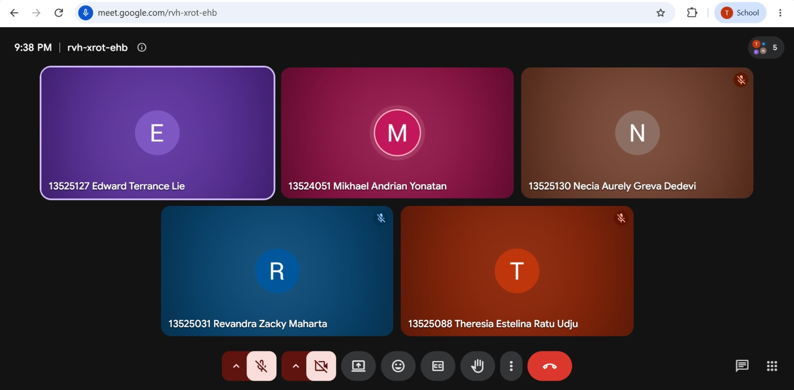

# Form Asistensi

## Tugas Besar IF2150 - Rekayasa Perangkat Lunak

| Informasi | Keterangan |
| --- | --- |
| **Hari** | Senin |
| **Tanggal** | 26/10/2026 |
| **Kelas** | K01 |
| **Nomor Kelompok** | G03  |
| **Nama Kelompok** | MAYOOOOOR  |
| **Nama Perangkat Lunak** | CariJasa  |
| **Dokumen** | K01_G03_DPPL2.md  |

### Anggota Kelompok

| NIM | Nama |
|---|---|
| 13525031 | Revandra Zacky Maharta |
| 13525079 | Danesh Rasyad Damotino |
| 13525088 | Theresia Estelina Ratu Udju |
| 13525127 | Edward Terrance Lie |
| 13525130 | Necia Aurely Greva Dedevi |

### Catatan

| Catatan |
| --- |
| 1. Pseudocode yang ditunjukkan sudah benar. |
| 2. Penjelasan singkat mengena query commands (SELECT, FROM, WHERE, wildcard). |
| 3. Algoritma query terletak pada entity class, tetapi ketika implementasi nanti diberikan pada controller class. |
| 4. Bab 6, penjelasan mengenai jenis objek, konten, dan keterangan. |
| 5. Algoritma untuk boundary class semacam service/method mana yang akan digunakan ketika berinteraksi dengan front-end-nya. |
| 6. Untuk varian pada suatu UI, penomoran ID-nya (contoh) 1.1, 1.2, 1.3, .... |

## Dokumentasi

<!--  -->

  

  <i>Gambar 1. Dokumentasi kegiatan asistensi.</i>

