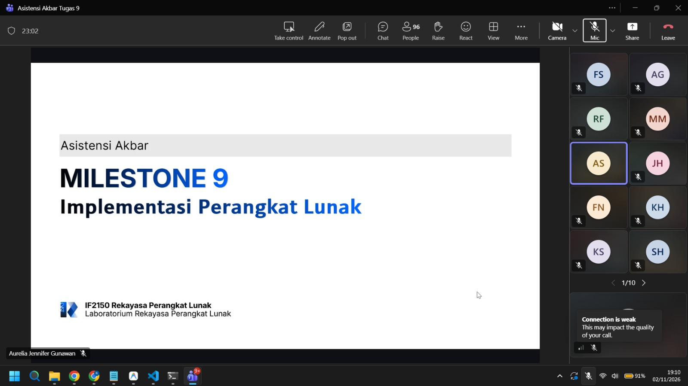

# Form Asistensi

## Tugas Besar IF2150 - Rekayasa Perangkat Lunak

| Informasi | Keterangan |
| --- | --- |
| **Hari** | Senin |
| **Tanggal** | 2/11/2026 |
| **Kelas** | K01 |
| **Nomor Kelompok** | G03  |
| **Nama Kelompok** | MAYOOOOOR  |
| **Nama Perangkat Lunak** | CariJasa  |
| **Dokumen** | K01_G03_Implementasi.md dan src  |

### Anggota Kelompok

| NIM | Nama |
|---|---|
| 13525031 | Revandra Zacky Maharta |
| 13525079 | Danesh Rasyad Damotino |
| 13525088 | Theresia Estelina Ratu Udju |
| 13525127 | Edward Terrance Lie |
| 13525130 | Necia Aurely Greva Dedevi |

### Catatan

| Catatan |
| --- |
| 1. Perubahan DPPL Harus dicatat  |
| 2. Bikin Readme yang mencakup Deskripsi, Teknologi + Versi,  Prasyarat & Instalasi, Konfigurasi, Cara Jalanin program, Akun / Data Uji, Daftar Modul & Pembagian Tugas, Tabel/Skema Basis Data,  |
| 3. Pakai Git Workflow untuk memudahkan pengerjaan dan best practice pake juga code review dan issue biar lebih jelas bagi2nya |

**Notes for this section:**  
*Catatan dapat dituliskan dalam bentuk paragraf atau poin-poin, disesuaikan saja.* 

## Dokumentasi

<!--  -->

  

  <i>Gambar 1. Dokumentasi kegiatan asistensi.</i>

